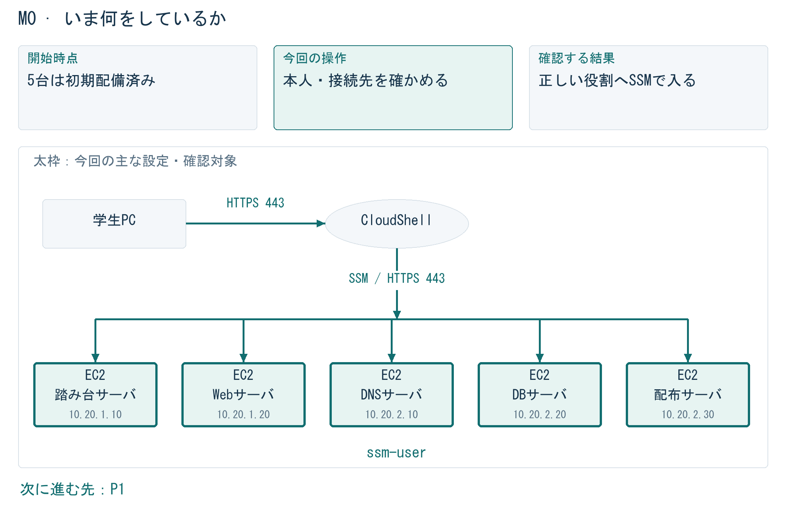

# M0 自分の環境と実行場所 (0)

[練習 P0〜P6](practice.md) · [課題 M0〜M6](missions.md)

[日本語](../ja/m0.md) · [Русский](../ru/m0.md) · [O‘zbekcha](../uz/m0.md)

2026-11-13 · D12 P/M r1.5

配布版の有効期限：2027年1月31日末（UZT）。

対応する詳しい練習は[P0](p0.md)。

## 完成要件

自分の5役割・元instance・SSM/内部SSH・本人登録の対応を確認する。構築点は0。P0を参照し、提供済み基盤を再作成しない。

## 今回の見取り図

図の太枠が今回の主な対象です。設定操作は各手順の実行場所で行い、図の矢印は接続・確認の向きを表します。 SGの通信許可は初期配備済みで、今回の課題はサーバー内の設定です。 SSMの矢印はAWSの接続管理を使う経路で、EC2の443番受信を開く指示ではありません。 図を参考に完成要件から設定値を自分で決めます。

[図を拡大する](../../assets/ja/m0.png) · [SVG](../../assets/ja/m0.svg)

## 確認・提出

1. 教師から案内された課題画面に学校のGoogleアカウントでログインし、自分のLabと **M0** を選ぶ。
2. 「この課題を確認する」を押す。
3. 処理中は「結果を更新する」で完了を待ち、課題ID・時刻・各check・保存状態を読む。結果は自動保存され、Mの成績は「保存済み成績を見る」で確認できる。PとM0は成績外。

---

[前の課題: P0](p0.md) · [次の課題: P1](p1.md)
