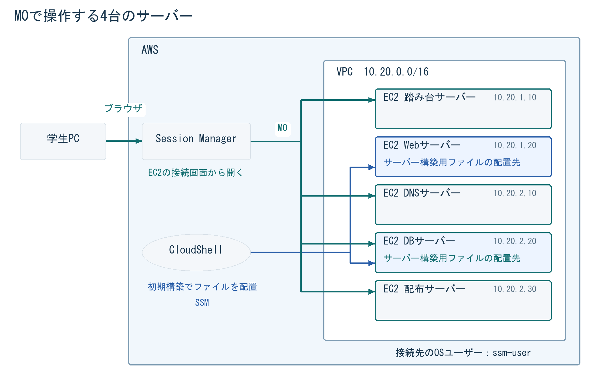

# M0 サーバーの確認と接続

[練習 P0〜P6](practice.md) · [課題 M0〜M6](missions.md)

[日本語](../ja/m0.md) · [Русский](../ru/m0.md) · [O‘zbekcha](../uz/m0.md)

対応する詳しい練習は[P0](p0.md)。

## 完成要件

P0ではWebサーバーを例に接続を練習した。M0ではEC2の一覧から自分のDBサーバーを選び、そのインスタンスIDを使ってCloudShellからSSMで接続する。接続先がDBサーバー（役割はdb）、操作ユーザーがssm-userであることを自分で確かめる。その後、課題画面でM0を選び、自分の環境の準備結果を確認する。

## 操作するサーバーと教材の配置先

利用者PCのブラウザでAWSのCloudShellを開き、SSMで対象のEC2へ接続する。教材ファイルの配置先はWebサーバーとDBサーバー。共通登録コード方式では初期構築時に配置される。

C3の図3-4。EC2 → Instancesを開き、対象サーバーと同じ行のInstance IDを確認する。

## 確認・提出

1. 教師から案内された課題画面に学校のGoogleアカウントでログインし、自分のLabと **M0** を選ぶ。
2. 「この課題を確認する」を押す。
3. 処理中は「結果を更新する」で完了を待ち、課題ID・時刻・各check・保存状態を読む。結果は自動保存され、Mの成績は「保存済み成績を見る」で確認できる。

---

[前の課題: P0](p0.md) · [次の課題: P1](p1.md)
