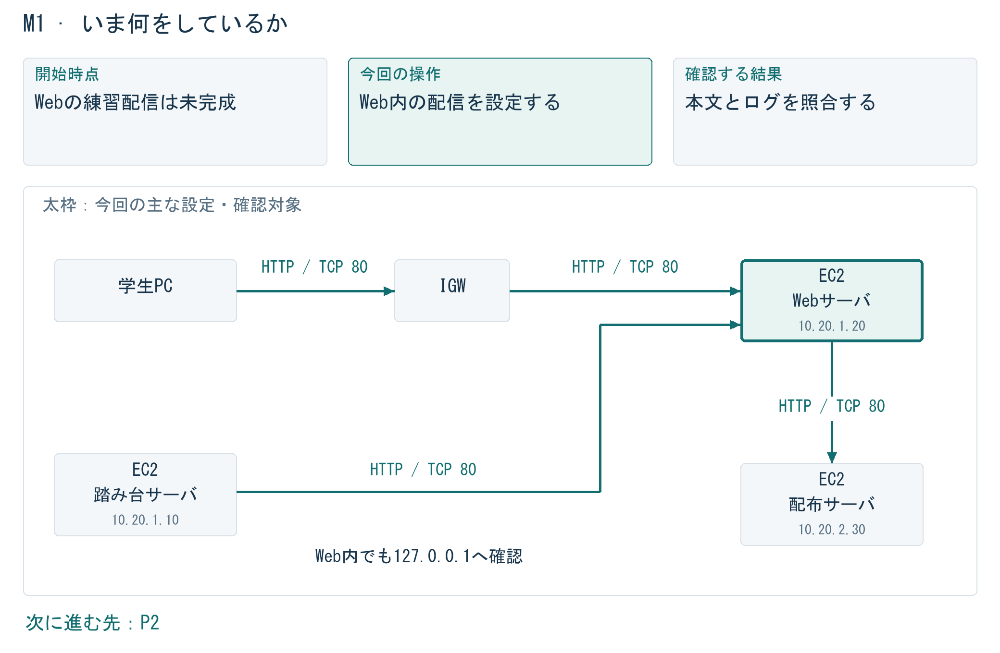

# M1 HTTPで静的ファイルを返す (8)

[練習 P0〜P6](practice.md) · [課題 M0〜M6](missions.md)

[日本語](../ja/m1.md) · [Русский](../ru/m1.md) · [O‘zbekcha](../uz/m1.md)

対応する詳しい練習は[P1](p1.md)。


## 完成要件

P1を参考に、指定された別fileと本文を独力でHTTP配信する。P1のpractice.txtを残す。file・service・listen・local/踏み台/public HTTP・今回要求のlogが対象。

## 今回の見取り図



図の太枠が今回の主な対象です。設定操作は各手順の実行場所で行い、図の矢印は接続・確認の向きを表します。 SGの通信許可は初期配備済みで、今回の課題はサーバー内の設定です。 左はインターネット側、右の枠はAWSのVPCです。IGWはVPCの境界に置き、踏み台を含む全EC2はAWS側にあります。 図を参考に完成要件から設定値を自分で決めます。

- File: /var/www/html/mission.txt
- URL path: /mission.txt

```text
JDU WEB-02 mission: independent HTTP delivery.
```

## 合格条件：採点check各1素点

| check ID（変更しない） | 満たすこと |
| --- | --- |
| WEB02_NGINX_ACTIVE | 既存checkerでnginxのactiveを確認。 |
| WEB02_CONFIG_VALID | 既存checkerでnginx -tが成功。 |
| WEB02_LISTEN_80 | 既存checkerでprivate/all-interfaceの80番待受を確認。 |
| WEB02_FILE | 既存checkerどおり指定本文・通常file・root所有・0644を確認。 |
| WEB02_LOCAL_HTTP | 既存checkerでloopbackの200と本文完全一致。 |
| WEB02_BASTION_HTTP | 既存checkerでprivate IP経由の200と本文完全一致。 |
| WEB02_PUBLIC_HTTP | 既存checkerでCloudShellからpublic IP経由の200と本文完全一致。 |
| WEB02_ACCESS_LOG | 既存checkerで今回のnonce付き要求がaccess logに残る。 |

本人確認・管理・配布元・通信基盤・依存前提等の準備checkは上表の素点に加えない。必要前提が未完了なら、点が一部あっても次段階の準備完了ではない。

## 確認・提出

1. 教師から案内された課題画面に学校のGoogleアカウントでログインし、自分のLabと **M1** を選ぶ。
2. 「この課題を確認する」を押す。
3. 処理中は「結果を更新する」で完了を待ち、課題ID・時刻・各check・保存状態を読む。結果は自動保存され、Mの成績は「保存済み成績を見る」で確認できる。

---

[前の課題: P1](p1.md) · [次の課題: P2](p2.md)
