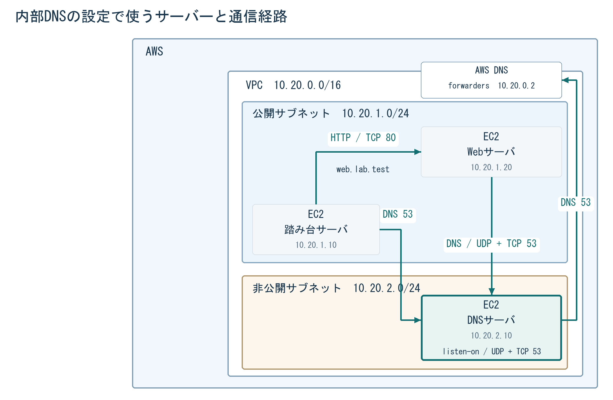

# M2 内部DNSと通常の名前解決 (13)

[練習 P0〜P5](practice.md) · [課題 M0〜M5](missions.md)

[日本語](../ja/m2.md) · [Русский](../ru/m2.md) · [O‘zbekcha](../uz/m2.md)

対応する詳しい練習は[P2](p2.md)。

## 完成要件

始める前に、採点ページで [M1](m1.md) が満点になっていることを確認する。

P2で構築した内部DNSに、下の6件の名前が登録されている状態にする。踏み台サーバーから `http://web.lab.test/mission.txt` が開けるようにする。

1. **DNSサーバー（P2.2〜P2.4）**　既存の `lab.test` ゾーンにAレコードを追加する。ゾーンファイルのシリアル番号を更新し、構文検査を通してから設定を読み込む。P2の名前は残してよい。
2. **踏み台サーバーとWebサーバー（P2.5〜P2.8）**　内部DNSへ直接問い合わせた結果と、OSが普段使う名前解決の結果を確認する。踏み台では `web.lab.test` でM1の本文を開き、Webサーバーでは `db.lab.test` が `10.20.2.20` になることを確認する。

表のIPは、各名前を使って接続するサーバーの内部IPである。DNSへの問い合わせ先はすべて `10.20.2.10` のままなので、例えばDBの名前を調べる場合も `dig @10.20.2.10 db.lab.test A` とする。`admin.lab.test` と `web.lab.test` は同じWebサーバーを指す。P2で登録済みの `dns.lab.test` は重複して追加せず、値が `10.20.2.10` であることを確認する。

## 今回の見取り図

| DNS name | 接続先のサーバー | A / IPv4 |
| --- | --- | --- |
| admin.lab.test | Webサーバ | 10.20.1.20 |
| bastion.lab.test | 踏み台サーバ | 10.20.1.10 |
| db.lab.test | DBサーバ | 10.20.2.20 |
| dns.lab.test | DNSサーバ | 10.20.2.10 |
| repo.lab.test | 配布サーバ | 10.20.2.30 |
| web.lab.test | Webサーバ | 10.20.1.20 |

## 採点基準

各項目は1点。

| № | 満たす条件 |
| --- | --- |
| 1 | DNSサーバーでBINDが起動している。 |
| 2 | BINDの設定と `lab.test` のゾーンファイルが構文検査に通る。 |
| 3 | 内部DNSが `lab.test` の情報を保持し、指定どおりのSOA・NSレコードを返す。 |
| 4 | 表の6件の名前が、すべて指定の内部IPアドレスになる。 |
| 5 | 踏み台サーバーとWebサーバーの両方が、UDPの53番ポートでDNSの回答を得られる。 |
| 6 | 踏み台サーバーとWebサーバーの両方が、TCPの53番ポートでDNSの回答を得られる。 |
| 7 | 踏み台サーバーとWebサーバーが通常の名前解決で内部DNSだけを使う。 |
| 8 | 踏み台サーバーから `http://web.lab.test/mission.txt` を開くと、HTTP 200とM1の本文が返る。 |
| 9 | Webサーバーの通常の名前解決で、`db.lab.test` が `10.20.2.20` になる。 |
| 10 | 外部の名前は `10.20.0.2` だけに転送して解決できる。 |
| 11 | `lab.test` の未登録名を問い合わせると、存在しないことを示す `NXDOMAIN` が返る。 |
| 12 | BINDが問い合わせ・再帰問い合わせ・キャッシュの利用を、DNSサーバー自身・踏み台・Webサーバーに限って許可する。 |
| 13 | 踏み台・Webサーバーからの通常の問い合わせは成功し、ゾーンの一括転送（AXFR）は明示的に拒否される。 |

## 確認・提出

1. 採点ページを開き、**M2** を選ぶ。
2. 「この課題を確認する」を押す。
3. 確認が終わると、満たした項目数と項目ごとの結果が表示される。「要修正」は該当する設定を直して再度確認する。「未確認」は、その項目を判定できなかった状態を表す。点数は課題一覧で確認する。

---

[前の課題: P2](p2.md) · [次の課題: P3](p3.md)
