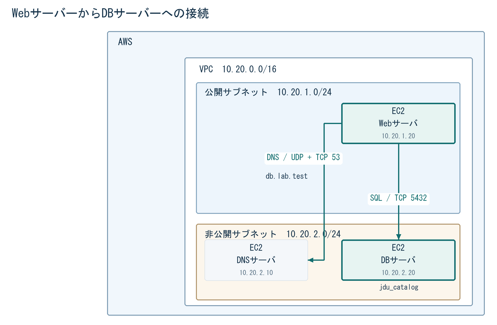

# M3 PostgreSQLへの認証接続 (9)

[練習 P0〜P5](practice.md) · [課題 M0〜M5](missions.md)

[日本語](../ja/m3.md) · [Русский](../ru/m3.md) · [O‘zbekcha](../uz/m3.md)

対応する詳しい練習は[P3](p3.md)。

## 完成要件

始める前に、採点ページで [M2](m2.md) が満点になっていることを確認する。

P3で使ったPostgreSQLに、下の課題用データベースと2つのロールを作る。アプリのテーブルはM4で用意する。

1. **DBサーバー（P3.2〜P3.6）**　課題用DBとロールを作り、Webサーバー（`10.20.1.20/32`）から指定のDB・ロールで接続できるようにする。認証方式にはP3と同じSCRAMを使う。
2. **Webサーバー（P3.7〜P3.8）**　`db.lab.test` に通常運用用ロールで接続し、SELECTが成功することを確かめる。P3.8と同じ方法で、既存パスワードを課題用（`mission`）として保存する。

## 今回の見取り図

| 設定する項目 | 値 |
| --- | --- |
| データベース名 | `jdu_catalog` |
| 構築用ロール | `catalog_setup` |
| 通常運用用ロール | `catalog_app` |

## 採点基準

各項目は1点。

| № | 満たす条件 |
| --- | --- |
| 1 | DBサーバーでPostgreSQLの `16/main` が動作している。 |
| 2 | `16/main` が標準のデータ保存先を使い、サーバー内ではOSユーザー `postgres` がローカル接続して管理できる。 |
| 3 | PostgreSQLが `10.20.2.20:5432` で接続を待ち受けている。 |
| 4 | 課題用DBとその `public` スキーマの所有者が `catalog_setup` になっている。 |
| 5 | `catalog_app` はログインできる。両ロールに管理者権限や、ロールの所属を通じた権限昇格がない。 |
| 6 | Webサーバーから課題用DBと指定ロールへの接続だけを、SCRAM認証で許可する。 |
| 7 | Webサーバーから `db.lab.test` に `catalog_app` で接続し、課題用DBで指定のSELECTが成功する。 |
| 8 | 正しいパスワードで接続でき、誤ったパスワードは拒否される。 |
| 9 | Webサーバーから許可外のデータベースやロールで接続しようとすると拒否される。 |

## 確認・提出

1. 採点ページを開き、**M3** を選ぶ。
2. 「この課題を確認する」を押す。
3. 確認が終わると、満たした項目数と項目ごとの結果が表示される。「要修正」は該当する設定を直して再度確認する。「未確認」は、その項目を判定できなかった状態を表す。点数は課題一覧で確認する。

---

[前の課題: P3](p3.md) · [次の課題: P4](p4.md)
