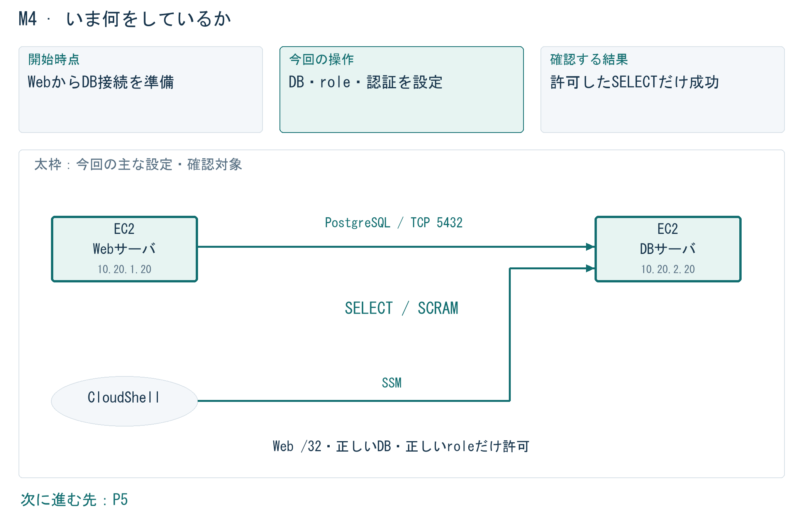

# M4 PostgreSQLへの認証接続 (9)

[練習 P0〜P6](practice.md) · [課題 M0〜M6](missions.md)

[日本語](../ja/m4.md) · [Русский](../ru/m4.md) · [O‘zbekcha](../uz/m4.md)

2026-11-13 · D12 P/M r1.5

配布版の有効期限：2027年1月31日末（UZT）。

対応する詳しい練習は[P4](p4.md)。

## 完成要件

本課題用DB/roleを自分で構築する。M2のdb.lab.testを通常解決し、Webのruntime roleで認証SELECTを成功させる。HBAはWeb/32・正しいDB/roleだけ。既存passwordをWeb内のmission用helperへ保存し、practiceと混ぜない。app tableはまだ不要。

## 今回の見取り図

図の太枠が今回の主な対象です。設定操作は各手順の実行場所で行い、図の矢印は接続・確認の向きを表します。 SGの通信許可は初期配備済みで、今回の課題はサーバー内の設定です。 CloudShellからSSMでDBサーバーに接続して設定します。 図を参考に完成要件から設定値を自分で決めます。

- Profile: mission
- Database: jdu_catalog
- Setup role: catalog_setup
- Runtime role: catalog_app
- 現在必要な前提: M2

## 合格条件：採点check各1素点

| check ID（変更しない） | 満たすこと |
| --- | --- |
| WEB05_CLUSTER_ACTIVE | PostgreSQL16/mainがactiveである。 |
| WEB05_CLUSTER_CONFIG | 16/mainの設定・標準data directory・postgres/socket peer管理が妥当である。 |
| WEB05_LISTEN_5432 | 10.20.2.20:5432で待ち受ける。 |
| WEB05_DATABASE_OWNER | P/M別DBとpublic schemaのownerが対応するsetup roleである。 |
| WEB05_ROLE_ATTRIBUTES | 対応runtime roleはLOGIN。両roleにsuperuser/CREATEDB/CREATEROLE/REPLICATION/BYPASSRLSや昇格membershipがない。setupは構築中LOGIN/完成後NOLOGINの両段階を認める。 |
| WEB05_HBA_SCRAM | pg_hbaはWeb /32・列挙したprofile DB/roleだけにSCRAMを許可し、それ以外の広い許可がない。 |
| WEB05_WEB_SQL | Pはprivate IP、Mは通常DNS名からruntime roleで新規認証接続し、current_database/current_user/SELECT結果が一致する。 |
| WEB05_BAD_PASSWORD_DENIED | 同じ回の正規接続を対照に、1回の誤password接続が明示認証拒否される。秘密値やhashは返さない。 |
| WEB05_WRONG_TARGET_DENIED | Webからpostgres role・許可外DB・他profileへの接続をHBA等で明示拒否する。未作成practice DB自体は必須にしない。 |

本人確認・管理・配布元・通信基盤・依存前提等の準備checkは上表の素点に加えない。必要前提が未完了なら、点が一部あっても次段階の準備完了ではない。

## 確認・提出

1. 教師から案内された課題画面に学校のGoogleアカウントでログインし、自分のLabと **M4** を選ぶ。
2. 「この課題を確認する」を押す。
3. 処理中は「結果を更新する」で完了を待ち、課題ID・時刻・各check・保存状態を読む。結果は自動保存され、Mの成績は「保存済み成績を見る」で確認できる。

---

[前の課題: P4](p4.md) · [次の課題: P5](p5.md)
