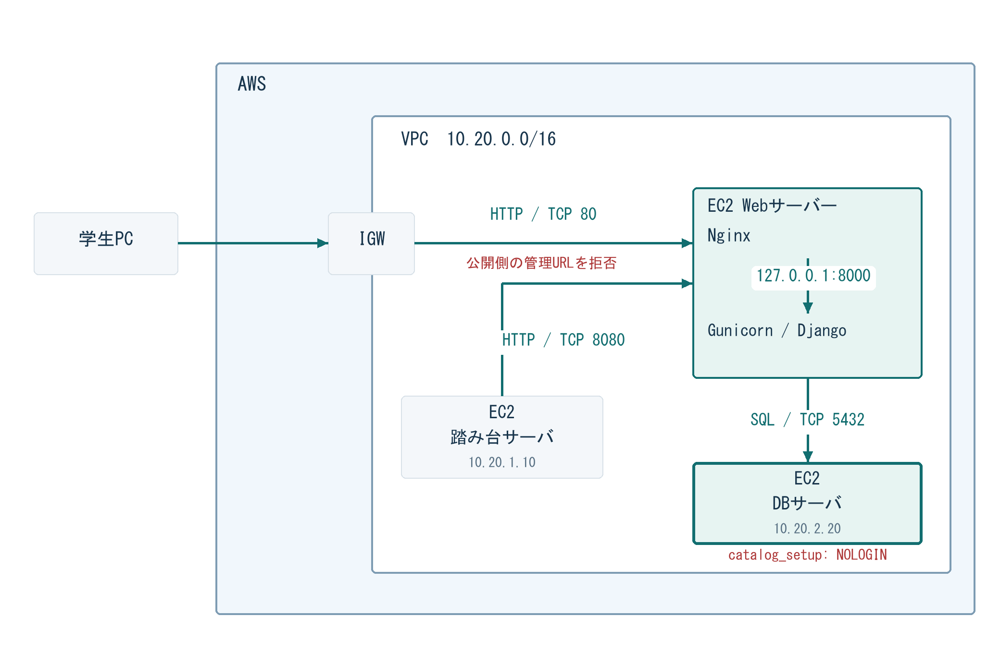

# M5 最小権限と公開範囲 (16)

[練習 P0〜P6](practice.md) · [課題 M0〜M5](missions.md)

[日本語](../ja/m5.md) · [Русский](../ru/m5.md) · [O‘zbekcha](../uz/m5.md)

対応する詳しい練習は[P6](p6.md)。

## 完成要件

始める前に、採点ページで [M4](m4.md) が満点になっていることを確認する。

P6で練習した方法で、M4の備品管理アプリを通常運用に切り替える。構築時だけ使った接続を閉じ、アプリと管理者に必要な権限を残す。

1. **DBサーバー（P6.1〜P6.2）**　`catalog_app` の権限を確認する。構築用の `catalog_setup` はログイン不可にし、パスワードと既存の接続を残さない。
2. **Webサーバー（P6.3〜P6.4）**　課題用の一時設定（`/etc/jdu-catalog/setup.env` と `/etc/jdu-catalog/profiles/mission.setup.env`）を片付け、通常運用用の `mission` 設定で起動する。実行ユーザーによるコードの書き換えを防ぎ、秘密を含む設定は `root:root`、`0600` にする。
3. **一般ページと管理画面（P6.4〜P6.5）**　公開の80番ポートではM4の公開備品だけを表示する。踏み台から8080番ポートの管理画面に入り、`lab_admin` が備品を閲覧・追加・変更できることを確認する。

## 今回の見取り図

## 採点基準

各項目は1点。

| № | 満たす条件 |
| --- | --- |
| 1 | 公開の80番ポートでは管理用URLへのアクセスが拒否され、踏み台から8080番ポートの管理画面を開ける。 |
| 2 | 秘密を含む設定ファイルは通常のファイルで、`root:root`・`0600` に設定されている。 |
| 3 | アプリの実行ユーザーは、コード・Python環境・親ディレクトリを変更できず、ログインやsudoもできない。 |
| 4 | 公開ページから、秘密を含むファイルをHTTPで取得できない。 |
| 5 | 構築用ロールはログイン不可で、パスワード・既存の接続・一時設定が残っていない。 |
| 6 | 通常運用用ロールは備品を読める・追加できる・更新できる。削除と権限委譲は許可されていない。 |
| 7 | アカウントの表は読み取りと、最終ログイン・パスワードの列の更新だけが許可されている。 |
| 8 | グループや権限などを参照する表は、読み取りだけが許可されている。 |
| 9 | ログイン状態を管理する表は、読み取り・追加・更新・削除が許可されている。 |
| 10 | 管理操作を記録する表は、読み取りと追加だけが許可されている。 |
| 11 | 通常運用用ロールには、構造の適用履歴の表への権限、スキーマ内にオブジェクトを作る権限、アプリのDBオブジェクトの所有権がない。 |
| 12 | 備品と管理ログの採番に必要なシーケンスに、使用権限（USAGE）だけがある。 |
| 13 | アプリ管理者は備品を閲覧・追加・変更できる。備品の削除やユーザー・グループの管理はできない。 |
| 14 | ログインしていない利用者による備品の登録・編集が拒否される。 |
| 15 | 正しいパスワードでログインでき、誤ったパスワードではログインできない。 |
| 16 | 一般ページには公開備品が表示され、非公開備品は表示されない。 |

## 確認・提出

1. 採点ページを開き、**M5** を選ぶ。
2. 「機能・権限を含めて確認する」を選び、lab_admin の既存パスワードを「アプリ管理者の既存パスワード」に非表示入力して「このパスワードで確認する」を押す。RDP用とは別。設定だけの確認では機能の合格を確定しない。
3. 確認が終わると、満たした項目数と項目ごとの結果が表示される。「要修正」は該当する設定を直して再度確認する。「未確認」は、その項目を判定できなかった状態を表す。点数は課題一覧で確認する。

---

[前の課題: M4](m4.md)
