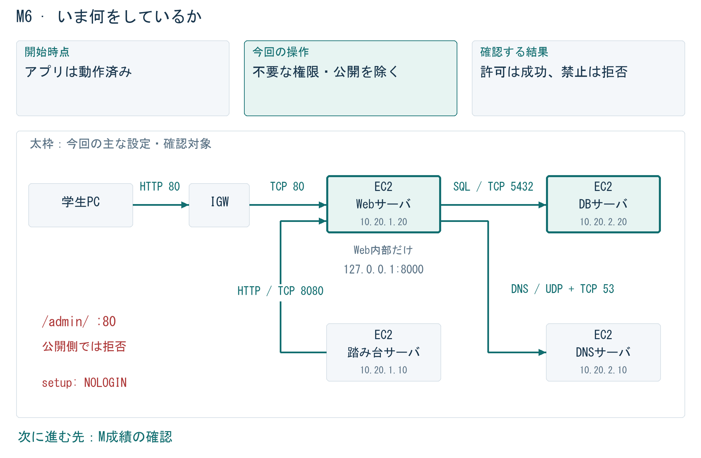

# M6 最小権限と公開範囲 (16)

[はじめに：接続・操作の約束](start.md) · [練習 P0〜P6](practice.md) · [課題 M0〜M6](missions.md) · [ブラウザで確認する](portal.md)

[日本語](../ja/m6.md) · [Русский](../ru/m6.md) · [O‘zbekcha](../uz/m6.md)

2026-11-13 · D12 P/M r1.5

配布版の有効期限：2027年1月31日末（UZT）。

## 始める前に

[共通の接続・操作](start.md)を確認する。対応する詳しい練習は[P6](p6.md)。課題の判定方法は[ブラウザ確認手順](portal.md)を使う。

## 完成要件

mission側の最小権限を完成する。catalog_setupはNOLOGIN/password NULL、一時mission setup.envは残さない。root管理コード/venv、600秘密file、公開80からの管理拒否、private8080の正規成功、備品のview/add/changeだけの管理者、公開/非公開分離とSQL権限を確認する。ブラウザの機能確認は本人実演ではなく自動確認。

## 今回の見取り図

図の太枠が今回の主な対象です。設定操作は各手順の実行場所で行い、図の矢印は接続・確認の向きを表します。 SGの通信許可は初期配備済みで、今回の課題はサーバー内の設定です。 8000番はWeb内部だけ、8080番は踏み台からの管理用です。 左はインターネット側、右の枠はAWSのVPCです。IGWはVPCの境界に置き、踏み台を含む全EC2はAWS側にあります。 図を参考に完成要件から設定値を自分で決めます。

[図を拡大する](../../assets/ja/m6.png) · [SVG](../../assets/ja/m6.svg)

- Profile: mission
- Database: jdu_catalog
- Setup role: catalog_setup
- Runtime role: catalog_app
- Application administrator: lab_admin

| code | name | quantity | location | is_public |
| --- | --- | --- | --- | --- |
| M5-PUBLIC-001 | Mission monitor | 6 | Lab cabinet C | true |
| M5-PRIVATE-001 | Mission router | 1 | Lab cabinet D | false |

- 現在必要な前提: M5

## 合格条件：採点check各1素点

| check ID（変更しない） | 満たすこと |
| --- | --- |
| WEB07_PUBLIC_ADMIN_DENIED | 公開80の/adminおよび配下・表記揺れがNginx/アプリで拒否され、偽装headerでも管理画面を返さない。 |
| WEB07_SECRET_PERMISSIONS | app.env/有効runtime秘密fileはroot:root0600、linkではなく、catalog等から読取り不可。内容は送信しない。 |
| WEB07_CODE_PROTECTED | 実行catalog userはコード/venv/親directoryを改変できず、非login・非sudoである。 |
| WEB07_SECRET_HTTP_DENIED | 秘密をstatic/public配下へ置かず、固定した秘密path候補を一般HTTPで取得できない。 |
| WEB07_SETUP_RETIRED | 対応setup roleはNOLOGIN/password NULL/既存sessionなし。一時setup.envも終了している。 |
| WEB07_ITEM_PRIVILEGES | catalog_itemはSELECT/INSERT/UPDATEのみ。DELETE・権限委譲を許さない。所有者/PUBLIC/membership経由も含める。 |
| WEB07_AUTH_USER_PRIVILEGES | auth_userはSELECTとUPDATE(last_login,password)のみ。属性変更・table全体UPDATE/INSERT/DELETEを許さない。 |
| WEB07_AUTH_LOOKUP_PRIVILEGES | auth_group/auth_permission/関連中間table/content_typeはSELECTのみ。 |
| WEB07_SESSION_PRIVILEGES | django_sessionはSELECT/INSERT/UPDATE/DELETEのみを許す。必要なDELETEを一律禁止しない。 |
| WEB07_AUDIT_PRIVILEGES | django_admin_logはSELECT/INSERTのみ。UPDATE/DELETEを許さない。 |
| WEB07_MIGRATION_PRIVILEGES | runtimeはdjango_migrations権限・schema CREATE・アプリobject所有権を持たず、既定外の実効許可もない。 |
| WEB07_SEQUENCE_PRIVILEGES | 必要な備品/admin log ID sequenceはUSAGEだけ。他の過剰権限とsetvalを許すUPDATEがない。nextval/setvalを実行して試さない。 |
| WEB07_ADMIN_PERMISSIONS | 対象管理者はstaffかつ非superuser、備品view/add/changeのみ。削除・user/group管理権限やrouteがない。 |
| WEB07_ANONYMOUS_DENIED | 正規routeと妥当なCSRF条件で匿名の登録/編集を試し、認証を要求して対象DBを書き換えない。同じ回の正規ログイン/登録成功を対照にする。 |
| WEB07_BAD_PASSWORD_DENIED | 正規認証の成功を対照に、1回の誤passwordで認証sessionが成立しない。既存passwordの変更や総当たりはしない。 |
| WEB07_PRIVATE_DATA_HIDDEN | 対象DBの非公開備品が一般画面へ出ず、公開備品は同じ回に表示される。 |

本人確認・管理・配布元・通信基盤・依存前提等の準備checkは上表の素点に加えない。必要前提が未完了なら、点が一部あっても次段階の準備完了ではない。

## 確認・提出

1. PCの[Web Portal](https://d9r6gn83y8wkl4xl.gpb.lambda-web.us-east-1.on.aws)へ学校Googleでログインし、本人のLabと **M6** を選ぶ。初回の連携・画面の説明は[ブラウザ確認手順](portal.md)を参照する。
2. 「機能・権限を含めて確認する」を選び、lab_admin の既存パスワードを「アプリ管理者の既存パスワード」に非表示入力して「このパスワードで確認する」を押す。RDP用とは別。設定だけの確認では機能の合格を確定しない。
3. 処理中は「結果を更新する」で完了を待ち、課題ID・時刻・各check・保存状態を読む。結果は自動保存され、Mの成績は「保存済み成績を見る」で確認できる。PとM0は成績外。

---

[前の課題: M5](m5.md)
