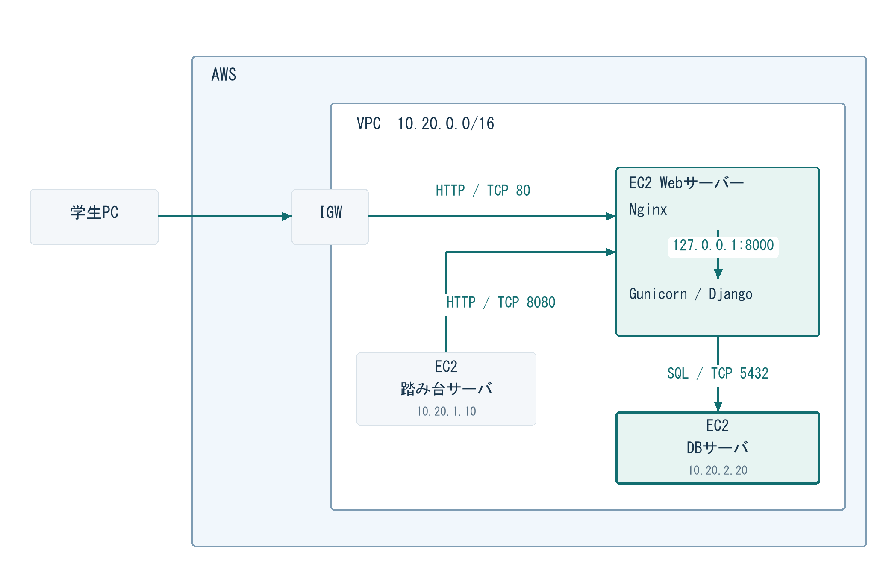
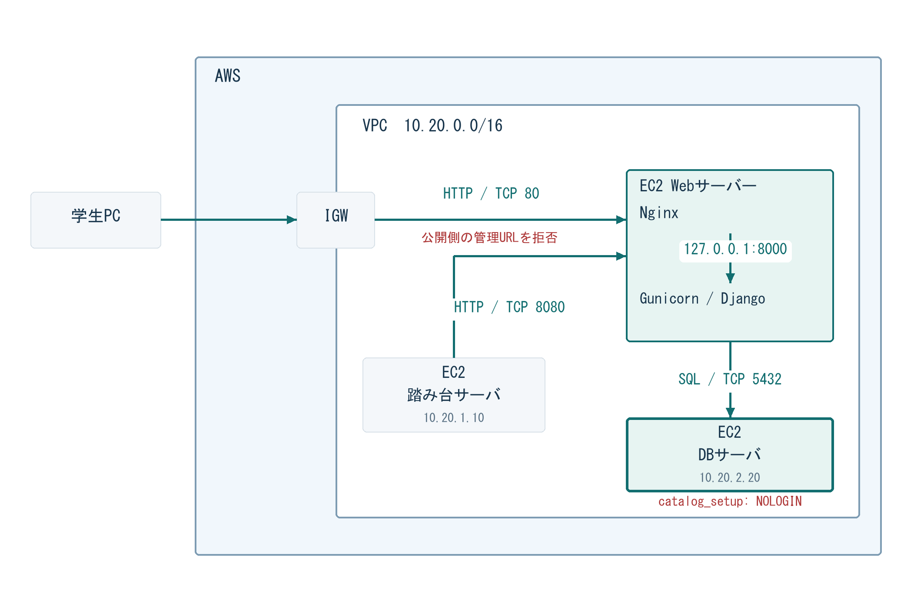
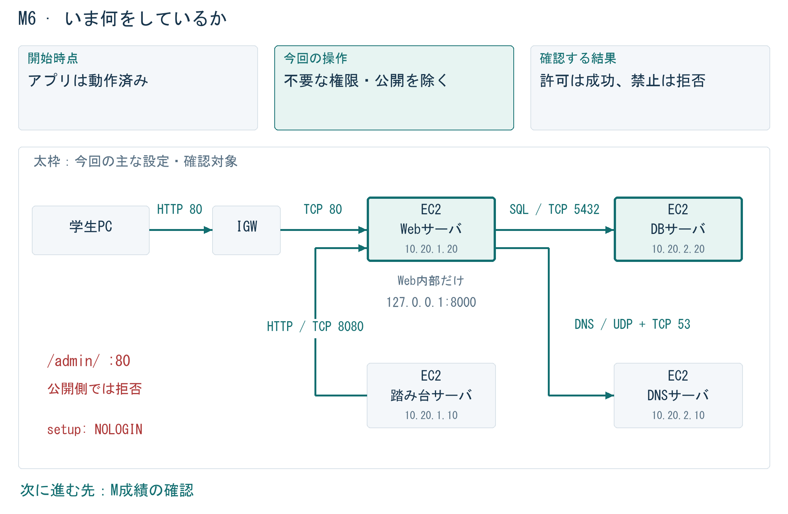

# Web演習：自力課題M0〜M6

教材初版・教師確認用。学生の最初からの通し試読は未実施。

ロシア語・ウズベク語は日本語原稿と同じ手順・条件の翻訳初稿。母語話者校閲は未実施。

[日本語](../ja/missions-full.md) · [Русский](../ru/missions-full.md) · [O‘zbekcha](../uz/missions-full.md)

[練習 P0〜P6](practice.md) · [課題 M0〜M6](missions.md)

## 使い方と共通の約束

まず各Pの課題文を読み、必要なら詳しい操作例を一段ずつ使う。Pは手順付きの練習である。Mは別の対象・値で自分で構築する。課題は授業回番号ではなく、自分の進度で進める。Pの完了はMの合格に置き換わらない。

P0 → M0 → P1 → M1 → P2 → M2 → P4 → M4 → P5 → P6 → M5 → M6

P5にもM2のDNSが必要。P4ではIPと名前を使ったDB接続を練習する。アプリはdb.lab.testを使う。練習profileから本課題profileへ切り替える前にP6でsetupを終了する。

P0=1、M0=1、M1=8、M2=13、M4=9、M5=13、M6=16（計61素点）。本人実演・backup/restore・追加disk・アプリ開発は課さない。科目25点への換算は教師が別に行う。再提出は教師が案内する締切まで可能。別々の回のPASSを合算したり自動最高点選択はしない。

## 対象・前提・準備

初期配布の署名確認、新規5台または既存環境へのinstall、内部SSHと個別採点登録までを先に完了する。初期配布の手順は教材zipのdistribution/STUDENT.mdを読む。秘密鍵を共有Windowsへ置かず、CloudShellは本人Academy accountの中で使う。教師は本人用の匿名Lab ID・署名fingerprint・有効期限を案内する。

共通IP表。public IPv4は固定しない。AWS regionはus-east-1、Ubuntu24.04/amd64。RDPはlabuser、SSMはssm-user、内部SSHはubuntu。user名とサーバー役割を混同しない。

| Role | Private IPv4 | 用途 |
| --- | --- | --- |
| bastion | 10.20.1.10 | RDP3389 / Firefox / SSH |
| web | 10.20.1.20 | HTTP80 / private8080 / loopback8000 |
| dns | 10.20.2.10 | BIND UDP/TCP53 |
| db | 10.20.2.20 | PostgreSQL5432 |
| repo | 10.20.2.30 | 事前保存した署名資源のHTTP80 |

P0・M0はEC2の一覧からSession Managerを開く。後の練習でCloudShellから接続するよう指定されたときは、CloudShellで `aws ssm start-session --target i-...` を実行する。`i-...` は対象のInstance IDに置き換える。どちらも接続先の `ssm-user` として操作する。

nanoの編集：file名を指定して開く→本文を入力→Ctrl+O→Enterで保存→Ctrl+Xで終了。設定fileの枠はshell commandではない。psqlに入るとpromptが変わる。SQL/\passwordはその中へ入力し、\qでUbuntuへ戻る。失敗したcommandの次へ進まず、期待結果を確認する。

番号付きコメントは、その手順内の操作順と目的を示します。# はshell、-- はpsql内のコメントです。コメントは説明なので、書き換える必要はありません。接続・エディタ・パスワード入力の完了を待ち、一つずつ実行します。改行で続くコマンドは一つとして扱います。

## 操作例の読み方

各Pは「課題→仕組み→操作例→理解の確認」の順で使う。操作例は一つのまとまりを貼り付けず、1コマンドずつ実行して表示を読む。末尾のバックスラッシュは次の行へ続く記号なので、その行と次の行を一つのコマンドとして扱う。

bash枠は表示された実行場所の端末へ入力する。text枠は設定ファイルの本文・psql内の入力・出力例などで、直前の説明に従う。行頭が#の説明行はコメント。自分の端末に出る$、#、postgres=#などのpromptをコマンドへ付け足さない。YOUR-から始まる値だけを自分の値へ置き換える。

設定を作るときは「保存したファイル→構文検査→サービスへの反映→実際の通信」の順で確認する。ファイルの内容が正しくても、実行中のサービスが古い設定を使うことがある。画面表示だけでなく、HTTP応答・DNS回答・SQL結果とlogを対応させる。

## 完成像と通信経路

| 送信元 | 宛先 | Protocol / port | 目的 |
| --- | --- | --- | --- |
| Windows PC | Web public IPv4 | TCP/80 | 一般利用。Internet Gatewayを通り、公開一覧と静的ファイルを読む。 |
| Windows PC | bastion public IPv4 | TCP/3389 | 許可CIDRからRDPで入る。踏み台のデスクトップを操作する。 |
| bastion | Web/DNS/DB/repo | TCP/22 | 内部SSHの管理経路。秘密鍵は踏み台内で保持する。 |
| bastion / Web | DNS 10.20.2.10 | UDP+TCP/53 | lab.testの名前を解決する。DNSはWeb本文を返さない。 |
| Web app | DB 10.20.2.20 | TCP/5432 | アプリのDB roleでSQLを実行する。WindowsからDBへ直接接続しない。 |
| bastion | Web 10.20.1.20 | TCP/8080 | admin.lab.testの管理画面。公開80番の入口とは分ける。 |
| Nginx on Web | 127.0.0.1 on Web | TCP/8000 | 同じWeb内のアプリへ渡す。127.0.0.1は実行中のそのホスト自身。 |

初期環境で提供されたSSMは、CloudShellから各EC2へ入る管理経路。上のWeb利用経路とは別に使う。表の内部IP/portはこのLabの仕様で、一般のWebシステム全てに同じ値を要求するものではない。

## 自力課題に取り組む前に

まず完成要件から「どのサーバーの、どのファイル・名前・DB・roleを変えるか」を自分の作業表へ整理する。練習と本課題の値を比較し、Mで必要な対象だけを選ぶ。採点表は完成状態の条件であり、実行順のコマンド一覧ではない。

次に「どこから何を確認すれば、要件を満たしたと分かるか」を考える。ファイルを確認する場所と、接続を試す場所は同じとは限らない。許可経路の成功と、制限すべき経路の拒否を分けて記録する。

ブラウザで課題を選んで確認し、結果と保存状態を読む。M5/M6の機能確認では既存アプリ管理者パスワードを非表示入力する。成績は自動保存される。理解の確認用メモやPの説明問題を、追加の成績要件にはしない。

## M0 サーバーの確認と接続 (1)

### 完成要件

P0ではWebサーバーへの接続を練習した。M0ではEC2の一覧から自分のDBサーバーを探し、同じ行の **Instance ID** をクリックする。詳細画面の **Connect** の右にある矢印から **Connect with SSM Session Manager** を選ぶ。接続先のロールが `db`、操作ユーザーが `ssm-user` であることを確かめる。DBサーバーの自分のホームディレクトリに `m0-connection.txt` を作り、`db` だけを1行に記録する。課題画面でM0を選び、記録が確認されると1点になる。

### 操作するサーバーと教材の配置先


緑の矢印はEC2の画面からSession ManagerでDBサーバーへ接続する経路。青の矢印は、初期構築時にCloudShellがSSMでWebとDBへ教材ファイルを配置する経路。


EC2のInstances一覧。P0は名前の末尾が `-web` の行、M0は `-db` の行を選ぶ。


EC2の詳細画面。Connectの右の矢印からConnect with SSM Session Managerを選ぶ。Webサーバーの画面を例に示す。

### 確認・提出

1. P0で使った課題画面に学校のGoogleアカウントでログインし、自分のLabと **M0** を選ぶ。
2. 「この課題を確認する」を押す。
3. 処理中は「結果を更新する」で完了を待ち、課題ID・時刻・各check・保存状態を読む。結果は自動保存され、Mの成績は「保存済み成績を見る」で確認できる。

## M1 HTTPで静的ファイルを返す (8)

### 完成要件

P1を参考に、指定された別fileと本文を独力でHTTP配信する。P1のpractice.txtを残す。file・service・listen・local/踏み台/public HTTP・今回要求のlogが対象。

### 今回の見取り図


図の太枠が今回の主な対象です。設定操作は各手順の実行場所で行い、図の矢印は接続・確認の向きを表します。 SGの通信許可は初期配備済みで、今回の課題はサーバー内の設定です。 左はインターネット側、右の枠はAWSのVPCです。IGWはVPCの境界に置き、踏み台を含む全EC2はAWS側にあります。 図を参考に完成要件から設定値を自分で決めます。

- File: /var/www/html/mission.txt
- URL path: /mission.txt

```text
JDU WEB-02 mission: independent HTTP delivery.
```

### 合格条件：採点check各1素点

| check ID（変更しない） | 満たすこと |
| --- | --- |
| WEB02_NGINX_ACTIVE | 既存checkerでnginxのactiveを確認。 |
| WEB02_CONFIG_VALID | 既存checkerでnginx -tが成功。 |
| WEB02_LISTEN_80 | 既存checkerでprivate/all-interfaceの80番待受を確認。 |
| WEB02_FILE | 既存checkerどおり指定本文・通常file・root所有・0644を確認。 |
| WEB02_LOCAL_HTTP | 既存checkerでloopbackの200と本文完全一致。 |
| WEB02_BASTION_HTTP | 既存checkerでprivate IP経由の200と本文完全一致。 |
| WEB02_PUBLIC_HTTP | 既存checkerでCloudShellからpublic IP経由の200と本文完全一致。 |
| WEB02_ACCESS_LOG | 既存checkerで今回のnonce付き要求がaccess logに残る。 |

本人確認・管理・配布元・通信基盤・依存前提等の準備checkは上表の素点に加えない。必要前提が未完了なら、点が一部あっても次段階の準備完了ではない。

### 確認・提出

1. P0で使った課題画面に学校のGoogleアカウントでログインし、自分のLabと **M1** を選ぶ。
2. 「この課題を確認する」を押す。
3. 処理中は「結果を更新する」で完了を待ち、課題ID・時刻・各check・保存状態を読む。結果は自動保存され、Mの成績は「保存済み成績を見る」で確認できる。

## M2 内部DNSと通常の名前解決 (13)

### 完成要件

同じlab.test zoneへ正式6名を設定する。P2のguide/practice-dbは保持してよい。踏み台/Webの通常resolver、名前によるM1 HTTP、DB名、UDP/TCP、外部forward、NXDOMAIN、ACL、AXFR拒否まで確認する。

### 今回の見取り図


図の太枠が今回の主な対象です。設定操作は各手順の実行場所で行い、図の矢印は接続・確認の向きを表します。 SGの通信許可は初期配備済みで、今回の課題はサーバー内の設定です。 図を参考に完成要件から設定値を自分で決めます。

| DNS name | A / IPv4 |
| --- | --- |
| admin.lab.test | 10.20.1.20 |
| bastion.lab.test | 10.20.1.10 |
| db.lab.test | 10.20.2.20 |
| dns.lab.test | 10.20.2.10 |
| repo.lab.test | 10.20.2.30 |
| web.lab.test | 10.20.1.20 |

- 現在必要な前提: M1

### 合格条件：採点check各1素点

| check ID（変更しない） | 満たすこと |
| --- | --- |
| WEB03_SERVICE | BINDがactiveである。 |
| WEB03_CONFIG_VALID | named設定とlab.test zoneの構文検査が成功する。 |
| WEB03_ZONE_AUTHORITY | lab.testのSOA/NSと権威応答が設計と一致する。 |
| WEB03_REQUIRED_RECORDS | P/M別の必須record全件が期待private IPを返す。6名を6点へ水増ししない。追加の正当な練習名を許す。 |
| WEB03_UDP_RESPONSE | 踏み台・Webの両方からUDP53で必要な回答が得られる。 |
| WEB03_TCP_RESPONSE | 踏み台・Webの両方からTCP53で必要な回答が得られる。 |
| WEB03_NORMAL_RESOLVER | 踏み台/Webの通常resolverがBINDだけを使い、対象名をhostsやbrowser DoHで代用しない。 |
| WEB03_NAMED_HTTP | 踏み台の通常resolverを使い、P/M別host名と既存HTTP fileで200/正しい本文を確認する。 |
| WEB03_DB_NAME | Webの通常resolverでP/M別DB名が10.20.2.20になる。 |
| WEB03_FORWARD_ONLY | forward only/転送先10.20.0.2の実効設定と外部名解決を確認する。外部Web接続成功は要求しない。 |
| WEB03_NXDOMAIN | その回で作る未登録lab.test名に権威NXDOMAINが返る。 |
| WEB03_CLIENT_ACL | BINDのquery/recursion/cache ACLがlocalhost・踏み台・Webのみを許す実効設定になっている。SGだけの遮断でBIND ACLの実証としない。 |
| WEB03_AXFR_DENIED | 通常問い合わせが同じ回に成功する踏み台/WebからAXFRが明示拒否される。timeoutだけではPASSにしない。 |

本人確認・管理・配布元・通信基盤・依存前提等の準備checkは上表の素点に加えない。必要前提が未完了なら、点が一部あっても次段階の準備完了ではない。

### 確認・提出

1. P0で使った課題画面に学校のGoogleアカウントでログインし、自分のLabと **M2** を選ぶ。
2. 「この課題を確認する」を押す。
3. 処理中は「結果を更新する」で完了を待ち、課題ID・時刻・各check・保存状態を読む。結果は自動保存され、Mの成績は「保存済み成績を見る」で確認できる。

## M4 PostgreSQLへの認証接続 (9)

### 完成要件

本課題用DB/roleを自分で構築する。P4.7の名前指定と同じ方法で、M2のdb.lab.testを使い、Webのruntime roleで認証SELECTを成功させる。HBAはWeb/32・正しいDB/roleだけ。既存passwordをWeb内のmission用helperへ保存し、practiceと混ぜない。app tableはまだ不要。

### 今回の見取り図



図の太枠が今回の主な対象です。設定操作は各手順の実行場所で行い、図の矢印は接続・確認の向きを表します。 SGの通信許可は初期配備済みで、今回の課題はサーバー内の設定です。 CloudShellからSSMでDBサーバーに接続して設定します。 図を参考に完成要件から設定値を自分で決めます。

- Profile: mission
- Database: jdu_catalog
- Setup role: catalog_setup
- Runtime role: catalog_app
- 現在必要な前提: M2

### 合格条件：採点check各1素点

| check ID（変更しない） | 満たすこと |
| --- | --- |
| WEB05_CLUSTER_ACTIVE | PostgreSQL16/mainがactiveである。 |
| WEB05_CLUSTER_CONFIG | 16/mainの設定・標準data directory・postgres/socket peer管理が妥当である。 |
| WEB05_LISTEN_5432 | 10.20.2.20:5432で待ち受ける。 |
| WEB05_DATABASE_OWNER | P/M別DBとpublic schemaのownerが対応するsetup roleである。 |
| WEB05_ROLE_ATTRIBUTES | 対応runtime roleはLOGIN。両roleにsuperuser/CREATEDB/CREATEROLE/REPLICATION/BYPASSRLSや昇格membershipがない。setupは構築中LOGIN/完成後NOLOGINの両段階を認める。 |
| WEB05_HBA_SCRAM | pg_hbaはWeb /32・列挙したprofile DB/roleだけにSCRAMを許可し、それ以外の広い許可がない。 |
| WEB05_WEB_SQL | Pはprivate IP、Mは通常DNS名からruntime roleで新規認証接続し、current_database/current_user/SELECT結果が一致する。 |
| WEB05_BAD_PASSWORD_DENIED | 同じ回の正規接続を対照に、1回の誤password接続が明示認証拒否される。秘密値やhashは返さない。 |
| WEB05_WRONG_TARGET_DENIED | Webからpostgres role・許可外DB・他profileへの接続をHBA等で明示拒否する。未作成practice DB自体は必須にしない。 |

本人確認・管理・配布元・通信基盤・依存前提等の準備checkは上表の素点に加えない。必要前提が未完了なら、点が一部あっても次段階の準備完了ではない。

### 確認・提出

1. P0で使った課題画面に学校のGoogleアカウントでログインし、自分のLabと **M4** を選ぶ。
2. 「この課題を確認する」を押す。
3. 処理中は「結果を更新する」で完了を待ち、課題ID・時刻・各check・保存状態を読む。結果は自動保存され、Mの成績は「保存済み成績を見る」で確認できる。

## M5 教員アプリをWeb・DBへ接続する (13)

### 完成要件

同じ教員アプリをmission DBへ接続する。P5のpractice手順を参考にprofile=missionを選ぶ。既存app/venvを再配置しない。アプリの停止はP6.3、通常接続の設定を作って選び、一時構築用の設定を作る流れはP5.4〜P5.5で練習した手順を使う。設定対象を課題用のmissionに置き換える。固定migration/seed/管理者と権限をそのDBへ構築し指定2件を登録する。P1/M1を保持する。完成後はmissionをactiveにする。

### 今回の見取り図



図の太枠が今回の主な対象です。設定操作は各手順の実行場所で行い、図の矢印は接続・確認の向きを表します。 SGの通信許可は初期配備済みで、今回の課題はサーバー内の設定です。 8000番はWeb内部だけ、8080番は踏み台からの管理用です。 左はインターネット側、右の枠はAWSのVPCです。IGWはVPCの境界に置き、踏み台を含む全EC2はAWS側にあります。 図を参考に完成要件から設定値を自分で決めます。

- Profile: mission
- Database: jdu_catalog
- Setup role: catalog_setup
- Runtime role: catalog_app
- Application administrator: lab_admin

| code | name | quantity | location | is_public |
| --- | --- | --- | --- | --- |
| M5-PUBLIC-001 | Mission monitor | 6 | Lab cabinet C | true |
| M5-PRIVATE-001 | Mission router | 1 | Lab cabinet D | false |

- 現在必要な前提: M2, M4

### 合格条件：採点check各1素点

| check ID（変更しない） | 満たすこと |
| --- | --- |
| WEB06_ARTIFACTS | 教員配布コード・依存・固定版が一致する。学生はアプリコードを書かない。 |
| WEB06_SERVICE | systemd serviceがactive/enabledで、設計の専用catalog userで起動する。 |
| WEB06_LOOPBACK | Gunicornが127.0.0.1:8000のみで待ち受ける。 |
| WEB06_PROFILE_DATABASE | app.envと実接続が選択profileのDB/runtime roleを通常DNSで使う。M4の単体SQL接続とは別にアプリ実接続を確認。 |
| WEB06_MIGRATIONS | 教員固定migrationと11table/必要sequenceが対象DBに揃う。 |
| WEB06_REQUIRED_RECORDS | P/M別の指定2件が対象DBに期待値で保存される。必須部分集合として照合する。 |
| WEB06_PUBLIC_DATA | 一般80のHTTP200と公開対象の値がDBと一致する。固定HTMLのみではPASSにしない。 |
| WEB06_ADMIN_ENTRY | 通常DNSのadmin.lab.test:8080/admin/に踏み台から到達し、正しいログイン画面が返る。 |
| WEB06_STATIC | 一般/管理画面に必要なCSS等が正しい入口から取得でき、Content-Typeも妥当である。 |
| WEB06_PASSWORD_LOGIN | 対話型自動確認で実passwordと正しいCSRF/session処理によって対象staffとしてHTTPログインする。force_loginやsession直書きを使わない。 |
| WEB06_CREATE_REFLECT | 同じ自動確認回で専用nonceの架空備品1件を管理HTTPから登録し、PostgreSQLと一般画面の値が一致する。 |
| WEB06_EDIT_REFLECT | その回にchecker自身が作った専用備品だけの数量を変更し、DBと一般画面の更新が一致する。 |
| WEB06_LOGOUT | 同じsessionをPOSTでログアウトし、そのcookieを再使用しても管理画面は再認証を要求する。 |

本人確認・管理・配布元・通信基盤・依存前提等の準備checkは上表の素点に加えない。必要前提が未完了なら、点が一部あっても次段階の準備完了ではない。

### 確認・提出

1. P0で使った課題画面に学校のGoogleアカウントでログインし、自分のLabと **M5** を選ぶ。
2. 「機能・権限を含めて確認する」を選び、lab_admin の既存パスワードを「アプリ管理者の既存パスワード」に非表示入力して「このパスワードで確認する」を押す。RDP用とは別。設定だけの確認では機能の合格を確定しない。
3. 処理中は「結果を更新する」で完了を待ち、課題ID・時刻・各check・保存状態を読む。結果は自動保存され、Mの成績は「保存済み成績を見る」で確認できる。

## M6 最小権限と公開範囲 (16)

### 完成要件

mission側の最小権限を完成する。catalog_setupはNOLOGIN/password NULL、一時mission setup.envは残さない。root管理コード/venv、600秘密file、公開80からの管理拒否、private8080の正規成功、備品のview/add/changeだけの管理者、公開/非公開分離とSQL権限を確認する。ブラウザの機能確認は本人実演ではなく自動確認。

### 今回の見取り図



図の太枠が今回の主な対象です。設定操作は各手順の実行場所で行い、図の矢印は接続・確認の向きを表します。 SGの通信許可は初期配備済みで、今回の課題はサーバー内の設定です。 8000番はWeb内部だけ、8080番は踏み台からの管理用です。 左はインターネット側、右の枠はAWSのVPCです。IGWはVPCの境界に置き、踏み台を含む全EC2はAWS側にあります。 図を参考に完成要件から設定値を自分で決めます。

- Profile: mission
- Database: jdu_catalog
- Setup role: catalog_setup
- Runtime role: catalog_app
- Application administrator: lab_admin

| code | name | quantity | location | is_public |
| --- | --- | --- | --- | --- |
| M5-PUBLIC-001 | Mission monitor | 6 | Lab cabinet C | true |
| M5-PRIVATE-001 | Mission router | 1 | Lab cabinet D | false |

- 現在必要な前提: M5

### 合格条件：採点check各1素点

| check ID（変更しない） | 満たすこと |
| --- | --- |
| WEB07_PUBLIC_ADMIN_DENIED | 公開80の/adminおよび配下・表記揺れがNginx/アプリで拒否され、偽装headerでも管理画面を返さない。 |
| WEB07_SECRET_PERMISSIONS | app.env/有効runtime秘密fileはroot:root0600、linkではなく、catalog等から読取り不可。内容は送信しない。 |
| WEB07_CODE_PROTECTED | 実行catalog userはコード/venv/親directoryを改変できず、非login・非sudoである。 |
| WEB07_SECRET_HTTP_DENIED | 秘密をstatic/public配下へ置かず、固定した秘密path候補を一般HTTPで取得できない。 |
| WEB07_SETUP_RETIRED | 対応setup roleはNOLOGIN/password NULL/既存sessionなし。一時setup.envも終了している。 |
| WEB07_ITEM_PRIVILEGES | catalog_itemはSELECT/INSERT/UPDATEのみ。DELETE・権限委譲を許さない。所有者/PUBLIC/membership経由も含める。 |
| WEB07_AUTH_USER_PRIVILEGES | auth_userはSELECTとUPDATE(last_login,password)のみ。属性変更・table全体UPDATE/INSERT/DELETEを許さない。 |
| WEB07_AUTH_LOOKUP_PRIVILEGES | auth_group/auth_permission/関連中間table/content_typeはSELECTのみ。 |
| WEB07_SESSION_PRIVILEGES | django_sessionはSELECT/INSERT/UPDATE/DELETEのみを許す。必要なDELETEを一律禁止しない。 |
| WEB07_AUDIT_PRIVILEGES | django_admin_logはSELECT/INSERTのみ。UPDATE/DELETEを許さない。 |
| WEB07_MIGRATION_PRIVILEGES | runtimeはdjango_migrations権限・schema CREATE・アプリobject所有権を持たず、既定外の実効許可もない。 |
| WEB07_SEQUENCE_PRIVILEGES | 必要な備品/admin log ID sequenceはUSAGEだけ。他の過剰権限とsetvalを許すUPDATEがない。nextval/setvalを実行して試さない。 |
| WEB07_ADMIN_PERMISSIONS | 対象管理者はstaffかつ非superuser、備品view/add/changeのみ。削除・user/group管理権限やrouteがない。 |
| WEB07_ANONYMOUS_DENIED | 正規routeと妥当なCSRF条件で匿名の登録/編集を試し、認証を要求して対象DBを書き換えない。同じ回の正規ログイン/登録成功を対照にする。 |
| WEB07_BAD_PASSWORD_DENIED | 正規認証の成功を対照に、1回の誤passwordで認証sessionが成立しない。既存passwordの変更や総当たりはしない。 |
| WEB07_PRIVATE_DATA_HIDDEN | 対象DBの非公開備品が一般画面へ出ず、公開備品は同じ回に表示される。 |

本人確認・管理・配布元・通信基盤・依存前提等の準備checkは上表の素点に加えない。必要前提が未完了なら、点が一部あっても次段階の準備完了ではない。

### 確認・提出

1. P0で使った課題画面に学校のGoogleアカウントでログインし、自分のLabと **M6** を選ぶ。
2. 「機能・権限を含めて確認する」を選び、lab_admin の既存パスワードを「アプリ管理者の既存パスワード」に非表示入力して「このパスワードで確認する」を押す。RDP用とは別。設定だけの確認では機能の合格を確定しない。
3. 処理中は「結果を更新する」で完了を待ち、課題ID・時刻・各check・保存状態を読む。結果は自動保存され、Mの成績は「保存済み成績を見る」で確認できる。

## 次回の再開・結果の確認

次回は本人のLabと同じ5台を起動し、running/SSM Onlineと現在の公開IPを確認する。Web Portalへ学校Googleでログインし、まずM0で準備確認する。作成・鍵生成・登録を毎回繰り返す必要はない。期限切れは教師へ更新を依頼する。

結果は自動保存される。処理中は「結果を更新する」、成績確認は「保存済み成績を見る」を使う。確認対象の課題・時刻と保存状態を読む。UNKNOWNは観測不能で、合格や0点を確定した意味ではない。未確認Mの確定済み点数は保持される。最新の評価可能な結果を使い、異なる回のPASSを合算したり自動で最高点を選んだりしない。

password/token/cookie/秘密鍵/env本文を提出物や会話へ送らない。

## 参考資料

- [Nginx Beginner’s Guide](https://nginx.org/en/docs/beginners_guide.html)
- [BIND 9: configurations and zones](https://bind9.readthedocs.io/en/v9.18.39/chapter3.html)
- [PostgreSQL 16: pg_hba.conf](https://www.postgresql.org/docs/16/auth-pg-hba-conf.html)
- [EC2 instance states](https://docs.aws.amazon.com/AWSEC2/latest/UserGuide/ec2-instance-lifecycle.html)
