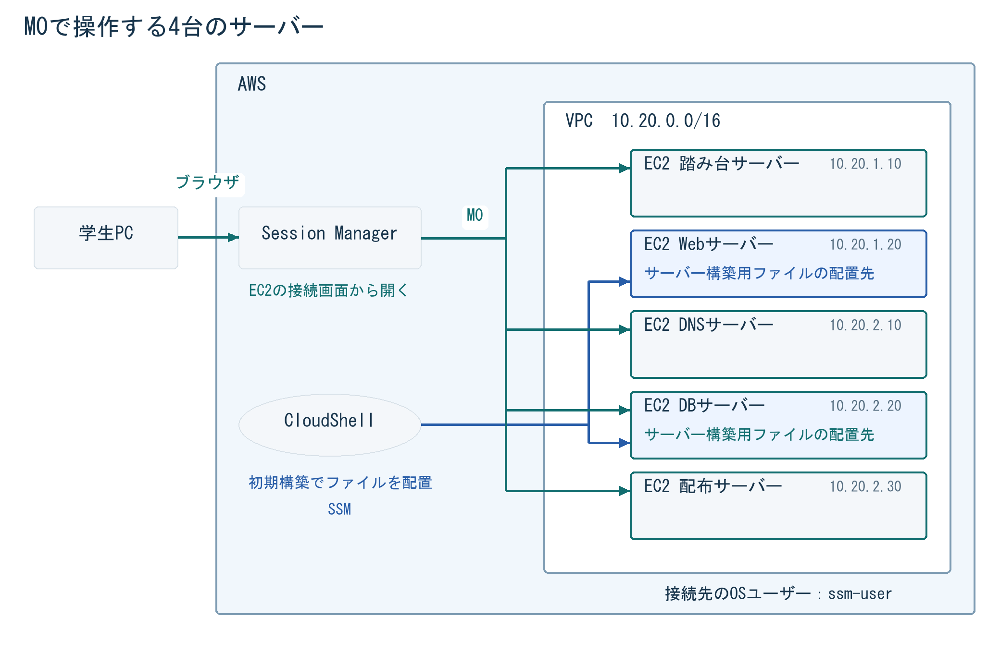
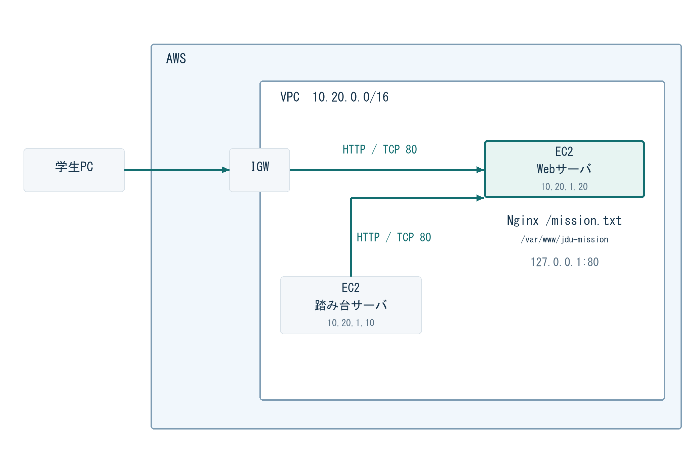
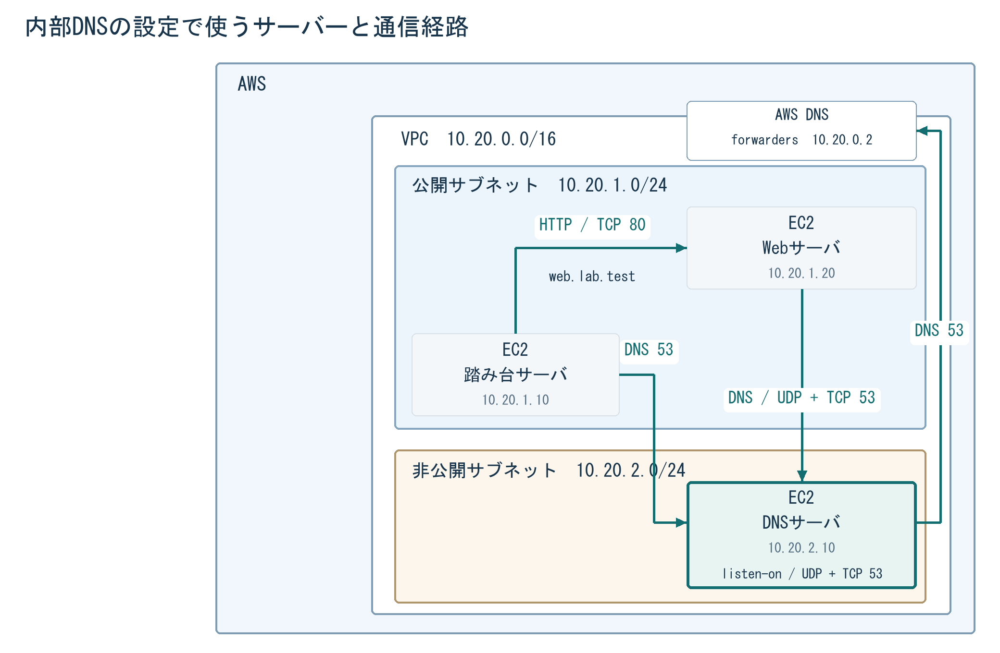
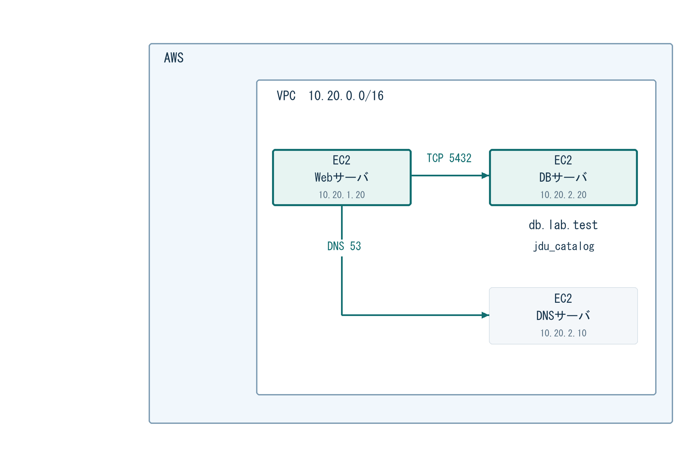

# Web演習：自力課題M0〜M5

教材初版・教師確認用。学生の最初からの通し試読は未実施。

ロシア語・ウズベク語は日本語原稿と同じ手順・条件の翻訳初稿。母語話者校閲は未実施。

[日本語](../ja/missions-full.md) · [Русский](../ru/missions-full.md) · [O‘zbekcha](../uz/missions-full.md)

[練習 P0〜P5](practice.md) · [課題 M0〜M5](missions.md)

## 使い方と共通の約束

Pで練習した方法を使い、同じ演習環境に課題用のファイルや設定を追加します。各Mで指定された値と、対応するPの手順を確認して作業を進めてください。

P0 → M0 → P1 → M1 → P2 → M2 → P3 → M3 → P4 → P5 → M4 → M5

P5で練習用アプリの設定を仕上げてから、M4で同じアプリを課題用DBに切り替えます。

## M0 サーバーの確認と接続 (4)

### 完成要件

P0で練習したSession Managerの接続手順を使い、今回はDB・DNS・配布・踏み台の4台を操作します。EC2の一覧で対象の行の **Instance ID** をクリックし、**Connect** の右にある矢印から **Connect with SSM Session Manager** を選びます。各サーバーで `ssm-user` として接続し、自分のホームディレクトリに `m0-connection.txt` を作って、下の表にある文字だけを1行で保存してください。

| サーバー | EC2の名前の末尾 | ファイルに書く内容 |
| --- | --- | --- |
| DBサーバー | `-db` | `db` |
| DNSサーバー | `-dns` | `dns` |
| 配布サーバー | `-repo` | `repo` |
| 踏み台サーバー | `-bastion` | `bastion` |

課題画面で **M0** を選ぶと、4台のファイルを個別に確認できます。ファイル1つにつき1点で、満点は4点です。

### 接続するサーバー



緑の矢印はM0で接続する4台への経路。


EC2のInstances一覧。P0は名前の末尾が `-web` の行、M0は `-db`・`-dns`・`-repo`・`-bastion` の行を順に選ぶ。


EC2の詳細画面。Connectの右の矢印からConnect with SSM Session Managerを選ぶ。Webサーバーの画面を例に示す。

### 確認・提出

1. P0で使った課題画面に学校のGoogleアカウントでログインし、自分のLabと **M0** を選ぶ。
2. 「この課題を確認する」を押す。
3. 処理中は「結果を更新する」で完了を待ち、クリアした項目数を確認する。「要修正」の項目があれば直してからもう一度確認する。結果は自動保存される。

## M1 HTTPで静的ファイルを返す (8)

### 完成要件

P1と同じWebサーバーで、`/var/www/jdu-mission/mission.txt` をTCPの80番ポートから `/mission.txt` として配信する。P1のファイルと設定も残し、`/practice.txt` を引き続き開けるようにする。

1. **配信ファイル（P1.2）**　`/var/www/jdu-mission` を作り、下の本文で `mission.txt` を配置する。所有者を `root`、所有グループを `www-data`、権限を `0640` にする。
2. **Nginxの設定（P1.3）**　`/etc/nginx/sites-available/default` の80番ポートを受け付ける既存の `server` 内に、`/mission.txt` と完全一致する `location` を追加し、その `root` に `/var/www/jdu-mission` を指定する。P1の設定を残し、構文検査に成功してから再読み込みする。
3. **HTTPとログ（P1.4〜P1.6）**　Webサーバー自身と踏み台サーバーから `/mission.txt` を開き、HTTP 200と下の本文を確認する。`/practice.txt` も開けることと、リクエストがアクセスログに残ることを確認する。

### 今回の見取り図



- **配信ファイル** `/var/www/jdu-mission/mission.txt`
- **URLのパス** `/mission.txt`

```text
JDU WEB-02 mission: independent HTTP delivery.
```

### 採点基準

各項目は1点。

| № | 満たす条件 |
| --- | --- |
| 1 | WebサーバーでNginxが起動している。 |
| 2 | Nginxの構文検査に通り、/mission.txtのlocationでrootが/var/www/jdu-missionに設定されている。M1ではP1の配信設定も残っている。 |
| 3 | NginxがWebサーバーの内部IPでTCPの80番ポートへの接続を受け付ける。 |
| 4 | /var/www/jdu-mission/mission.txt が通常のファイルで、本文が指定どおり、所有者がroot、所有グループがwww-data、権限が0640である。 |
| 5 | Webサーバー自身から指定URLを開くとHTTP 200と指定の本文が返る。M1では /practice.txt も引き続き開ける。 |
| 6 | 踏み台サーバーから `10.20.1.20` の `/mission.txt` を開くと、HTTP 200と指定の本文が返る。 |
| 7 | Webサーバーの公開IPで `/mission.txt` を開くと、HTTP 200と指定の本文が返る。 |
| 8 | 確認時の `/mission.txt` へのリクエストがNginxのアクセスログに残る。 |

### 確認・提出

1. 採点ページを開き、**M1** を選ぶ。
2. 「この課題を確認する」を押す。
3. 確認が終わると、満たした項目数と項目ごとの結果が表示される。「要修正」は該当する設定を直して再度確認する。「未確認」は、その項目を判定できなかった状態を表す。点数は課題一覧で確認する。

## M2 内部DNSと通常の名前解決 (13)

### 完成要件

始める前に、採点ページで [M1](m1.md) が満点になっていることを確認する。

P2で構築した内部DNSに、下の6件の名前を追加する。踏み台サーバーから `http://web.lab.test/mission.txt` が開けるようにする。

1. **DNSサーバー（P2.2〜P2.4）**　既存の `lab.test` ゾーンにAレコードを追加する。ゾーンファイルのシリアル番号を更新し、構文検査を通してから設定を読み込む。P2の名前は残してよい。
2. **踏み台サーバーとWebサーバー（P2.5〜P2.8）**　内部DNSへ直接問い合わせた結果と、OSが普段使う名前解決の結果を確認する。踏み台では `web.lab.test` でM1の本文を開き、Webサーバーでは `db.lab.test` が `10.20.2.20` になることを確認する。

### 今回の見取り図



| DNS name | A / IPv4 |
| --- | --- |
| admin.lab.test | 10.20.1.20 |
| bastion.lab.test | 10.20.1.10 |
| db.lab.test | 10.20.2.20 |
| dns.lab.test | 10.20.2.10 |
| repo.lab.test | 10.20.2.30 |
| web.lab.test | 10.20.1.20 |

### 採点基準

各項目は1点。

| № | 満たす条件 |
| --- | --- |
| 1 | DNSサーバーでBINDが起動している。 |
| 2 | BINDの設定と `lab.test` のゾーンファイルが構文検査に通る。 |
| 3 | 内部DNSが `lab.test` の情報を保持し、指定どおりのSOA・NSレコードを返す。 |
| 4 | 表の6件の名前が、すべて指定の内部IPアドレスになる。 |
| 5 | 踏み台サーバーとWebサーバーの両方が、UDPの53番ポートでDNSの回答を得られる。 |
| 6 | 踏み台サーバーとWebサーバーの両方が、TCPの53番ポートでDNSの回答を得られる。 |
| 7 | 踏み台サーバーとWebサーバーが通常の名前解決で内部DNSだけを使う。 |
| 8 | 踏み台サーバーから `http://web.lab.test/mission.txt` を開くと、HTTP 200とM1の本文が返る。 |
| 9 | Webサーバーの通常の名前解決で、`db.lab.test` が `10.20.2.20` になる。 |
| 10 | 外部の名前は `10.20.0.2` だけに転送して解決できる。 |
| 11 | `lab.test` の未登録名を問い合わせると、存在しないことを示す `NXDOMAIN` が返る。 |
| 12 | BINDが問い合わせ・再帰問い合わせ・キャッシュの利用を、DNSサーバー自身・踏み台・Webサーバーに限って許可する。 |
| 13 | 踏み台・Webサーバーからの通常の問い合わせは成功し、ゾーンの一括転送（AXFR）は明示的に拒否される。 |

### 確認・提出

1. 採点ページを開き、**M2** を選ぶ。
2. 「この課題を確認する」を押す。
3. 確認が終わると、満たした項目数と項目ごとの結果が表示される。「要修正」は該当する設定を直して再度確認する。「未確認」は、その項目を判定できなかった状態を表す。点数は課題一覧で確認する。

## M3 PostgreSQLへの認証接続 (9)

### 完成要件

始める前に、採点ページで [M2](m2.md) が満点になっていることを確認する。

P3で使ったPostgreSQLに、下の課題用データベースと2つのロールを作る。アプリのテーブルはM4で用意する。

1. **DBサーバー（P3.2〜P3.6）**　課題用DBとロールを作り、Webサーバー（`10.20.1.20/32`）から指定のDB・ロールで接続できるようにする。認証方式にはP3と同じSCRAMを使う。
2. **Webサーバー（P3.7〜P3.8）**　`db.lab.test` に通常運用用ロールで接続し、SELECTが成功することを確かめる。P3.8と同じ方法で、既存パスワードを課題用（`mission`）として保存する。

### 今回の見取り図



| 設定する項目 | 値 |
| --- | --- |
| データベース名 | `jdu_catalog` |
| 構築用ロール | `catalog_setup` |
| 通常運用用ロール | `catalog_app` |

### 採点基準

各項目は1点。

| № | 満たす条件 |
| --- | --- |
| 1 | DBサーバーでPostgreSQLの `16/main` が動作している。 |
| 2 | `16/main` が標準のデータ保存先を使い、サーバー内ではOSユーザー `postgres` がローカル接続して管理できる。 |
| 3 | PostgreSQLが `10.20.2.20:5432` で接続を待ち受けている。 |
| 4 | 課題用DBとその `public` スキーマの所有者が `catalog_setup` になっている。 |
| 5 | `catalog_app` はログインできる。両ロールに管理者権限や、ロールの所属を通じた権限昇格がない。 |
| 6 | Webサーバーから課題用DBと指定ロールへの接続だけを、SCRAM認証で許可する。 |
| 7 | Webサーバーから `db.lab.test` に `catalog_app` で接続し、課題用DBで指定のSELECTが成功する。 |
| 8 | 正しいパスワードで接続でき、誤ったパスワードは拒否される。 |
| 9 | Webサーバーから許可外のデータベースやロールで接続しようとすると拒否される。 |

### 確認・提出

1. 採点ページを開き、**M3** を選ぶ。
2. 「この課題を確認する」を押す。
3. 確認が終わると、満たした項目数と項目ごとの結果が表示される。「要修正」は該当する設定を直して再度確認する。「未確認」は、その項目を判定できなかった状態を表す。点数は課題一覧で確認する。

## M4 教員アプリをWeb・DBへ接続する (13)

### 完成要件

始める前に、採点ページで [M2](m2.md)、[M3](m3.md) が満点になっていることを確認する。

P4で動かした備品管理アプリを、M3で構築した課題用DBにつなぐ。P5で練習用の設定を仕上げてから始める。

1. **Webサーバー（P5.3、P4.4〜P4.5）**　アプリを停止し、使用する設定を `mission` に切り替える。配備済みのアプリを使い、課題用DBにテーブルと初期データを用意し、アプリ管理者を作る。
2. **DBサーバーとWebサーバー（P4.6〜P4.8）**　通常運用用ロールに権限を付け、アプリを起動する。公開ページと管理画面の両方を開き、`/practice.txt` と `/mission.txt` も引き続き開けることを確かめる。
3. **踏み台サーバー（P4.9）**　`http://admin.lab.test:8080/admin/` に `lab_admin` で入り、下の2件を登録する。一般ページでは公開にした備品を確認する。

### 今回の見取り図


| 備品コード | 名前 | 数量 | 保管場所 | 公開 |
| --- | --- | --- | --- | --- |
| `M5-PUBLIC-001` | Mission monitor | 6 | Lab cabinet C | 公開する |
| `M5-PRIVATE-001` | Mission router | 1 | Lab cabinet D | 公開しない |

### 採点基準

各項目は1点。

| № | 満たす条件 |
| --- | --- |
| 1 | 配備済みのアプリ本体と指定バージョンの依存パッケージを使用している。 |
| 2 | アプリが専用のOSユーザー `catalog` で動作し、OS起動時の自動起動が有効になっている。 |
| 3 | GunicornはWebサーバー内の `127.0.0.1:8000` だけで接続を受け付ける。 |
| 4 | アプリが `db.lab.test` を使い、`catalog_app` で課題用DBに接続している。 |
| 5 | 配布されたマイグレーションを適用し、課題用DBに11個のテーブルと必要な採番の仕組みがある。 |
| 6 | 表の備品2件が、すべて指定された値で課題用DBに保存されている。 |
| 7 | 一般ページがHTTP 200を返し、公開備品の表示がDBの内容と一致する。 |
| 8 | 踏み台サーバーから `http://admin.lab.test:8080/admin/` を開くと、管理画面のログインページが表示される。 |
| 9 | 一般ページと管理画面に必要なCSSなどが、それぞれの入口から取得できる。 |
| 10 | 指定のアプリ管理者が、管理画面にパスワードでログインできる。 |
| 11 | 管理画面で登録した確認用の備品がDBに保存され、一般ページにも反映される。 |
| 12 | 確認用備品の数量を管理画面から変更すると、DBと一般ページの表示が更新される。 |
| 13 | ログアウト後に管理画面を開き直すと、再びログインを求められる。 |

### 確認・提出

1. 採点ページを開き、**M4** を選ぶ。
2. 「機能・権限を含めて確認する」を選び、lab_admin の既存パスワードを「アプリ管理者の既存パスワード」に非表示入力して「このパスワードで確認する」を押す。RDP用とは別。設定だけの確認では機能の合格を確定しない。
3. 確認が終わると、満たした項目数と項目ごとの結果が表示される。「要修正」は該当する設定を直して再度確認する。「未確認」は、その項目を判定できなかった状態を表す。点数は課題一覧で確認する。

## M5 最小権限と公開範囲 (16)

### 完成要件

始める前に、採点ページで [M4](m4.md) が満点になっていることを確認する。

P5で練習した方法で、M4の備品管理アプリを通常運用に切り替える。構築時だけ使った接続を閉じ、アプリと管理者に必要な権限を残す。

1. **DBサーバー（P5.1〜P5.2）**　`catalog_app` の権限を確認する。構築用の `catalog_setup` はログイン不可にし、パスワードと既存の接続を残さない。
2. **Webサーバー（P5.3〜P5.4）**　課題用の一時設定（`/etc/jdu-catalog/setup.env` と `/etc/jdu-catalog/profiles/mission.setup.env`）を片付け、通常運用用の `mission` 設定で起動する。実行ユーザーによるコードの書き換えを防ぎ、秘密を含む設定は `root:root`、`0600` にする。
3. **一般ページと管理画面（P5.4〜P5.5）**　公開の80番ポートではM4の公開備品だけを表示する。踏み台から8080番ポートの管理画面に入り、`lab_admin` が備品を閲覧・追加・変更できることを確認する。

### 今回の見取り図


### 採点基準

各項目は1点。

| № | 満たす条件 |
| --- | --- |
| 1 | 公開の80番ポートでは管理用URLへのアクセスが拒否され、踏み台から8080番ポートの管理画面を開ける。 |
| 2 | 秘密を含む設定ファイルは通常のファイルで、`root:root`・`0600` に設定されている。 |
| 3 | アプリの実行ユーザーは、コード・Python環境・親ディレクトリを変更できず、ログインやsudoもできない。 |
| 4 | 公開ページから、秘密を含むファイルをHTTPで取得できない。 |
| 5 | 構築用ロールはログイン不可で、パスワード・既存の接続・一時設定が残っていない。 |
| 6 | 通常運用用ロールは備品を読める・追加できる・更新できる。削除と権限委譲は許可されていない。 |
| 7 | アカウントの表は読み取りと、最終ログイン・パスワードの列の更新だけが許可されている。 |
| 8 | グループや権限などを参照する表は、読み取りだけが許可されている。 |
| 9 | ログイン状態を管理する表は、読み取り・追加・更新・削除が許可されている。 |
| 10 | 管理操作を記録する表は、読み取りと追加だけが許可されている。 |
| 11 | 通常運用用ロールには、構造の適用履歴の表への権限、スキーマ内にオブジェクトを作る権限、アプリのDBオブジェクトの所有権がない。 |
| 12 | 備品と管理ログの採番に必要なシーケンスに、使用権限（USAGE）だけがある。 |
| 13 | アプリ管理者は備品を閲覧・追加・変更できる。備品の削除やユーザー・グループの管理はできない。 |
| 14 | ログインしていない利用者による備品の登録・編集が拒否される。 |
| 15 | 正しいパスワードでログインでき、誤ったパスワードではログインできない。 |
| 16 | 一般ページには公開備品が表示され、非公開備品は表示されない。 |

### 確認・提出

1. 採点ページを開き、**M5** を選ぶ。
2. 「機能・権限を含めて確認する」を選び、lab_admin の既存パスワードを「アプリ管理者の既存パスワード」に非表示入力して「このパスワードで確認する」を押す。RDP用とは別。設定だけの確認では機能の合格を確定しない。
3. 確認が終わると、満たした項目数と項目ごとの結果が表示される。「要修正」は該当する設定を直して再度確認する。「未確認」は、その項目を判定できなかった状態を表す。点数は課題一覧で確認する。
