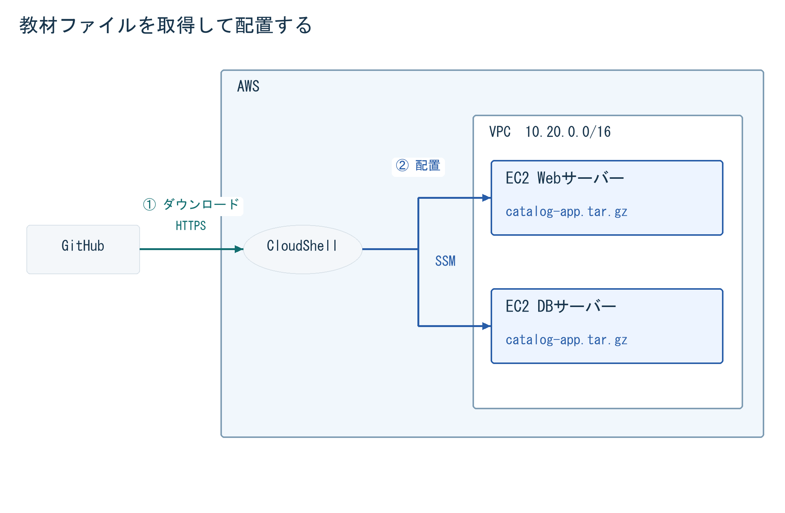
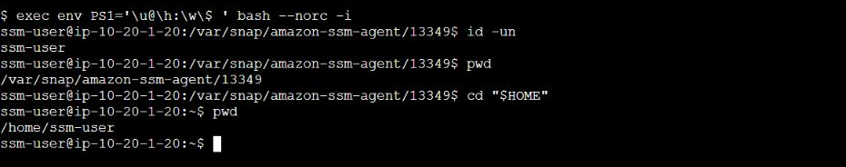
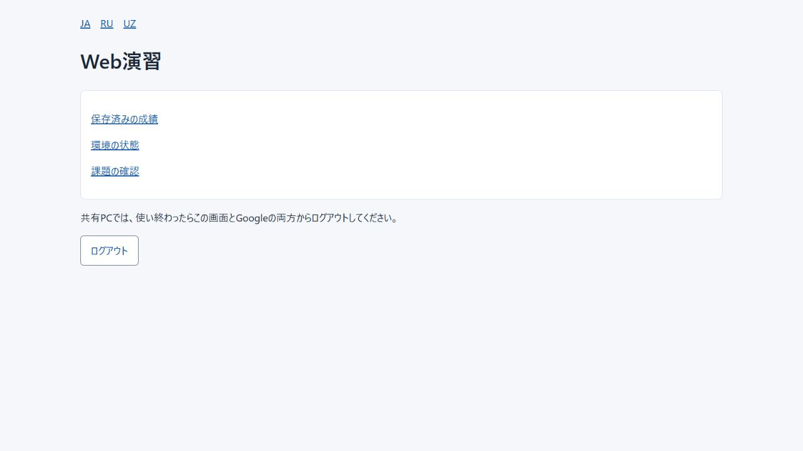
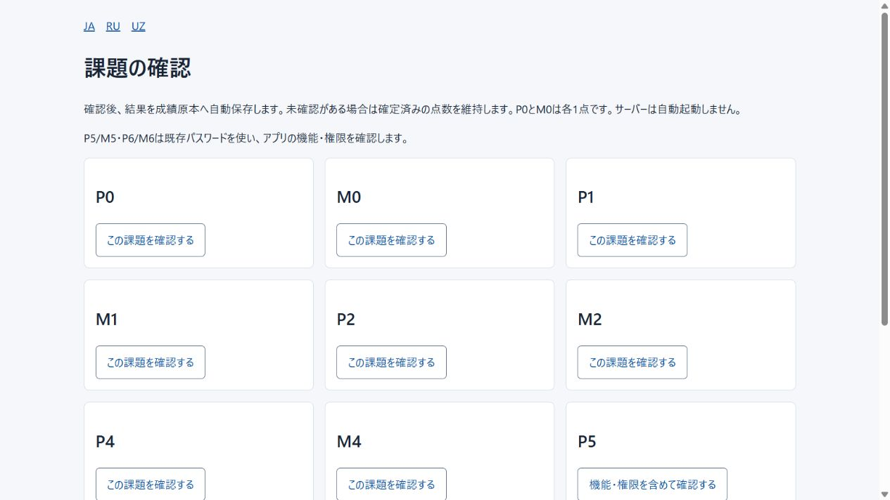
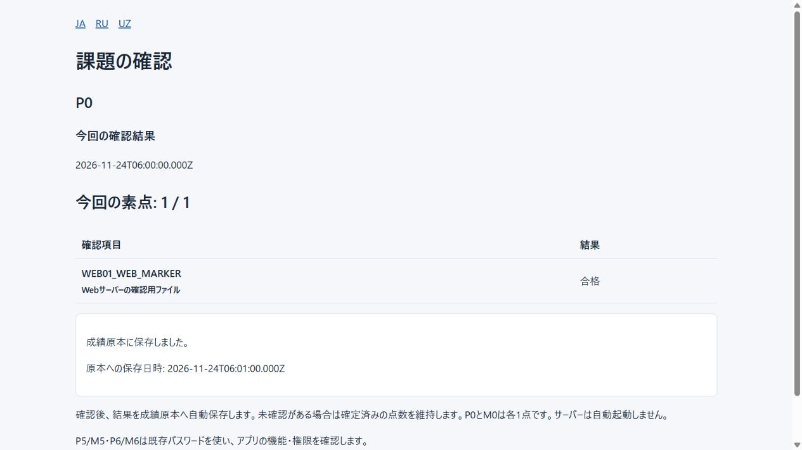
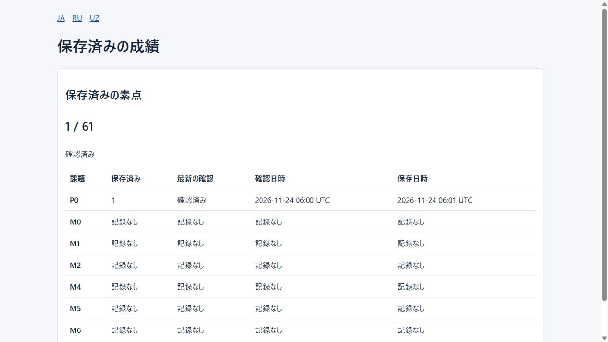

# P0 サーバーの確認と接続

[練習 P0〜P6](practice.md) · [課題 M0〜M6](missions.md)

[日本語](../ja/p0.md) · [Русский](../ru/p0.md) · [O‘zbekcha](../uz/p0.md)

対応する自力課題は[M0](m0.md)。


## 学ぶこと

EC2の一覧から正しいサーバーを選び、Session Managerで接続して、課題の結果を自分で確認できる。

## 課題

構築済みの自分の環境で、5台のインスタンスIDとロールを確認し、接続先と操作ユーザーを確かめる。

## 操作するサーバーとサーバー構築用ファイルの配置先


緑の矢印はP0.2の端末接続。青の矢印は初期構築時のサーバー構築用ファイルの配置を示す。配布サーバーはUbuntuなどのパッケージの配信を担当する。

**このPractice0で作業すること**

自分のAWSアカウント、各サーバーのロール、コマンドを実行する環境を確認する。

## 初期構築で配置されるサーバー構築用ファイル

共通登録コードで初期構築を完了すると、備品管理アプリとDB設定用のSQLが入った `catalog-app.tar.gz` は、WebサーバーとDBサーバーの `/var/lib/jdu-web/lesson-resources-r1` に配置済みです。WebサーバーからインターネットへのHTTPS接続はセキュリティのために制限されているので、構築スクリプトが下の経路でサーバー構築用ファイルを届けます。



共通登録コードで環境を構築すると、CloudShellはGitHubからサーバー構築用ファイルを取得し、SSMを使ってWebサーバーとDBサーバーに配置する。

## 解答例（操作手順）

### P0.1 5台のinstance IDを確認する

**実行環境:**

学生本人のAWSコンソール

**目的と操作:**

AWSマネジメントコンソール上部のSearch欄にEC2と入力し、EC2の管理画面を開く。EC2 → Instancesを開き、Name列で自分の演習環境の5台のサーバーを確認する。同じ行のInstance ID列からi-を含めてIDを確認する。


EC2のInstances一覧。P0は名前の末尾が `-web` の行、M0は `-db` の行を選ぶ。

### P0.2 Session ManagerでWebサーバーに接続する

**実行環境:**

WebサーバーのSSM端末：ssm-user

**目的と操作:**

P0.1で確認したWebサーバーの **Instance ID** をクリックする。詳細画面で **Connect** の右にある矢印を押し、**Connect with SSM Session Manager** を選ぶ。新しいタブのターミナルで、下のコマンドを上から1行ずつ実行する。初期構築時に置かれた `/etc/jdu-web/bootstrap.json` を `cat` で表示し、`"role": "web"` を探す。Webサーバーだと確認できたら、ホームディレクトリで `nano` を使って確認用ファイルを作る。


EC2の詳細画面。Connectの右の矢印からConnect with SSM Session Managerを選ぶ。Webサーバーの画面を例に示す。

入力するコマンド（番号はこの手順内の順番）

```bash
# 1. この端末で操作しているOSユーザー名を表示する。
id -un
# 2. 自分のホームディレクトリへ移動する。
cd ~
# 3. 現在の作業ディレクトリを表示する。
pwd
# 4. 設置済みのファイルを表示し、role が web であることを確認する。
cat /etc/jdu-web/bootstrap.json
# 5. web とだけ入力する。Ctrl+O、Enterで保存し、Ctrl+Xで終了する。
nano p0-connection.txt
# 6. p0-connection.txt の内容を変更せずに読む。
cat p0-connection.txt
```

**期待する結果と読み方:**

`id -un` は `ssm-user`、`pwd` は `/home/ssm-user` を表示する。JSONファイルには `"role": "web"` が含まれ、最後の `cat` では `web` だけが1行表示される。

プロンプトにユーザー名、ホスト名、現在のディレクトリが表示される。`~` はホームディレクトリを表し、`pwd` は現在地を絶対パスで表示する。セットアップが表示を自動設定できず、`$` だけが表示された場合は、次の1行を実行して現在地を常時表示する。作業が終わったら `exit` で接続を閉じる。

```bash
exec env PS1='\u@\h:\w\$ ' bash --norc -i
```



Session Managerの端末。表示を変えると、移動後のディレクトリがプロンプトに反映される。

### P0.3 RDPで踏み台のデスクトップを開く

**実行環境:**

学生のWindows PC（共有アカウント）

**目的と操作:**

Windowsの「リモート デスクトップ接続」で、自分の踏み台サーバーのデスクトップを開く。

**1. 踏み台サーバーを選ぶ**

EC2 → Instancesで、自分の演習環境のうち名前の末尾が `-bastion` の行を探し、同じ行の **Instance ID** をクリックする。


**2. 公開IPv4アドレスをコピーする**

インスタンスの詳細画面で **Public IPv4 address** の横にあるコピーアイコンを押す。次に入力するのは、自分の画面に表示された現在の公開IPv4アドレス。スクリーンショットの値は例。


Windowsキー＋Rで「ファイル名を指定して実行」を開く。「名前」欄に `mstsc /prompt` を入力し、**OK** を押す。

入力するコマンド（番号はこの手順内の順番）

```bash
# 1. WindowsのRDP接続画面を開き、資格情報の入力を求める。
mstsc /prompt
```

**3. 公開IPv4アドレスを入力して接続する**

「リモート デスクトップ接続」の **コンピューター** 欄に、手順2でコピーした公開IPv4アドレスを貼り付け、**接続** を押す。


**4. 証明書の確認画面を読む**

この画面が出た場合は、表示された接続先を手順2の公開IPv4アドレスと照合する。接続先が今回の踏み台であり、演習用の証明書だと教師に確認できたら **はい** を押す。確認できない場合は **いいえ** を押して教師に相談する。


**5. 踏み台サーバーにログインする**

xrdpのログイン画面で **Session** が `Xorg` になっていることを確かめる。**username** に `labuser`、**password** に学生用セットアップで自分が設定したRDPパスワードを入力し、**OK** を押す。


**6. デスクトップが開いたことを確認する**

リモート デスクトップ接続のウィンドウ内に、左上の **Applications** メニューや **Home** アイコンが表示されれば、踏み台サーバーに接続できている。


**コマンド・設定値の意味:**

RDPは踏み台の画面と入力を運ぶ。踏み台内Firefoxからの通信の送信元はWindowsではなく踏み台になる。日本語/英語などのキー配列はpasswordの記号入力にも影響するため、表示言語と配列を区別する。

**期待する結果と読み方:**

踏み台サーバーのUbuntuのデスクトップ（Xfce）が表示される。左上の「Applications」からFirefoxなどを開ける。

**うまくいかないとき:**

Login failedならuser名と日本語/英語等のkeyboard配列を確認する。passwordを会話へ送らない。到達しない場合は現在のIPと許可された接続元CIDRを教師と確認し、3389を全公開しない。終了時はRDP内の自分の作業を保存し、接続を閉じる。

## 確認・提出

P0の作業を終えたら、教師がクラスごとに案内する採点ページのURLを、自分のPCのブラウザで開く。採点ページを開くためにCloudShellでコマンドを実行する必要はない。Googleのログイン画面が表示されたら、学校のGoogleアカウントでログインする。以下はサンプルデータを使った日本語の画面例。画面上部の「RU」「UZ」で表示言語を切り替えられる。

**1. トップページで「課題の確認」を開く**

ログイン後、「Web演習」のトップページで **課題の確認** をクリックする。



**2. P0の採点を開始する**

P0の枠にある **この課題を確認する** をクリックする。画面を開いたまま1〜2分を目安に待つ。「確認を実行中です」の表示が続くときは、**結果を更新する** をクリックする。



**3. 今回の点数と保存状況を見る**

Webサーバーで作った `p0-connection.txt` の内容が `web` の1行なら、「今回の素点」が **1 / 1** になる。「成績原本に保存しました。」と表示されたら、**保存済み成績を見る** をクリックする。



**4. 保存済みの成績でP0の点数を確認する**

「保存済みの成績」の表でP0の行を見つけ、**1点** が保存されていることを確認する。



---

[次の課題: M0](m0.md)
