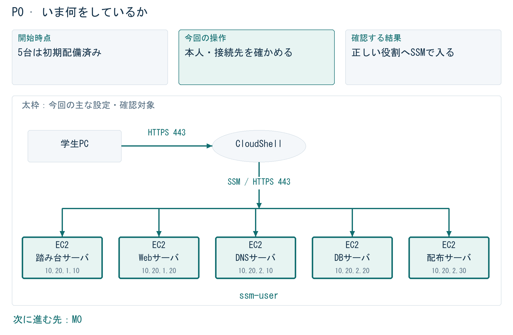

# P0 自分の環境と実行場所

[練習 P0〜P6](practice.md) · [課題 M0〜M6](missions.md)

[日本語](../ja/p0.md) · [Русский](../ru/p0.md) · [O‘zbekcha](../uz/p0.md)

2026-11-13 · D12 P/M r1.5

配布版の有効期限：2027年1月31日末（UZT）。

対応する自力課題は[M0](m0.md)。


## 学ぶこと

CloudShell、Windows、5台のUbuntuを区別し、正しいサーバーへSSMで入り、採点を自己確認できる。

## 課題

構築済みの自分の環境で、5台のインスタンスIDと役割を確認し、接続先と操作ユーザーを確かめる。P0は成績に加算しない。

## 今回の見取り図



図の太枠が今回の主な対象です。設定操作は各手順の実行場所で行い、図の矢印は接続・確認の向きを表します。 SGの通信許可は初期配備済みで、今回の課題はサーバー内の設定です。 SSMの矢印はAWSの接続管理を使う経路で、EC2の443番受信を開く指示ではありません。

[図を拡大する](../../assets/ja/p0.png) · [SVG](../../assets/ja/p0.svg)

## 仕組みを理解する

**始める前の状態:**

教師が初期配布と個別登録を終えた、本人の5台を使う。

**このPで変えること:**

対象account・役割・実行場所を見分け、公開教材資源を準備する。

AWSコンソールはAWS資源を管理する画面、CloudShellはAWS CLIを使う自分の端末、SSMは選んだEC2のOS内へ入る接続である。SSMへ入っても5台が一つのOSになるわけではない。Webの/var/wwwとDBの/var/wwwは別の保存先である。サーバーの役割と、そこで操作するOS userを別々に確認する。

## 操作例：一つずつ実行する

### P0.1 5台のinstance IDを記録する

**実行場所:**

学生本人のAWSコンソール

**目的と操作:**

EC2のInstances一覧で自分のLabIdとDeploymentIdのタグを照合し、bastion/web/dns/db/repoのinstance IDを手元の作業表へ記入する。名前だけで選ばない。公開IPv4はbastionとwebだけにある。SSM接続は公開IPではなくinstance IDを使う。

**コマンド・設定値の意味:**

instance IDはEC2を識別する値、roleは授業内の担当、公開IPは外から接続する宛先である。公開IPが変わっても同じinstance IDなら同じEC2として追跡できる。作業表には5役割とIDの組を記録する。

**期待する結果と読み方:**

5台ともrunning、SSM Online。private IPは本書の共通表と一致する。公開IPv4は停止・起動後に変わることがある。

**うまくいかないとき:**

別Lab・別account・不明な台を操作しない。停止中は教師の起動案内に従う。ResetやTerminateで開始状態を作り直さない。

### P0.2 SSMで入り、戻る

**実行場所:**

CloudShell（学生本人のAWS）

**目的と操作:**

EC2で確認したWebのIDに置き換えて実行する。接続後はCloudShellではなくUbuntuの端末になる。id -unはSSM管理userを、bootstrap.jsonのroleはサーバー役割を示す。最後のexitを1回実行するとCloudShellへ戻る。

入力するコマンド（番号はこの手順内の順番）

```bash
# 1. CloudShellから指定EC2へSSM接続する。接続完了後に次へ進む。
aws ssm start-session --target i-YOUR-WEB-INSTANCE-ID
# 2. この端末で操作しているOSユーザー名を表示する。
id -un
# 3. 接続中のサーバーのホスト名を表示する。
hostname
# 4. bootstrap情報のroleだけを読み、接続先の役割を確認する。
python3 -c 'import json;print(json.load(open("/etc/jdu-web/bootstrap.json"))["role"])'
# 5. 現在の作業ディレクトリを表示する。
pwd
# 6. 現在のサーバーへの接続を閉じ、CloudShellへ戻る。
exit
```

**コマンド・設定値の意味:**

最初のstart-sessionだけをCloudShellで実行し、接続完了を待ってから残りを1行ずつ入力する。id -unはuser、hostnameはOSのhost名、roleは教材上の役割を読む。exitは現在の接続を1段だけ戻す。

**期待する結果と読み方:**

userはssm-user、roleはweb。以降もサーバーを替えるたびに確認する。SSHで入ったUbuntuのuserはubuntuになる場合がある。

**うまくいかないとき:**

TargetNotConnectedならrunning/SSM Online/region us-east-1を確認する。SGを全面開放したりWindowsへ鍵をダウンロードしない。

### P0.3 公開教材資源だけを準備する

**実行場所:**

CloudShell（学生本人のAWS）

**目的と操作:**

署名付き配布を使う場合の手順です。共通登録コード方式では構築時に配置済みです。本教材zipをCloudShellのActions→Upload fileでアップロードし、unzip web-lab-pm-r1.zipで展開する。resourcesへ移動し、YOUR-INSTALLATION-DIRECTORYを署名付き配布の導入先に置き換える。導入先は、初回に表示されたactivate.shがあるディレクトリ。補助処理は本人の署名版と元5台を照合し、Web/DBへアプリ資源・SQL・秘密の非表示入力helperを置くだけ。サービスやDBは構築しない。秘密は送らない。

入力するコマンド（番号はこの手順内の順番）

```bash
# 1. 作業場所を $HOME/web-lab-pm-r1/resources へ移す。
cd "$HOME/web-lab-pm-r1/resources"
# 2. 署名版と本人の5台を照合し、公開教材をWeb/DBへ配置する。
python3 -B stage_resources.py --installation 'YOUR-INSTALLATION-DIRECTORY'
```

**コマンド・設定値の意味:**

公開教材資源はアプリやSQLの材料であり、完成済みのサービスではない。stage_resources.pyをCloudShellで実行して初めてWeb/DBへ配置される。Windowsへzipを保存しただけではEC2内のファイルは増えない。

**期待する結果と読み方:**

PUBLIC_LESSON_RESOURCES_READY=web と =db。各台の/var/lib/jdu-web/lesson-resources-r1に公開ファイルがある。既存の異なるファイルは上書きしない。

**うまくいかないとき:**

初期化未完・版違い・期限切れならここで止めて教師へ状況を知らせる。検証用fixtureや完成アプリの自動適用ツールで代用しない。

### P0.4 ブラウザで準備を確認する

**実行場所:**

自分のPCのブラウザ：Web Portal

**目的と操作:**

教師から案内された課題画面を開く。学校Googleでログインし、本人AWSとの連携を済ませ、P0を選んで「この課題を確認する」を押す。結果が処理中なら「結果を更新する」を押す。M0も同じ方法で確認する。P0/M0は準備確認で成績に加算しない。

**コマンド・設定値の意味:**

ブラウザの確認結果は自動保存される。結果のPASS/FAIL/UNKNOWNと、処理・保存の状態を分けて読む。PとM0は保存されても成績に加算しない。

**期待する結果と読み方:**

本人のLab・課題ID・確認時刻が正しい。各checkの結果と保存状態を読む。処理完了と保存を確認する。UNKNOWNは観測できなかった状態で、合格とは別。

**うまくいかないとき:**

失敗行のcheck ID・実行時刻・対象roleだけを相談に使う。token・password・本人用URLを共有しない。

### P0.5 RDPで踏み台のデスクトップを開く

**実行場所:**

学生のWindows PC（共有アカウント）

**目的と操作:**

EC2で確認した現在の踏み台の公開IPv4を使う。Windowsキー＋Rを押し、mstsc /promptを入力してEnter。ComputerへそのIPを指定し、userはlabuser、passwordは本人が初期配備で設定したRDP用を使う。Windowsアカウントのpasswordではない。「資格情報を記憶する」は選ばない。青いxrdp loginが出たらSession=Xorgを確認し、labuserで入る。

入力するコマンド（番号はこの手順内の順番）

```powershell
# 1. WindowsのRDP接続画面を開き、資格情報の入力を求める。
mstsc /prompt
```

**コマンド・設定値の意味:**

RDPは踏み台の画面と入力を運ぶ。踏み台内Firefoxからの通信の送信元はWindowsではなく踏み台になる。日本語/英語などのキー配列はpasswordの記号入力にも影響するため、表示言語と配列を区別する。

**期待する結果と読み方:**

UbuntuのXfceデスクトップとFirefoxが開く。これは踏み台内のbrowserであり、Windows側のbrowserとは別。RDPのlabuserにはsudo管理権限がないため、構築はCloudShellからSSM/ssm-userで行う。

**うまくいかないとき:**

Login failedならuser名と日本語/英語等のkeyboard配列を確認する。passwordを会話へ送らない。到達しない場合は現在のIPと許可された接続元CIDRを教師と確認し、3389を全公開しない。終了時はRDP内の自分の作業を保存し、接続を閉じる。

## 理解の確認（採点外）

WebへSSM接続したままDBの手順を入力すると、どのサーバーが変わるか？

**考え方:**

現在接続中のWebが変わる。exitでCloudShellへ戻り、DBのinstance IDへ接続し直す。

---

[次の課題: M0](m0.md)
