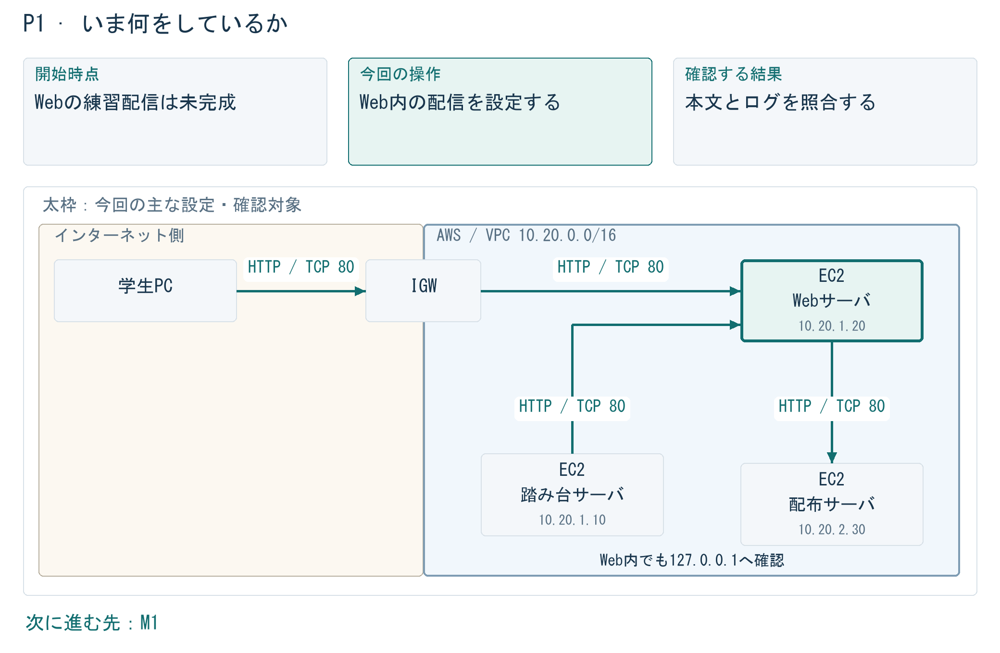
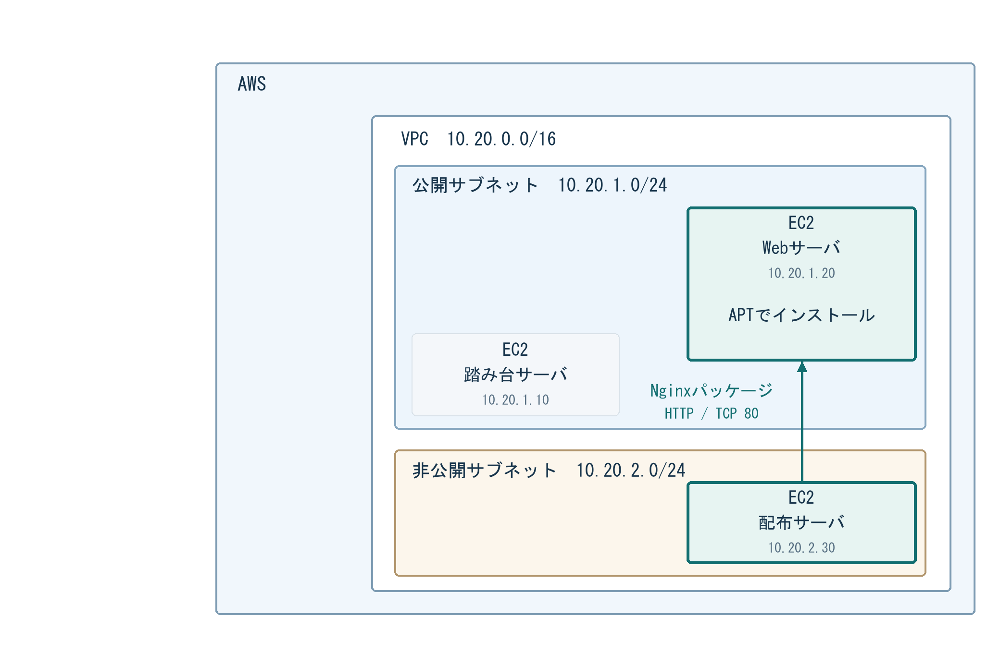
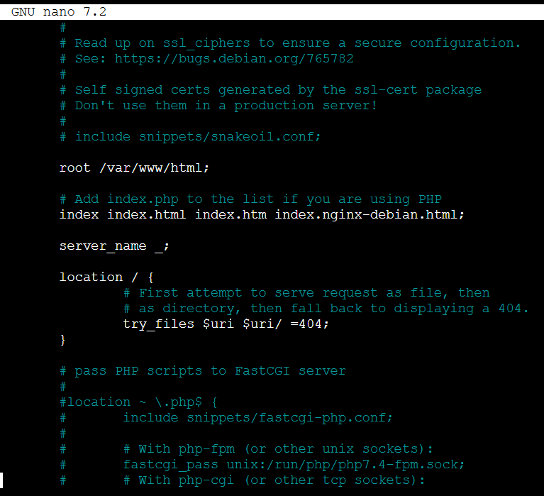
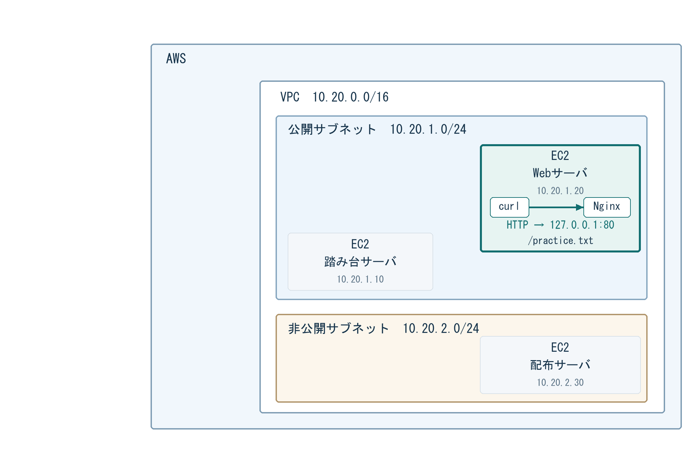
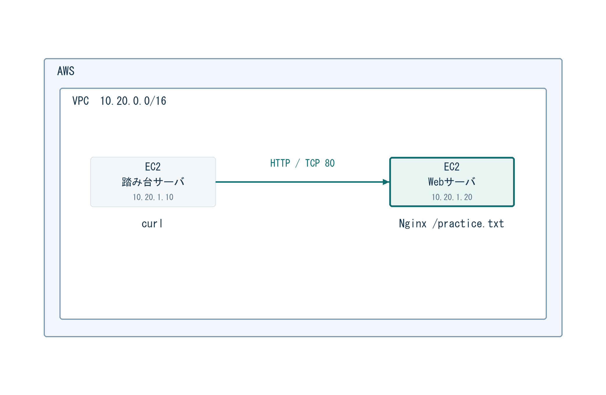

# P1 HTTPで静的ファイルを返す

[練習 P0〜P5](practice.md) · [課題 M0〜M5](missions.md)

[日本語](../ja/p1.md) · [Русский](../ru/p1.md) · [O‘zbekcha](../uz/p1.md)

対応する自力課題は[M1](m1.md)。


## 学ぶこと

Nginx、保存先、待受、HTTP応答、access logを一組で確認する。

## 課題

Nginxを設定し、`/var/www/jdu-practice/practice.txt` をHTTPで配信する。

## 今回の見取り図



- File: /var/www/jdu-practice/practice.txt
- URL path: /practice.txt

```text
JDU WEB-02 practice: HTTP response verified.
```

**このPractice1で作業すること**

NginxでTCPの80番ポートにHTTPを公開し、`/practice.txt` のリクエストにファイルの本文を返す。Webサーバー自身の端末と踏み台サーバーの端末からアクセスし、そのリクエストがNginxのアクセスログに残ることを確かめる。

## 解答例（操作手順）

### P1.1 内部APTからNginxを導入する

**実行環境:**

WebサーバーのSSM端末：ssm-user

**目的と操作:**

P0と同じ方法でWebサーバーへSSMで接続する。内部の配布サーバー（`10.20.2.30`）からNginxのパッケージをダウンロードし、Webサーバーにインストールする。



入力するコマンド（番号はこの手順内の順番）

```bash
# 1. 配布サーバーのパッケージ一覧を更新する。
sudo apt-get update
# 2. 配布サーバーから nginx をインストールする。
sudo apt-get install nginx
```

**コマンド・設定値の意味:**

`apt-get update` は利用できるパッケージの一覧を更新する。`apt-get install nginx` は、その一覧を使ってNginxをインストールする。

**期待する結果と読み方:**

一覧を更新すると、配布サーバーの行に `Hit:` または `Get:` が表示される。`N: Ignoring file ... ubuntu.sources.jdu-disabled` は、初回セットアップで無効にしたUbuntu標準の配布先設定をAPTが読み飛ばしたという通知である。取得や署名のエラーがなければインストールへ進む。確認画面が出たら `Y` を入力する。

**うまくいかないとき:**

パッケージ一覧の取得に失敗した場合は、配布サーバーの稼働状態とIPアドレスを確認する。

### P1.2 正しい本文を作り、所有者と権限を揃える

**実行環境:**

WebサーバーのSSM端末：ssm-user

**目的と操作:**

作業用のファイルに本文を書き、Nginxが配信するディレクトリへコピーする。

入力するコマンド（番号はこの手順内の順番）

```bash
# 1. 自分のホームディレクトリへ移動する。
cd ~
# 2. 練習の作業ディレクトリを作る。既存ならそのまま使う。
mkdir -p jdu-web-practice/p1
# 3. 作業場所を jdu-web-practice/p1 へ移す。
cd jdu-web-practice/p1
# 4. 現在の作業ディレクトリを表示する。
pwd
# 5. practice.txtを編集する。本文を入力し、保存して終了する。
nano practice.txt
```

**nanoに入力する本文**

```text
JDU WEB-02 practice: HTTP response verified.
```

nanoの画面に上の1行をそのまま入力し、行末で Enter を押す。Ctrl+O、Enter の順に押して保存し、Ctrl+X で終了する。端末に戻ったら、手順6から続ける。

入力するコマンド（番号はこの手順内の順番）

```bash
# 6. /var/www/jdu-practice ディレクトリを作る。
sudo mkdir -p /var/www/jdu-practice
# 7. ファイルを /var/www/jdu-practice/practice.txt にコピーする。
sudo cp practice.txt /var/www/jdu-practice/practice.txt
# 8. /var/www/jdu-practice/practice.txt の所有者とグループを root:www-data に変更する。
sudo chown root:www-data /var/www/jdu-practice/practice.txt
# 9. /var/www/jdu-practice/practice.txt の権限を 0640 に変更する。
sudo chmod 0640 /var/www/jdu-practice/practice.txt
# 10. 指定ファイルの所有者・グループ・権限・名前を読む。
stat -c '%U:%G %a %n' /var/www/jdu-practice/practice.txt
# 11. 管理者権限で /var/www/jdu-practice/practice.txt の内容を読む。
sudo cat /var/www/jdu-practice/practice.txt
```

**コマンド・設定値の意味:**

`chown root:www-data` で所有者をroot、所有グループをwww-dataにする。`chmod 0640` は所有者に読み書き、グループに読み取りを許可し、その他のユーザーには許可しない。Nginxのワーカープロセスはwww-dataとして動くため、このグループの権限でファイルを読める。

**期待する結果と読み方:**

`root:www-data 640 /var/www/jdu-practice/practice.txt` と表示され、本文は `JDU WEB-02 practice: HTTP response verified.` の1行である。

**うまくいかないとき:**

nanoが開いている場合は、保存して終了してから次のコマンドを実行する。

### P1.3 Nginxに配信先を設定する

**実行環境:**

WebサーバーのSSM端末：ssm-user

**目的と操作:**

`sudo nano /etc/nginx/sites-available/default` で設定を開く。`listen 80` がある既存の `server { ... }` の中へ、下の設定を追加する。別の `location` の中には入れない。`/practice.txt` をリクエストされたとき、Nginxは指定したrootにパスをつなげて `/var/www/jdu-practice/practice.txt` を読む。保存後、構文検査に成功したら設定を再読み込みする。

入力するコマンド（番号はこの手順内の順番）

```bash
# 1. /etc/nginx/sites-available/default をnanoで編集する。
sudo nano /etc/nginx/sites-available/default
```

**追加する位置**



nanoで `location / {` を探す。Ctrl+Wで `location /` を検索してもよい。画面の `try_files $uri $uri/ =404;` と、その次の `}` は削除しない。この `}` が既存の `location /` の終わりである。その下の空行へカーソルを移し、次の3行を追加する。`try_files` の直下、つまり `}` より手前には入れない。

**nanoで設定する内容**

```text
location = /practice.txt {
    root /var/www/jdu-practice;
}
```

**追加後の配置（一部抜粋）**

既存のブロックと追加するブロックは、次のように並ぶ。どちらも既存の `server { ... }` の中に置く。ファイル全体をこの例へ置き換えず、ほかの設定と上側の `root /var/www/html;` はそのまま残す。

```text
location / {
    try_files $uri $uri/ =404;
}

location = /practice.txt {
    root /var/www/jdu-practice;
}
```

`location = /practice.txt` は、リクエストのパスが `/practice.txt` と完全に一致するときの設定である。その場合だけ追加したrootを使い、`/var/www/jdu-practice/practice.txt` を読む。

設定を入力したらCtrl+O、Enterで保存し、Ctrl+Xで終了する。端末に戻って、続きのコマンドを実行する。

入力するコマンド（番号はこの手順内の順番）

```bash
# 2. Nginxの設定全体を表示し、どのように記載されているか確認する。
sudo nginx -T
# 3. Nginx設定の構文と参照ファイルを検査する。
sudo nginx -t
# 4. nginx を今すぐ起動し、次回起動時も自動起動させる。
sudo systemctl enable --now nginx
# 5. nginx を止めずに設定を再読込する。
sudo systemctl reload nginx
# 6. nginx の現在の起動状態を読む。
systemctl is-active nginx
# 7. NginxがTCPの80番ポート（例 0.0.0.0:80）で待ち受けていることを確認する。
sudo ss -lntp
```

**コマンド・設定値の意味:**

nginx -Tは読込対象の設定を表示し、-tは構文を検査する。systemctlのenableは次回起動時、--nowは現在の起動を指定する。設定ファイルの保存だけで終わらず、reload後のserviceと待受portを読む。

**期待する結果と読み方:**

構文検査で `syntax is ok` と `test is successful`、起動状態で `active` が表示される。最後に、NginxがTCPの80番ポート（例 `0.0.0.0:80`）で待ち受けていることを確認する。

**うまくいかないとき:**

構文検査に失敗した場合は、`nginx -t` に表示されたファイル名と行番号を確認して修正する。

### P1.4 Web自身から応答を見る

**実行環境:**

WebサーバーのSSM端末：ssm-user

**目的と操作:**

Webサーバーの端末で `curl` を使い、HTTPリクエストを送る。宛先の `127.0.0.1` は、コマンドを実行しているWebサーバー自身を指す。



入力するコマンド（番号はこの手順内の順番）

```bash
# 1. http://127.0.0.1/practice.txt へHTTPリクエストを送る。
curl -i http://127.0.0.1/practice.txt
```

**コマンド・設定値の意味:**

`127.0.0.1` はループバックアドレスで、リクエストは同じWebサーバー内のNginxに届く。

**期待する結果と読み方:**

HTTP 200と、practice.txtに書いた `JDU WEB-02 practice: HTTP response verified.` が表示される。

**うまくいかないとき:**

「Welcome to nginx」が表示されたら、curlで `/practice.txt` を指定したか確認する。`http://127.0.0.1/` を開くとNginxの初期ページが返ることがある。

### P1.5 踏み台サーバーから同じファイルを見る

**実行環境:**

踏み台のSSM端末：ssm-user

**目的と操作:**

踏み台サーバーへSSMで接続し、`curl` でWebサーバーにHTTPリクエストを送る。イントラネット（内部ネットワーク）から接続するので、宛先にはWebサーバーの内部IPアドレス `10.20.1.20` を指定する。



入力するコマンド（番号はこの手順内の順番）

```bash
# 1. http://10.20.1.20/practice.txt へHTTPリクエストを送る。
curl -i http://10.20.1.20/practice.txt
```

**コマンド・設定値の意味:**

宛先はWebサーバーの内部IPに変わる。リクエストするファイルのパスはP1.4と同じ `/practice.txt` を使う。

**期待する結果と読み方:**

HTTP 200と、`JDU WEB-02 practice: HTTP response verified.` が表示される。

### P1.6 要求とlogを結び付けて提出する

**実行環境:**

WebサーバーのSSM端末：ssm-user

**目的と操作:**

Webへ戻り、access logの時刻・client IP・path・statusを見る。logは実際に要求を処理した証拠で、fileがある証拠とは別。exitでCloudShellへ戻ったら、PCのWeb PortalでP1を選び「この課題を確認する」を押す。

入力するコマンド（番号はこの手順内の順番）

```bash
# 1. access log末尾20行を読み、直前のHTTP要求を探す。
sudo tail -n 20 /var/log/nginx/access.log
# 2. 現在のサーバーへの接続を閉じ、CloudShellへ戻る。
exit
```

**コマンド・設定値の意味:**

access logでは時刻・要求path・statusを直前のcurlと対応させる。tailは末尾を読む操作で、logを書き換えない。exitで接続を終えたら、PCのブラウザでP1を確認する。

**期待する結果と読み方:**

確認画面に8項目の結果と、クリアした項目数が表示される。公開IPからのHTTPアクセスは採点システムが自動で確認する。

**うまくいかないとき:**

処理中なら結果を更新する。保存に失敗していれば表示された理由を確認する。checkerの期待本文を書き換えない。

## 出力の読み取り例（入力しない）

```text
HTTP/1.1 200 OK

JDU WEB-02 practice: HTTP response verified.
```

上は説明用に必要な行だけを抜き出した例。実際には日時などのheaderが加わる。200と本文を読み、access logのpath/statusとも照合する。

## 理解の確認（採点外）

Web自身では200、踏み台からは接続失敗。本文を作り直す前に何を確認するか？

**考え方:**

要求先IP・待受アドレスとport・踏み台からWebへの通信許可を調べる。本文の正否と到達性を分ける。

---

[前の課題: M0](m0.md) · [次の課題: M1](m1.md)
