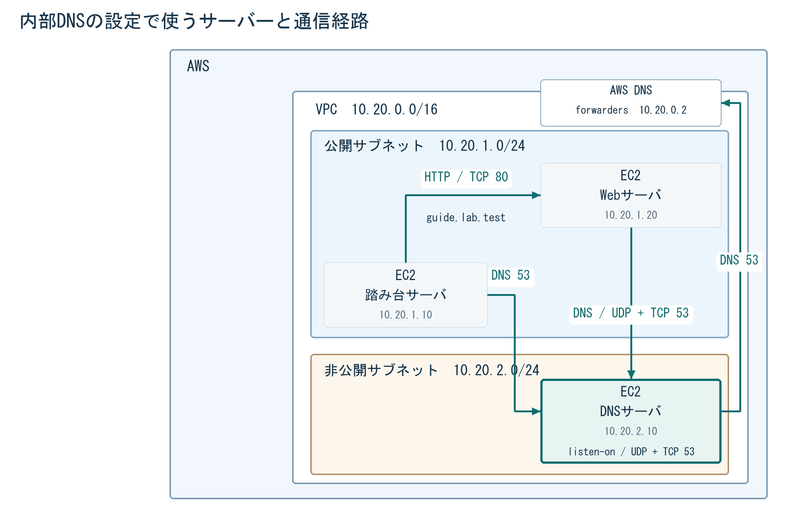

# P2 内部DNSと通常の名前解決

[練習 P0〜P5](practice.md) · [課題 M0〜M5](missions.md)

[日本語](../ja/p2.md) · [Русский](../ru/p2.md) · [O‘zbekcha](../uz/p2.md)

対応する自力課題は[M2](m2.md)。


**このPractice2で作業すること**

内部DNSにWeb・DBサーバーの名前を登録する。踏み台サーバーとWebサーバーがこのDNSを使うように設定し、P1のファイルを名前で開く。

## 今回の見取り図



## 解答例（操作手順）

### P2.1 配布サーバーからBINDをインストールする

**実行環境:**

DNSサーバーのSSM端末：ssm-user

DNSサーバーで配布サーバーのパッケージ一覧を更新し、BINDと設定を確認するためのツールをインストールする。続けて、編集する設定ファイル2つの控えを作る。

入力するコマンド（番号はこの手順内の順番）

```bash
# 1. 配布サーバーのパッケージ一覧を更新する。
sudo apt-get update
# 2. 配布サーバーから bind9 bind9-utils と、動作に必要なパッケージをインストールする。
sudo apt-get install --no-install-recommends bind9 bind9-utils
# 3. 元ファイルを控えへコピーする。既存の控えは上書きしない。
sudo cp -an /etc/bind/named.conf.options /etc/bind/named.conf.options.before-p2
# 4. 元ファイルを控えへコピーする。既存の控えは上書きしない。
sudo cp -an /etc/bind/named.conf.local /etc/bind/named.conf.local.before-p2
```

**期待する結果と読み方:**

`bind9` と `bind9-utils` がインストールされ、2つの `.before-p2` ファイルができる。

### P2.2 問い合わせを受け付けるサーバーを設定する

**実行環境:**

DNSサーバーのSSM端末：ssm-user

問い合わせを受け付けるのは、DNSサーバー自身、踏み台サーバー、Webサーバーの3台。演習の外の名前はAWSのDNS（`10.20.0.2`）に問い合わせる。

ファイルの内容を下の設定に置き換えて保存する。検索するときはnanoの Ctrl+W、保存するときは Ctrl+O、Enter、終了は Ctrl+X を使う。

```bash
sudo nano /etc/bind/named.conf.options
```

**nanoに入力する内容**

```text
acl "jdu_clients" { 127.0.0.1; 10.20.1.10; 10.20.1.20; };
options {
    directory "/var/cache/bind";
    listen-on { 127.0.0.1; 10.20.2.10; };
    listen-on-v6 { none; };
    allow-query { jdu_clients; };
    allow-recursion { jdu_clients; };
    allow-query-cache { jdu_clients; };
    recursion yes;
    forward only;
    forwarders { 10.20.0.2; };
    dnssec-validation no;
    allow-transfer { none; };
};
```

**期待する結果と読み方:**

`listen-on` にDNSサーバー自身の内部IP `10.20.2.10`、`forwarders` にAWSのDNS `10.20.0.2` が入る。

### P2.3 名前とIPv4アドレスを登録する

**実行環境:**

DNSサーバーのSSM端末：ssm-user

`named.conf.local` で、`lab.test` のゾーンファイルがどこにあるかをBINDに指定する。`db.lab.test` に、一つの名前とIPv4アドレスを一組にしてAレコードを書く。

既存の `named.conf.local` の末尾に次のブロックを追加する。`lab.test` のブロックが既にあれば、そのブロックを編集する。

```bash
sudo nano /etc/bind/named.conf.local
```

**nanoに入力する内容**

```text
zone "lab.test" {
    type primary;
    file "/etc/bind/zones/db.lab.test";
    allow-transfer { none; };
    allow-update { none; };
};
```

nanoで `/etc/bind/zones/db.lab.test` を開き、下の設定を入力して保存する。

```bash
sudo mkdir -p /etc/bind/zones
sudo chmod 0755 /etc/bind/zones
sudo nano /etc/bind/zones/db.lab.test
```

**nanoに入力する内容**

```text
$TTL 300
@ IN SOA dns.lab.test. hostmaster.lab.test. (
    2026102301 3600 600 604800 300 )
@ IN NS dns.lab.test.
dns IN A 10.20.2.10
guide IN A 10.20.1.20
practice-db IN A 10.20.2.20
```

**期待する結果と読み方:**

`guide.lab.test` はWebサーバーの `10.20.1.20`、`practice-db.lab.test` はDBサーバーの `10.20.2.20` に対応する。

**うまくいかないとき:**

すでにゾーンファイルがある場合は、既存の名前を残して練習用の2件を追加する。レコードを変更するたびに、SOAのシリアル番号を現在の値より増やす。

### P2.4 BINDを起動してDNSサーバー自身から問い合わせる

**実行環境:**

DNSサーバーのSSM端末：ssm-user

設定とゾーンファイルにエラーがないことを確かめてからBINDを起動する。`dig` はDNSに問い合わせてレスポンスを表示するコマンド。ここでは自分自身を指す `127.0.0.1` を問い合わせ先にする。

入力するコマンド（番号はこの手順内の順番）

```bash
# 1. BINDの設定と参照zoneを構文検査する。
sudo named-checkconf -z
# 2. lab.testのzoneファイルを検査する。
sudo named-checkzone lab.test /etc/bind/zones/db.lab.test
# 3. named を次回のOS起動時に自動起動させる。
sudo systemctl enable named
# 4. named を再起動して設定を読み直す。
sudo systemctl restart named
# 5. UDP 53で guide.lab.test を問い合わせ、応答を読む。
dig @127.0.0.1 guide.lab.test A
# 6. TCP 53で guide.lab.test を問い合わせ、応答を読む。
dig @127.0.0.1 guide.lab.test A +tcp
```

**期待する結果と読み方:**

ゾーンファイルの検査で `OK` が表示される。UDPとTCPのどちらでも `NOERROR` が返り、`guide.lab.test` のIPは `10.20.1.20` になる。

**うまくいかないとき:**

失敗ならsudo journalctl -u named -n 30 --no-pagerで対象行を調べ、設定を直して再検査する。

### P2.5 踏み台サーバーとWebサーバーからBINDを試す

**実行環境:**

踏み台サーバーとWebサーバーのSSM端末

両方のサーバーで実行する。`dig` の `@10.20.2.10` は、その1回の問い合わせ先を指定する。`AXFR` はゾーンのレコードをまとめて転送するための指定で、この演習では拒否されることを確かめる。

入力するコマンド（番号はこの手順内の順番）

```bash
# 1. UDP 53で guide.lab.test を問い合わせ、応答を読む。
dig @10.20.2.10 guide.lab.test A
# 2. TCP 53で practice-db.lab.test を問い合わせ、応答を読む。
dig @10.20.2.10 practice-db.lab.test A +tcp
# 3. UDP 53で absent-p2.lab.test を問い合わせ、応答を読む。
dig @10.20.2.10 absent-p2.lab.test A
# 4. UDP 53で aws.amazon.com を問い合わせ、応答を読む。
dig @10.20.2.10 aws.amazon.com A
# 5. zone全件の転送を要求し、明示的に拒否されるか調べる。
dig @10.20.2.10 lab.test AXFR
```

**期待する結果と読み方:**

`guide.lab.test` は `10.20.1.20`、`practice-db.lab.test` は `10.20.2.20`。未登録の名前は `NXDOMAIN`、外部名 `aws.amazon.com` にはIPアドレスが返り、ゾーン転送は拒否される。

### P2.6 Ubuntu OSが普段使うDNSを設定する

**実行環境:**

踏み台サーバーとWebサーバーのSSM端末

踏み台サーバーとWebサーバーを1台ずつ設定する。ブラウザやアプリが名前を調べるときに使うDNSを、Ubuntu OSのNetplanで `10.20.2.10` に指定する。

まずネットワークインターフェース名とNetplanのファイル名を調べる。

```bash
ip -br link
ls /etc/netplan
```

例の `ens5` と `YOUR-NETPLAN-FILE.yaml` を実際の名前に置き換える。`networkctl status` の `Network File` に表示される名前も、対応するNetplanのファイルを見つける手掛かりになる。

```bash
networkctl status ens5
```

下は既存ファイルを編集するための例。自分のファイルのインターフェースの下に `dhcp4-overrides` と `nameservers` を追加または修正する。すでにあるインターフェース名とその他の設定は残す。

```bash
sudo cp -an /etc/netplan/YOUR-NETPLAN-FILE.yaml /etc/netplan/YOUR-NETPLAN-FILE.yaml.before-p2
sudo nano /etc/netplan/YOUR-NETPLAN-FILE.yaml
```

**nanoに入力する内容**

```text
network:
  version: 2
  ethernets:
    ens5:
      dhcp4: true
      dhcp4-overrides:
        use-dns: false
      nameservers:
        addresses: [10.20.2.10]
```

**期待する結果と読み方:**

DHCPでIPアドレスを受け取る設定を残し、DNSに限って自動取得を止める。YAMLのインデントをそろえて保存する。

**うまくいかないとき:**

同じinterfaceが複数YAMLにあると値がmergeされる。resolvectl dnsにAWS DNSが残る場合は、対応する全YAMLとruntimeの設定を確認する。

### P2.7 DNSの設定を反映して名前でページを開く

**実行環境:**

踏み台サーバーとWebサーバーのSSM端末

Netplanの設定を反映する。`resolvectl dns` で実際に使うDNSサーバーを確かめ、`getent` でUbuntu OSが名前をどう解決するかを見る。その名前を使ってP1のファイルを取得する。

入力するコマンド（番号はこの手順内の順番）

```bash
# 1. netplan YAMLから設定を生成し、適用前の構文を検査する。
sudo netplan generate
# 2. 保存したnetplan設定をネットワークへ適用する。
sudo netplan apply
# 3. systemd-resolved を再起動して設定を読み直す。
sudo systemctl restart systemd-resolved
# 4. 通常の名前解決に使うDNSサーバーを表示する。
resolvectl dns
# 5. 通常のresolverで guide.lab.test のIPv4を調べる。
getent ahostsv4 guide.lab.test
# 6. 通常のresolverで practice-db.lab.test のIPv4を調べる。
getent ahostsv4 practice-db.lab.test
# 7. http://guide.lab.test/practice.txt へHTTPリクエストを送る。
curl -i http://guide.lab.test/practice.txt
```

**期待する結果と読み方:**

`resolvectl dns` のDNSは `10.20.2.10`。名前はそれぞれ `10.20.1.20` と `10.20.2.20` になり、HTTP `200` と `JDU WEB-02 practice: HTTP response verified.` が返る。

**うまくいかないとき:**

dig成功/getent失敗ならclient resolverを調べる。FirefoxはDoH無効の教師設定を維持する。

### P2.8 踏み台サーバーのブラウザで表示を確かめる

**実行環境:**

RDP内のFirefox（踏み台）

P0の手順で踏み台サーバーへRDP接続する。踏み台サーバー上のFirefoxで `http://10.20.1.20/practice.txt`、次に `http://guide.lab.test/practice.txt` を開く。最後に自分のPCの採点ページでP2を確認する。

**期待する結果と読み方:**

どちらのURLでも `JDU WEB-02 practice: HTTP response verified.` が表示される。採点ページでP2の13項目を確認できる。

## 出力の読み取り例（入力しない）

```text
status: NOERROR
guide.lab.test.  300  IN  A  10.20.1.20
```

dig出力の説明用抜粋。Aの右が回答IPv4、300がTTL。回答が出ても、問い合わせ先SERVERが10.20.2.10かを別に確認する。

---

[前の課題: M1](m1.md) · [次の課題: M2](m2.md)
