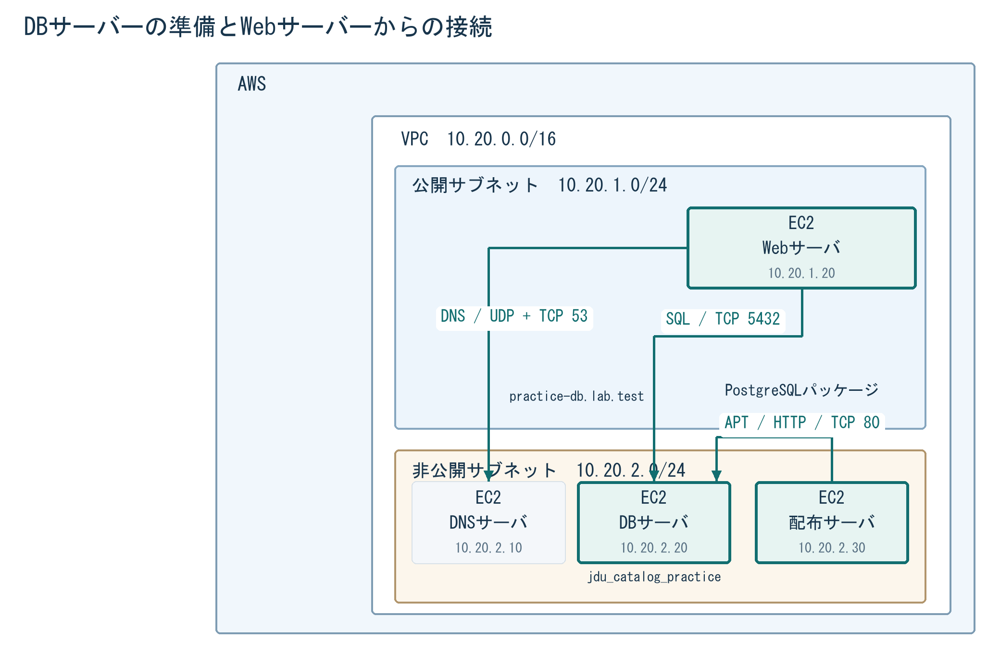

# P3 PostgreSQLへの認証接続

[練習 P0〜P5](practice.md) · [課題 M0〜M5](missions.md)

[日本語](../ja/p3.md) · [Русский](../ru/p3.md) · [O‘zbekcha](../uz/p3.md)

対応する自力課題は[M3](m3.md)。


**このPractice3で作業すること**

DBサーバーにPostgreSQLを設定し、Webサーバーから練習用DBへパスワードで接続する。

## 今回の見取り図



## 解答例（操作手順）

### P3.1 配布サーバーからPostgreSQLをインストールする

**実行環境:**

DBサーバーのSSM端末：ssm-user

DBサーバーにPostgreSQL 16をインストールする。続けて後の手順で使うSQLファイルを展開する。

入力するコマンド（番号はこの手順内の順番）

```bash
# 1. 配布サーバーのパッケージ一覧を更新する。
sudo apt-get update
# 2. 配布サーバーから postgresql-16 postgresql-client-16 と、動作に必要なパッケージをインストールする。
sudo apt-get install --no-install-recommends postgresql-16 postgresql-client-16
# 3. 固定hashを照合して教員提供アプリ・SQL資源を展開する。
sudo python3 -B /var/lib/jdu-web/lesson-resources-r1/offline_assets.py
# 4. PostgreSQLのversion・cluster・port・起動状態を読む。
pg_lsclusters
# 5. postgresとしてDB設定を読む：SHOW data_directory;
sudo -u postgres psql -X -d postgres -c "SHOW data_directory;"
```

**期待する結果と読み方:**

`pg_lsclusters` にバージョン `16` とクラスタ名 `main` が表示される。データの保存先は `/var/lib/postgresql/16/main`。

### P3.2 PostgreSQLの待受アドレス・ポートを設定する

**実行環境:**

DBサーバーのSSM端末：ssm-user

`postgresql.conf` で、DBサーバーの内部IP `10.20.2.20` の5432番ポートで受け付けるようにする。パスワード認証にはSCRAM-SHA-256を使う。

該当する設定項目を探し、下の値に変更する。行頭に `#` があれば外して保存する。

```bash
sudo cp -an /etc/postgresql/16/main/postgresql.conf /etc/postgresql/16/main/postgresql.conf.before-p4
sudo nano /etc/postgresql/16/main/postgresql.conf
```

**nanoに入力する内容**

```text
listen_addresses = '10.20.2.20'
port = 5432
password_encryption = 'scram-sha-256'
```

**期待する結果と読み方:**

下の3項目を同じ設定ファイルに保存する。再起動は接続許可を設定した後のP3.4で行う。

### P3.3 WebサーバーからのDB接続を許可する

**実行環境:**

DBサーバーのSSM端末：ssm-user

`pg_hba.conf` では、どのサーバーから、どのDBに、どのロールで接続できるかを指定する。Webサーバーの内部IP `10.20.1.20` を送信元にし、練習用と課題用のDB・ロールの組み合わせを許可する。

接続ルールを下の内容に置き換えて保存する。

```bash
sudo cp -an /etc/postgresql/16/main/pg_hba.conf /etc/postgresql/16/main/pg_hba.conf.before-p4
sudo nano /etc/postgresql/16/main/pg_hba.conf
```

**nanoに入力する内容**

```text
local all postgres peer
local all all reject
host jdu_catalog_practice catalog_practice_setup 10.20.1.20/32 scram-sha-256
host jdu_catalog_practice catalog_practice_app 10.20.1.20/32 scram-sha-256
host jdu_catalog catalog_setup 10.20.1.20/32 scram-sha-256
host jdu_catalog catalog_app 10.20.1.20/32 scram-sha-256
host all all 0.0.0.0/0 reject
host all all ::/0 reject
```

**期待する結果と読み方:**

PostgreSQLは上から読んで最初に一致した行を使う。許可する行を先に置き、その他の接続は末尾の `reject` で拒否する。

### P3.4 PostgreSQLを再起動して設定を確認する

**実行環境:**

DBサーバーのSSM端末：ssm-user

再起動して、保存した待受設定と接続許可を反映する。

入力するコマンド（番号はこの手順内の順番）

```bash
# 1. postgresql@16-main を再起動して設定を読み直す。
sudo systemctl restart postgresql@16-main
# 2. postgresql@16-main の現在の起動状態を読む。
systemctl is-active postgresql@16-main
# 3. PostgreSQL が 10.20.2.20:5432 で待ち受けていることを確認する。
sudo ss -lntp
# 4. postgresとしてDB設定を読む：SHOW password_encryption;
sudo -u postgres psql -X -d postgres -c "SHOW password_encryption;"
# 5. HBAの読込エラー行を調べる。正常なら0行。
sudo -u postgres psql -X -d postgres -c \
  "SELECT line_number,error FROM pg_hba_file_rules WHERE error IS NOT NULL;"
```

**期待する結果と読み方:**

サービスは `active`。待受は `10.20.2.20:5432`、パスワードの保存方式は `scram-sha-256`、接続許可ファイルのエラーは `(0 rows)`。

### P3.5 練習用のDBと2つのロールを作る

**実行環境:**

DBサーバーのSSM端末：ssm-user

付属のSQLで、練習用DB `jdu_catalog_practice` を作る。テーブルを準備するロールは `catalog_practice_setup`、通常のアプリ接続に使うロールは `catalog_practice_app`。最初にSQLの内容を表示し、その後 `psql` に渡して実行する。

入力するコマンド（番号はこの手順内の順番）

```bash
# 1. 作業場所を /var/lib/jdu-web/lesson-resources-r1/app へ移す。
cd /var/lib/jdu-web/lesson-resources-r1/app
# 2. 練習用DB roleを作るSQLを表示する。まだ適用しない。
python3 -B profile_sql.py --profile practice 01_create_roles.sql
# 3. 練習用DB roleを作るSQLを生成し、postgres経由で指定DBへ適用する。
python3 -B profile_sql.py --profile practice 01_create_roles.sql | sudo -u postgres \
  psql -X -v ON_ERROR_STOP=1 -d postgres
# 4. 練習用DBとschemaを作るSQLを生成し、postgres経由で指定DBへ適用する。
python3 -B profile_sql.py --profile practice 02_prepare_schema.sql | sudo -u postgres \
  psql -X -v ON_ERROR_STOP=1 -d jdu_catalog_practice
```

**期待する結果と読み方:**

`CREATE ROLE` が2回、`CREATE DATABASE` が1回表示される。

**うまくいかないとき:**

already existsなら成功済みの可能性。DROPで消さず\duと\lで対応を確認する。パイプ右側psqlにSQL errorがないことを確認する。

### P3.6 それぞれのDBロールにパスワードを設定する

**実行環境:**

DBサーバーのSSM端末：ssm-user

DBサーバーの端末で `psql` を開く。`\password` を1行ずつ実行し、ロールごとに決めたパスワードを確認のため2回入力する。入力した文字は画面に表示されない。2つのパスワードはP4でも使う。 それぞれ16文字以上で異なるものを設定する。

入力するコマンド（番号はこの手順内の順番）

```bash
# 1. DBのOS端末からpostgresとしてpsqlを開く。以降はpsql内で操作する。
sudo -u postgres psql -X -d postgres
```

ここからはpsql内で入力する

```sql
-- 2. psql内で catalog_practice_setup のパスワードを非表示入力する。
\password catalog_practice_setup
-- 3. psql内で catalog_practice_app のパスワードを非表示入力する。
\password catalog_practice_app
-- 4. psql内で練習用DB roleの属性と権限を確認する。
\du catalog_practice_*
-- 5. psqlを終了し、同じDBサーバーのOS端末へ戻る。
\q
```

**期待する結果と読み方:**

`\du` に `catalog_practice_setup` と `catalog_practice_app` が表示される。

### P3.7 Webサーバーから練習用DBに接続する

**実行環境:**

WebサーバーのSSM端末：ssm-user

P0と同じ方法でWebサーバーのSession Managerを開く。`psql` で最初はDBサーバーの内部IP、次はP2で登録した `practice-db.lab.test` を指定する。パスワードを聞かれたら、P3.6で `catalog_practice_app` に設定したものを入力する。

入力するコマンド（番号はこの手順内の順番）

```bash
# 1. 配布サーバーから postgresql-client-16 と、動作に必要なパッケージをインストールする。
sudo apt-get install --no-install-recommends postgresql-client-16
# 2. Webから指定DBへ既存パスワードで接続し、SELECT結果を読む。
psql -X -h 10.20.2.20 -U catalog_practice_app -d jdu_catalog_practice -W -c \
  'SELECT current_database(),current_user,1 AS value;'
# 3. 通常のresolverで practice-db.lab.test のIPv4を調べる。
getent ahostsv4 practice-db.lab.test
# 4. Webから指定DBへ既存パスワードで接続し、SELECT結果を読む。
psql -X -h practice-db.lab.test -U catalog_practice_app -d jdu_catalog_practice -W -c \
  'SELECT current_database(),current_user,1 AS value;'
```

**期待する結果と読み方:**

どちらの接続でもDBは `jdu_catalog_practice`、ロールは `catalog_practice_app`、SQLの結果は `1` と表示される。

**うまくいかないとき:**

内部IPで成功し、名前で失敗する場合は、P2で設定した通常の名前解決と練習用のDB名を確認する。認証が拒否される場合は接続元・DB・ロール・パスワードを確認する。DBをInternetへ公開して試さない。

### P3.8 採点に使うDBパスワードをWebサーバーに保存する

**実行環境:**

WebサーバーのSSM端末：ssm-user

コマンドを実行し、`catalog_practice_app` に設定したパスワードを2回入力する。入力は画面に表示されず、採点で接続を確認できるようWebサーバーの保護されたファイルに保存される。自分のPCの採点ページでP3を確認する。

入力するコマンド（番号はこの手順内の順番）

```bash
# 1. 既存の練習用DBパスワードを非表示入力し、Web内だけに保存する。
sudo python3 -B /var/lib/jdu-web/lesson-resources-r1/database_secret.py --profile \
  practice
```

**期待する結果と読み方:**

端末に `D11_EXISTING_DB_PASSWORD_STORED_LOCALLY` が表示され、採点ページでP3の9項目を確認できる。

**うまくいかないとき:**

既存fileありなら再生成しない。P4では同じDB passwordをapp設定にも入力する。M3はmission用の別DB/roleで構築する。

## 出力の読み取り例（入力しない）

```text
current_database    | current_user         | value
jdu_catalog_practice | catalog_practice_app | 1
```

SELECT結果の読み方の例。列の幅や罫線は実際と異なってよい。DB名・role名・value=1を確認する。table編集の許可を証明する結果ではない。

---

[前の課題: M2](m2.md) · [次の課題: M3](m3.md)
