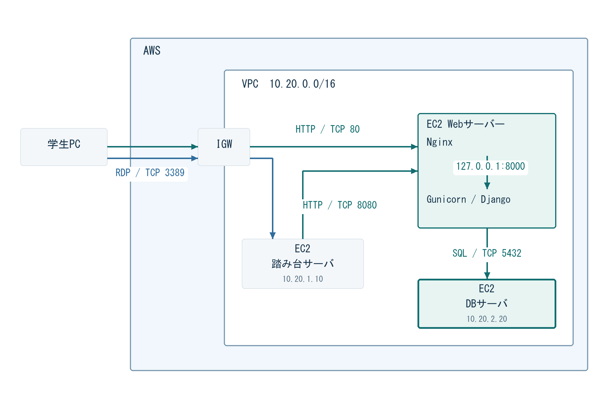

# P5 教員アプリをWeb・DBへ接続する

[練習 P0〜P6](practice.md) · [課題 M0〜M6](missions.md)

[日本語](../ja/p5.md) · [Русский](../ru/p5.md) · [O‘zbekcha](../uz/p5.md)

2026-11-13 · D12 P/M r1.5

配布版の有効期限：2027年1月31日末（UZT）。

対応する自力課題は[M5](m5.md)。


## 学ぶこと

コードを書かず、オフライン依存・専用user・DB初期化・Nginx/systemd・実HTTPをつなぐ。

## 課題

practice profileで備品カタログを構築する。M2の正式DNSとP4が現在も使えることが前提。PのDB/管理者とMのDB/管理者を分け、同じWebのapp/portは共有する。

## 今回の見取り図



図の太枠が今回の主な対象です。設定操作は各手順の実行場所で行い、図の矢印は接続・確認の向きを表します。 SGの通信許可は初期配備済みで、今回の課題はサーバー内の設定です。 8000番はWeb内部だけ、8080番は踏み台からの管理用です。 左はインターネット側、右の枠はAWSのVPCです。IGWはVPCの境界に置き、踏み台を含む全EC2はAWS側にあります。

- Profile: practice
- Database: jdu_catalog_practice
- Setup role: catalog_practice_setup
- Runtime role: catalog_practice_app
- Application administrator: practice_admin

| code | name | quantity | location | is_public |
| --- | --- | --- | --- | --- |
| P5-PUBLIC-001 | Practice keyboard | 4 | Training shelf A | true |
| P5-PRIVATE-001 | Practice mouse | 2 | Training shelf B | false |

## 仕組みを理解する

**始める前の状態:**

M2のDNSとP4の練習DBが現在動作する。

**このPで変えること:**

提供アプリをWeb内で動かし、公開一覧と踏み台限定の管理画面をDBへ接続する。

NginxがHTTPの入口、GunicornがPythonアプリを実行するプロセス、PostgreSQLがデータの保存先となる。静的ファイルのP1と異なり、一覧の内容はDBから取得する。venvはアプリ用Python環境、systemd unitは起動方法の定義である。ここでは提供コードを読みながら配置し、プログラムを書き直す必要はない。

## 操作例：一つずつ実行する

### P5.1 必要なDNSと公開資源を確認する

**実行場所:**

WebサーバーのSSM端末：ssm-user

**目的と操作:**

Webで通常resolverのdb.lab.testが10.20.2.20、admin.lab.testが10.20.1.20になることを確認。offline_assetsは元署名にある7 wheelとlockを内部repoから取得しhashを検査する。pipの外部取得やDB/appの設定は行わない。

入力するコマンド（番号はこの手順内の順番）

```bash
# 1. 通常のresolverで db.lab.test のIPv4を調べる。
getent ahostsv4 db.lab.test
# 2. 通常のresolverで admin.lab.test のIPv4を調べる。
getent ahostsv4 admin.lab.test
# 3. 内部repoから python3-venv python3-pip を推奨追加なしで導入する。
sudo apt-get install --no-install-recommends python3-venv python3-pip
# 4. 署名・hashを確認してアプリと固定wheelを教材領域へ展開する。
sudo python3 -B /var/lib/jdu-web/lesson-resources-r1/offline_assets.py --wheels
# 5. /var/lib/jdu-web/lesson-resources-r1/app に配置された公開教材ファイルを一覧する。
ls /var/lib/jdu-web/lesson-resources-r1/app
# 6. /var/lib/jdu-web/lesson-resources-r1/wheels に配置された公開教材ファイルを一覧する。
ls /var/lib/jdu-web/lesson-resources-r1/wheels
```

**コマンド・設定値の意味:**

P5ではDB名をIPへ手で置き換えず、M2で設定した通常DNSを使う。--wheelsは固定版のPython package資源を用意する指定で、アプリの起動ではない。公開資源と、次に自分が作る秘密設定を分けて扱う。

**期待する結果と読み方:**

PUBLIC_APP_RESOURCES_VERIFIEDとSIGNED_OFFLINE_WHEELS_READY=7。app資源はroot管理の公開fileだけ。

**うまくいかないとき:**

practice-dbでなくdb.lab.testも必要。P5はM2へ依存する。Mの備品課題を終えていなくてもM2のDNSは使う。

### P5.2 コードを配置し専用venvを作る

**実行場所:**

WebサーバーのSSM端末：ssm-user

**目的と操作:**

appとvenvはrootが管理し、実行user catalogには書換えさせない。/opt/jdu-catalog/appまたはvenvが既にある場合は新規配置を中止し、現在の版を確認する。cpは検査済み公開資源だけを配置する。venvはシステムPythonと依存を分離する。

入力するコマンド（番号はこの手順内の順番）

```bash
# 1. 指定した所有者・グループ・権限でディレクトリを作る。
sudo install -d -o root -g root -m 0755 /opt/jdu-catalog/app
# 2. 教員提供アプリを/optの運用先へ属性を保ってコピーする。
sudo cp -a /var/lib/jdu-web/lesson-resources-r1/app/. /opt/jdu-catalog/app/
# 3. アプリ専用のPython仮想環境を作る。
sudo python3 -m venv /opt/jdu-catalog/venv
# 4. 固定lock/hashと内部wheelだけでPython依存を導入する。
sudo /opt/jdu-catalog/venv/bin/python -m pip --isolated --no-cache-dir install \
  --no-index --find-links=/var/lib/jdu-web/lesson-resources-r1/wheels \
  --only-binary=:all: --require-hashes -r \
  /var/lib/jdu-web/lesson-resources-r1/requirements.lock
# 5. 導入済みPython依存パッケージの整合を検査する。
sudo /opt/jdu-catalog/venv/bin/python -m pip check
```

**コマンド・設定値の意味:**

コードは/opt/jdu-catalog/app、Python環境は隣のvenvへ置く。--no-indexは外部package一覧を使わず、--find-linksはローカルwheelの場所、--require-hashesは期待hashとの一致を必須にする。最後のpip checkは導入後の依存関係を調べる。

**期待する結果と読み方:**

--no-indexは外部indexを使わない、--require-hashesはlockのhashを要求する。pip checkは依存矛盾なし。

**うまくいかないとき:**

依存不足は教員の収録資源へ戻す。pip installで最新版へ更新しない。appコードは変更しない。

### P5.3 service userとstatic保存先を作る

**実行場所:**

WebサーバーのSSM端末：ssm-user

**目的と操作:**

catalogは人のlogin用ではなくGunicornの専用user。nologin、sudoなしで作る。staticの配置先だけはcollectstaticが書けるようcatalog所有にする。root管理のコード/venvとは役割が違う。既にcatalogがある場合はidとshellを確認し、useraddを繰り返さない。

入力するコマンド（番号はこの手順内の順番）

```bash
# 1. ログイン用homeやshellを持たないアプリ専用catalogユーザーを作る。
sudo useradd --system --user-group --home-dir /nonexistent --no-create-home --shell \
  /usr/sbin/nologin catalog
# 2. 指定した所有者・グループ・権限でディレクトリを作る。
sudo install -d -o root -g root -m 0755 /var/lib/jdu-catalog
# 3. 指定した所有者・グループ・権限でディレクトリを作る。
sudo install -d -o catalog -g catalog -m 0755 /var/lib/jdu-catalog/static
# 4. catalogユーザーのUID・GID・所属グループを確認する。
id catalog
# 5. catalogのホームとログインシェルを確認する。
getent passwd catalog
```

**コマンド・設定値の意味:**

catalogはアプリを動かすOS service userで、DB roleのcatalog_practice_appとは別物。nologinは対話shellへ入らない指定で、serviceとして実行できない意味ではない。id catalogがすでに存在するなら、作成済みかを確認してから続ける。

**期待する結果と読み方:**

catalogはsudo groupになくshellは/usr/sbin/nologin。labuserやssm-userとは別user。

**うまくいかないとき:**

権限errorをchmod -R 777やcatalogのsudo追加で解決しない。対象directoryとownerを照合する。

### P5.4 通常接続の設定を非表示入力で作る

**実行場所:**

WebサーバーのSSM端末：ssm-user

**目的と操作:**

PUBLIC_WEB_IPV4はEC2に表示された現在のWeb公開IPv4へ置き換える。runtime helperへP4で設定したcatalog_practice_appの既存passwordを2回入力する。Django secretは本人Labで生成される。root専用app.envとpractice profileが作られ、内容は表示しない。

入力するコマンド（番号はこの手順内の順番）

```bash
# 1. AWS画面で確認した現在のWeb公開IPv4を変数へ入れる。
PUBLIC_WEB_IPV4='YOUR-CURRENT-WEB-PUBLIC-IP'
# 2. 既存DBパスワードを非表示入力し、練習用runtime設定を作る。
sudo python3 -B /opt/jdu-catalog/app/configuration.py create-runtime --profile \
  practice --public-web-ipv4 "$PUBLIC_WEB_IPV4"
# 3. 秘密の値を表示せずruntime設定の妥当性を検査する。
sudo python3 -B /opt/jdu-catalog/app/configuration.py check --phase runtime
# 4. 指定ファイルの所有者・グループ・権限・名前を読む。
sudo stat -c '%U:%G %a %n' /etc/jdu-catalog/app.env
```

**コマンド・設定値の意味:**

runtime設定はアプリが通常使うDB接続と公開host名を持つ。PUBLIC_WEB_IPV4はStop/Start後の現在値にする。checkは値の妥当性、statは所有者・権限を読む。秘密を確認するためにapp.env全体をcatしない。

**期待する結果と読み方:**

CATALOG_ENV_CREATED=practice、VALID、root:root 600。DB_NAMEは練習DB、DB_USERは練習app roleとして生成される。

**うまくいかないとき:**

RDPや管理者用passwordを入力しない。既存fileを削除してやり直さず、作成済みならcheckへ進む。

### P5.5 一時setup接続でtableと管理者を作る

**実行場所:**

WebサーバーのSSM端末：ssm-user

**目的と操作:**

create-setupにはP4のcatalog_practice_setup passwordを入力する。migrateは配布済みDB構造を作り、seedは空DBへ架空サンプル3件を一度だけ入れる。create_lab_adminはpractice_adminを非表示password入力で作る。通常アプリはこのsetup roleでは動かさない。

入力するコマンド（番号はこの手順内の順番）

```bash
# 1. 既存構築用パスワードを非表示入力し、一時setup設定を作る。
sudo python3 -B /opt/jdu-catalog/app/configuration.py create-setup --profile practice
# 2. 構築用設定でアプリの設定エラーを検査する。
sudo /opt/jdu-catalog/venv/bin/python -B /opt/jdu-catalog/app/manage_secure.py \
  --phase setup check
# 3. 教員提供migrationを実行し、対象DBへ必要な表を作る。
sudo /opt/jdu-catalog/venv/bin/python -B /opt/jdu-catalog/app/manage_secure.py \
  --phase setup migrate
# 4. 提供済みの固定初期データを練習用DBへ登録する。
sudo /opt/jdu-catalog/venv/bin/python -B /opt/jdu-catalog/app/manage_secure.py \
  --phase setup seed_catalog
# 5. アプリ管理者を作り、そのパスワードを非表示入力する。
sudo /opt/jdu-catalog/venv/bin/python -B /opt/jdu-catalog/app/manage_secure.py \
  --phase setup create_lab_admin
```

**コマンド・設定値の意味:**

migrateはアプリ用tableの構造を作り、seed_catalogは初期データ、create_lab_adminはアプリ管理者を作る。管理者のpasswordはDBやRDPのpasswordとは別。ここだけsetup接続を使い、通常起動へその権限を引き継がない。

**期待する結果と読み方:**

固定11table、サンプル3件、staff管理者（superuserではない）。操作はcatalog OS userへ権限を落として実行される。

**うまくいかないとき:**

seedや管理者のalready existsは既存データ保護。初期化/resetせず次の状態確認へ進む。

### P5.6 通常roleへ必要なSQL権限を付ける

**実行場所:**

DBサーバーのSSM端末：ssm-user

**目的と操作:**

WebをexitしてCloudShellへ戻りDBへSSM接続する。SQL03を先に読み、11table/所有者を検査してからtable・列・sequence単位に必要権限を付ける。appに所有権やALL PRIVILEGESを与える方法ではない。

入力するコマンド（番号はこの手順内の順番）

```bash
# 1. 作業場所を /var/lib/jdu-web/lesson-resources-r1/app へ移す。
cd /var/lib/jdu-web/lesson-resources-r1/app
# 2. runtimeへ必要なSQL権限を与えるSQLを表示する。まだ適用しない。
python3 -B profile_sql.py --profile practice 03_runtime_grants.sql
# 3. runtimeへ必要なSQL権限を与えるSQLを生成し、postgres経由で指定DBへ適用する。
python3 -B profile_sql.py --profile practice 03_runtime_grants.sql | sudo -u postgres \
  psql -X -v ON_ERROR_STOP=1 -d jdu_catalog_practice
```

**コマンド・設定値の意味:**

DB側へ戻り、作成済みtableに通常roleの権限を付ける。DBへ接続する権限と、table/sequenceを使う権限は別。練習profileのSQLを読んでから渡し、runtimeをsuperuserへ変更して解決しない。

**期待する結果と読み方:**

COMMITまで成功。catalog_itemはSELECT/INSERT/UPDATE、auth_userは参照とlast_login/password列だけの更新、session等は用途別。

**うまくいかないとき:**

guard errorはmigration/ownerを確認する合図。制約を削除して通さない。

### P5.7 staticとsystemd unitを配置する

**実行場所:**

WebサーバーのSSM端末：ssm-user

**目的と操作:**

Webへ戻る。collectstaticは配布CSS等をNginxが読むdirectoryへ集める。unitを/etc/systemd/systemへ置きdaemon-reloadでsystemdに認識させる。unit内容を読み、User=catalog、EnvironmentFile、127.0.0.1:8000を見つける。

入力するコマンド（番号はこの手順内の順番）

```bash
# 1. runtime設定でCSS等の静的ファイルを配信先へ集める。
sudo /opt/jdu-catalog/venv/bin/python -B /opt/jdu-catalog/app/manage_secure.py \
  --phase runtime collectstatic
# 2. /opt/jdu-catalog/app/config/jdu-catalog.service の内容を変更せずに読む。
cat /opt/jdu-catalog/app/config/jdu-catalog.service
# 3. 指定ファイルを配置し、所有者・グループ・権限を揃える。
sudo install -o root -g root -m 0644 /opt/jdu-catalog/app/config/jdu-catalog.service \
  /etc/systemd/system/jdu-catalog.service
# 4. 配置したsystemd unitファイルを管理機能へ読み込ませる。
sudo systemctl daemon-reload
# 5. jdu-catalog を今すぐ起動し、次回起動時も自動起動させる。
sudo systemctl enable --now jdu-catalog
# 6. jdu-catalog の現在の起動状態を読む。
systemctl is-active jdu-catalog
# 7. TCP待受のIP・port・対応プロセスを表示する。
sudo ss -lntp
```

**コマンド・設定値の意味:**

collectstaticはアプリのCSS等を配信用の保存先へ集める。unit配置後のdaemon-reloadはsystemdにunit定義を読み直させる操作で、アプリ設定の編集とは異なる。待受8000はWeb内の127.0.0.1だけであることを読む。

**期待する結果と読み方:**

activeで、アプリ8000は127.0.0.1だけ。0.0.0.0:8000へ直接公開しない。

**うまくいかないとき:**

起動errorはjournalctl -u jdu-catalogを見る。秘密設定本文をlogへ貼らず、configuration.py checkで形式を確認する。

### P5.8 Nginxの公開入口と管理入口を分ける

**実行場所:**

WebサーバーのSSM端末：ssm-user

**目的と操作:**

配布confをcatで読み、80→公開一覧、private8080→/admin/だけ、転送先8000を確認。初期default siteのsymlinkは別名で保存して無効化する。既にjdu-catalogが有効なら再移動せず現在設定を確認する。P1/M1の静的URLを保持したconfを使う。

入力するコマンド（番号はこの手順内の順番）

```bash
# 1. /opt/jdu-catalog/app/config/jdu-catalog.nginx.conf の内容を変更せずに読む。
cat /opt/jdu-catalog/app/config/jdu-catalog.nginx.conf
# 2. 指定ファイルを配置し、所有者・グループ・権限を揃える。
sudo install -o root -g root -m 0644 \
  /opt/jdu-catalog/app/config/jdu-catalog.nginx.conf \
  /etc/nginx/sites-available/jdu-catalog
# 3. 既定サイトのリンクを控えへ移す。既存の控えは上書きしない。
sudo mv -n /etc/nginx/sites-enabled/default /etc/nginx/default-site.before-p5
# 4. 配置したアプリ用サイト設定への有効化リンクを作る。
sudo ln -s /etc/nginx/sites-available/jdu-catalog /etc/nginx/sites-enabled/jdu-catalog
# 5. Nginx設定の構文と参照ファイルを検査する。
sudo nginx -t
# 6. nginx を止めずに設定を再読込する。
sudo systemctl reload nginx
# 7. http://127.0.0.1/practice.txt へHTTP要求し、status・header・本文を表示する。
curl --noproxy '*' -i http://127.0.0.1/practice.txt
```

**コマンド・設定値の意味:**

sites-availableは保存した設定、sites-enabledのsymbolic linkは有効にする設定を指す。元defaultは控えへ移す。nginx -tが通ってからreloadし、アプリ追加後もP1の静的ファイルを配信できることを確認する。

**期待する結果と読み方:**

構文成功、practice.txtは引き続き200。公開access logはjdu-catalog-public.access.logへ切り替わる。

**うまくいかないとき:**

duplicate default serverなら旧siteを確認。reload前に-t失敗を直す。管理portをpublic IPでlistenさせない。

### P5.9 管理画面で練習用2件を登録する

**実行場所:**

RDP内のFirefox（踏み台）

**目的と操作:**

踏み台のFirefoxでhttp://admin.lab.test:8080/admin/を開き、practice_adminと自分のアプリ管理者passwordでログイン。備品のAddから下の2行を登録する。code/name/quantity/locationを正確に入力し、公開行だけIs publicを有効にする。保存後にhttp://web.lab.test/で公開行だけ出るか見る。

設定・入力データ（端末で実行するコマンドではない）

```text
P5-PUBLIC-001 | Practice keyboard | 4 | Training shelf A | is_public=true
P5-PRIVATE-001 | Practice mouse | 2 | Training shelf B | is_public=false
```

**コマンド・設定値の意味:**

2件はcode・name・quantity・location・is_publicの組で区別する。is_publicは公開一覧に出すかというアプリ内の値で、SGの公開設定ではない。非公開の1件もDBへ保存し、公開一覧からは見えないことを確かめる。

**期待する結果と読み方:**

demo3件を消す必要はない。指定2件は完成条件の部分集合で、他の正当な公開備品も許される。非公開備品は公開一覧に出ない。

**うまくいかないとき:**

school PCでadmin.lab.testを開かず、RDP内Firefoxを使う。CSRFエラーはhost/port/正しいproxy設定を調べる。

### P5.10 DBの実データを読み、画面と照合する

**実行場所:**

WebサーバーのSSM端末：ssm-user

**目的と操作:**

Webのpsqlで練習app roleを使って読取りSQLを実行する。管理画面の保存が本当にPostgreSQLへ届いたかを確認する。SELECTは読み取りで、UPDATE/DELETEはこの確認では使わない。

入力するコマンド（番号はこの手順内の順番）

```bash
# 1. 指定した2件を読むSQLを変数へ保存する。まだDBへ送らない。
QUERY="SELECT code,name,quantity,location,is_public
FROM catalog_item
WHERE code IN ('P5-PUBLIC-001','P5-PRIVATE-001')
ORDER BY code;"
# 2. Webから指定DBへ既存パスワードで接続し、SELECT結果を読む。
psql -X -h db.lab.test -U catalog_practice_app -d jdu_catalog_practice -W -c "$QUERY"
```

**コマンド・設定値の意味:**

SELECTはDB内の値を読み、WHEREは対象の2件へ絞り、ORDER BYは表示順を揃える。追加の正当なrecordがあっても消さない。browserとSQLで同じ値を見ることで、単なる見た目のページではなくDBの実データを確認する。

**期待する結果と読み方:**

指定した2行が一致する。画面が出てもDB接続失敗を固定HTMLで隠す構成にはしない。

**うまくいかないとき:**

permission deniedならSQL03のprofile/対象DBを確認。superuserで通常接続を代用しない。

### P5.11 自動機能確認を起動して提出する

**実行場所:**

自分のPCのブラウザ：Web Portal

**目的と操作:**

WebをexitしてPCのWeb PortalでP5を選び、「機能・権限を含めて確認する」を選ぶ。既存practice_adminのパスワードを「アプリ管理者の既存パスワード」へ非表示入力し「このパスワードで確認する」を押す。RDP用とは別。自動処理はHTTPでloginし、自分専用CK-P-備品1件の登録・数量編集、DB/公開画面の照合、logoutを行う。指定2件は変えず、確認用1件は残る。本人実演・教師立会いは不要。

**コマンド・設定値の意味:**

機能確認は設定ファイルの存在だけでなく、実際のHTTP操作とDB更新を確かめる。パスワード欄はアプリ管理者の既存値用で、RDPの値ではない。確認結果と保存状態を両方読む。

**期待する結果と読み方:**

練習13項目と保存状態が表示される。設定だけの確認と機能確認を区別する。

**うまくいかないとき:**

誤パスワードなら既存の正しい値でやり直す。結果の更新だけなら「結果を更新する」を使う。新しい機能確認は確認用CKレコードを1件追加する。

## 理解の確認（採点外）

公開一覧に非公開備品も表示された場合、HTTP200だけで正常と言えるか？

**考え方:**

言えない。HTTPの到達、DBの値、is_publicによる表示の分離をそれぞれ確認する。

---

[前の課題: M4](m4.md) · [次の課題: P6](p6.md)
