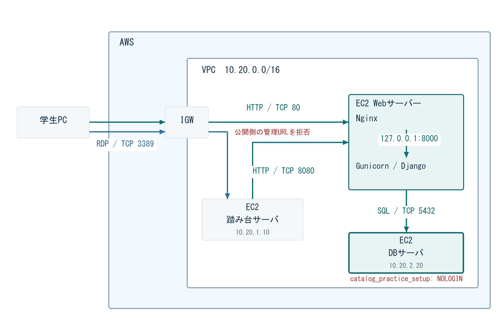

# P6 最小権限と公開範囲

[練習 P0〜P6](practice.md) · [課題 M0〜M5](missions.md)

[日本語](../ja/p6.md) · [Русский](../ru/p6.md) · [O‘zbekcha](../uz/p6.md)

対応する自力課題は[M5](m5.md)。


**このPractice6で作業すること**

DBの初期設定用ロールのログインを止める。アプリが通常の権限で動き、公開側から管理画面や内部設定を開けないことを確かめる。

## 今回の見取り図



## 解答例（操作手順）

### P6.1 アプリがDBでできる操作を調べる

**実行環境:**

DBサーバーのSSM端末：ssm-user

DBサーバーの端末で `psql` を開く。`\du` で練習用ロールの属性、`\dp` でテーブルごとのアクセス権限を確認する。

入力するコマンド（番号はこの手順内の順番）

```bash
# 1. DBのOS端末からpostgresとしてpsqlを開く。以降はpsql内で操作する。
sudo -u postgres psql -X -d jdu_catalog_practice
```

ここからはpsql内で入力する

```sql
-- 2. psql内で練習用DB roleの属性と権限を確認する。
\du catalog_practice_*
-- 3. psql内でpublic schemaのテーブル権限を読む。
\dp public.*
-- 4. psqlを終了し、同じDBサーバーのOS端末へ戻る。
\q
```

**期待する結果と読み方:**

`catalog_practice_app` に備品を読み取る・追加する・変更する権限がある。備品を削除する権限は付いていない。

### P6.2 初期設定用のDBロールでログインできないようにする

**実行環境:**

DBサーバーのSSM端末：ssm-user

テーブル作成に使った `catalog_practice_setup` でログインできる状態を残すと、そのパスワードを知られたときに高い権限を使われるおそれがある。SQLを表示して `NOLOGIN` の指定を確認し、`psql` で適用する。

入力するコマンド（番号はこの手順内の順番）

```bash
# 1. 作業場所を /var/lib/jdu-web/lesson-resources-r1/app へ移す。
cd /var/lib/jdu-web/lesson-resources-r1/app
# 2. 構築用roleのログインを無効にするSQLを表示する。まだ適用しない。
python3 -B profile_sql.py --profile practice 04_disable_setup.sql
# 3. 構築用roleのログインを無効にするSQLを生成し、postgres経由で指定DBへ適用する。
python3 -B profile_sql.py --profile practice 04_disable_setup.sql | sudo -u postgres \
  psql -X -v ON_ERROR_STOP=1 -d jdu_catalog_practice
```

**期待する結果と読み方:**

`ALTER ROLE` が表示される。`catalog_practice_setup` のログインが無効になり、アプリは通常用の `catalog_practice_app` で引き続き接続できる。

### P6.3 Webサーバーの初期設定用ファイルを片付ける

**実行環境:**

WebサーバーのSSM端末：ssm-user

練習用の初期設定ファイル2つを削除する。次にアプリを停止し、P5で作った通常用の設定 `practice` を選んでから起動する。最後に、アプリのOSユーザー `catalog` がコードを書き換えられないことを確かめる。

入力するコマンド（番号はこの手順内の順番）

```bash
# 1. 指定ファイルの所有者・グループ・権限・名前を読む。
sudo stat -c '%U:%G %a %n' /etc/jdu-catalog/setup.env \
  /etc/jdu-catalog/profiles/practice.setup.env
# 2. 表示して確認した2つの一時setup秘密ファイルだけを削除する。
sudo rm -- /etc/jdu-catalog/setup.env /etc/jdu-catalog/profiles/practice.setup.env
# 3. 指定ファイルの所有者・グループ・権限・名前を読む。
sudo stat -c '%U:%G %a %n' /etc/jdu-catalog/app.env \
  /etc/jdu-catalog/profiles/practice.app.env /etc/jdu-web/db-practice.runtime.env
# 4. jdu-catalog を停止してから使用する設定を選ぶ。
sudo systemctl stop jdu-catalog
# 5. 保存済みの練習用設定を、アプリが次に起動するときに使う設定として選ぶ。
sudo python3 -B /opt/jdu-catalog/app/configuration.py activate --profile practice
# 6. 秘密の値を表示せずruntime設定の妥当性を検査する。
sudo python3 -B /opt/jdu-catalog/app/configuration.py check --phase runtime
# 7. 選んだ設定で jdu-catalog を起動する。
sudo systemctl start jdu-catalog
# 8. jdu-catalog の現在の起動状態を読む。
systemctl is-active jdu-catalog
# 9. catalogユーザーが書き込めるアプリのファイルやディレクトリを調べる。
sudo -u catalog find /opt/jdu-catalog/app -writable -print
```

**期待する結果と読み方:**

`CATALOG_PROFILE_ACTIVATED=practice` と `VALID` が表示され、アプリは `active` になる。通常用の設定ファイルは `root:root 600`。最後の `find` では何も表示されない。

**うまくいかないとき:**

練習用以外の設定が有効なら、ここで止める。既に削除済みのファイルは削除し直さない。停止・設定の選択・設定チェックが失敗したら、原因を確認してからアプリを起動する。

### P6.4 公開用の80番ポートから見える範囲を確かめる

**実行環境:**

踏み台のSSM端末：ssm-user

踏み台サーバーの端末からWebサーバーの80番ポートへHTTPリクエストを送る。備品一覧が表示され、管理画面や内部設定ファイルが公開されていないことを確かめる。管理画面は、RDPで開いた踏み台サーバーのFirefoxから `http://admin.lab.test:8080/admin/` で確認する。

入力するコマンド（番号はこの手順内の順番）

```bash
# 1. http://web.lab.test/ へHTTP要求し、status・header・本文を表示する。
curl -i http://web.lab.test/
# 2. http://web.lab.test/admin/ へHTTP要求し、status・header・本文を表示する。
curl -i http://web.lab.test/admin/
# 3. http://web.lab.test/app.env へHTTP要求し、status・header・本文を表示する。
curl -i http://web.lab.test/app.env
# 4. http://web.lab.test/static/app.env へHTTP要求し、status・header・本文を表示する。
curl -i http://web.lab.test/static/app.env
```

**期待する結果と読み方:**

一覧はHTTP `200`。`/admin/` と設定ファイルのURLには `403` や `404` が返る。8080番ポートでは管理画面のログインページが表示される。

**うまくいかないとき:**

もしenv本文が見えたら共有せず、その場で教師へ知らせ公開設定を修正する。

### P6.5 採点ページでアクセス制御を確かめる

**実行環境:**

自分のPCのブラウザ：Web Portal

採点ページでP6を開き、**機能・権限を含めて確認する** を選ぶ。`practice_admin` のパスワードを入力して確認を実行する。採点では、正しいパスワードで管理画面に入れることと、ログインしていない状態では備品を追加・変更できないことを確認する。

**期待する結果と読み方:**

P6の16項目の結果が表示される。

---

[前の課題: P5](p5.md) · [次の課題: M4](m4.md)
