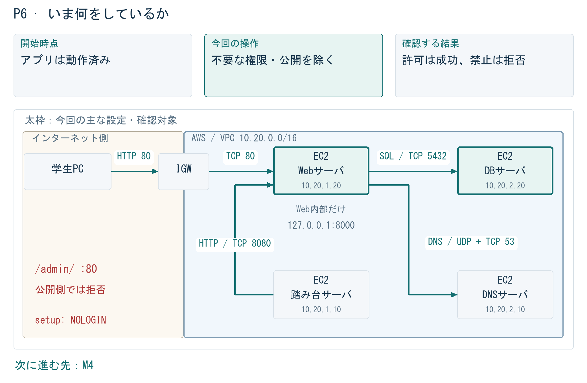

# Web演習：練習P0〜P6と詳しい操作例

2026-11-13 | D12 P/M r1.5 | web-course-class193548-20261103-r3

配布版の有効期限：2027年1月31日末（UZT）。

教材初版・教師確認用。学生の最初からの通し試読は未実施。

ロシア語・ウズベク語は日本語原稿と同じ手順・条件の翻訳初稿。母語話者校閲は未実施。

[日本語](../ja/practice-full.md) · [Русский](../ru/practice-full.md) · [O‘zbekcha](../uz/practice-full.md)

[はじめに：接続・操作の約束](start.md) · [練習 P0〜P6](practice.md) · [課題 M0〜M6](missions.md) · [ブラウザで確認する](portal.md)

## 使い方と共通の約束

まず各Pの課題文を読み、必要なら詳しい操作例を一段ずつ使う。Pは練習で成績に加算しない。Mは別の対象・値で自分で構築する。課題は授業回番号ではなく、自分の進度で進める。Pの完了はMの合格に置き換わらない。

P0 → M0 → P1 → M1 → P2 → M2 → P4 → M4 → P5 → P6 → M5 → M6

P5にもM2のDNSが必要。P4はIP指定だが、アプリはdb.lab.testを使う。練習profileから本課題profileへ切り替える前にP6でsetupを終了する。Pは任意の練習で、採点は各Mの現在の前提を検査する。

M1=8、M2=13、M4=9、M5=13、M6=16、合計59素点。M0は0点。本人実演・backup/restore・追加disk・アプリ開発は課さない。科目25点への換算は教師が別に行う。再提出は教師が案内する締切まで可能。別々の回のPASSを合算したり自動最高点選択はしない。

## 対象・前提・準備

初期配布の署名確認、新規5台または既存環境へのinstall、内部SSHと個別採点登録までを先に完了する。初期配布の手順は教材zipのdistribution/STUDENT.mdを読む。秘密鍵を共有Windowsへ置かず、CloudShellは本人Academy accountの中で使う。教師は本人用の匿名Lab ID・署名fingerprint・有効期限を案内する。

共通IP表。public IPv4は固定しない。AWS regionはus-east-1、Ubuntu24.04/amd64。RDPはlabuser、SSMはssm-user、内部SSHはubuntu。user名とサーバー役割を混同しない。

| Role | Private IPv4 | 用途 |
| --- | --- | --- |
| bastion | 10.20.1.10 | RDP3389 / Firefox / SSH |
| web | 10.20.1.20 | HTTP80 / private8080 / loopback8000 |
| dns | 10.20.2.10 | BIND UDP/TCP53 |
| db | 10.20.2.20 | PostgreSQL5432 |
| repo | 10.20.2.30 | 事前保存した署名資源のHTTP80 |

各Ubuntuへ入る操作：CloudShellで aws ssm start-session --target i-自分の対象ID。接続直後にid -unとbootstrap.jsonのroleを確認する。サーバーを替えるときはexitを1回でCloudShellへ戻り、次のIDでstart-sessionする。CloudShellの変数は接続先へ自動コピーされない。SSMのssm-userはsudo可能。RDPのlabuserはsudo管理者ではない。

nanoの編集：file名を指定して開く→本文を入力→Ctrl+O→Enterで保存→Ctrl+Xで終了。設定fileの枠はshell commandではない。psqlに入るとpromptが変わる。SQL/\passwordはその中へ入力し、\qでUbuntuへ戻る。失敗したcommandの次へ進まず、期待結果を確認する。

番号付きコメントは、その手順内の操作順と目的を示します。# はshell、-- はpsql内のコメントです。コメントは説明なので、書き換える必要はありません。接続・エディタ・パスワード入力の完了を待ち、一つずつ実行します。改行で続くコマンドは一つとして扱います。

## 操作例の読み方

各Pは「課題→仕組み→操作例→理解の確認」の順で使う。操作例は一つのまとまりを貼り付けず、1コマンドずつ実行して表示を読む。末尾のバックスラッシュは次の行へ続く記号なので、その行と次の行を一つのコマンドとして扱う。

bash枠は表示された実行場所の端末へ入力する。text枠は設定ファイルの本文・psql内の入力・出力例などで、直前の説明に従う。行頭が#の説明行はコメント。自分の端末に出る$、#、postgres=#などのpromptをコマンドへ付け足さない。YOUR-から始まる値だけを自分の値へ置き換える。

設定を作るときは「保存したファイル→構文検査→サービスへの反映→実際の通信」の順で確認する。ファイルの内容が正しくても、実行中のサービスが古い設定を使うことがある。画面表示だけでなく、HTTP応答・DNS回答・SQL結果とlogを対応させる。

## 完成像と通信経路

| 送信元 | 宛先 | Protocol / port | 目的 |
| --- | --- | --- | --- |
| Windows PC | Web public IPv4 | TCP/80 | 一般利用。Internet Gatewayを通り、公開一覧と静的ファイルを読む。 |
| Windows PC | bastion public IPv4 | TCP/3389 | 許可CIDRからRDPで入る。踏み台のデスクトップを操作する。 |
| bastion | Web/DNS/DB/repo | TCP/22 | 内部SSHの管理経路。秘密鍵は踏み台内で保持する。 |
| bastion / Web | DNS 10.20.2.10 | UDP+TCP/53 | lab.testの名前を解決する。DNSはWeb本文を返さない。 |
| Web app | DB 10.20.2.20 | TCP/5432 | アプリのDB roleでSQLを実行する。WindowsからDBへ直接接続しない。 |
| bastion | Web 10.20.1.20 | TCP/8080 | admin.lab.testの管理画面。公開80番の入口とは分ける。 |
| Nginx on Web | 127.0.0.1 on Web | TCP/8000 | 同じWeb内のアプリへ渡す。127.0.0.1は実行中のそのホスト自身。 |

初期環境で提供されたSSMは、CloudShellから各EC2へ入る管理経路。上のWeb利用経路とは別に使う。表の内部IP/portはこのLabの仕様で、一般のWebシステム全てに同じ値を要求するものではない。

## P0 自分の環境と実行場所

### 学ぶこと

CloudShell、Windows、5台のUbuntuを区別し、正しいサーバーへSSMで入り、採点を自己確認できる。

### 課題

構築済みの自分の環境で、5台のインスタンスIDと役割を確認し、接続先と操作ユーザーを確かめる。P0は成績に加算しない。

### 今回の見取り図


図の太枠が今回の主な対象です。設定操作は各手順の実行場所で行い、図の矢印は接続・確認の向きを表します。 SGの通信許可は初期配備済みで、今回の課題はサーバー内の設定です。 SSMの矢印はAWSの接続管理を使う経路で、EC2の443番受信を開く指示ではありません。

[図を拡大する](../../assets/ja/p0.png) · [SVG](../../assets/ja/p0.svg)

### 仕組みを理解する

**始める前の状態:**

教師が初期配布と個別登録を終えた、本人の5台を使う。

**このPで変えること:**

対象account・役割・実行場所を見分け、公開教材資源を準備する。

AWSコンソールはAWS資源を管理する画面、CloudShellはAWS CLIを使う自分の端末、SSMは選んだEC2のOS内へ入る接続である。SSMへ入っても5台が一つのOSになるわけではない。Webの/var/wwwとDBの/var/wwwは別の保存先である。サーバーの役割と、そこで操作するOS userを別々に確認する。

### 操作例：一つずつ実行する

#### P0.1 5台のinstance IDを記録する

**実行場所:**

学生本人のAWSコンソール

**目的と操作:**

EC2のInstances一覧で自分のLabIdとDeploymentIdのタグを照合し、bastion/web/dns/db/repoのinstance IDを手元の作業表へ記入する。名前だけで選ばない。公開IPv4はbastionとwebだけにある。SSM接続は公開IPではなくinstance IDを使う。

**コマンド・設定値の意味:**

instance IDはEC2を識別する値、roleは授業内の担当、公開IPは外から接続する宛先である。公開IPが変わっても同じinstance IDなら同じEC2として追跡できる。作業表には5役割とIDの組を記録する。

**期待する結果と読み方:**

5台ともrunning、SSM Online。private IPは本書の共通表と一致する。公開IPv4は停止・起動後に変わることがある。

**うまくいかないとき:**

別Lab・別account・不明な台を操作しない。停止中は教師の起動案内に従う。ResetやTerminateで開始状態を作り直さない。

#### P0.2 SSMで入り、戻る

**実行場所:**

CloudShell（学生本人のAWS）

**目的と操作:**

EC2で確認したWebのIDに置き換えて実行する。接続後はCloudShellではなくUbuntuの端末になる。id -unはSSM管理userを、bootstrap.jsonのroleはサーバー役割を示す。最後のexitを1回実行するとCloudShellへ戻る。

入力するコマンド（番号はこの手順内の順番）

```bash
# 1. CloudShellから指定EC2へSSM接続する。接続完了後に次へ進む。
aws ssm start-session --target i-YOUR-WEB-INSTANCE-ID
# 2. この端末で操作しているOSユーザー名を表示する。
id -un
# 3. 接続中のサーバーのホスト名を表示する。
hostname
# 4. bootstrap情報のroleだけを読み、接続先の役割を確認する。
python3 -c 'import json;print(json.load(open("/etc/jdu-web/bootstrap.json"))["role"])'
# 5. 現在の作業ディレクトリを表示する。
pwd
# 6. 現在のサーバーへの接続を閉じ、CloudShellへ戻る。
exit
```

**コマンド・設定値の意味:**

最初のstart-sessionだけをCloudShellで実行し、接続完了を待ってから残りを1行ずつ入力する。id -unはuser、hostnameはOSのhost名、roleは教材上の役割を読む。exitは現在の接続を1段だけ戻す。

**期待する結果と読み方:**

userはssm-user、roleはweb。以降もサーバーを替えるたびに確認する。SSHで入ったUbuntuのuserはubuntuになる場合がある。

**うまくいかないとき:**

TargetNotConnectedならrunning/SSM Online/region us-east-1を確認する。SGを全面開放したりWindowsへ鍵をダウンロードしない。

#### P0.3 公開教材資源だけを準備する

**実行場所:**

CloudShell（学生本人のAWS）

**目的と操作:**

署名付き配布を使う場合の手順です。共通登録コード方式では構築時に配置済みです。本教材zipをCloudShellのActions→Upload fileでアップロードし、unzip web-lab-pm-r1.zipで展開する。resourcesへ移動し、YOUR-INSTALLATION-DIRECTORYを署名付き配布の導入先に置き換える。導入先は、初回に表示されたactivate.shがあるディレクトリ。補助処理は本人の署名版と元5台を照合し、Web/DBへアプリ資源・SQL・秘密の非表示入力helperを置くだけ。サービスやDBは構築しない。秘密は送らない。

入力するコマンド（番号はこの手順内の順番）

```bash
# 1. 作業場所を $HOME/web-lab-pm-r1/resources へ移す。
cd "$HOME/web-lab-pm-r1/resources"
# 2. 署名版と本人の5台を照合し、公開教材をWeb/DBへ配置する。
python3 -B stage_resources.py --installation 'YOUR-INSTALLATION-DIRECTORY'
```

**コマンド・設定値の意味:**

公開教材資源はアプリやSQLの材料であり、完成済みのサービスではない。stage_resources.pyをCloudShellで実行して初めてWeb/DBへ配置される。Windowsへzipを保存しただけではEC2内のファイルは増えない。

**期待する結果と読み方:**

PUBLIC_LESSON_RESOURCES_READY=web と =db。各台の/var/lib/jdu-web/lesson-resources-r1に公開ファイルがある。既存の異なるファイルは上書きしない。

**うまくいかないとき:**

初期化未完・版違い・期限切れならここで止めて教師へ状況を知らせる。検証用fixtureや完成アプリの自動適用ツールで代用しない。

#### P0.4 ブラウザで準備を確認する

**実行場所:**

自分のPCのブラウザ：Web Portal

**目的と操作:**

[ブラウザ確認手順](portal.md)からWeb Portalを開く。学校Googleでログインし、本人AWSとの連携を済ませ、P0を選んで「この課題を確認する」を押す。結果が処理中なら「結果を更新する」を押す。M0も同じ方法で確認する。P0/M0は準備確認で成績に加算しない。

**コマンド・設定値の意味:**

ブラウザの確認結果は自動保存される。結果のPASS/FAIL/UNKNOWNと、処理・保存の状態を分けて読む。PとM0は保存されても成績に加算しない。

**期待する結果と読み方:**

本人のLab・課題ID・確認時刻が正しい。各checkの結果と保存状態を読む。処理完了と保存を確認する。UNKNOWNは観測できなかった状態で、合格とは別。

**うまくいかないとき:**

失敗行のcheck ID・実行時刻・対象roleだけを相談に使う。token・password・本人用URLを共有しない。

#### P0.5 RDPで踏み台のデスクトップを開く

**実行場所:**

学生のWindows PC（共有アカウント）

**目的と操作:**

EC2で確認した現在の踏み台の公開IPv4を使う。Windowsキー＋Rを押し、mstsc /promptを入力してEnter。ComputerへそのIPを指定し、userはlabuser、passwordは本人が初期配備で設定したRDP用を使う。Windowsアカウントのpasswordではない。「資格情報を記憶する」は選ばない。青いxrdp loginが出たらSession=Xorgを確認し、labuserで入る。

入力するコマンド（番号はこの手順内の順番）

```powershell
# 1. WindowsのRDP接続画面を開き、資格情報の入力を求める。
mstsc /prompt
```

**コマンド・設定値の意味:**

RDPは踏み台の画面と入力を運ぶ。踏み台内Firefoxからの通信の送信元はWindowsではなく踏み台になる。日本語/英語などのキー配列はpasswordの記号入力にも影響するため、表示言語と配列を区別する。

**期待する結果と読み方:**

UbuntuのXfceデスクトップとFirefoxが開く。これは踏み台内のbrowserであり、Windows側のbrowserとは別。RDPのlabuserにはsudo管理権限がないため、構築はCloudShellからSSM/ssm-userで行う。

**うまくいかないとき:**

Login failedならuser名と日本語/英語等のkeyboard配列を確認する。passwordを会話へ送らない。到達しない場合は現在のIPと許可された接続元CIDRを教師と確認し、3389を全公開しない。終了時はRDP内の自分の作業を保存し、接続を閉じる。

### 理解の確認（採点外）

WebへSSM接続したままDBの手順を入力すると、どのサーバーが変わるか？

**考え方:**

現在接続中のWebが変わる。exitでCloudShellへ戻り、DBのinstance IDへ接続し直す。

## P1 HTTPで静的ファイルを返す

### 学ぶこと

Nginx、保存先、待受、HTTP応答、access logを一組で確認する。

### 課題

Webの/var/www/html/practice.txtから指定本文をHTTP200で返す。Web自身・踏み台・外部の三経路で確認する。

### 今回の見取り図


図の太枠が今回の主な対象です。設定操作は各手順の実行場所で行い、図の矢印は接続・確認の向きを表します。 SGの通信許可は初期配備済みで、今回の課題はサーバー内の設定です。 左はインターネット側、右の枠はAWSのVPCです。IGWはVPCの境界に置き、踏み台を含む全EC2はAWS側にあります。

[図を拡大する](../../assets/ja/p1.png) · [SVG](../../assets/ja/p1.svg)

- File: /var/www/html/practice.txt
- URL path: /practice.txt

```text
JDU WEB-02 practice: HTTP response verified.
```

### 仕組みを理解する

**始める前の状態:**

Webは提供済みだが、練習用ファイルはまだ配信していない。

**このPで変えること:**

Nginxが公開80番でpractice.txtを返し、要求をlogへ残す。

この練習では、URLの/practice.txtをWeb内の/var/www/html/practice.txtへ対応させる。最初の127.0.0.1での成功はWeb内部の確認で、踏み台やWindowsから届く証明にはならない。同じ本文を三つの位置から読み、どの経路まで正常かを切り分ける。[Nginxの一次資料](https://nginx.org/en/docs/beginners_guide.html)も参照。

### 操作例：一つずつ実行する

#### P1.1 内部APTからNginxを導入する

**実行場所:**

WebサーバーのSSM端末：ssm-user

**目的と操作:**

P0と同じ方法でWebへSSM接続し、role=webを確認する。APTのsourceを読み、10.20.2.30の署名済みrepoだけを使う。updateは一覧を取得し、installはpackageを導入する。Internet用sourceを追加しない。

入力するコマンド（番号はこの手順内の順番）

```bash
# 1. /etc/apt/sources.list.d/jdu-web.sources の内容を変更せずに読む。
cat /etc/apt/sources.list.d/jdu-web.sources
# 2. 内部repoのパッケージ一覧を更新する。取得エラーは失敗扱いにする。
sudo apt-get update -o APT::Update::Error-Mode=any
# 3. 内部repoから nginx を推奨追加なしで導入する。
sudo apt-get install --no-install-recommends nginx
```

**コマンド・設定値の意味:**

apt-get updateは利用可能なpackage一覧を更新し、installは選んだpackageを導入する。--no-install-recommendsは推奨packageを追加しない指定。Signed-Byは許可した署名鍵の指定であり、repoへ接続できただけでは署名確認の成功にならない。

**期待する結果と読み方:**

sourceに内部IPとSigned-Byがあり、署名エラーなしで終了する。インストール確認にYを入力する。

**うまくいかないとき:**

取得失敗ならrepoのrunning/SSMとIPを確認。--allow-unauthenticatedや外部pipで回避しない。

#### P1.2 正しい本文を作り、所有者と権限を揃える

**実行場所:**

WebサーバーのSSM端末：ssm-user

**目的と操作:**

まずnanoで練習本文を編集する。表示する1行は下の指定どおりで、最後に改行を入れる。Ctrl+O→Enterで保存、Ctrl+Xで終了する。installはファイルを配置し、-o/-gは所有者、-mは権限を指定する。

入力するコマンド（番号はこの手順内の順番）

```bash
# 1. 作業場所を ~ へ移す。
cd ~
# 2. 練習の作業ディレクトリを作る。既存ならそのまま使う。
mkdir -p jdu-web-practice/p1
# 3. 作業場所を jdu-web-practice/p1 へ移す。
cd jdu-web-practice/p1
# 4. 現在の作業ディレクトリを表示する。
pwd
# 5. practice.txtを編集する。本文を入力し、保存して終了する。
nano practice.txt
# File content: JDU WEB-02 practice: HTTP response verified.
# 6. 指定ファイルを配置し、所有者・グループ・権限を揃える。
sudo install -o root -g root -m 0644 practice.txt /var/www/html/practice.txt
# 7. 指定ファイルの所有者・グループ・権限・名前を読む。
stat -c '%U:%G %a %n' /var/www/html/practice.txt
# 8. /var/www/html/practice.txt の内容を変更せずに読む。
cat /var/www/html/practice.txt
```

**コマンド・設定値の意味:**

nanoで編集する自分の作業fileと、Nginxが読む配信用fileを分ける。installはここではpackage導入ではなく、コピー時にroot:rootと0644を指定するコマンド。0644では所有者だけが書け、他のuserは読める。末尾の改行も本文の一部となる。

**期待する結果と読み方:**

root:root 644。本文は JDU WEB-02 practice: HTTP response verified. の1行である。大文字、小文字、空白、句点も判定対象。

**うまくいかないとき:**

空白画面ならまだnano内。保存して終了してから次のcommandを実行する。既存のmission.txtは変更しない。

#### P1.3 Web rootとportを確認して起動する

**実行場所:**

WebサーバーのSSM端末：ssm-user

**目的と操作:**

Ubuntuの初期siteは/var/www/htmlをrootにする。nginx -Tで実効設定を読み、/etc/nginx/sites-enabled/defaultが有効でrootとlisten 80があることを確認する。変更が必要ならsudo nanoで編集し、構文検査に成功してからreloadする。enable --nowは今起動し、次のOS起動時も起動させる。

入力するコマンド（番号はこの手順内の順番）

```bash
# 1. Nginxの設定全体を表示する（秘密の値は共有しない）。
sudo nginx -T
# 2. Nginx設定の構文と参照ファイルを検査する。
sudo nginx -t
# 3. nginx を今すぐ起動し、次回起動時も自動起動させる。
sudo systemctl enable --now nginx
# 4. nginx を止めずに設定を再読込する。
sudo systemctl reload nginx
# 5. nginx の現在の起動状態を読む。
systemctl is-active nginx
# 6. TCP待受のIP・port・対応プロセスを表示する。
sudo ss -lntp
```

**コマンド・設定値の意味:**

nginx -Tは読込対象の設定を表示し、-tは構文を検査する。systemctlのenableは次回起動時、--nowは現在の起動を指定する。設定ファイルの保存だけで終わらず、reload後のserviceと待受portを読む。

**期待する結果と読み方:**

syntax is ok/test is successful、active、0.0.0.0:80等の待受。127.0.0.1:80だけでは他のサーバーから利用できない。

**うまくいかないとき:**

失敗時はnginx -tのfile名・行番号を確認し、そのfileを直す。SGを変更しても構文エラーは直らない。

#### P1.4 Web自身から応答を見る

**実行場所:**

WebサーバーのSSM端末：ssm-user

**目的と操作:**

curlはHTTP client。-iはstatus/headerと本文を表示する。127.0.0.1は今のWeb自身で、public IPではない。表示を読み、端末のcommandが成功しただけで合格としない。

入力するコマンド（番号はこの手順内の順番）

```bash
# 1. http://127.0.0.1/practice.txt へHTTP要求し、status・header・本文を表示する。
curl --noproxy '*' -i http://127.0.0.1/practice.txt
```

**コマンド・設定値の意味:**

curl -iは本文に加えてHTTP headerを表示する。127.0.0.1はこのWeb自身なので、この要求はInternetを通らない。HTTP200と指定本文の両方を読み、別ページの200を成功と取り違えない。

**期待する結果と読み方:**

HTTP200と指定本文。404はfile/root/URLの関係、connection refusedはservice/listenを調べる。

**うまくいかないとき:**

Welcome to nginxが出るなら/ではなく/practice.txtを要求したか確認する。

#### P1.5 踏み台と外部から同じファイルを見る

**実行場所:**

踏み台のSSM端末：ssm-user

**目的と操作:**

Web端末をexitで閉じ、CloudShellから踏み台へSSM接続して下のURLを要求する。その後exitでCloudShellへ戻り、EC2に表示された現在のWeb公開IPv4を使って同じpathをcurl -iで要求する。内部の10.20.1.20と公開IPv4を混同しない。

入力するコマンド（番号はこの手順内の順番）

```bash
# 1. http://10.20.1.20/practice.txt へHTTP要求し、status・header・本文を表示する。
curl --noproxy '*' -i http://10.20.1.20/practice.txt
```

**コマンド・設定値の意味:**

同じcurlでも踏み台から実行すれば内部通信の検査になる。WindowsのbrowserからはWebの現在の公開IPを使う。10.20.1.20をWindows側へ入力して到達できないことと、Webの停止を同一視しない。

**期待する結果と読み方:**

両経路とも200/同じ本文。InternetからのHTTP80は公開、管理8080とDB5432は公開しない。

**うまくいかないとき:**

内部成功/外部失敗なら現在のpublic IPとLab稼働を確認する。教師の基盤SGを無断で緩めない。

#### P1.6 要求とlogを結び付けて提出する

**実行場所:**

WebサーバーのSSM端末：ssm-user

**目的と操作:**

Webへ戻り、access logの時刻・client IP・path・statusを見る。logは実際に要求を処理した証拠で、fileがある証拠とは別。exitでCloudShellへ戻ったら、PCのWeb PortalでP1を選び「この課題を確認する」を押す。

入力するコマンド（番号はこの手順内の順番）

```bash
# 1. access log末尾20行を読み、直前のHTTP要求を探す。
sudo tail -n 20 /var/log/nginx/access.log
# 2. 現在のサーバーへの接続を閉じ、CloudShellへ戻る。
exit
```

**コマンド・設定値の意味:**

access logでは時刻・要求path・statusを直前のcurlと対応させる。tailは末尾を読む操作で、logを書き換えない。exitで接続を終えたら、PCのブラウザでP1を確認する。

**期待する結果と読み方:**

練習8項目と準備確認の結果が表示・保存される。P1は成績0点。M1は別file/本文で自分で構成する。

**うまくいかないとき:**

処理中なら結果を更新する。保存に失敗していれば表示された理由を確認する。checkerの期待本文を書き換えない。

### 出力の読み取り例（入力しない）

```text
HTTP/1.1 200 OK

JDU WEB-02 practice: HTTP response verified.
```

上は説明用に必要な行だけを抜き出した例。実際には日時などのheaderが加わる。200と本文を読み、access logのpath/statusとも照合する。

### 理解の確認（採点外）

Web自身では200、踏み台からは接続失敗。本文を作り直す前に何を確認するか？

**考え方:**

要求先IP・待受アドレスとport・踏み台からWebへの通信許可を調べる。本文の正否と到達性を分ける。

## P2 内部DNSと通常の名前解決

### 学ぶこと

BINDのzone・A record・問い合わせ制限と、client側resolverを順に構築する。

### 課題

guide.lab.test→10.20.1.20、practice-db.lab.test→10.20.2.20を設定する。P1のHTTPを名前で利用する。基盤の固定IPは変えない。

### 今回の見取り図


図の太枠が今回の主な対象です。設定操作は各手順の実行場所で行い、図の矢印は接続・確認の向きを表します。 SGの通信許可は初期配備済みで、今回の課題はサーバー内の設定です。

[図を拡大する](../../assets/ja/p2.png) · [SVG](../../assets/ja/p2.svg)

| DNS name | A / IPv4 |
| --- | --- |
| guide.lab.test | 10.20.1.20 |
| practice-db.lab.test | 10.20.2.20 |

### 仕組みを理解する

**始める前の状態:**

P1のHTTPがIP指定で使える。DNSはこれから設定する。

**このPで変えること:**

BINDの練習名を、踏み台とWebの通常resolverから使える。

DNSの仕事は名前への回答で、HTTP本文の配信ではない。lab.testのzoneはBINDが管理し、A recordはIPv4を返す。digで問い合わせ先を明示した確認と、getentやbrowserがOSの設定を使う確認を分ける。名前解決後のHTTP接続は別の通信である。[BINDの一次資料](https://bind9.readthedocs.io/en/v9.18.39/chapter3.html)。

### 操作例：一つずつ実行する

#### P2.1 BINDを導入し元設定を残す

**実行場所:**

DNSサーバーのSSM端末：ssm-user

**目的と操作:**

DNSへSSMで入りrole=dnsを確認。cp -aは元fileの属性を保って控えを作る。-nは既存の控えを上書きしない。これは編集失敗への控えであり、DB backup/restore課題ではない。

入力するコマンド（番号はこの手順内の順番）

```bash
# 1. 内部repoのパッケージ一覧を更新する。取得エラーは失敗扱いにする。
sudo apt-get update -o APT::Update::Error-Mode=any
# 2. 内部repoから bind9 bind9-utils を推奨追加なしで導入する。
sudo apt-get install --no-install-recommends bind9 bind9-utils
# 3. 元ファイルを控えへコピーする。既存の控えは上書きしない。
sudo cp -an /etc/bind/named.conf.options /etc/bind/named.conf.options.before-p2
# 4. 元ファイルを控えへコピーする。既存の控えは上書きしない。
sudo cp -an /etc/bind/named.conf.local /etc/bind/named.conf.local.before-p2
```

**コマンド・設定値の意味:**

namedはBINDのservice名、named-checkconf等は設定を検査する道具である。cp -anの-nは同名の控えを上書きしない指定なので、再実行して最初の控えを失うことを防ぐ。

**期待する結果と読み方:**

内部repoから導入される。後のM2では同じDNSにrecordを追加し、P2のrecordを消さない。

**うまくいかないとき:**

別Labのnamed.conf全体を流用しない。既に自分のzoneがある場合は内容を読んでから編集する。

#### P2.2 問い合わせ元とforwarderを設定する

**実行場所:**

DNSサーバーのSSM端末：ssm-user

**目的と操作:**

sudo nano /etc/bind/named.conf.optionsで次の内容を設定し保存する。aclは許可するclient集合、listen-onはDNS自身の待受、forward onlyは外部名をAWS DNSへ渡す指定。recursionとqueryの両方を同じ3送信元へ限定する。dnssec-validation noは閉じた学習用forward構成に合わせた設定である。

設定・入力データ（端末で実行するコマンドではない）

```text
acl "jdu_clients" { 127.0.0.1; 10.20.1.10; 10.20.1.20; };
options {
    directory "/var/cache/bind";
    listen-on { 127.0.0.1; 10.20.2.10; };
    listen-on-v6 { none; };
    allow-query { jdu_clients; };
    allow-recursion { jdu_clients; };
    allow-query-cache { jdu_clients; };
    recursion yes;
    forward only;
    forwarders { 10.20.0.2; };
    dnssec-validation no;
    allow-transfer { none; };
};
```

**コマンド・設定値の意味:**

allow-queryは問い合わせを受ける相手、allow-recursionは外部名の再帰処理を認める相手を指定する。lab.testの回答は自分のzone、外部名はforwarderへ渡す。ここでは接続元を踏み台・Web・localhostへ限定する。

**期待する結果と読み方:**

これは設定fileの内容で、shellへ直接実行しない。10.20.0.2はAWS resolver、10.20.2.10は自分のBIND。

**うまくいかないとき:**

セミコロン・波括弧も構文。0.0.0.0/0やanyで許可を広げない。

#### P2.3 zoneを登録しA recordを書く

**実行場所:**

DNSサーバーのSSM端末：ssm-user

**目的と操作:**

sudo nano /etc/bind/named.conf.localで先頭のzoneブロックを記入。sudo install -d -m 0755 /etc/bind/zonesの後、sudo nano /etc/bind/zones/db.lab.testで残りを記入する。SOAは管理情報、NSは権威DNS、Aは名前とIPv4。末尾のドットは絶対名を示す。serialは編集のたびに増やす。

設定・入力データ（端末で実行するコマンドではない）

```text
// /etc/bind/named.conf.local
zone "lab.test" {
    type primary;
    file "/etc/bind/zones/db.lab.test";
    allow-transfer { none; };
    allow-update { none; };
};

; /etc/bind/zones/db.lab.test
$TTL 300
@ IN SOA dns.lab.test. hostmaster.lab.test. (
    2026102301 3600 600 604800 300 )
@ IN NS dns.lab.test.
dns IN A 10.20.2.10
guide IN A 10.20.1.20
practice-db IN A 10.20.2.20
```

**コマンド・設定値の意味:**

zone宣言とzone本文は別ファイルへ保存する。guideはzone名を補ってguide.lab.testとなり、末尾ドット付きのdns.lab.test.は完全な名前。TTLはcache時間、SOAのserialはzone更新を識別する番号で、IPアドレスではない。

**期待する結果と読み方:**

二つの別fileへ分けて保存する。dnsのAはNS名の到達先。まだclientのresolverは変更しない。

**うまくいかないとき:**

既存M2がある場合はzoneを置換せず、この練習2件を追加する。zone定義を二重登録しない。

#### P2.4 構文を検査してDNS自身から確認する

**実行場所:**

DNSサーバーのSSM端末：ssm-user

**目的と操作:**

設定誤りのままclientを切り替えると名前解決が止まる。先にnamed-checkconfとnamed-checkzoneを成功させ、起動後にUDP/TCPの両方で応答を見る。

入力するコマンド（番号はこの手順内の順番）

```bash
# 1. BINDの設定と参照zoneを構文検査する。
sudo named-checkconf -z
# 2. lab.testのzoneファイルを検査する。
sudo named-checkzone lab.test /etc/bind/zones/db.lab.test
# 3. named を今すぐ起動し、次回起動時も自動起動させる。
sudo systemctl enable --now named
# 4. named を再起動して設定を読み直す。
sudo systemctl restart named
# 5. UDP 53で guide.lab.test を問い合わせ、応答を読む。
dig @127.0.0.1 guide.lab.test A
# 6. TCP 53で guide.lab.test を問い合わせ、応答を読む。
dig @127.0.0.1 guide.lab.test A +tcp
```

**コマンド・設定値の意味:**

構文検査が成功してからserviceへ反映する。digの@は問い合わせ先DNSを指定する記号、AはIPv4のrecord種別。+tcpを付けた確認ではTCP53を使い、UDPで成功した場合とは別に読む。

**期待する結果と読み方:**

zone loaded/OK、status NOERROR、flagsにaa、A=10.20.1.20。aaはこのzoneの権威応答。

**うまくいかないとき:**

失敗ならsudo journalctl -u named -n 30 --no-pagerで対象行を調べ、設定を直して再検査する。

#### P2.5 踏み台とWebからDNSを指定して問い合わせる

**実行場所:**

踏み台のSSM端末：ssm-user

**目的と操作:**

踏み台とWebの両方で下を実行する。@10.20.2.10は今回だけ問い合わせ先を指定する。この成功だけでは、普通のbrowserやアプリが同じDNSを使うとは言えない。

入力するコマンド（番号はこの手順内の順番）

```bash
# 1. UDP 53で guide.lab.test を問い合わせ、応答を読む。
dig @10.20.2.10 guide.lab.test A
# 2. TCP 53で practice-db.lab.test を問い合わせ、応答を読む。
dig @10.20.2.10 practice-db.lab.test A +tcp
# 3. UDP 53で absent-p2.lab.test を問い合わせ、応答を読む。
dig @10.20.2.10 absent-p2.lab.test A
# 4. UDP 53で aws.amazon.com を問い合わせ、応答を読む。
dig @10.20.2.10 aws.amazon.com A
# 5. zone全件の転送を要求し、明示的に拒否されるか調べる。
dig @10.20.2.10 lab.test AXFR
```

**コマンド・設定値の意味:**

存在する内部名・存在しない内部名・外部名・zone転送を別々に試す。存在しない名のNXDOMAINは正しい否定回答で、DNSへ届かないtimeoutとは異なる。AXFRはzone一括転送の要求で、このLabでは拒否されることを確かめる。

**期待する結果と読み方:**

必要名は正しいA、absent-p2は権威NXDOMAIN、外部名は回答、AXFRは転送拒否。timeoutは意図した拒否成功としない。

**うまくいかないとき:**

DNSへ届かない場合は送信元とport53のUDP/TCPを区別して調べる。DNS以外のprivate台を問い合わせclientに追加しない。

#### P2.6 通常resolverをBINDだけへ向ける

**実行場所:**

踏み台のSSM端末：ssm-user

**目的と操作:**

踏み台とWebで1台ずつ実施。ip -br linkでens5等の実interface名を調べ、networkctl status その名前でNetwork Fileを読む。対応するnetplan YAMLをls /etc/netplanで探し、sudo cp -anで控えを作る。sudo nanoで既存の同じinterfaceにdhcp4-overrides/use-dns:falseとnameserversを追加する。下はファイルの構造例であり、interface名と既存match/set-name/renderer等を自分のファイルに合わせて保持する。

設定・入力データ（端末で実行するコマンドではない）

```text
network:
  version: 2
  ethernets:
    ens5:
      dhcp4: true
      dhcp4-overrides:
        use-dns: false
      nameservers:
        addresses: [10.20.2.10]
```

**コマンド・設定値の意味:**

このNetplan設定はDNSサーバー側ではなく、名前を使う踏み台とWebへ入れる。dhcp4はIPの取得を継続し、use-dns: falseはDHCPからのDNS採用を止める。addressesの名前解決先と、EC2自身のIPを混同しない。

**期待する結果と読み方:**

IP/gatewayを手書きせずDHCPを保持。別DNSをfallbackに加えない。/etc/resolv.confを直接置換せず、/etc/hostsへ課題名を書かない。次の手順まで同じSSM端末を開いたままにする。

**うまくいかないとき:**

同じinterfaceが複数YAMLにあると値がmergeされる。resolvectl dnsにAWS DNSが残る場合は、対応する全YAMLとruntimeの設定を確認する。

#### P2.7 適用後に通常名前解決とHTTPを見る

**実行場所:**

踏み台のSSM端末：ssm-user

**目的と操作:**

踏み台とWebで構文生成→適用→確認の順に行う。SSH/RDPの別端末も開いておき、もし切断したらSSMで戻って控えとの差分を確認する。netplan tryの確認待ちは使わず、設定を読んでgenerate成功後にapplyする。

入力するコマンド（番号はこの手順内の順番）

```bash
# 1. netplan YAMLから設定を生成し、適用前の構文を検査する。
sudo netplan generate
# 2. 保存したnetplan設定をネットワークへ適用する。
sudo netplan apply
# 3. systemd-resolved を再起動して設定を読み直す。
sudo systemctl restart systemd-resolved
# 4. 通常の名前解決に使うDNSサーバーを表示する。
resolvectl dns
# 5. 通常のresolverで guide.lab.test のIPv4を調べる。
getent ahostsv4 guide.lab.test
# 6. 通常のresolverで practice-db.lab.test のIPv4を調べる。
getent ahostsv4 practice-db.lab.test
# 7. http://guide.lab.test/practice.txt へHTTP要求し、status・header・本文を表示する。
curl --noproxy '*' -i http://guide.lab.test/practice.txt
```

**コマンド・設定値の意味:**

netplan generateは設定の生成、applyは適用である。設定変更でSSMが切れた場合は同じinstanceへ接続し直す。resolvectlは選ばれたDNS、getentはOSの通常経路を読み、最後に名前指定のHTTPも確かめる。

**期待する結果と読み方:**

実DNSの集合は10.20.2.10だけ。getentは期待IP、HTTPは200/練習本文。127.0.0.53はローカルstubであり、上流はresolvectlで確認する。

**うまくいかないとき:**

dig成功/getent失敗ならclient resolverを調べる。FirefoxはDoH無効の教師設定を維持する。

#### P2.8 browserでIPと名前を比較して提出する

**実行場所:**

RDP内のFirefox（踏み台）

**目的と操作:**

RDPで踏み台へ入りFirefoxを開く。http://10.20.1.20/practice.txt と http://guide.lab.test/practice.txt が同じ本文になることを確認する。lab.testは学校PCの通常DNSではなく踏み台の内部DNSで使う名前。その後、PCのWeb PortalでP2を選び確認する。

**コマンド・設定値の意味:**

Firefoxの送信元は踏み台で、内部名guide.lab.testを使う。Windows側browserは同じ内部DNSを使う設定ではない。IPでの表示と名前での表示を比較し、P1のファイルが同じことを確認してから提出する。

**期待する結果と読み方:**

13項目の練習確認。P1の現在機能も必要。次のM2で正式名6件を追加してからDB/appへ進む。

**うまくいかないとき:**

名前が開かない原因をHTTP停止と決めつけず、IP指定→dig→getent→HTTPの順で比べる。

### 出力の読み取り例（入力しない）

```text
status: NOERROR
guide.lab.test.  300  IN  A  10.20.1.20
```

dig出力の説明用抜粋。Aの右が回答IPv4、300がTTL。回答が出ても、問い合わせ先SERVERが10.20.2.10かを別に確認する。

### 理解の確認（採点外）

dig @10.20.2.10は成功し、getentは失敗する。DNSのzoneだけが原因と言えるか？

**考え方:**

言えない。明示したDNSへの回答と、OSが通常選ぶresolverは別なので、Netplanとresolvectlの実効設定を確認する。

## P4 PostgreSQLへの認証接続

### 学ぶこと

DB・role・schemaの違いを理解し、Webだけから既存パスワードでSQLを実行する。

### 課題

jdu_catalog_practice、catalog_practice_setup、catalog_practice_appを作る。Webの10.20.1.20/32だけからSCRAMで接続させる。P4時点ではappのtableは不要。

### 今回の見取り図


図の太枠が今回の主な対象です。設定操作は各手順の実行場所で行い、図の矢印は接続・確認の向きを表します。 SGの通信許可は初期配備済みで、今回の課題はサーバー内の設定です。 SSMの矢印はAWSの接続管理を使う経路で、EC2の443番受信を開く指示ではありません。

[図を拡大する](../../assets/ja/p4.png) · [SVG](../../assets/ja/p4.svg)

- Profile: practice
- Database: jdu_catalog_practice
- Setup role: catalog_practice_setup
- Runtime role: catalog_practice_app
### 仕組みを理解する

**始める前の状態:**

DBに教材資源があり、WebからDBへ許可された経路を使う。

**このPで変えること:**

練習DBとsetup/runtime roleを作り、Webから認証付きSQLを実行する。

接続には、通信の到達、DBの待受、HBAの許可、password、SQL権限がそれぞれ必要。ssm-userはOS userで、catalog_practice_appはDB roleである。HBAは上から最初に一致した行を使う。SQLへ接続できることと、tableを作成できることも別の権限である。[HBA](https://www.postgresql.org/docs/16/auth-pg-hba-conf.html)・[SQL権限](https://www.postgresql.org/docs/16/sql-grant.html)。

### 操作例：一つずつ実行する

#### P4.1 DBを導入し教材SQLを展開する

**実行場所:**

DBサーバーのSSM端末：ssm-user

**目的と操作:**

DBへSSM接続しrole=dbを確認する。PostgreSQL16のclusterはDBをまとめて動かす単位。公開資源の展開補助は署名版のappを検査し、SQLを取り出すだけでroleやDBを作らない。

入力するコマンド（番号はこの手順内の順番）

```bash
# 1. 内部repoのパッケージ一覧を更新する。取得エラーは失敗扱いにする。
sudo apt-get update -o APT::Update::Error-Mode=any
# 2. 内部repoから postgresql-16 postgresql-client-16 を推奨追加なしで導入する。
sudo apt-get install --no-install-recommends postgresql-16 postgresql-client-16
# 3. 固定hashを照合して教員提供アプリ・SQL資源を展開する。
sudo python3 -B /var/lib/jdu-web/lesson-resources-r1/offline_assets.py
# 4. PostgreSQLのversion・cluster・port・起動状態を読む。
pg_lsclusters
# 5. postgresとしてDB設定を読む：SHOW data_directory;
sudo -u postgres psql -X -d postgres -c "SHOW data_directory;"
```

**コマンド・設定値の意味:**

packageの導入と、DB内の教材データ作成は別の段階。pg_lsclustersでversion・cluster・port・状態を読む。sudo -u postgresはOS userをpostgresへ切り替えて1コマンドを実行し、-Xは個人のpsql設定を読み込まない指定である。

**期待する結果と読み方:**

16/main、data directory=/var/lib/postgresql/16/main。教材SQLは/var/lib/jdu-web/lesson-resources-r1/app/sqlにある。

**うまくいかないとき:**

既存DBやroleは削除しない。すでに構築した場合は現在の状態を読み、未実施の手順だけ進める。

#### P4.2 DBの待受とSCRAMを設定する

**実行場所:**

DBサーバーのSSM端末：ssm-user

**目的と操作:**

sudo cp -anでpostgresql.confの控えを作り、sudo nano /etc/postgresql/16/main/postgresql.confで次の3値を設定する。同じ項目が複数ある場合は有効値を後でSHOWで確認。listen_addressesはDBのprivate IPだけ、portは5432。password_encryptionはこの後設定するpasswordの保存方式。

設定・入力データ（端末で実行するコマンドではない）

```text
listen_addresses = '10.20.2.20'
port = 5432
password_encryption = 'scram-sha-256'
```

**コマンド・設定値の意味:**

listen_addressesはDBが接続を受ける自分側のIPで、接続元の許可リストではない。password_encryptionは新しく設定するDB passwordの保存方式。設定を保存しただけでは、稼働中の待受や既存passwordが自動で変わった証拠にはならない。

**期待する結果と読み方:**

外部全addressを示す*は使わない。まだpasswordを設定せず、次のHBAを整えてからrestartする。

**うまくいかないとき:**

これは設定内容。psqlではなくpostgresql.confへ書く。SGとOSのlistenは別の制御である。

#### P4.3 接続元・DB・roleをHBAで限定する

**実行場所:**

DBサーバーのSSM端末：ssm-user

**目的と操作:**

sudo cp -anでpg_hba.confを控え、sudo nano /etc/postgresql/16/main/pg_hba.confで以下を保存。最初に一致する行が使われるため、既存の広い許可行は残さない。OS postgresだけはUnix socketのpeerで管理できる。M4で作る別profileも明示列挙し、練習roleが本課題DBへ入る組合せは許さない。

設定・入力データ（端末で実行するコマンドではない）

```text
local all postgres peer
local all all reject
host jdu_catalog_practice catalog_practice_setup 10.20.1.20/32 scram-sha-256
host jdu_catalog_practice catalog_practice_app 10.20.1.20/32 scram-sha-256
host jdu_catalog catalog_setup 10.20.1.20/32 scram-sha-256
host jdu_catalog catalog_app 10.20.1.20/32 scram-sha-256
host all all 0.0.0.0/0 reject
host all all ::/0 reject
```

**コマンド・設定値の意味:**

HBAのhost行は「DB名・DB role・接続元・認証方式」の組で読む。10.20.1.20/32はWeb1台だけ。末尾のrejectより前へ必要な許可を置く。localのpeerはDB内のOS postgres用で、WebからのTCP password認証とは別の行である。

**期待する結果と読み方:**

接続許可はDB/role/送信元の組合せで判断する。0.0.0.0/0の行はrejectであり許可ではない。

**うまくいかないとき:**

trustへ変えて認証を省略しない。DB5432は基盤SGでもWebだけから許可される。

#### P4.4 起動して設定の実効値を読む

**実行場所:**

DBサーバーのSSM端末：ssm-user

**目的と操作:**

restartは設定を読み直す。SQLのSHOWとpg_hba_file_rulesで、編集したつもりの値ではなく動作中の値を確認する。psqlの-Xは個人設定fileを読み込ませない指定。

入力するコマンド（番号はこの手順内の順番）

```bash
# 1. postgresql@16-main を再起動して設定を読み直す。
sudo systemctl restart postgresql@16-main
# 2. postgresql@16-main の現在の起動状態を読む。
systemctl is-active postgresql@16-main
# 3. TCP待受のIP・port・対応プロセスを表示する。
sudo ss -lntp
# 4. postgresとしてDB設定を読む：SHOW password_encryption;
sudo -u postgres psql -X -d postgres -c "SHOW password_encryption;"
# 5. HBAの読込エラー行を調べる。正常なら0行。
sudo -u postgres psql -X -d postgres -c \
  "SELECT line_number,error FROM pg_hba_file_rules WHERE error IS NOT NULL;"
```

**コマンド・設定値の意味:**

postgresql@16-mainは実際のclusterのservice。再起動後はservice・待受・SHOWの実効値を組み合わせて確認する。pg_hba_file_rulesでerrorの行が0件でも、対象clientが接続できるかは次の実通信で確かめる。

**期待する結果と読み方:**

active、10.20.2.20:5432、scram-sha-256、HBA errorは0行。

**うまくいかないとき:**

postgresql.serviceのactive(exited)だけでcluster稼働を判断しない。journalctl -u postgresql@16-mainで調べる。

#### P4.5 練習DBと2種類のroleを作る

**実行場所:**

DBサーバーのSSM端末：ssm-user

**目的と操作:**

profile_sql.pyは固定SQLの練習名を出力するだけ。最初のcommandで内容を読み、その後同じ出力をpsqlへ渡す。setupはDB/schemaを所有し初期tableを作るrole、appは通常接続するrole。コードを作る授業ではないので配布SQLを使う。

入力するコマンド（番号はこの手順内の順番）

```bash
# 1. 作業場所を /var/lib/jdu-web/lesson-resources-r1/app へ移す。
cd /var/lib/jdu-web/lesson-resources-r1/app
# 2. 練習用DB roleを作るSQLを表示する。まだ適用しない。
python3 -B profile_sql.py --profile practice 01_create_roles.sql
# 3. 練習用DB roleを作るSQLを生成し、postgres経由で指定DBへ適用する。
python3 -B profile_sql.py --profile practice 01_create_roles.sql | sudo -u postgres \
  psql -X -v ON_ERROR_STOP=1 -d postgres
# 4. 練習用DBとschemaを作るSQLを生成し、postgres経由で指定DBへ適用する。
python3 -B profile_sql.py --profile practice 02_prepare_schema.sql | sudo -u postgres \
  psql -X -v ON_ERROR_STOP=1 -d jdu_catalog_practice
```

**コマンド・設定値の意味:**

profile_sql.pyの最初の実行は生成SQLを読むだけ。|でpsqlへ渡した実行で初めてDBを変更する。--profile practiceは練習DB/roleを選び、ON_ERROR_STOP=1はSQLエラーの後へ処理が続くことを防ぐ。既存DBに同じ作成SQLを重ねない。

**期待する結果と読み方:**

CREATE ROLEが2回、CREATE DATABASE、schemaとCONNECT/USAGEの設定。appにsuperuser/CREATEDB等は付けない。

**うまくいかないとき:**

already existsなら成功済みの可能性。DROPで消さず\duと\lで対応を確認する。パイプ右側psqlにSQL errorがないことを確認する。

#### P4.6 2つのDBパスワードを非表示で設定する

**実行場所:**

DBサーバーのpsql：OS postgres

**目的と操作:**

DBのshellで最初の行を実行するとpostgres=#のpsqlに入る。\passwordはその中で入力する。16文字以上の異なるpasswordをsetup/appへそれぞれ2回入力。値は画面にも履歴にも書かない。最後の\qでDBのshellへ戻る。

入力するコマンド（番号はこの手順内の順番）

```bash
# 1. DBのOS端末からpostgresとしてpsqlを開く。以降はpsql内で操作する。
sudo -u postgres psql -X -d postgres
```

ここからはpsql内で入力する

```sql
-- 2. psql内で catalog_practice_setup のパスワードを非表示入力する。
\password catalog_practice_setup
-- 3. psql内で catalog_practice_app のパスワードを非表示入力する。
\password catalog_practice_app
-- 4. psql内で練習用DB roleの属性と権限を確認する。
\du catalog_practice_*
-- 5. psqlを終了し、同じDBサーバーのOS端末へ戻る。
\q
```

**コマンド・設定値の意味:**

sudoから始まる行をOS端末へ入力し、その後の\password・\du・\qをpsql内へ1行ずつ入れる。setupとappは別のDB roleなので、それぞれのpasswordを区別する。入力が表示されなくてもキー入力は受け付けられている。

**期待する結果と読み方:**

roleの属性にSuperuser/Create role/Create DB等がない。RDP用password、アプリ管理者password、採点tokenとは別の秘密である。

**うまくいかないとき:**

keyboard配列に注意。値を確認するために会話やエディタへ書き出さない。忘れた場合は教師と本人用復旧を行う。

#### P4.7 Webからpassword付きSELECTを行う

**実行場所:**

WebサーバーのSSM端末：ssm-user

**目的と操作:**

DBのSSMをexitしCloudShellへ戻り、WebのSSMへ入る。psqlの-hは接続先、-UはDB role、-dはDB名、-Wはpassword入力を要求する。P4はDNS前提を増やさずprivate IPで接続する。

入力するコマンド（番号はこの手順内の順番）

```bash
# 1. 内部repoから postgresql-client-16 を推奨追加なしで導入する。
sudo apt-get install --no-install-recommends postgresql-client-16
# 2. Webから指定DBへ既存パスワードで接続し、SELECT結果を読む。
psql -X -h 10.20.2.20 -U catalog_practice_app -d jdu_catalog_practice -W -c \
  'SELECT current_database(),current_user,1 AS value;'
```

**コマンド・設定値の意味:**

psqlの-hは接続先、-UはDB role、-dはDB名、-Wはpasswordの入力要求、-cは実行するSQL。これはWeb側から実行する。SELECT結果のDB名とuser名で、意図した練習環境へ入ったことを確認する。

**期待する結果と読み方:**

jdu_catalog_practice / catalog_practice_app / 1。portが開くだけ、pg_isreadyが成功するだけではこの認証SQLの代わりにならない。

**うまくいかないとき:**

拒否なら接続元/DB/role/passwordを分けて確認する。DBをInternetへ公開して試さない。

#### P4.8 checkerが使う既存passwordをWeb内だけに保存する

**実行場所:**

WebサーバーのSSM端末：ssm-user

**目的と操作:**

helperは既存のcatalog_practice_app passwordを2回非表示入力し、Webのroot専用0600 fileへ保存する。DBのpasswordは変えない。envをcatしたりshellでsourceしない。exitでCloudShellへ戻ったら、PCのWeb PortalでP4を確認する。

入力するコマンド（番号はこの手順内の順番）

```bash
# 1. 既存の練習用DBパスワードを非表示入力し、Web内だけに保存する。
sudo python3 -B /var/lib/jdu-web/lesson-resources-r1/database_secret.py --profile \
  practice
# 2. 現在のサーバーへの接続を閉じ、CloudShellへ戻る。
exit
```

**コマンド・設定値の意味:**

database_secret.pyは今設定したruntime passwordを再入力し、Web内の保護された設定へ保存する。新しいpasswordの生成や変更ではない。setup用やRDP用の値を入れず、catalog_practice_appの既存値を使う。

**期待する結果と読み方:**

D11_EXISTING_DB_PASSWORD_STORED_LOCALLYと練習9項目。誤password・他DB/管理roleの拒否も正常接続との対照で確認される。

**うまくいかないとき:**

既存fileありなら再生成しない。P5では同じDB passwordをapp設定にも入力する。M4はmission用の別DB/roleで構築する。

### 出力の読み取り例（入力しない）

```text
current_database    | current_user         | value
jdu_catalog_practice | catalog_practice_app | 1
```

SELECT結果の読み方の例。列の幅や罫線は実際と異なってよい。DB名・role名・value=1を確認する。table編集の許可を証明する結果ではない。

### 理解の確認（採点外）

psqlがpasswordを受け付けたのにtable作成が拒否される。必ずpasswordの誤りか？

**考え方:**

認証とSQL権限は別。runtime roleの役割に合った拒否なら正常で、setup用の操作をruntimeへ追加しない。

## P5 教員アプリをWeb・DBへ接続する

### 学ぶこと

コードを書かず、オフライン依存・専用user・DB初期化・Nginx/systemd・実HTTPをつなぐ。

### 課題

practice profileで備品カタログを構築する。M2の正式DNSとP4が現在も使えることが前提。PのDB/管理者とMのDB/管理者を分け、同じWebのapp/portは共有する。

### 今回の見取り図


図の太枠が今回の主な対象です。設定操作は各手順の実行場所で行い、図の矢印は接続・確認の向きを表します。 SGの通信許可は初期配備済みで、今回の課題はサーバー内の設定です。 8000番はWeb内部だけ、8080番は踏み台からの管理用です。 左はインターネット側、右の枠はAWSのVPCです。IGWはVPCの境界に置き、踏み台を含む全EC2はAWS側にあります。

[図を拡大する](../../assets/ja/p5.png) · [SVG](../../assets/ja/p5.svg)

- Profile: practice
- Database: jdu_catalog_practice
- Setup role: catalog_practice_setup
- Runtime role: catalog_practice_app
- Application administrator: practice_admin

| code | name | quantity | location | is_public |
| --- | --- | --- | --- | --- |
| P5-PUBLIC-001 | Practice keyboard | 4 | Training shelf A | true |
| P5-PRIVATE-001 | Practice mouse | 2 | Training shelf B | false |

### 仕組みを理解する

**始める前の状態:**

M2のDNSとP4の練習DBが現在動作する。

**このPで変えること:**

提供アプリをWeb内で動かし、公開一覧と踏み台限定の管理画面をDBへ接続する。

NginxがHTTPの入口、GunicornがPythonアプリを実行するプロセス、PostgreSQLがデータの保存先となる。静的ファイルのP1と異なり、一覧の内容はDBから取得する。venvはアプリ用Python環境、systemd unitは起動方法の定義である。ここでは提供コードを読みながら配置し、プログラムを書き直す必要はない。

### 操作例：一つずつ実行する

#### P5.1 必要なDNSと公開資源を確認する

**実行場所:**

WebサーバーのSSM端末：ssm-user

**目的と操作:**

Webで通常resolverのdb.lab.testが10.20.2.20、admin.lab.testが10.20.1.20になることを確認。offline_assetsは元署名にある7 wheelとlockを内部repoから取得しhashを検査する。pipの外部取得やDB/appの設定は行わない。

入力するコマンド（番号はこの手順内の順番）

```bash
# 1. 通常のresolverで db.lab.test のIPv4を調べる。
getent ahostsv4 db.lab.test
# 2. 通常のresolverで admin.lab.test のIPv4を調べる。
getent ahostsv4 admin.lab.test
# 3. 内部repoから python3-venv python3-pip を推奨追加なしで導入する。
sudo apt-get install --no-install-recommends python3-venv python3-pip
# 4. 署名・hashを確認してアプリと固定wheelを教材領域へ展開する。
sudo python3 -B /var/lib/jdu-web/lesson-resources-r1/offline_assets.py --wheels
# 5. /var/lib/jdu-web/lesson-resources-r1/app に配置された公開教材ファイルを一覧する。
ls /var/lib/jdu-web/lesson-resources-r1/app
# 6. /var/lib/jdu-web/lesson-resources-r1/wheels に配置された公開教材ファイルを一覧する。
ls /var/lib/jdu-web/lesson-resources-r1/wheels
```

**コマンド・設定値の意味:**

P5ではDB名をIPへ手で置き換えず、M2で設定した通常DNSを使う。--wheelsは固定版のPython package資源を用意する指定で、アプリの起動ではない。公開資源と、次に自分が作る秘密設定を分けて扱う。

**期待する結果と読み方:**

PUBLIC_APP_RESOURCES_VERIFIEDとSIGNED_OFFLINE_WHEELS_READY=7。app資源はroot管理の公開fileだけ。

**うまくいかないとき:**

practice-dbでなくdb.lab.testも必要。P5はM2へ依存する。Mの備品課題を終えていなくてもM2のDNSは使う。

#### P5.2 コードを配置し専用venvを作る

**実行場所:**

WebサーバーのSSM端末：ssm-user

**目的と操作:**

appとvenvはrootが管理し、実行user catalogには書換えさせない。/opt/jdu-catalog/appまたはvenvが既にある場合は新規配置を中止し、現在の版を確認する。cpは検査済み公開資源だけを配置する。venvはシステムPythonと依存を分離する。

入力するコマンド（番号はこの手順内の順番）

```bash
# 1. 指定した所有者・グループ・権限でディレクトリを作る。
sudo install -d -o root -g root -m 0755 /opt/jdu-catalog/app
# 2. 教員提供アプリを/optの運用先へ属性を保ってコピーする。
sudo cp -a /var/lib/jdu-web/lesson-resources-r1/app/. /opt/jdu-catalog/app/
# 3. アプリ専用のPython仮想環境を作る。
sudo python3 -m venv /opt/jdu-catalog/venv
# 4. 固定lock/hashと内部wheelだけでPython依存を導入する。
sudo /opt/jdu-catalog/venv/bin/python -m pip --isolated --no-cache-dir install \
  --no-index --find-links=/var/lib/jdu-web/lesson-resources-r1/wheels \
  --only-binary=:all: --require-hashes -r \
  /var/lib/jdu-web/lesson-resources-r1/requirements.lock
# 5. 導入済みPython依存パッケージの整合を検査する。
sudo /opt/jdu-catalog/venv/bin/python -m pip check
```

**コマンド・設定値の意味:**

コードは/opt/jdu-catalog/app、Python環境は隣のvenvへ置く。--no-indexは外部package一覧を使わず、--find-linksはローカルwheelの場所、--require-hashesは期待hashとの一致を必須にする。最後のpip checkは導入後の依存関係を調べる。

**期待する結果と読み方:**

--no-indexは外部indexを使わない、--require-hashesはlockのhashを要求する。pip checkは依存矛盾なし。

**うまくいかないとき:**

依存不足は教員の収録資源へ戻す。pip installで最新版へ更新しない。appコードは変更しない。

#### P5.3 service userとstatic保存先を作る

**実行場所:**

WebサーバーのSSM端末：ssm-user

**目的と操作:**

catalogは人のlogin用ではなくGunicornの専用user。nologin、sudoなしで作る。staticの配置先だけはcollectstaticが書けるようcatalog所有にする。root管理のコード/venvとは役割が違う。既にcatalogがある場合はidとshellを確認し、useraddを繰り返さない。

入力するコマンド（番号はこの手順内の順番）

```bash
# 1. ログイン用homeやshellを持たないアプリ専用catalogユーザーを作る。
sudo useradd --system --user-group --home-dir /nonexistent --no-create-home --shell \
  /usr/sbin/nologin catalog
# 2. 指定した所有者・グループ・権限でディレクトリを作る。
sudo install -d -o root -g root -m 0755 /var/lib/jdu-catalog
# 3. 指定した所有者・グループ・権限でディレクトリを作る。
sudo install -d -o catalog -g catalog -m 0755 /var/lib/jdu-catalog/static
# 4. catalogユーザーのUID・GID・所属グループを確認する。
id catalog
# 5. catalogのホームとログインシェルを確認する。
getent passwd catalog
```

**コマンド・設定値の意味:**

catalogはアプリを動かすOS service userで、DB roleのcatalog_practice_appとは別物。nologinは対話shellへ入らない指定で、serviceとして実行できない意味ではない。id catalogがすでに存在するなら、作成済みかを確認してから続ける。

**期待する結果と読み方:**

catalogはsudo groupになくshellは/usr/sbin/nologin。labuserやssm-userとは別user。

**うまくいかないとき:**

権限errorをchmod -R 777やcatalogのsudo追加で解決しない。対象directoryとownerを照合する。

#### P5.4 通常接続の設定を非表示入力で作る

**実行場所:**

WebサーバーのSSM端末：ssm-user

**目的と操作:**

PUBLIC_WEB_IPV4はEC2に表示された現在のWeb公開IPv4へ置き換える。runtime helperへP4で設定したcatalog_practice_appの既存passwordを2回入力する。Django secretは本人Labで生成される。root専用app.envとpractice profileが作られ、内容は表示しない。

入力するコマンド（番号はこの手順内の順番）

```bash
# 1. AWS画面で確認した現在のWeb公開IPv4を変数へ入れる。
PUBLIC_WEB_IPV4='YOUR-CURRENT-WEB-PUBLIC-IP'
# 2. 既存DBパスワードを非表示入力し、練習用runtime設定を作る。
sudo python3 -B /opt/jdu-catalog/app/configuration.py create-runtime --profile \
  practice --public-web-ipv4 "$PUBLIC_WEB_IPV4"
# 3. 秘密の値を表示せずruntime設定の妥当性を検査する。
sudo python3 -B /opt/jdu-catalog/app/configuration.py check --phase runtime
# 4. 指定ファイルの所有者・グループ・権限・名前を読む。
sudo stat -c '%U:%G %a %n' /etc/jdu-catalog/app.env
```

**コマンド・設定値の意味:**

runtime設定はアプリが通常使うDB接続と公開host名を持つ。PUBLIC_WEB_IPV4はStop/Start後の現在値にする。checkは値の妥当性、statは所有者・権限を読む。秘密を確認するためにapp.env全体をcatしない。

**期待する結果と読み方:**

CATALOG_ENV_CREATED=practice、VALID、root:root 600。DB_NAMEは練習DB、DB_USERは練習app roleとして生成される。

**うまくいかないとき:**

RDPや管理者用passwordを入力しない。既存fileを削除してやり直さず、作成済みならcheckへ進む。

#### P5.5 一時setup接続でtableと管理者を作る

**実行場所:**

WebサーバーのSSM端末：ssm-user

**目的と操作:**

create-setupにはP4のcatalog_practice_setup passwordを入力する。migrateは配布済みDB構造を作り、seedは空DBへ架空サンプル3件を一度だけ入れる。create_lab_adminはpractice_adminを非表示password入力で作る。通常アプリはこのsetup roleでは動かさない。

入力するコマンド（番号はこの手順内の順番）

```bash
# 1. 既存構築用パスワードを非表示入力し、一時setup設定を作る。
sudo python3 -B /opt/jdu-catalog/app/configuration.py create-setup --profile practice
# 2. 構築用設定でアプリの設定エラーを検査する。
sudo /opt/jdu-catalog/venv/bin/python -B /opt/jdu-catalog/app/manage_secure.py \
  --phase setup check
# 3. 教員提供migrationを実行し、対象DBへ必要な表を作る。
sudo /opt/jdu-catalog/venv/bin/python -B /opt/jdu-catalog/app/manage_secure.py \
  --phase setup migrate
# 4. 提供済みの固定初期データを練習用DBへ登録する。
sudo /opt/jdu-catalog/venv/bin/python -B /opt/jdu-catalog/app/manage_secure.py \
  --phase setup seed_catalog
# 5. アプリ管理者を作り、そのパスワードを非表示入力する。
sudo /opt/jdu-catalog/venv/bin/python -B /opt/jdu-catalog/app/manage_secure.py \
  --phase setup create_lab_admin
```

**コマンド・設定値の意味:**

migrateはアプリ用tableの構造を作り、seed_catalogは初期データ、create_lab_adminはアプリ管理者を作る。管理者のpasswordはDBやRDPのpasswordとは別。ここだけsetup接続を使い、通常起動へその権限を引き継がない。

**期待する結果と読み方:**

固定11table、サンプル3件、staff管理者（superuserではない）。操作はcatalog OS userへ権限を落として実行される。

**うまくいかないとき:**

seedや管理者のalready existsは既存データ保護。初期化/resetせず次の状態確認へ進む。

#### P5.6 通常roleへ必要なSQL権限を付ける

**実行場所:**

DBサーバーのSSM端末：ssm-user

**目的と操作:**

WebをexitしてCloudShellへ戻りDBへSSM接続する。SQL03を先に読み、11table/所有者を検査してからtable・列・sequence単位に必要権限を付ける。appに所有権やALL PRIVILEGESを与える方法ではない。

入力するコマンド（番号はこの手順内の順番）

```bash
# 1. 作業場所を /var/lib/jdu-web/lesson-resources-r1/app へ移す。
cd /var/lib/jdu-web/lesson-resources-r1/app
# 2. runtimeへ必要なSQL権限を与えるSQLを表示する。まだ適用しない。
python3 -B profile_sql.py --profile practice 03_runtime_grants.sql
# 3. runtimeへ必要なSQL権限を与えるSQLを生成し、postgres経由で指定DBへ適用する。
python3 -B profile_sql.py --profile practice 03_runtime_grants.sql | sudo -u postgres \
  psql -X -v ON_ERROR_STOP=1 -d jdu_catalog_practice
```

**コマンド・設定値の意味:**

DB側へ戻り、作成済みtableに通常roleの権限を付ける。DBへ接続する権限と、table/sequenceを使う権限は別。練習profileのSQLを読んでから渡し、runtimeをsuperuserへ変更して解決しない。

**期待する結果と読み方:**

COMMITまで成功。catalog_itemはSELECT/INSERT/UPDATE、auth_userは参照とlast_login/password列だけの更新、session等は用途別。

**うまくいかないとき:**

guard errorはmigration/ownerを確認する合図。制約を削除して通さない。

#### P5.7 staticとsystemd unitを配置する

**実行場所:**

WebサーバーのSSM端末：ssm-user

**目的と操作:**

Webへ戻る。collectstaticは配布CSS等をNginxが読むdirectoryへ集める。unitを/etc/systemd/systemへ置きdaemon-reloadでsystemdに認識させる。unit内容を読み、User=catalog、EnvironmentFile、127.0.0.1:8000を見つける。

入力するコマンド（番号はこの手順内の順番）

```bash
# 1. runtime設定でCSS等の静的ファイルを配信先へ集める。
sudo /opt/jdu-catalog/venv/bin/python -B /opt/jdu-catalog/app/manage_secure.py \
  --phase runtime collectstatic
# 2. /opt/jdu-catalog/app/config/jdu-catalog.service の内容を変更せずに読む。
cat /opt/jdu-catalog/app/config/jdu-catalog.service
# 3. 指定ファイルを配置し、所有者・グループ・権限を揃える。
sudo install -o root -g root -m 0644 /opt/jdu-catalog/app/config/jdu-catalog.service \
  /etc/systemd/system/jdu-catalog.service
# 4. 配置したsystemd unitファイルを管理機能へ読み込ませる。
sudo systemctl daemon-reload
# 5. jdu-catalog を今すぐ起動し、次回起動時も自動起動させる。
sudo systemctl enable --now jdu-catalog
# 6. jdu-catalog の現在の起動状態を読む。
systemctl is-active jdu-catalog
# 7. TCP待受のIP・port・対応プロセスを表示する。
sudo ss -lntp
```

**コマンド・設定値の意味:**

collectstaticはアプリのCSS等を配信用の保存先へ集める。unit配置後のdaemon-reloadはsystemdにunit定義を読み直させる操作で、アプリ設定の編集とは異なる。待受8000はWeb内の127.0.0.1だけであることを読む。

**期待する結果と読み方:**

activeで、アプリ8000は127.0.0.1だけ。0.0.0.0:8000へ直接公開しない。

**うまくいかないとき:**

起動errorはjournalctl -u jdu-catalogを見る。秘密設定本文をlogへ貼らず、configuration.py checkで形式を確認する。

#### P5.8 Nginxの公開入口と管理入口を分ける

**実行場所:**

WebサーバーのSSM端末：ssm-user

**目的と操作:**

配布confをcatで読み、80→公開一覧、private8080→/admin/だけ、転送先8000を確認。初期default siteのsymlinkは別名で保存して無効化する。既にjdu-catalogが有効なら再移動せず現在設定を確認する。P1/M1の静的URLを保持したconfを使う。

入力するコマンド（番号はこの手順内の順番）

```bash
# 1. /opt/jdu-catalog/app/config/jdu-catalog.nginx.conf の内容を変更せずに読む。
cat /opt/jdu-catalog/app/config/jdu-catalog.nginx.conf
# 2. 指定ファイルを配置し、所有者・グループ・権限を揃える。
sudo install -o root -g root -m 0644 \
  /opt/jdu-catalog/app/config/jdu-catalog.nginx.conf \
  /etc/nginx/sites-available/jdu-catalog
# 3. 既定サイトのリンクを控えへ移す。既存の控えは上書きしない。
sudo mv -n /etc/nginx/sites-enabled/default /etc/nginx/default-site.before-p5
# 4. 配置したアプリ用サイト設定への有効化リンクを作る。
sudo ln -s /etc/nginx/sites-available/jdu-catalog /etc/nginx/sites-enabled/jdu-catalog
# 5. Nginx設定の構文と参照ファイルを検査する。
sudo nginx -t
# 6. nginx を止めずに設定を再読込する。
sudo systemctl reload nginx
# 7. http://127.0.0.1/practice.txt へHTTP要求し、status・header・本文を表示する。
curl --noproxy '*' -i http://127.0.0.1/practice.txt
```

**コマンド・設定値の意味:**

sites-availableは保存した設定、sites-enabledのsymbolic linkは有効にする設定を指す。元defaultは控えへ移す。nginx -tが通ってからreloadし、アプリ追加後もP1の静的ファイルを配信できることを確認する。

**期待する結果と読み方:**

構文成功、practice.txtは引き続き200。公開access logはjdu-catalog-public.access.logへ切り替わる。

**うまくいかないとき:**

duplicate default serverなら旧siteを確認。reload前に-t失敗を直す。管理portをpublic IPでlistenさせない。

#### P5.9 管理画面で練習用2件を登録する

**実行場所:**

RDP内のFirefox（踏み台）

**目的と操作:**

踏み台のFirefoxでhttp://admin.lab.test:8080/admin/を開き、practice_adminと自分のアプリ管理者passwordでログイン。備品のAddから下の2行を登録する。code/name/quantity/locationを正確に入力し、公開行だけIs publicを有効にする。保存後にhttp://web.lab.test/で公開行だけ出るか見る。

設定・入力データ（端末で実行するコマンドではない）

```text
P5-PUBLIC-001 | Practice keyboard | 4 | Training shelf A | is_public=true
P5-PRIVATE-001 | Practice mouse | 2 | Training shelf B | is_public=false
```

**コマンド・設定値の意味:**

2件はcode・name・quantity・location・is_publicの組で区別する。is_publicは公開一覧に出すかというアプリ内の値で、SGの公開設定ではない。非公開の1件もDBへ保存し、公開一覧からは見えないことを確かめる。

**期待する結果と読み方:**

demo3件を消す必要はない。指定2件は完成条件の部分集合で、他の正当な公開備品も許される。非公開備品は公開一覧に出ない。

**うまくいかないとき:**

school PCでadmin.lab.testを開かず、RDP内Firefoxを使う。CSRFエラーはhost/port/正しいproxy設定を調べる。

#### P5.10 DBの実データを読み、画面と照合する

**実行場所:**

WebサーバーのSSM端末：ssm-user

**目的と操作:**

Webのpsqlで練習app roleを使って読取りSQLを実行する。管理画面の保存が本当にPostgreSQLへ届いたかを確認する。SELECTは読み取りで、UPDATE/DELETEはこの確認では使わない。

入力するコマンド（番号はこの手順内の順番）

```bash
# 1. 指定した2件を読むSQLを変数へ保存する。まだDBへ送らない。
QUERY="SELECT code,name,quantity,location,is_public
FROM catalog_item
WHERE code IN ('P5-PUBLIC-001','P5-PRIVATE-001')
ORDER BY code;"
# 2. Webから指定DBへ既存パスワードで接続し、SELECT結果を読む。
psql -X -h db.lab.test -U catalog_practice_app -d jdu_catalog_practice -W -c "$QUERY"
```

**コマンド・設定値の意味:**

SELECTはDB内の値を読み、WHEREは対象の2件へ絞り、ORDER BYは表示順を揃える。追加の正当なrecordがあっても消さない。browserとSQLで同じ値を見ることで、単なる見た目のページではなくDBの実データを確認する。

**期待する結果と読み方:**

指定した2行が一致する。画面が出てもDB接続失敗を固定HTMLで隠す構成にはしない。

**うまくいかないとき:**

permission deniedならSQL03のprofile/対象DBを確認。superuserで通常接続を代用しない。

#### P5.11 自動機能確認を起動して提出する

**実行場所:**

自分のPCのブラウザ：Web Portal

**目的と操作:**

WebをexitしてPCのWeb PortalでP5を選び、「機能・権限を含めて確認する」を選ぶ。既存practice_adminのパスワードを「アプリ管理者の既存パスワード」へ非表示入力し「このパスワードで確認する」を押す。RDP用とは別。自動処理はHTTPでloginし、自分専用CK-P-備品1件の登録・数量編集、DB/公開画面の照合、logoutを行う。指定2件は変えず、確認用1件は残る。本人実演・教師立会いは不要。

**コマンド・設定値の意味:**

機能確認は設定ファイルの存在だけでなく、実際のHTTP操作とDB更新を確かめる。パスワード欄はアプリ管理者の既存値用で、RDPの値ではない。確認結果と保存状態を両方読む。

**期待する結果と読み方:**

練習13項目と保存状態が表示される。設定だけの確認と機能確認を区別する。Pは成績外。

**うまくいかないとき:**

誤パスワードなら既存の正しい値でやり直す。結果の更新だけなら「結果を更新する」を使う。新しい機能確認は確認用CKレコードを1件追加する。

### 理解の確認（採点外）

公開一覧に非公開備品も表示された場合、HTTP200だけで正常と言えるか？

**考え方:**

言えない。HTTPの到達、DBの値、is_publicによる表示の分離をそれぞれ確認する。

## P6 最小権限と公開範囲

### 学ぶこと

正しい動作を保ち、不要な管理経路・DB権限・秘密fileの公開を拒否する。

### 課題

P5のpractice profileを使う。setup roleを無効化し、一時設定を片付け、正規loginを対照に拒否を自動確認する。SGやIAMの許可を広げない。

### 今回の見取り図



図の太枠が今回の主な対象です。設定操作は各手順の実行場所で行い、図の矢印は接続・確認の向きを表します。 SGの通信許可は初期配備済みで、今回の課題はサーバー内の設定です。 8000番はWeb内部だけ、8080番は踏み台からの管理用です。 左はインターネット側、右の枠はAWSのVPCです。IGWはVPCの境界に置き、踏み台を含む全EC2はAWS側にあります。

[図を拡大する](../../assets/ja/p6.png) · [SVG](../../assets/ja/p6.svg)

- Profile: practice
- Database: jdu_catalog_practice
- Setup role: catalog_practice_setup
- Runtime role: catalog_practice_app
- Application administrator: practice_admin

| code | name | quantity | location | is_public |
| --- | --- | --- | --- | --- |
| P5-PUBLIC-001 | Practice keyboard | 4 | Training shelf A | true |
| P5-PRIVATE-001 | Practice mouse | 2 | Training shelf B | false |

### 仕組みを理解する

**始める前の状態:**

P5の練習アプリが動作し、初期構築用のsetup接続が残る。

**このPで変えること:**

setupを終了し、通常アプリの成功と不要なアクセスの拒否を同時に確かめる。

作成時だけ必要なsetup権限と、運用中に必要なruntime権限を分ける。setup roleをNOLOGINにし、一時setup設定を削除しても、通常アプリはruntime接続で動くことが目標。公開80番・管理8080番・loopback8000番も別の境界である。どこか一つを閉じれば全体が安全と決めず、正規操作の成功と対象を限定した拒否を組にする。

### 操作例：一つずつ実行する

#### P6.1 DB roleとtable権限を読む

**実行場所:**

DBサーバーのpsql：OS postgres

**目的と操作:**

DBでpostgresのpsqlへ入る。\dpはtable権限、\duはrole属性。auth_user全体のUPDATEではなくlast_login/password列だけ、catalog_itemにDELETEなし、lookupは読取りだけ、django_migrationsは権限なしをSQL03と比べる。sequenceのnextval/setvalは確認目的で呼ばない。

入力するコマンド（番号はこの手順内の順番）

```bash
# 1. DBのOS端末からpostgresとしてpsqlを開く。以降はpsql内で操作する。
sudo -u postgres psql -X -d jdu_catalog_practice
```

ここからはpsql内で入力する

```sql
-- 2. psql内で練習用DB roleの属性と権限を確認する。
\du catalog_practice_*
-- 3. psql内でpublic schemaのテーブル権限を読む。
\dp public.*
-- 4. psqlを終了し、同じDBサーバーのOS端末へ戻る。
\q
```

**コマンド・設定値の意味:**

\duはDB roleの属性、\dpはtable等のアクセス権を読む。OSのls -lとは別の権限表である。setupとruntimeの役割を比較し、runtimeに構造変更の権限が不要な理由を考える。

**期待する結果と読み方:**

runtimeはowner/superuserではない。Django sessionには必要なDELETEがあるが備品削除権限とは別。

**うまくいかないとき:**

想定外の権限があればSQL03のguardを維持して見直す。実データを削除して拒否を試さない。

#### P6.2 setup roleをNOLOGINにする

**実行場所:**

DBサーバーのSSM端末：ssm-user

**目的と操作:**

初期化に使ったsetup roleは完成後には不要。SQL04はNOLOGIN/password NULLにし、そのprofileの残存setup接続も閉じる。DB/tableの所有者はsetupのまま残す。削除やappへの所有権移転はしない。

入力するコマンド（番号はこの手順内の順番）

```bash
# 1. 作業場所を /var/lib/jdu-web/lesson-resources-r1/app へ移す。
cd /var/lib/jdu-web/lesson-resources-r1/app
# 2. 構築用roleのログインを無効にするSQLを表示する。まだ適用しない。
python3 -B profile_sql.py --profile practice 04_disable_setup.sql
# 3. 構築用roleのログインを無効にするSQLを生成し、postgres経由で指定DBへ適用する。
python3 -B profile_sql.py --profile practice 04_disable_setup.sql | sudo -u postgres \
  psql -X -v ON_ERROR_STOP=1 -d jdu_catalog_practice
```

**コマンド・設定値の意味:**

NOLOGINはsetup roleの新しい直接loginを止める指定で、DBやtableの削除ではない。runtimeは残す。適用前のSQLを読んで対象がpracticeであることを確認し、続く通常アプリの成功も検査する。

**期待する結果と読み方:**

ALTER ROLE成功。通常catalog_practice_appの動作を止めない。

**うまくいかないとき:**

この後setupをLOGINへ戻して常用しない。M5は別のmission setup roleで初期化する。

#### P6.3 一時秘密設定だけを削除する

**実行場所:**

WebサーバーのSSM端末：ssm-user

**目的と操作:**

Webで対象のmetadataだけを確認する。rmの対象は練習setupの2fileに限定する。app.env、practice.app.env、DB runtime file、元command-state、SSH鍵、採点認証は残す。root専用fileの内容をcatする必要はない。

入力するコマンド（番号はこの手順内の順番）

```bash
# 1. 指定ファイルの所有者・グループ・権限・名前を読む。
sudo stat -c '%U:%G %a %n' /etc/jdu-catalog/setup.env \
  /etc/jdu-catalog/profiles/practice.setup.env
# 2. 表示して確認した2つの一時setup秘密ファイルだけを削除する。
sudo rm -- /etc/jdu-catalog/setup.env /etc/jdu-catalog/profiles/practice.setup.env
# 3. 指定ファイルの所有者・グループ・権限・名前を読む。
sudo stat -c '%U:%G %a %n' /etc/jdu-catalog/app.env \
  /etc/jdu-catalog/profiles/practice.app.env /etc/jdu-web/db-practice.runtime.env
# 4. 秘密の値を表示せずruntime設定の妥当性を検査する。
sudo python3 -B /opt/jdu-catalog/app/configuration.py check --phase runtime
```

**コマンド・設定値の意味:**

setup.envとpractice.setup.envは一時構築用で、app.envとruntime用DB設定は運用に必要。rmの対象は示した2ファイルだけ。削除後は秘密本文を表示せず、残すファイルの権限とruntime設定のcheckで確認する。

**期待する結果と読み方:**

通常fileはroot:root 600、runtime check成功。再開時setup fileが既に無ければ削除を繰り返さず次へ進む。

**うまくいかないとき:**

違うprofileのsetup fileがあるなら止める。ワイルドカードやrm -rで秘密directory全体を消さない。

#### P6.4 公開80から管理画面と秘密が見えないか確認する

**実行場所:**

踏み台のSSM端末：ssm-user

**目的と操作:**

踏み台のSSMで公開用port80を使い、通常一覧の成功を対照に/admin/やenvを要求する。8080の管理成功はRDP内Firefoxで別に確認する。404/403等の明示拒否と通常成功を組にして読み、timeoutだけで安全としない。

入力するコマンド（番号はこの手順内の順番）

```bash
# 1. http://web.lab.test/ へHTTP要求し、status・header・本文を表示する。
curl --noproxy '*' -i http://web.lab.test/
# 2. http://web.lab.test/admin/ へHTTP要求し、status・header・本文を表示する。
curl --noproxy '*' -i http://web.lab.test/admin/
# 3. http://web.lab.test/app.env へHTTP要求し、status・header・本文を表示する。
curl --noproxy '*' -i http://web.lab.test/app.env
# 4. http://web.lab.test/static/app.env へHTTP要求し、status・header・本文を表示する。
curl --noproxy '*' -i http://web.lab.test/static/app.env
```

**コマンド・設定値の意味:**

このcurlは踏み台から公開側80番の振る舞いを確かめる。/は成功し、/admin/や秘密のpathは情報を返さないことを読む。接続できないという一つの症状だけでは、意図した拒否かservice停止かを判断できない。

**期待する結果と読み方:**

一覧は200、管理とenvは秘密を含まない拒否。公開用NginxがX-JDU-Entryを上書きして管理偽装を許さない。

**うまくいかないとき:**

もしenv本文が見えたら共有せず、その場で教師へ知らせ公開設定を修正する。

#### P6.5 正規成功と拒否を同じ確認回で送る

**実行場所:**

自分のPCのブラウザ：Web Portal

**目的と操作:**

Web PortalでP6を選び、「機能・権限を含めて確認する」から既存practice_adminパスワードを非表示入力する。正規loginを対照に、匿名登録/編集や誤passwordがDBを変えず拒否されるかを確かめる。CSRF不足だけの403と認可制限を混同しない。通常userは備品のview/add/changeだけを持ち、deleteやuser管理は持たない。

**コマンド・設定値の意味:**

正しい管理操作の成功と、誤password・setup・不要経路の拒否を一緒に確認する。拒否だけの成功で満点と考えない。P6を終えてからmission profileへ進み、checkerが自動でprofileを戻すとは考えない。

**期待する結果と読み方:**

練習16項目と保存状態を読む。Pは成績外で、M6はmission profileで別に確認する。「保存済み成績を見る」でMの成績原本を確認できる。

**うまくいかないとき:**

処理中は結果を更新する。UNKNOWNは原因を直して再確認する。満点表示のためにgrade fileを編集しない。

### 理解の確認（採点外）

setupを閉じた後、アプリも停止した。setupを再び公開することが完成か？

**考え方:**

完成ではない。runtimeの接続設定・role・必要なtable権限を確認し、setupなしで正規機能が動く状態にする。

## 次回の再開・結果の確認

次回は本人のLabと同じ5台を起動し、running/SSM Onlineと現在の公開IPを確認する。Web Portalへ学校Googleでログインし、まずM0で準備確認する。作成・鍵生成・登録を毎回繰り返す必要はない。期限切れは教師へ更新を依頼する。

結果は自動保存される。処理中は「結果を更新する」、成績確認は「保存済み成績を見る」を使う。確認対象の課題・時刻と保存状態を読む。UNKNOWNは観測不能で、合格や0点を確定した意味ではない。未確認Mの確定済み点数は保持される。最新の評価可能な結果を使い、異なる回のPASSを合算したり自動で最高点を選んだりしない。

詳しい画面操作は[ブラウザ確認手順](portal.md)へ。password/token/cookie/秘密鍵/env本文を提出物や会話へ送らない。

## 根拠と使用版

採点条件は各Mの表と同梱の固定registryを参照する。

web-course-class193548-20261103-r3; web-d11-2026-10-r1; registry SHA256 `3feeb3d8a9225e6e19e06f68367b07c6cb4a657f05818c146ccb22cfcd654c33`.

配布版の有効期限：2027年1月31日末（UZT）。

取得URLの期限と配布版の期限は別。期限を書き換えず、教師から有効な版を受け取る。以下は一般機能の一次資料（2026-10-23確認）。

- [Nginx Beginner’s Guide](https://nginx.org/en/docs/beginners_guide.html)
- [BIND 9: configurations and zones](https://bind9.readthedocs.io/en/v9.18.39/chapter3.html)
- [PostgreSQL 16: pg_hba.conf](https://www.postgresql.org/docs/16/auth-pg-hba-conf.html)
- [EC2 instance states](https://docs.aws.amazon.com/AWSEC2/latest/UserGuide/ec2-instance-lifecycle.html)
