# Web演習：練習P0〜P5と詳しい操作例

教材初版・教師確認用。学生の最初からの通し試読は未実施。

ロシア語・ウズベク語は日本語原稿と同じ手順・条件の翻訳初稿。母語話者校閲は未実施。

[日本語](../ja/practice-full.md) · [Русский](../ru/practice-full.md) · [O‘zbekcha](../uz/practice-full.md)

[練習 P0〜P5](practice.md) · [課題 M0〜M5](missions.md)

## 使い方と共通の約束

まず各Pの課題文を読み、必要なら詳しい操作例を一段ずつ使う。Pは手順付きの練習である。Mは別の対象・値で自分で構築する。課題は授業回番号ではなく、自分の進度で進める。Pの完了はMの合格に置き換わらない。

P0 → M0 → P1 → M1 → P2 → M2 → P3 → M3 → P4 → P5 → M4 → M5

P4にもM2のDNSが必要。P3ではIPと名前を使ったDB接続を練習する。アプリはdb.lab.testを使う。練習profileから本課題profileへ切り替える前にP5でsetupを終了する。

P0〜P5とM0〜M5はすべて採点対象です。Pは60点、Mは63点で、合計123素点です。本人実演・backup/restore・追加disk・アプリ開発は課さない。科目25点への換算は教師が別に行う。再提出は教師が案内する締切まで可能。別々の回のPASSを合算したり自動最高点選択はしない。

## 対象・前提・準備

初期配布の署名確認、新規5台または既存環境へのinstall、内部SSHと個別採点登録までを先に完了する。初期配布の手順は教材zipのdistribution/STUDENT.mdを読む。秘密鍵を共有Windowsへ置かず、CloudShellは本人Academy accountの中で使う。教師は本人用の匿名Lab ID・署名fingerprint・有効期限を案内する。

共通IP表。public IPv4は固定しない。AWS regionはus-east-1、Ubuntu24.04/amd64。RDPはlabuser、SSMはssm-user、内部SSHはubuntu。user名とサーバー役割を混同しない。

| Role | Private IPv4 | 用途 |
| --- | --- | --- |
| bastion | 10.20.1.10 | RDP3389 / Firefox / SSH |
| web | 10.20.1.20 | HTTP80 / private8080 / loopback8000 |
| dns | 10.20.2.10 | BIND UDP/TCP53 |
| db | 10.20.2.20 | PostgreSQL5432 |
| repo | 10.20.2.30 | 事前保存した署名資源のHTTP80 |

P0・M0はEC2の一覧からSession Managerを開く。後の練習でCloudShellから接続するよう指定されたときは、CloudShellで `aws ssm start-session --target i-...` を実行する。`i-...` は対象のInstance IDに置き換える。どちらも接続先の `ssm-user` として操作する。

nanoの編集：file名を指定して開く→本文を入力→Ctrl+O→Enterで保存→Ctrl+Xで終了。設定fileの枠はshell commandではない。psqlに入るとpromptが変わる。SQL/\passwordはその中へ入力し、\qでUbuntuへ戻る。失敗したcommandの次へ進まず、期待結果を確認する。

番号付きコメントは、その手順内の操作順と目的を示します。# はshell、-- はpsql内のコメントです。コメントは説明なので、書き換える必要はありません。接続・エディタ・パスワード入力の完了を待ち、一つずつ実行します。改行で続くコマンドは一つとして扱います。

## 操作例の読み方

まず各Practiceで作業することと図を読み、実行環境を確かめてから手順を進める。各コマンドは1つずつ実行し、表示を確かめる。行末のバックスラッシュは、コマンドが次の行に続くことを表す。

bash枠は表示された実行場所の端末へ入力する。text枠は設定ファイルの本文・psql内の入力・出力例などで、直前の説明に従う。行頭が#の説明行はコメント。自分の端末に出る$、#、postgres=#などのpromptをコマンドへ付け足さない。YOUR-から始まる値だけを自分の値へ置き換える。

設定を作るときは「保存したファイル→構文検査→サービスへの反映→実際の通信」の順で確認する。ファイルの内容が正しくても、実行中のサービスが古い設定を使うことがある。画面表示だけでなく、HTTP応答・DNS回答・SQL結果とlogを対応させる。

## 完成像と通信経路

| 送信元 | 宛先 | Protocol / port | 目的 |
| --- | --- | --- | --- |
| Windows PC | Web public IPv4 | TCP/80 | 一般利用。Internet Gatewayを通り、公開一覧と静的ファイルを読む。 |
| Windows PC | bastion public IPv4 | TCP/3389 | 許可CIDRからRDPで入る。踏み台のデスクトップを操作する。 |
| bastion | Web/DNS/DB/repo | TCP/22 | 内部SSHの管理経路。秘密鍵は踏み台内で保持する。 |
| bastion / Web | DNS 10.20.2.10 | UDP+TCP/53 | lab.testの名前を解決する。DNSはWeb本文を返さない。 |
| Web app | DB 10.20.2.20 | TCP/5432 | アプリのDB roleでSQLを実行する。WindowsからDBへ直接接続しない。 |
| bastion | Web 10.20.1.20 | TCP/8080 | admin.lab.testの管理画面。公開80番の入口とは分ける。 |
| Nginx on Web | 127.0.0.1 on Web | TCP/8000 | 同じWeb内のアプリへ渡す。127.0.0.1は実行中のそのホスト自身。 |

初期環境で提供されたSSMは、CloudShellから各EC2へ入る管理経路。上のWeb利用経路とは別に使う。表の内部IP/portはこのLabの仕様で、一般のWebシステム全てに同じ値を要求するものではない。

## P0 サーバーの確認と接続

### 学ぶこと

EC2の一覧から正しいサーバーを選び、Session Managerで接続して、課題の結果を自分で確認できる。

### 課題

構築済みの自分の環境で、5台のインスタンスIDとロールを確認し、接続先と操作ユーザーを確かめる。

### 接続するサーバー

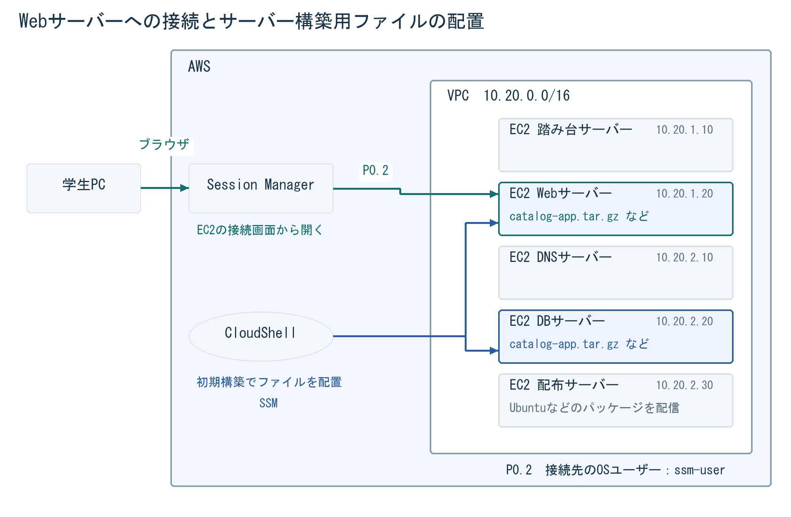

緑の矢印はP0.2でWebサーバーに接続する経路。

**このPractice0で作業すること**

自分のAWSアカウント、各サーバーのロール、コマンドを実行する環境を確認する。

### 解答例（操作手順）

#### P0.1 5台のinstance IDを確認する

**実行環境:**

学生本人のAWSコンソール

**目的と操作:**

AWSマネジメントコンソール上部のSearch欄にEC2と入力し、EC2の管理画面を開く。EC2 → Instancesを開き、Name列で自分の演習環境の5台のサーバーを確認する。同じ行のInstance ID列からi-を含めてIDを確認する。


EC2のInstances一覧。P0は名前の末尾が `-web` の行、M0は `-db`・`-dns`・`-repo`・`-bastion` の行を順に選ぶ。

#### P0.2 Session ManagerでWebサーバーに接続する

**実行環境:**

WebサーバーのSSM端末：ssm-user

**目的と操作:**

P0.1で確認したWebサーバーの **Instance ID** をクリックする。詳細画面で **Connect** の右にある矢印を押し、**Connect with SSM Session Manager** を選ぶ。新しいタブのターミナルで、下のコマンドを上から1行ずつ実行する。初期構築時に置かれた `/etc/jdu-web/bootstrap.json` を `cat` で表示し、`"role": "web"` を探す。Webサーバーだと確認できたら、ホームディレクトリで `nano` を使って確認用ファイルを作る。


EC2の詳細画面。Connectの右の矢印からConnect with SSM Session Managerを選ぶ。Webサーバーの画面を例に示す。

入力するコマンド（番号はこの手順内の順番）

```bash
# 1. この端末で操作しているOSユーザー名を表示する。
id -un
# 2. 自分のホームディレクトリへ移動する。
cd ~
# 3. 現在の作業ディレクトリを表示する。
pwd
# 4. 管理者権限で /etc/jdu-web/bootstrap.json の内容を読む。
cat /etc/jdu-web/bootstrap.json
# 5. web とだけ入力する。Ctrl+O、Enterで保存し、Ctrl+Xで終了する。
nano p0-connection.txt
# 6. 管理者権限で p0-connection.txt の内容を読む。
cat p0-connection.txt
```

**期待する結果と読み方:**

`id -un` は `ssm-user`、`pwd` は `/home/ssm-user` を表示する。JSONファイルには `"role": "web"` が含まれ、最後の `cat` では `web` だけが1行表示される。

#### P0.3 RDPで踏み台のデスクトップを開く

**実行環境:**

学生のWindows PC（共有アカウント）

**目的と操作:**

Windowsの「リモート デスクトップ接続」で、自分の踏み台サーバーのデスクトップを開く。

**1. 踏み台サーバーを選ぶ**

EC2 → Instancesで、自分の演習環境のうち名前の末尾が `-bastion` の行を探し、同じ行の **Instance ID** をクリックする。

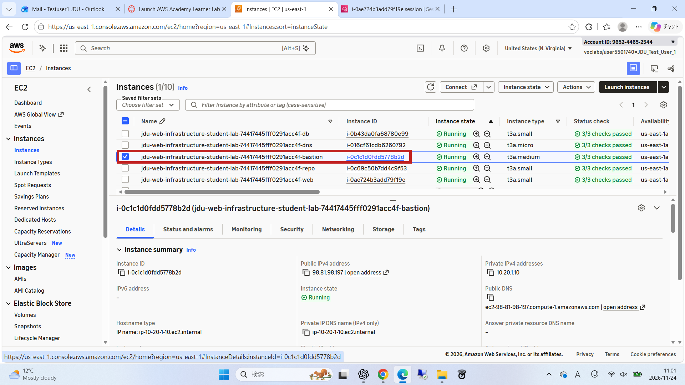

**2. 公開IPv4アドレスをコピーする**

インスタンスの詳細画面で **Public IPv4 address** の横にあるコピーアイコンを押す。次に入力するのは、自分の画面に表示された現在の公開IPv4アドレス。スクリーンショットの値は例。


Windowsキー＋Rで「ファイル名を指定して実行」を開く。「名前」欄に `mstsc /prompt` を入力し、**OK** を押す。

入力するコマンド（番号はこの手順内の順番）

```bash
# 1. WindowsのRDP接続画面を開き、資格情報の入力を求める。
mstsc /prompt
```

**3. 公開IPv4アドレスを入力して接続する**

「リモート デスクトップ接続」の **コンピューター** 欄に、手順2でコピーした公開IPv4アドレスを貼り付け、**接続** を押す。


**4. 証明書の確認画面を読む**

この画面が出た場合は、表示された接続先を手順2の公開IPv4アドレスと照合する。接続先が今回の踏み台であり、演習用の証明書だと教師に確認できたら **はい** を押す。確認できない場合は **いいえ** を押して教師に相談する。


**5. 踏み台サーバーにログインする**

xrdpのログイン画面で **Session** が `Xorg` になっていることを確かめる。**username** に `labuser`、**password** に学生用セットアップで自分が設定したRDPパスワードを入力し、**OK** を押す。

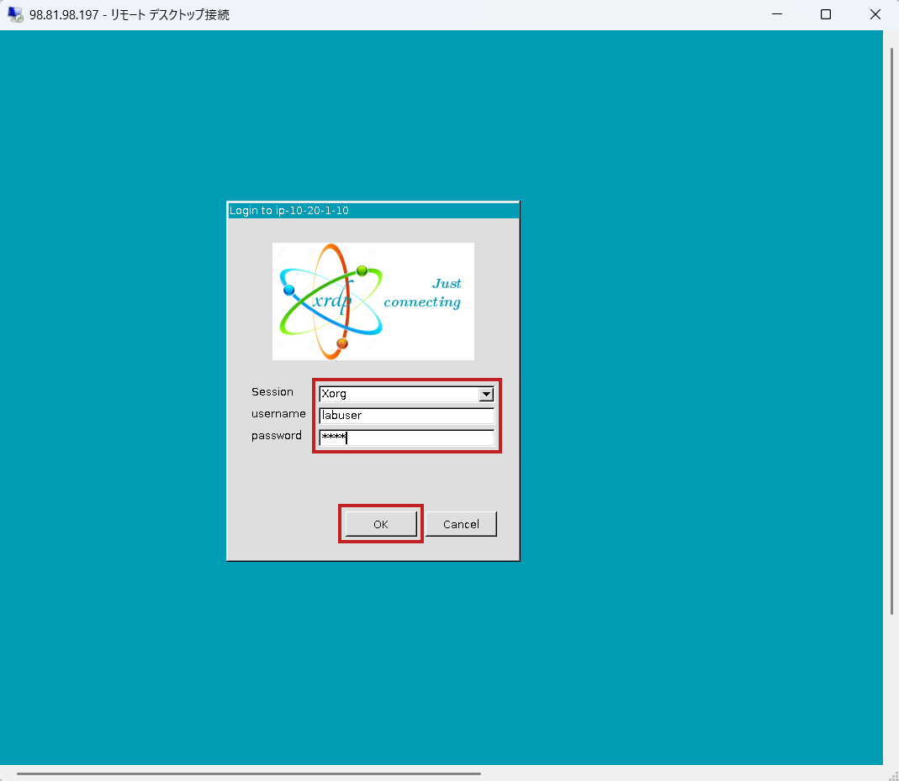

**6. デスクトップが開いたことを確認する**

リモート デスクトップ接続のウィンドウ内に、左上の **Applications** メニューや **Home** アイコンが表示されれば、踏み台サーバーに接続できている。


**コマンド・設定値の意味:**

RDPは踏み台の画面と入力を運ぶ。踏み台内Firefoxからの通信の送信元はWindowsではなく踏み台になる。日本語/英語などのキー配列はpasswordの記号入力にも影響するため、表示言語と配列を区別する。

**期待する結果と読み方:**

踏み台サーバーのUbuntuのデスクトップ（Xfce）が表示される。左上の「Applications」からFirefoxなどを開ける。

**うまくいかないとき:**

Login failedならuser名と日本語/英語等のkeyboard配列を確認する。passwordを会話へ送らない。到達しない場合は現在のIPと許可された接続元CIDRを教師と確認し、3389を全公開しない。終了時はRDP内の自分の作業を保存し、接続を閉じる。

### 確認・提出

教師が案内する採点ページのURLを自分のPCのブラウザで開き、学校のGoogleアカウントでログインする。初回だけ「自分のAWS環境を登録」を選び、画面の手順で連携する。

表のP0の行で **この課題を確認する** を押す。同じページで今回の結果を確認し、P0の行に **1 / 1** が保存されたことを確認する。

## P1 HTTPで静的ファイルを返す

### 学ぶこと

Nginx、保存先、待受、HTTP応答、access logを一組で確認する。

### 課題

Nginxを設定し、`/var/www/jdu-practice/practice.txt` をHTTPで配信する。

### 今回の見取り図

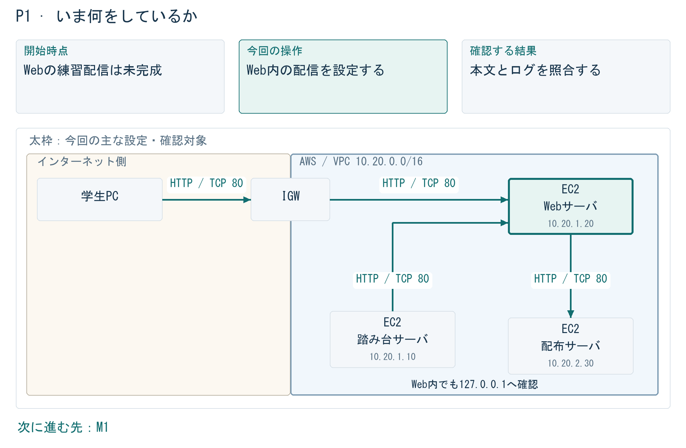

- File: /var/www/jdu-practice/practice.txt
- URL path: /practice.txt

```text
JDU WEB-02 practice: HTTP response verified.
```

**このPractice1で作業すること**

NginxでTCPの80番ポートにHTTPを公開し、`/practice.txt` のリクエストにファイルの本文を返す。Webサーバー自身の端末と踏み台サーバーの端末からアクセスし、そのリクエストがNginxのアクセスログに残ることを確かめる。

### 解答例（操作手順）

#### P1.1 内部APTからNginxを導入する

**実行環境:**

WebサーバーのSSM端末：ssm-user

**目的と操作:**

P0と同じ方法でWebサーバーへSSMで接続する。内部の配布サーバー（`10.20.2.30`）からNginxのパッケージをダウンロードし、Webサーバーにインストールする。

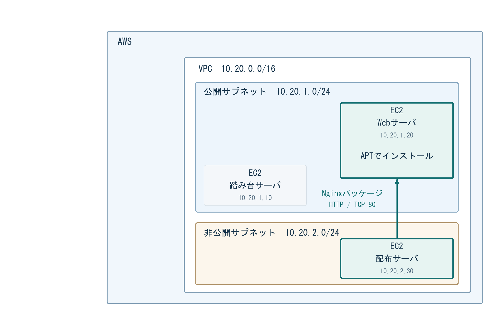

入力するコマンド（番号はこの手順内の順番）

```bash
# 1. 配布サーバーのパッケージ一覧を更新する。
sudo apt-get update
# 2. 配布サーバーから nginx をインストールする。
sudo apt-get install nginx
```

**コマンド・設定値の意味:**

`apt-get update` は利用できるパッケージの一覧を更新する。`apt-get install nginx` は、その一覧を使ってNginxをインストールする。

**期待する結果と読み方:**

一覧を更新すると、配布サーバーの行に `Hit:` または `Get:` が表示される。`N: Ignoring file ... ubuntu.sources.jdu-disabled` は、初回セットアップで無効にしたUbuntu標準の配布先設定をAPTが読み飛ばしたという通知である。取得や署名のエラーがなければインストールへ進む。確認画面が出たら `Y` を入力する。

**うまくいかないとき:**

パッケージ一覧の取得に失敗した場合は、配布サーバーの稼働状態とIPアドレスを確認する。

#### P1.2 正しい本文を作り、所有者と権限を揃える

**実行環境:**

WebサーバーのSSM端末：ssm-user

**目的と操作:**

作業用のファイルに本文を書き、Nginxが配信するディレクトリへコピーする。

入力するコマンド（番号はこの手順内の順番）

```bash
# 1. 自分のホームディレクトリへ移動する。
cd ~
# 2. 練習の作業ディレクトリを作る。既存ならそのまま使う。
mkdir -p jdu-web-practice/p1
# 3. 作業場所を jdu-web-practice/p1 へ移す。
cd jdu-web-practice/p1
# 4. 現在の作業ディレクトリを表示する。
pwd
# 5. practice.txtを編集する。本文を入力し、保存して終了する。
nano practice.txt
```

**nanoに入力する本文**

```text
JDU WEB-02 practice: HTTP response verified.
```

nanoの画面に上の1行をそのまま入力し、行末で Enter を押す。Ctrl+O、Enter の順に押して保存し、Ctrl+X で終了する。端末に戻ったら、手順6から続ける。

入力するコマンド（番号はこの手順内の順番）

```bash
# 6. /var/www/jdu-practice ディレクトリを作る。
sudo mkdir -p /var/www/jdu-practice
# 7. ファイルを /var/www/jdu-practice/practice.txt にコピーする。
sudo cp practice.txt /var/www/jdu-practice/practice.txt
# 8. /var/www/jdu-practice/practice.txt の所有者とグループを root:www-data に変更する。
sudo chown root:www-data /var/www/jdu-practice/practice.txt
# 9. /var/www/jdu-practice/practice.txt の権限を 0640 に変更する。
sudo chmod 0640 /var/www/jdu-practice/practice.txt
# 10. 指定ファイルの所有者・グループ・権限・名前を読む。
stat -c '%U:%G %a %n' /var/www/jdu-practice/practice.txt
# 11. 管理者権限で /var/www/jdu-practice/practice.txt の内容を読む。
sudo cat /var/www/jdu-practice/practice.txt
```

**コマンド・設定値の意味:**

`chown root:www-data` で所有者をroot、所有グループをwww-dataにする。`chmod 0640` は所有者に読み書き、グループに読み取りを許可し、その他のユーザーには許可しない。Nginxのワーカープロセスはwww-dataとして動くため、このグループの権限でファイルを読める。

**期待する結果と読み方:**

`root:www-data 640 /var/www/jdu-practice/practice.txt` と表示され、本文は `JDU WEB-02 practice: HTTP response verified.` の1行である。

**うまくいかないとき:**

nanoが開いている場合は、保存して終了してから次のコマンドを実行する。

#### P1.3 Nginxに配信先を設定する

**実行環境:**

WebサーバーのSSM端末：ssm-user

**目的と操作:**

`sudo nano /etc/nginx/sites-available/default` で設定を開く。`listen 80` がある既存の `server { ... }` の中へ、下の設定を追加する。別の `location` の中には入れない。`/practice.txt` をリクエストされたとき、Nginxは指定したrootにパスをつなげて `/var/www/jdu-practice/practice.txt` を読む。保存後、構文検査に成功したら設定を再読み込みする。

入力するコマンド（番号はこの手順内の順番）

```bash
# 1. /etc/nginx/sites-available/default をnanoで編集する。
sudo nano /etc/nginx/sites-available/default
```

**追加する位置**

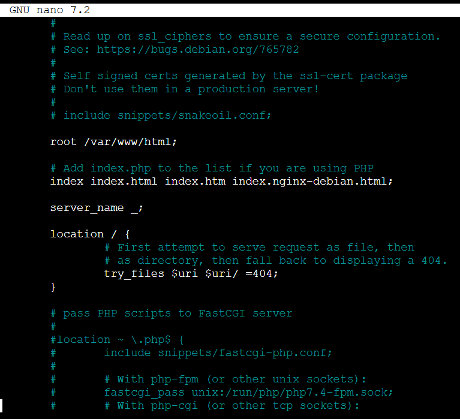

nanoで `location / {` を探す。Ctrl+Wで `location /` を検索してもよい。画面の `try_files $uri $uri/ =404;` と、その次の `}` は削除しない。この `}` が既存の `location /` の終わりである。その下の空行へカーソルを移し、次の3行を追加する。`try_files` の直下、つまり `}` より手前には入れない。

**nanoで設定する内容**

```text
location = /practice.txt {
    root /var/www/jdu-practice;
}
```

**追加後の配置（一部抜粋）**

既存のブロックと追加するブロックは、次のように並ぶ。どちらも既存の `server { ... }` の中に置く。ファイル全体をこの例へ置き換えず、ほかの設定と上側の `root /var/www/html;` はそのまま残す。

```text
location / {
    try_files $uri $uri/ =404;
}

location = /practice.txt {
    root /var/www/jdu-practice;
}
```

`location = /practice.txt` は、リクエストのパスが `/practice.txt` と完全に一致するときの設定である。その場合だけ追加したrootを使い、`/var/www/jdu-practice/practice.txt` を読む。

設定を入力したらCtrl+O、Enterで保存し、Ctrl+Xで終了する。端末に戻って、続きのコマンドを実行する。

入力するコマンド（番号はこの手順内の順番）

```bash
# 2. Nginxの設定全体を表示し、どのように記載されているか確認する。
sudo nginx -T
# 3. Nginx設定の構文と参照ファイルを検査する。
sudo nginx -t
# 4. nginx を今すぐ起動し、次回起動時も自動起動させる。
sudo systemctl enable --now nginx
# 5. nginx を止めずに設定を再読込する。
sudo systemctl reload nginx
# 6. nginx の現在の起動状態を読む。
systemctl is-active nginx
# 7. NginxがTCPの80番ポート（例 0.0.0.0:80）で待ち受けていることを確認する。
sudo ss -lntp
```

**コマンド・設定値の意味:**

nginx -Tは読込対象の設定を表示し、-tは構文を検査する。systemctlのenableは次回起動時、--nowは現在の起動を指定する。設定ファイルの保存だけで終わらず、reload後のserviceと待受portを読む。

**期待する結果と読み方:**

構文検査で `syntax is ok` と `test is successful`、起動状態で `active` が表示される。最後に、NginxがTCPの80番ポート（例 `0.0.0.0:80`）で待ち受けていることを確認する。

**うまくいかないとき:**

構文検査に失敗した場合は、`nginx -t` に表示されたファイル名と行番号を確認して修正する。

#### P1.4 Web自身から応答を見る

**実行環境:**

WebサーバーのSSM端末：ssm-user

**目的と操作:**

Webサーバーの端末で `curl` を使い、HTTPリクエストを送る。宛先の `127.0.0.1` は、コマンドを実行しているWebサーバー自身を指す。

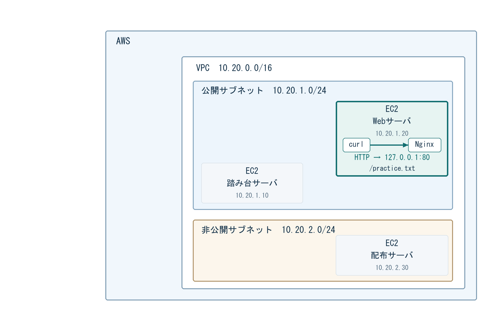

入力するコマンド（番号はこの手順内の順番）

```bash
# 1. http://127.0.0.1/practice.txt へHTTPリクエストを送る。
curl -i http://127.0.0.1/practice.txt
```

**コマンド・設定値の意味:**

`127.0.0.1` はループバックアドレスで、リクエストは同じWebサーバー内のNginxに届く。

**期待する結果と読み方:**

HTTP 200と、practice.txtに書いた `JDU WEB-02 practice: HTTP response verified.` が表示される。

**うまくいかないとき:**

「Welcome to nginx」が表示されたら、curlで `/practice.txt` を指定したか確認する。`http://127.0.0.1/` を開くとNginxの初期ページが返ることがある。

#### P1.5 踏み台サーバーから同じファイルを見る

**実行環境:**

踏み台のSSM端末：ssm-user

**目的と操作:**

踏み台サーバーへSSMで接続し、`curl` でWebサーバーにHTTPリクエストを送る。イントラネット（内部ネットワーク）から接続するので、宛先にはWebサーバーの内部IPアドレス `10.20.1.20` を指定する。

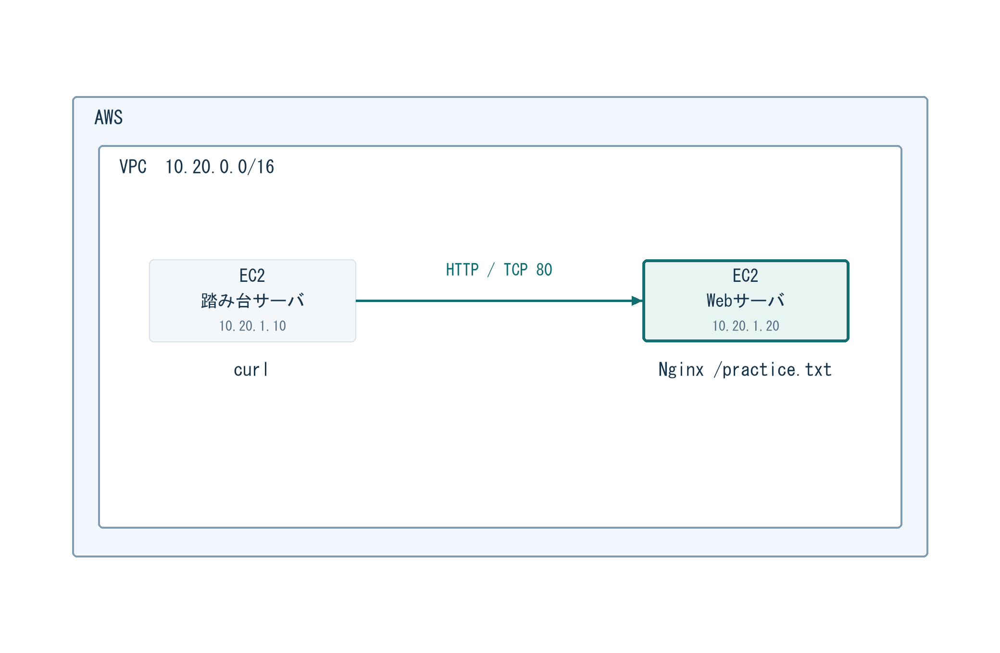

入力するコマンド（番号はこの手順内の順番）

```bash
# 1. http://10.20.1.20/practice.txt へHTTPリクエストを送る。
curl -i http://10.20.1.20/practice.txt
```

**コマンド・設定値の意味:**

宛先はWebサーバーの内部IPに変わる。リクエストするファイルのパスはP1.4と同じ `/practice.txt` を使う。

**期待する結果と読み方:**

HTTP 200と、`JDU WEB-02 practice: HTTP response verified.` が表示される。

#### P1.6 要求とlogを結び付けて提出する

**実行環境:**

WebサーバーのSSM端末：ssm-user

**目的と操作:**

Webへ戻り、access logの時刻・client IP・path・statusを見る。logは実際に要求を処理した証拠で、fileがある証拠とは別。exitでCloudShellへ戻ったら、PCのWeb PortalでP1を選び「この課題を確認する」を押す。

入力するコマンド（番号はこの手順内の順番）

```bash
# 1. access log末尾20行を読み、直前のHTTP要求を探す。
sudo tail -n 20 /var/log/nginx/access.log
# 2. 現在のサーバーへの接続を閉じ、CloudShellへ戻る。
exit
```

**コマンド・設定値の意味:**

access logでは時刻・要求path・statusを直前のcurlと対応させる。tailは末尾を読む操作で、logを書き換えない。exitで接続を終えたら、PCのブラウザでP1を確認する。

**期待する結果と読み方:**

確認画面に8項目の結果と、クリアした項目数が表示される。公開IPからのHTTPアクセスは採点システムが自動で確認する。

**うまくいかないとき:**

処理中なら結果を更新する。保存に失敗していれば表示された理由を確認する。checkerの期待本文を書き換えない。

### 出力の読み取り例（入力しない）

```text
HTTP/1.1 200 OK

JDU WEB-02 practice: HTTP response verified.
```

上は説明用に必要な行だけを抜き出した例。実際には日時などのheaderが加わる。200と本文を読み、access logのpath/statusとも照合する。

### 理解の確認（採点外）

Web自身では200、踏み台からは接続失敗。本文を作り直す前に何を確認するか？

**考え方:**

要求先IP・待受アドレスとport・踏み台からWebへの通信許可を調べる。本文の正否と到達性を分ける。

## P2 内部DNSと通常の名前解決

**このPractice2で作業すること**

内部DNSにWeb・DBサーバーの名前を登録する。踏み台サーバーとWebサーバーがこのDNSを使うように設定し、P1のファイルを名前で開く。

### 今回の見取り図

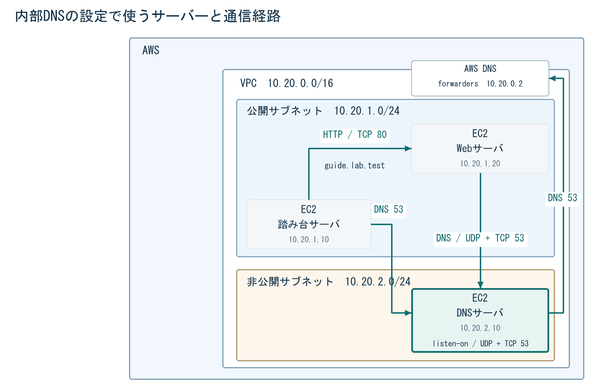

### 解答例（操作手順）

#### P2.1 配布サーバーからBINDをインストールする

**実行環境:**

DNSサーバーのSSM端末：ssm-user

DNSサーバーで配布サーバーのパッケージ一覧を更新し、BINDと設定を確認するためのツールをインストールする。続けて、編集する設定ファイル2つの控えを作る。

入力するコマンド（番号はこの手順内の順番）

```bash
# 1. 配布サーバーのパッケージ一覧を更新する。
sudo apt-get update
# 2. 配布サーバーから bind9 bind9-utils と、動作に必要なパッケージをインストールする。
sudo apt-get install bind9 bind9-utils
# 3. 元ファイルを控えへコピーする。既存の控えは上書きしない。
sudo cp -an /etc/bind/named.conf.options /etc/bind/named.conf.options.before-p2
# 4. 元ファイルを控えへコピーする。既存の控えは上書きしない。
sudo cp -an /etc/bind/named.conf.local /etc/bind/named.conf.local.before-p2
```

**期待する結果と読み方:**

`bind9` と `bind9-utils` がインストールされ、2つの `.before-p2` ファイルができる。

#### P2.2 問い合わせを受け付けるサーバーを設定する

**実行環境:**

DNSサーバーのSSM端末：ssm-user

問い合わせを受け付けるのは、DNSサーバー自身、踏み台サーバー、Webサーバーの3台。演習の外の名前はAWSのDNS（`10.20.0.2`）に問い合わせる。

ファイルの内容を下の設定に置き換えて保存する。検索するときはnanoの Ctrl+W、保存するときは Ctrl+O、Enter、終了は Ctrl+X を使う。

```bash
sudo nano /etc/bind/named.conf.options
```

**nanoに入力する内容**

```text
acl "jdu_clients" { 127.0.0.1; 10.20.1.10; 10.20.1.20; };
options {
    directory "/var/cache/bind";
    listen-on { 127.0.0.1; 10.20.2.10; };
    listen-on-v6 { none; };
    allow-query { jdu_clients; };
    allow-recursion { jdu_clients; };
    allow-query-cache { jdu_clients; };
    recursion yes;
    forward only;
    forwarders { 10.20.0.2; };
    dnssec-validation no;
    allow-transfer { none; };
};
```

**期待する結果と読み方:**

`listen-on` にDNSサーバー自身の内部IP `10.20.2.10`、`forwarders` にAWSのDNS `10.20.0.2` が入る。

#### P2.3 名前とIPv4アドレスを登録する

**実行環境:**

DNSサーバーのSSM端末：ssm-user

`named.conf.local` で、`lab.test` のゾーンファイルがどこにあるかをBINDに指定する。`db.lab.test` に、一つの名前とIPv4アドレスを一組にしてAレコードを書く。

既存の `named.conf.local` の末尾に次のブロックを追加する。`lab.test` のブロックが既にあれば、そのブロックを編集する。

```bash
sudo nano /etc/bind/named.conf.local
```

**nanoに入力する内容**

```text
zone "lab.test" {
    type primary;
    file "/etc/bind/zones/db.lab.test";
    allow-transfer { none; };
    allow-update { none; };
};
```

nanoで `/etc/bind/zones/db.lab.test` を開き、下の設定を入力して保存する。

```bash
sudo mkdir -p /etc/bind/zones
sudo chmod 0755 /etc/bind/zones
sudo nano /etc/bind/zones/db.lab.test
```

**nanoに入力する内容**

```text
$TTL 300
@ IN SOA dns.lab.test. hostmaster.lab.test. (
    2026102301 3600 600 604800 300 )
@ IN NS dns.lab.test.
dns IN A 10.20.2.10
guide IN A 10.20.1.20
practice-db IN A 10.20.2.20
```

**期待する結果と読み方:**

`guide.lab.test` はWebサーバーの `10.20.1.20`、`practice-db.lab.test` はDBサーバーの `10.20.2.20` に対応する。

**うまくいかないとき:**

すでにゾーンファイルがある場合は、既存の名前を残して練習用の2件を追加する。レコードを変更するたびに、SOAのシリアル番号を現在の値より増やす。

#### P2.4 BINDを起動してDNSサーバー自身から問い合わせる

**実行環境:**

DNSサーバーのSSM端末：ssm-user

設定とゾーンファイルにエラーがないことを確かめてからBINDを起動する。`dig` はDNSに問い合わせてレスポンスを表示するコマンド。ここでは自分自身を指す `127.0.0.1` を問い合わせ先にする。

入力するコマンド（番号はこの手順内の順番）

```bash
# 1. BINDの設定と参照zoneを構文検査する。
sudo named-checkconf -z
# 2. lab.testのzoneファイルを検査する。
sudo named-checkzone lab.test /etc/bind/zones/db.lab.test
# 3. named を次回のOS起動時に自動起動させる。
sudo systemctl enable named
# 4. named を再起動して設定を読み直す。
sudo systemctl restart named
# 5. UDP 53で guide.lab.test を問い合わせ、応答を読む。
dig @127.0.0.1 guide.lab.test A
# 6. TCP 53で guide.lab.test を問い合わせ、応答を読む。
dig @127.0.0.1 guide.lab.test A +tcp
```

**期待する結果と読み方:**

ゾーンファイルの検査で `OK` が表示される。UDPとTCPのどちらでも `NOERROR` が返り、`guide.lab.test` のIPは `10.20.1.20` になる。

**うまくいかないとき:**

失敗ならsudo journalctl -u named -n 30 --no-pagerで対象行を調べ、設定を直して再検査する。

#### P2.5 踏み台サーバーとWebサーバーからBINDを試す

**実行環境:**

踏み台サーバーとWebサーバーのSSM端末

両方のサーバーで実行する。`dig` の `@10.20.2.10` は、その1回の問い合わせ先を指定する。`AXFR` はゾーンのレコードをまとめて転送するための指定で、この演習では拒否されることを確かめる。

入力するコマンド（番号はこの手順内の順番）

```bash
# 1. UDP 53で guide.lab.test を問い合わせ、応答を読む。
dig @10.20.2.10 guide.lab.test A
# 2. TCP 53で practice-db.lab.test を問い合わせ、応答を読む。
dig @10.20.2.10 practice-db.lab.test A +tcp
# 3. UDP 53で absent-p2.lab.test を問い合わせ、応答を読む。
dig @10.20.2.10 absent-p2.lab.test A
# 4. UDP 53で aws.amazon.com を問い合わせ、応答を読む。
dig @10.20.2.10 aws.amazon.com A
# 5. zone全件の転送を要求し、明示的に拒否されるか調べる。
dig @10.20.2.10 lab.test AXFR
```

**期待する結果と読み方:**

`guide.lab.test` は `10.20.1.20`、`practice-db.lab.test` は `10.20.2.20`。未登録の名前は `NXDOMAIN`、外部名 `aws.amazon.com` にはIPアドレスが返り、ゾーン転送は拒否される。

#### P2.6 Ubuntu OSが普段使うDNSを設定する

**実行環境:**

踏み台サーバーとWebサーバーのSSM端末

踏み台サーバーとWebサーバーを1台ずつ設定する。ブラウザやアプリが名前を調べるときに使うDNSを、Ubuntu OSのNetplanで `10.20.2.10` に指定する。

まずネットワークインターフェース名とNetplanのファイル名を調べる。

```bash
ip -br link
ls /etc/netplan
```

例の `ens5` と `YOUR-NETPLAN-FILE.yaml` を実際の名前に置き換える。`networkctl status` の `Network File` に表示される名前も、対応するNetplanのファイルを見つける手掛かりになる。

```bash
networkctl status ens5
```

下は既存ファイルを編集するための例。自分のファイルのインターフェースの下に `dhcp4-overrides` と `nameservers` を追加または修正する。すでにあるインターフェース名とその他の設定は残す。

```bash
sudo cp -an /etc/netplan/YOUR-NETPLAN-FILE.yaml /etc/netplan/YOUR-NETPLAN-FILE.yaml.before-p2
sudo nano /etc/netplan/YOUR-NETPLAN-FILE.yaml
```

**nanoに入力する内容**

```text
network:
  version: 2
  ethernets:
    ens5:
      dhcp4: true
      dhcp4-overrides:
        use-dns: false
      nameservers:
        addresses: [10.20.2.10]
```

**期待する結果と読み方:**

DHCPでIPアドレスを受け取る設定を残し、DNSに限って自動取得を止める。YAMLのインデントをそろえて保存する。

**うまくいかないとき:**

同じinterfaceが複数YAMLにあると値がmergeされる。resolvectl dnsにAWS DNSが残る場合は、対応する全YAMLとruntimeの設定を確認する。

#### P2.7 DNSの設定を反映して名前でページを開く

**実行環境:**

踏み台サーバーとWebサーバーのSSM端末

Netplanの設定を反映する。`resolvectl dns` で実際に使うDNSサーバーを確かめ、`getent` でUbuntu OSが名前をどう解決するかを見る。その名前を使ってP1のファイルを取得する。

入力するコマンド（番号はこの手順内の順番）

```bash
# 1. netplan YAMLから設定を生成し、適用前の構文を検査する。
sudo netplan generate
# 2. 保存したnetplan設定をネットワークへ適用する。
sudo netplan apply
# 3. systemd-resolved を再起動して設定を読み直す。
sudo systemctl restart systemd-resolved
# 4. 通常の名前解決に使うDNSサーバーを表示する。
resolvectl dns
# 5. 通常のresolverで guide.lab.test のIPv4を調べる。
getent ahostsv4 guide.lab.test
# 6. 通常のresolverで practice-db.lab.test のIPv4を調べる。
getent ahostsv4 practice-db.lab.test
# 7. http://guide.lab.test/practice.txt へHTTPリクエストを送る。
curl -i http://guide.lab.test/practice.txt
```

**期待する結果と読み方:**

`resolvectl dns` のDNSは `10.20.2.10`。名前はそれぞれ `10.20.1.20` と `10.20.2.20` になり、HTTP `200` と `JDU WEB-02 practice: HTTP response verified.` が返る。

**うまくいかないとき:**

dig成功/getent失敗ならclient resolverを調べる。FirefoxはDoH無効の教師設定を維持する。

#### P2.8 踏み台サーバーのブラウザで表示を確かめる

**実行環境:**

RDP内のFirefox（踏み台）

P0の手順で踏み台サーバーへRDP接続する。踏み台サーバー上のFirefoxで `http://10.20.1.20/practice.txt`、次に `http://guide.lab.test/practice.txt` を開く。最後に自分のPCの採点ページでP2を確認する。

**期待する結果と読み方:**

どちらのURLでも `JDU WEB-02 practice: HTTP response verified.` が表示される。採点ページでP2の13項目を確認できる。

### 出力の読み取り例（入力しない）

```text
status: NOERROR
guide.lab.test.  300  IN  A  10.20.1.20
```

dig出力の説明用抜粋。Aの右が回答IPv4、300がTTL。回答が出ても、問い合わせ先SERVERが10.20.2.10かを別に確認する。

## P3 PostgreSQLへの認証接続

**このPractice3で作業すること**

DBサーバーにPostgreSQLを設定し、Webサーバーから練習用DBへパスワードで接続する。

### 今回の見取り図

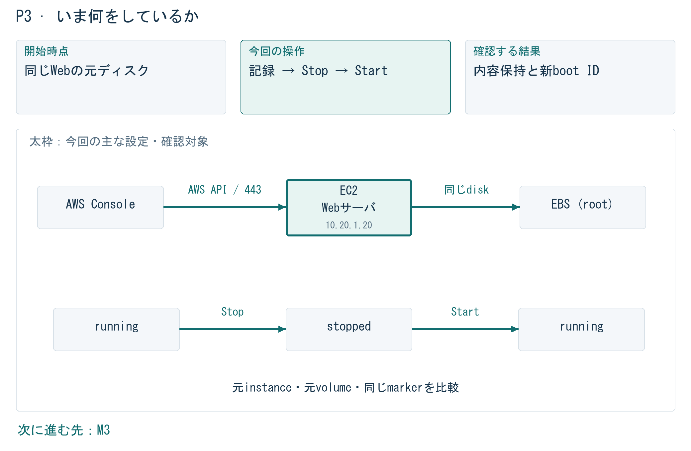

### 解答例（操作手順）

#### P3.1 配布サーバーからPostgreSQLをインストールする

**実行環境:**

DBサーバーのSSM端末：ssm-user

DBサーバーにPostgreSQL 16をインストールする。続けて後の手順で使うSQLファイルを展開する。

入力するコマンド（番号はこの手順内の順番）

```bash
# 1. 配布サーバーのパッケージ一覧を更新する。
sudo apt-get update
# 2. 配布サーバーから postgresql-16 postgresql-client-16 と、動作に必要なパッケージをインストールする。
sudo apt-get install postgresql-16 postgresql-client-16
# 3. 固定hashを照合して教員提供アプリ・SQL資源を展開する。
sudo python3 -B /var/lib/jdu-web/lesson-resources-r1/offline_assets.py
# 4. PostgreSQLのversion・cluster・port・起動状態を読む。
pg_lsclusters
# 5. postgresとしてDB設定を読む：SHOW data_directory;
sudo -u postgres psql -X -d postgres -c "SHOW data_directory;"
```

**期待する結果と読み方:**

`pg_lsclusters` にバージョン `16` とクラスタ名 `main` が表示される。データの保存先は `/var/lib/postgresql/16/main`。

#### P3.2 PostgreSQLの待受アドレス・ポートを設定する

**実行環境:**

DBサーバーのSSM端末：ssm-user

`postgresql.conf` で、DBサーバーの内部IP `10.20.2.20` の5432番ポートで受け付けるようにする。パスワード認証にはSCRAM-SHA-256を使う。

該当する設定項目を探し、下の値に変更する。行頭に `#` があれば外して保存する。

```bash
sudo cp -an /etc/postgresql/16/main/postgresql.conf /etc/postgresql/16/main/postgresql.conf.before-p4
sudo nano /etc/postgresql/16/main/postgresql.conf
```

**nanoに入力する内容**

```text
listen_addresses = '10.20.2.20'
port = 5432
password_encryption = 'scram-sha-256'
```

**期待する結果と読み方:**

下の3項目を同じ設定ファイルに保存する。再起動は接続許可を設定した後のP3.4で行う。

#### P3.3 WebサーバーからのDB接続を許可する

**実行環境:**

DBサーバーのSSM端末：ssm-user

`pg_hba.conf` では、どのサーバーから、どのDBに、どのロールで接続できるかを指定する。Webサーバーの内部IP `10.20.1.20` を送信元にし、練習用と課題用のDB・ロールの組み合わせを許可する。

接続ルールを下の内容に置き換えて保存する。

```bash
sudo cp -an /etc/postgresql/16/main/pg_hba.conf /etc/postgresql/16/main/pg_hba.conf.before-p4
sudo nano /etc/postgresql/16/main/pg_hba.conf
```

**nanoに入力する内容**

```text
local all postgres peer
local all all reject
host jdu_catalog_practice catalog_practice_setup 10.20.1.20/32 scram-sha-256
host jdu_catalog_practice catalog_practice_app 10.20.1.20/32 scram-sha-256
host jdu_catalog catalog_setup 10.20.1.20/32 scram-sha-256
host jdu_catalog catalog_app 10.20.1.20/32 scram-sha-256
host all all 0.0.0.0/0 reject
host all all ::/0 reject
```

**期待する結果と読み方:**

PostgreSQLは上から読んで最初に一致した行を使う。許可する行を先に置き、その他の接続は末尾の `reject` で拒否する。

#### P3.4 PostgreSQLを再起動して設定を確認する

**実行環境:**

DBサーバーのSSM端末：ssm-user

再起動して、保存した待受設定と接続許可を反映する。

入力するコマンド（番号はこの手順内の順番）

```bash
# 1. postgresql@16-main を再起動して設定を読み直す。
sudo systemctl restart postgresql@16-main
# 2. postgresql@16-main の現在の起動状態を読む。
systemctl is-active postgresql@16-main
# 3. PostgreSQL が 10.20.2.20:5432 で待ち受けていることを確認する。
sudo ss -lntp
# 4. postgresとしてDB設定を読む：SHOW password_encryption;
sudo -u postgres psql -X -d postgres -c "SHOW password_encryption;"
# 5. HBAの読込エラー行を調べる。正常なら0行。
sudo -u postgres psql -X -d postgres -c \
  "SELECT line_number,error FROM pg_hba_file_rules WHERE error IS NOT NULL;"
```

**期待する結果と読み方:**

サービスは `active`。待受は `10.20.2.20:5432`、パスワードの保存方式は `scram-sha-256`、接続許可ファイルのエラーは `(0 rows)`。

#### P3.5 練習用のDBと2つのロールを作る

**実行環境:**

DBサーバーのSSM端末：ssm-user

付属のSQLで、練習用DB `jdu_catalog_practice` を作る。テーブルを準備するロールは `catalog_practice_setup`、通常のアプリ接続に使うロールは `catalog_practice_app`。最初にSQLの内容を表示し、その後 `psql` に渡して実行する。

入力するコマンド（番号はこの手順内の順番）

```bash
# 1. 作業場所を /var/lib/jdu-web/lesson-resources-r1/app へ移す。
cd /var/lib/jdu-web/lesson-resources-r1/app
# 2. 練習用DB roleを作るSQLを表示する。まだ適用しない。
python3 -B profile_sql.py --profile practice 01_create_roles.sql
# 3. 練習用DB roleを作るSQLを生成し、postgres経由で指定DBへ適用する。
python3 -B profile_sql.py --profile practice 01_create_roles.sql | sudo -u postgres \
  psql -X -v ON_ERROR_STOP=1 -d postgres
# 4. 練習用DBとschemaを作るSQLを生成し、postgres経由で指定DBへ適用する。
python3 -B profile_sql.py --profile practice 02_prepare_schema.sql | sudo -u postgres \
  psql -X -v ON_ERROR_STOP=1 -d jdu_catalog_practice
```

**期待する結果と読み方:**

`CREATE ROLE` が2回、`CREATE DATABASE` が1回表示される。

**うまくいかないとき:**

already existsなら成功済みの可能性。DROPで消さず\duと\lで対応を確認する。パイプ右側psqlにSQL errorがないことを確認する。

#### P3.6 それぞれのDBロールにパスワードを設定する

**実行環境:**

DBサーバーのSSM端末：ssm-user

DBサーバーの端末で `psql` を開く。`\password` を1行ずつ実行し、ロールごとに決めたパスワードを確認のため2回入力する。入力した文字は画面に表示されない。2つのパスワードはP4でも使う。 それぞれ16文字以上で異なるものを設定する。

入力するコマンド（番号はこの手順内の順番）

```bash
# 1. DBのOS端末からpostgresとしてpsqlを開く。以降はpsql内で操作する。
sudo -u postgres psql -X -d postgres
```

ここからはpsql内で入力する

```sql
-- 2. psql内で catalog_practice_setup のパスワードを非表示入力する。
\password catalog_practice_setup
-- 3. psql内で catalog_practice_app のパスワードを非表示入力する。
\password catalog_practice_app
-- 4. psql内で練習用DB roleの属性と権限を確認する。
\du catalog_practice_*
-- 5. psqlを終了し、同じDBサーバーのOS端末へ戻る。
\q
```

**期待する結果と読み方:**

`\du` に `catalog_practice_setup` と `catalog_practice_app` が表示される。

#### P3.7 Webサーバーから練習用DBに接続する

**実行環境:**

WebサーバーのSSM端末：ssm-user

P0と同じ方法でWebサーバーのSession Managerを開く。`psql` で最初はDBサーバーの内部IP、次はP2で登録した `practice-db.lab.test` を指定する。パスワードを聞かれたら、P3.6で `catalog_practice_app` に設定したものを入力する。

入力するコマンド（番号はこの手順内の順番）

```bash
# 1. 配布サーバーから postgresql-client-16 と、動作に必要なパッケージをインストールする。
sudo apt-get install postgresql-client-16
# 2. Webから指定DBへ既存パスワードで接続し、SELECT結果を読む。
psql -X -h 10.20.2.20 -U catalog_practice_app -d jdu_catalog_practice -W -c \
  'SELECT current_database(),current_user,1 AS value;'
# 3. 通常のresolverで practice-db.lab.test のIPv4を調べる。
getent ahostsv4 practice-db.lab.test
# 4. Webから指定DBへ既存パスワードで接続し、SELECT結果を読む。
psql -X -h practice-db.lab.test -U catalog_practice_app -d jdu_catalog_practice -W -c \
  'SELECT current_database(),current_user,1 AS value;'
```

**期待する結果と読み方:**

どちらの接続でもDBは `jdu_catalog_practice`、ロールは `catalog_practice_app`、SQLの結果は `1` と表示される。

**うまくいかないとき:**

内部IPで成功し、名前で失敗する場合は、P2で設定した通常の名前解決と練習用のDB名を確認する。認証が拒否される場合は接続元・DB・ロール・パスワードを確認する。DBをInternetへ公開して試さない。

#### P3.8 採点に使うDBパスワードをWebサーバーに保存する

**実行環境:**

WebサーバーのSSM端末：ssm-user

コマンドを実行し、`catalog_practice_app` に設定したパスワードを2回入力する。入力は画面に表示されず、採点で接続を確認できるようWebサーバーの保護されたファイルに保存される。自分のPCの採点ページでP3を確認する。

入力するコマンド（番号はこの手順内の順番）

```bash
# 1. 既存の練習用DBパスワードを非表示入力し、Web内だけに保存する。
sudo python3 -B /var/lib/jdu-web/lesson-resources-r1/database_secret.py --profile \
  practice
```

**期待する結果と読み方:**

端末に `D11_EXISTING_DB_PASSWORD_STORED_LOCALLY` が表示され、採点ページでP3の9項目を確認できる。

**うまくいかないとき:**

既存fileありなら再生成しない。P4では同じDB passwordをapp設定にも入力する。M3はmission用の別DB/roleで構築する。

### 出力の読み取り例（入力しない）

```text
current_database    | current_user         | value
jdu_catalog_practice | catalog_practice_app | 1
```

SELECT結果の読み方の例。列の幅や罫線は実際と異なってよい。DB名・role名・value=1を確認する。table編集の許可を証明する結果ではない。

## P4 教員アプリをWeb・DBへ接続する

**このPractice4で作業すること**

Webサーバーで備品管理アプリを起動し、DBサーバーにつなぐ。公開の一覧と、踏み台サーバーから使う管理画面を用意する。

### 今回の見取り図

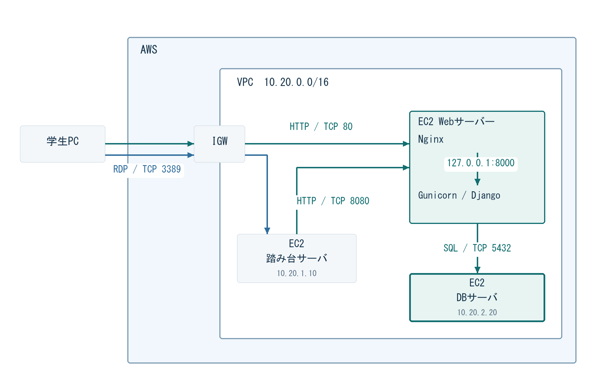

### 解答例（操作手順）

#### P4.1 アプリに必要な名前解決とPythonパッケージを準備する

**実行環境:**

WebサーバーのSSM端末：ssm-user

初めにWebサーバーからDBと管理画面の名前を解決する。続けて、配布サーバーからPython環境を作るためのツールをインストールし、備品管理アプリとPythonパッケージを展開する。

入力するコマンド（番号はこの手順内の順番）

```bash
# 1. 通常のresolverで db.lab.test のIPv4を調べる。
getent ahostsv4 db.lab.test
# 2. 通常のresolverで admin.lab.test のIPv4を調べる。
getent ahostsv4 admin.lab.test
# 3. 配布サーバーから python3-venv python3-pip と、動作に必要なパッケージをインストールする。
sudo apt-get install python3-venv python3-pip
# 4. 署名・hashを確認してアプリと固定wheelを教材領域へ展開する。
sudo python3 -B /var/lib/jdu-web/lesson-resources-r1/offline_assets.py --wheels
# 5. /var/lib/jdu-web/lesson-resources-r1/app に配置されたサーバー構築用ファイルを一覧する。
ls /var/lib/jdu-web/lesson-resources-r1/app
# 6. /var/lib/jdu-web/lesson-resources-r1/wheels に配置されたサーバー構築用ファイルを一覧する。
ls /var/lib/jdu-web/lesson-resources-r1/wheels
```

**期待する結果と読み方:**

`db.lab.test` は `10.20.2.20`、`admin.lab.test` は `10.20.1.20`。端末に `PUBLIC_APP_RESOURCES_VERIFIED` と `SIGNED_OFFLINE_WHEELS_READY=7` が表示される。

#### P4.2 アプリのファイルを配置して専用のPython環境を作る

**実行環境:**

WebサーバーのSSM端末：ssm-user

アプリのファイルを `/opt/jdu-catalog/app` にコピーする。`venv` で専用のPython環境を作り、展開済みのパッケージを入れる。`pip` は外部サイトに接続せず、ファイルが指定のハッシュ値と一致することを確認してからインストールする。

入力するコマンド（番号はこの手順内の順番）

```bash
# 1. /opt/jdu-catalog/app ディレクトリを作る。
sudo mkdir -p /opt/jdu-catalog/app
# 2. /opt/jdu-catalog/app の所有者とグループを root:root に変更する。
sudo chown root:root /opt/jdu-catalog/app
# 3. /opt/jdu-catalog/app の権限を 0755 に変更する。
sudo chmod 0755 /opt/jdu-catalog/app
# 4. ファイルを /opt/jdu-catalog/app/ にコピーする。
sudo cp -a /var/lib/jdu-web/lesson-resources-r1/app/. /opt/jdu-catalog/app/
# 5. アプリ専用のPython仮想環境を作る。
sudo python3 -m venv /opt/jdu-catalog/venv
# 6. 固定lock/hashと内部wheelだけでPython依存を導入する。
sudo /opt/jdu-catalog/venv/bin/python -m pip --isolated --no-cache-dir install \
  --no-index --find-links=/var/lib/jdu-web/lesson-resources-r1/wheels \
  --only-binary=:all: --require-hashes -r \
  /var/lib/jdu-web/lesson-resources-r1/requirements.lock
# 7. 導入済みPython依存パッケージの整合を検査する。
sudo /opt/jdu-catalog/venv/bin/python -m pip check
```

**期待する結果と読み方:**

最後の `pip check` で `No broken requirements found.` と表示される。

#### P4.3 アプリを実行するOSユーザーを作る

**実行環境:**

WebサーバーのSSM端末：ssm-user

Webサーバーでアプリを動かすOSユーザー `catalog` を作る。続けて、CSSなどのファイルを集めるディレクトリを作り、`catalog` がその中に書き込めるように設定する。

入力するコマンド（番号はこの手順内の順番）

```bash
# 1. ログイン用homeやshellを持たないアプリ専用catalogユーザーを作る。
sudo useradd --system --user-group --home-dir /nonexistent --no-create-home --shell \
  /usr/sbin/nologin catalog
# 2. /var/lib/jdu-catalog ディレクトリを作る。
sudo mkdir -p /var/lib/jdu-catalog
# 3. /var/lib/jdu-catalog の所有者とグループを root:root に変更する。
sudo chown root:root /var/lib/jdu-catalog
# 4. /var/lib/jdu-catalog の権限を 0755 に変更する。
sudo chmod 0755 /var/lib/jdu-catalog
# 5. /var/lib/jdu-catalog/static ディレクトリを作る。
sudo mkdir -p /var/lib/jdu-catalog/static
# 6. /var/lib/jdu-catalog/static の所有者とグループを catalog:catalog に変更する。
sudo chown catalog:catalog /var/lib/jdu-catalog/static
# 7. /var/lib/jdu-catalog/static の権限を 0755 に変更する。
sudo chmod 0755 /var/lib/jdu-catalog/static
# 8. catalogユーザーのUID・GID・所属グループを確認する。
id catalog
# 9. catalogのホームとログインシェルを確認する。
getent passwd catalog
```

**期待する結果と読み方:**

ユーザー `catalog` とログインシェル `/usr/sbin/nologin` が表示される。`/var/lib/jdu-catalog/static` の所有者とグループは `catalog`。

**うまくいかないとき:**

権限errorをchmod -R 777やcatalogのsudo追加で解決しない。対象directoryとownerを照合する。

#### P4.4 アプリの通常のDB接続を設定する

**実行環境:**

WebサーバーのSSM端末：ssm-user

AWSコンソールでWebサーバーの現在の公開IPv4アドレスを確認し、`YOUR-CURRENT-WEB-PUBLIC-IP` と置き換える。設定コマンドで入力を求められたら、P3で `catalog_practice_app` に設定したパスワードを入力する。作成した練習用の設定をアプリで使うように選ぶ。 入力した文字は画面に表示されない。

入力するコマンド（番号はこの手順内の順番）

```bash
# 1. AWS画面で確認した現在のWeb公開IPv4を変数へ入れる。
PUBLIC_WEB_IPV4='YOUR-CURRENT-WEB-PUBLIC-IP'
# 2. 既存DBパスワードを非表示入力し、練習用runtime設定を作る。
sudo python3 -B /opt/jdu-catalog/app/configuration.py create-runtime --profile \
  practice --public-web-ipv4 "$PUBLIC_WEB_IPV4"
# 3. 保存済みの練習用設定を、アプリが次に起動するときに使う設定として選ぶ。
sudo python3 -B /opt/jdu-catalog/app/configuration.py activate --profile practice
# 4. 秘密の値を表示せずruntime設定の妥当性を検査する。
sudo python3 -B /opt/jdu-catalog/app/configuration.py check --phase runtime
# 5. 指定ファイルの所有者・グループ・権限・名前を読む。
sudo stat -c '%U:%G %a %n' /etc/jdu-catalog/app.env
```

**期待する結果と読み方:**

`CATALOG_ENV_CREATED=practice`、`CATALOG_PROFILE_ACTIVATED=practice`、`VALID` が表示される。`app.env` の所有者は `root:root`、権限は `600`。

#### P4.5 備品管理アプリのテーブルと管理者を用意する

**実行環境:**

WebサーバーのSSM端末：ssm-user

一時設定の作成時に、P3の `catalog_practice_setup` のパスワードを入力する。コマンドを1行ずつ実行して、テーブルを作り、見本の備品を登録する。最後に `practice_admin` のパスワードを自分で決めて入力する。 入力した文字は画面に表示されない。

入力するコマンド（番号はこの手順内の順番）

```bash
# 1. 既存構築用パスワードを非表示入力し、一時setup設定を作る。
sudo python3 -B /opt/jdu-catalog/app/configuration.py create-setup --profile practice
# 2. 構築用設定でアプリの設定エラーを検査する。
sudo /opt/jdu-catalog/venv/bin/python -B /opt/jdu-catalog/app/manage_secure.py \
  --phase setup check
# 3. 教員提供migrationを実行し、対象DBへ必要な表を作る。
sudo /opt/jdu-catalog/venv/bin/python -B /opt/jdu-catalog/app/manage_secure.py \
  --phase setup migrate
# 4. 提供済みの固定初期データを練習用DBへ登録する。
sudo /opt/jdu-catalog/venv/bin/python -B /opt/jdu-catalog/app/manage_secure.py \
  --phase setup seed_catalog
# 5. アプリ管理者を作り、そのパスワードを非表示入力する。
sudo /opt/jdu-catalog/venv/bin/python -B /opt/jdu-catalog/app/manage_secure.py \
  --phase setup create_lab_admin
```

**期待する結果と読み方:**

アプリ用テーブルが11個、見本の備品が3件作られる。管理画面では今回設定した `practice_admin` でログインする。

#### P4.6 アプリのDBロールに必要な権限を付ける

**実行環境:**

DBサーバーのSSM端末：ssm-user

DBサーバーのSession Managerを開く。通常の備品管理で使う `catalog_practice_app` に、作成済みのテーブルを読み書きするための権限を付ける。先にSQLを表示し、次のコマンドで適用する。

入力するコマンド（番号はこの手順内の順番）

```bash
# 1. 作業場所を /var/lib/jdu-web/lesson-resources-r1/app へ移す。
cd /var/lib/jdu-web/lesson-resources-r1/app
# 2. runtimeへ必要なSQL権限を与えるSQLを表示する。まだ適用しない。
python3 -B profile_sql.py --profile practice 03_runtime_grants.sql
# 3. runtimeへ必要なSQL権限を与えるSQLを生成し、postgres経由で指定DBへ適用する。
python3 -B profile_sql.py --profile practice 03_runtime_grants.sql | sudo -u postgres \
  psql -X -v ON_ERROR_STOP=1 -d jdu_catalog_practice
```

**期待する結果と読み方:**

`COMMIT` が表示される。備品テーブル `catalog_item` では読み取り・追加・変更が許可される。

#### P4.7 アプリをsystemdサービスとして起動する

**実行環境:**

WebサーバーのSSM端末：ssm-user

WebサーバーでCSSなどをNginxが配信するディレクトリに集める。サービス定義を `/etc/systemd/system` にコピーし、systemdに読み込ませる。`enable --now` で現在の起動と、次回のOS起動時の自動起動を設定する。

入力するコマンド（番号はこの手順内の順番）

```bash
# 1. runtime設定でCSS等の静的ファイルを配信先へ集める。
sudo /opt/jdu-catalog/venv/bin/python -B /opt/jdu-catalog/app/manage_secure.py \
  --phase runtime collectstatic
# 2. 管理者権限で /opt/jdu-catalog/app/config/jdu-catalog.service の内容を読む。
cat /opt/jdu-catalog/app/config/jdu-catalog.service
# 3. ファイルを /etc/systemd/system/jdu-catalog.service にコピーする。
sudo cp /opt/jdu-catalog/app/config/jdu-catalog.service \
  /etc/systemd/system/jdu-catalog.service
# 4. /etc/systemd/system/jdu-catalog.service の所有者とグループを root:root に変更する。
sudo chown root:root /etc/systemd/system/jdu-catalog.service
# 5. /etc/systemd/system/jdu-catalog.service の権限を 0644 に変更する。
sudo chmod 0644 /etc/systemd/system/jdu-catalog.service
# 6. 配置したsystemd unitファイルを管理機能へ読み込ませる。
sudo systemctl daemon-reload
# 7. jdu-catalog を今すぐ起動し、次回起動時も自動起動させる。
sudo systemctl enable --now jdu-catalog
# 8. jdu-catalog の現在の起動状態を読む。
systemctl is-active jdu-catalog
# 9. Gunicorn が 127.0.0.1:8000 で待ち受けていることを確認する。
sudo ss -lntp
```

**期待する結果と読み方:**

サービスは `active`。Gunicornは同じWebサーバーのNginxから接続できる `127.0.0.1:8000` で待ち受ける。

**うまくいかないとき:**

起動errorはjournalctl -u jdu-catalogを見る。秘密設定本文をlogへ貼らず、configuration.py checkで形式を確認する。

#### P4.8 Nginxに公開用と管理用の入口を設定する

**実行環境:**

WebサーバーのSSM端末：ssm-user

設定ファイルをコピーして、`sites-enabled` からシンボリックリンクを作る。設定を反映すると、80番ポートで公開一覧、踏み台サーバーからの8080番ポートで管理画面を開ける。Nginxはアプリ宛てのリクエストをGunicornへ転送する。

コピーした設定の `/practice.txt` と `/mission.txt` の2つのlocationを、下の内容へ置き換える。P1・M1の配信ディレクトリを引き継ぐための変更である。他の設定は保持する。

入力するコマンド（番号はこの手順内の順番）

```bash
# 1. 管理者権限で /opt/jdu-catalog/app/config/jdu-catalog.nginx.conf の内容を読む。
cat /opt/jdu-catalog/app/config/jdu-catalog.nginx.conf
# 2. ファイルを /etc/nginx/sites-available/jdu-catalog にコピーする。
sudo cp /opt/jdu-catalog/app/config/jdu-catalog.nginx.conf \
  /etc/nginx/sites-available/jdu-catalog
# 3. /etc/nginx/sites-available/jdu-catalog の所有者とグループを root:root に変更する。
sudo chown root:root /etc/nginx/sites-available/jdu-catalog
# 4. /etc/nginx/sites-available/jdu-catalog の権限を 0644 に変更する。
sudo chmod 0644 /etc/nginx/sites-available/jdu-catalog
# 5. 既定サイトのリンクを控えへ移す。既存の控えは上書きしない。
sudo mv -n /etc/nginx/sites-enabled/default /etc/nginx/default-site.before-p5
# 6. 配置したアプリ用サイト設定への有効化リンクを作る。
sudo ln -s /etc/nginx/sites-available/jdu-catalog /etc/nginx/sites-enabled/jdu-catalog
# 7. /etc/nginx/sites-available/jdu-catalog をnanoで編集する。
sudo nano /etc/nginx/sites-available/jdu-catalog
```

**nanoで設定する内容**

```text
location = /practice.txt { root /var/www/jdu-practice; try_files $uri =404; }
location = /mission.txt { root /var/www/jdu-mission; try_files $uri =404; }
```

設定を入力したらCtrl+O、Enterで保存し、Ctrl+Xで終了する。端末に戻って、続きのコマンドを実行する。

入力するコマンド（番号はこの手順内の順番）

```bash
# 8. Nginx設定の構文と参照ファイルを検査する。
sudo nginx -t
# 9. nginx を止めずに設定を再読込する。
sudo systemctl reload nginx
# 10. http://127.0.0.1/practice.txt へHTTPリクエストを送る。
curl -i http://127.0.0.1/practice.txt
```

**期待する結果と読み方:**

`nginx -t` が成功する。 `/practice.txt` にはHTTP `200` と `JDU WEB-02 practice: HTTP response verified.` が返る。同じ方法で `http://127.0.0.1/mission.txt` を開き、M1の本文も返ることを確かめる。

#### P4.9 管理画面から公開・非公開の備品を1件ずつ登録する

**実行環境:**

RDP内のFirefox（踏み台）

踏み台サーバーへRDP接続し、その中のFirefoxで `http://admin.lab.test:8080/admin/` を開く。P4.5で設定した `practice_admin` でログインする。「備品管理」の「備品」から追加画面を開き、下の表に従って1件ずつ保存する。登録後は公開備品を開いて数量を変更して保存し、表の数量4に戻す。

| コード | 名前 | 数量 | 保管場所 | 公開する |
| --- | --- | --- | --- | --- |
| P5-PUBLIC-001 | Practice keyboard | 4 | Training shelf A | チェックを入れる |
| P5-PRIVATE-001 | Practice mouse | 2 | Training shelf B | チェックを外す |

**期待する結果と読み方:**

管理画面には `P5-PUBLIC-001` と `P5-PRIVATE-001` が表示される。Webサーバーの公開一覧で新しく表示されるのは `P5-PUBLIC-001`。

#### P4.10 登録した2件がDBに保存されたことを確かめる

**実行環境:**

WebサーバーのSSM端末：ssm-user

Webサーバーの端末で `psql` を使い、管理画面から登録した2件をDBから読み出す。パスワードを聞かれたらP3.6で設定した `catalog_practice_app` のものを使う。

入力するコマンド（番号はこの手順内の順番）

```bash
# 1. 指定した2件を読むSQLを変数へ保存する。まだDBへ送らない。
QUERY="SELECT code,name,quantity,location,is_public
FROM catalog_item
WHERE code IN ('P5-PUBLIC-001','P5-PRIVATE-001')
ORDER BY code;"
# 2. Webから指定DBへ既存パスワードで接続し、SELECT結果を読む。
psql -X -h db.lab.test -U catalog_practice_app -d jdu_catalog_practice -W -c "$QUERY"
```

**期待する結果と読み方:**

`P5-PUBLIC-001` の数量は `4`、公開設定は `t`。`P5-PRIVATE-001` の数量は `2`、公開設定は `f`。名前と保管場所もP4.9の表と照合する。

#### P4.11 採点ページでアプリの動作を確かめる

**実行環境:**

自分のPCのブラウザ：Web Portal

自分のPCの採点ページでP4を開き、**機能・権限を含めて確認する** を選ぶ。`practice_admin` のパスワードを入力し、**このパスワードで確認する** を押す。採点では管理画面から確認用の備品を1件登録し、数量の変更も確かめる。

**期待する結果と読み方:**

P4の13項目の結果が表示される。採点で登録した確認用の備品は管理画面に残る。

## P5 最小権限と公開範囲

**このPractice5で作業すること**

DBの初期設定用ロールのログインを止める。アプリが通常の権限で動き、公開側から管理画面や内部設定を開けないことを確かめる。

### 今回の見取り図


### 解答例（操作手順）

#### P5.1 アプリがDBでできる操作を調べる

**実行環境:**

DBサーバーのSSM端末：ssm-user

DBサーバーの端末で `psql` を開く。`\du` で練習用ロールの属性、`\dp` でテーブルごとのアクセス権限を確認する。

入力するコマンド（番号はこの手順内の順番）

```bash
# 1. DBのOS端末からpostgresとしてpsqlを開く。以降はpsql内で操作する。
sudo -u postgres psql -X -d jdu_catalog_practice
```

ここからはpsql内で入力する

```sql
-- 2. psql内で練習用DB roleの属性と権限を確認する。
\du catalog_practice_*
-- 3. psql内でpublic schemaのテーブル権限を読む。
\dp public.*
-- 4. psqlを終了し、同じDBサーバーのOS端末へ戻る。
\q
```

**期待する結果と読み方:**

`catalog_practice_app` に備品を読み取る・追加する・変更する権限がある。備品を削除する権限は付いていない。

#### P5.2 初期設定用のDBロールでログインできないようにする

**実行環境:**

DBサーバーのSSM端末：ssm-user

テーブル作成に使った `catalog_practice_setup` でログインできる状態を残すと、そのパスワードを知られたときに高い権限を使われるおそれがある。SQLを表示して `NOLOGIN` の指定を確認し、`psql` で適用する。

入力するコマンド（番号はこの手順内の順番）

```bash
# 1. 作業場所を /var/lib/jdu-web/lesson-resources-r1/app へ移す。
cd /var/lib/jdu-web/lesson-resources-r1/app
# 2. 構築用roleのログインを無効にするSQLを表示する。まだ適用しない。
python3 -B profile_sql.py --profile practice 04_disable_setup.sql
# 3. 構築用roleのログインを無効にするSQLを生成し、postgres経由で指定DBへ適用する。
python3 -B profile_sql.py --profile practice 04_disable_setup.sql | sudo -u postgres \
  psql -X -v ON_ERROR_STOP=1 -d jdu_catalog_practice
```

**期待する結果と読み方:**

`ALTER ROLE` が表示される。`catalog_practice_setup` のログインが無効になり、アプリは通常用の `catalog_practice_app` で引き続き接続できる。

#### P5.3 Webサーバーの初期設定用ファイルを片付ける

**実行環境:**

WebサーバーのSSM端末：ssm-user

練習用の初期設定ファイル2つを削除する。次にアプリを停止し、P4で作った通常用の設定 `practice` を選んでから起動する。最後に、アプリのOSユーザー `catalog` がコードを書き換えられないことを確かめる。

入力するコマンド（番号はこの手順内の順番）

```bash
# 1. 指定ファイルの所有者・グループ・権限・名前を読む。
sudo stat -c '%U:%G %a %n' /etc/jdu-catalog/setup.env \
  /etc/jdu-catalog/profiles/practice.setup.env
# 2. 表示して確認した2つの一時setup秘密ファイルだけを削除する。
sudo rm -- /etc/jdu-catalog/setup.env /etc/jdu-catalog/profiles/practice.setup.env
# 3. 指定ファイルの所有者・グループ・権限・名前を読む。
sudo stat -c '%U:%G %a %n' /etc/jdu-catalog/app.env \
  /etc/jdu-catalog/profiles/practice.app.env /etc/jdu-web/db-practice.runtime.env
# 4. jdu-catalog を停止してから使用する設定を選ぶ。
sudo systemctl stop jdu-catalog
# 5. 保存済みの練習用設定を、アプリが次に起動するときに使う設定として選ぶ。
sudo python3 -B /opt/jdu-catalog/app/configuration.py activate --profile practice
# 6. 秘密の値を表示せずruntime設定の妥当性を検査する。
sudo python3 -B /opt/jdu-catalog/app/configuration.py check --phase runtime
# 7. 選んだ設定で jdu-catalog を起動する。
sudo systemctl start jdu-catalog
# 8. jdu-catalog の現在の起動状態を読む。
systemctl is-active jdu-catalog
# 9. catalogユーザーが書き込めるアプリのファイルやディレクトリを調べる。
sudo -u catalog find /opt/jdu-catalog/app -writable -print
```

**期待する結果と読み方:**

`CATALOG_PROFILE_ACTIVATED=practice` と `VALID` が表示され、アプリは `active` になる。通常用の設定ファイルは `root:root 600`。最後の `find` では何も表示されない。

**うまくいかないとき:**

練習用以外の設定が有効なら、ここで止める。既に削除済みのファイルは削除し直さない。停止・設定の選択・設定チェックが失敗したら、原因を確認してからアプリを起動する。

#### P5.4 公開用の80番ポートから見える範囲を確かめる

**実行環境:**

踏み台のSSM端末：ssm-user

踏み台サーバーの端末からWebサーバーの80番ポートへHTTPリクエストを送る。備品一覧が表示され、管理画面や内部設定ファイルが公開されていないことを確かめる。管理画面は、RDPで開いた踏み台サーバーのFirefoxから `http://admin.lab.test:8080/admin/` で確認する。

入力するコマンド（番号はこの手順内の順番）

```bash
# 1. http://web.lab.test/ へHTTP要求し、status・header・本文を表示する。
curl -i http://web.lab.test/
# 2. http://web.lab.test/admin/ へHTTP要求し、status・header・本文を表示する。
curl -i http://web.lab.test/admin/
# 3. http://web.lab.test/app.env へHTTP要求し、status・header・本文を表示する。
curl -i http://web.lab.test/app.env
# 4. http://web.lab.test/static/app.env へHTTP要求し、status・header・本文を表示する。
curl -i http://web.lab.test/static/app.env
```

**期待する結果と読み方:**

一覧はHTTP `200`。`/admin/` と設定ファイルのURLには `403` や `404` が返る。8080番ポートでは管理画面のログインページが表示される。

**うまくいかないとき:**

もしenv本文が見えたら共有せず、その場で教師へ知らせ公開設定を修正する。

#### P5.5 採点ページでアクセス制御を確かめる

**実行環境:**

自分のPCのブラウザ：Web Portal

採点ページでP5を開き、**機能・権限を含めて確認する** を選ぶ。`practice_admin` のパスワードを入力して確認を実行する。採点では、正しいパスワードで管理画面に入れることと、ログインしていない状態では備品を追加・変更できないことを確認する。

**期待する結果と読み方:**

P5の16項目の結果が表示される。

## 次回の再開・結果の確認

次回は本人のLabと同じ5台を起動し、running/SSM Onlineと現在の公開IPを確認する。Web Portalへ学校Googleでログインし、まずM0で準備確認する。作成・鍵生成・登録を毎回繰り返す必要はない。期限切れは教師へ更新を依頼する。

結果は自動保存される。処理中は「結果を更新する」、成績確認は「保存済み成績を見る」を使う。クリアした項目数と修正が必要な項目を見る。UNKNOWNは観測不能で、合格や0点を確定した意味ではない。未確認Mの確定済み点数は保持される。最新の評価可能な結果を使い、異なる回のPASSを合算したり自動で最高点を選んだりしない。

password/token/cookie/秘密鍵/env本文を提出物や会話へ送らない。

## 参考資料

- [Nginx Beginner’s Guide](https://nginx.org/en/docs/beginners_guide.html)
- [BIND 9: configurations and zones](https://bind9.readthedocs.io/en/v9.18.39/chapter3.html)
- [PostgreSQL 16: pg_hba.conf](https://www.postgresql.org/docs/16/auth-pg-hba-conf.html)
- [EC2 instance states](https://docs.aws.amazon.com/AWSEC2/latest/UserGuide/ec2-instance-lifecycle.html)
