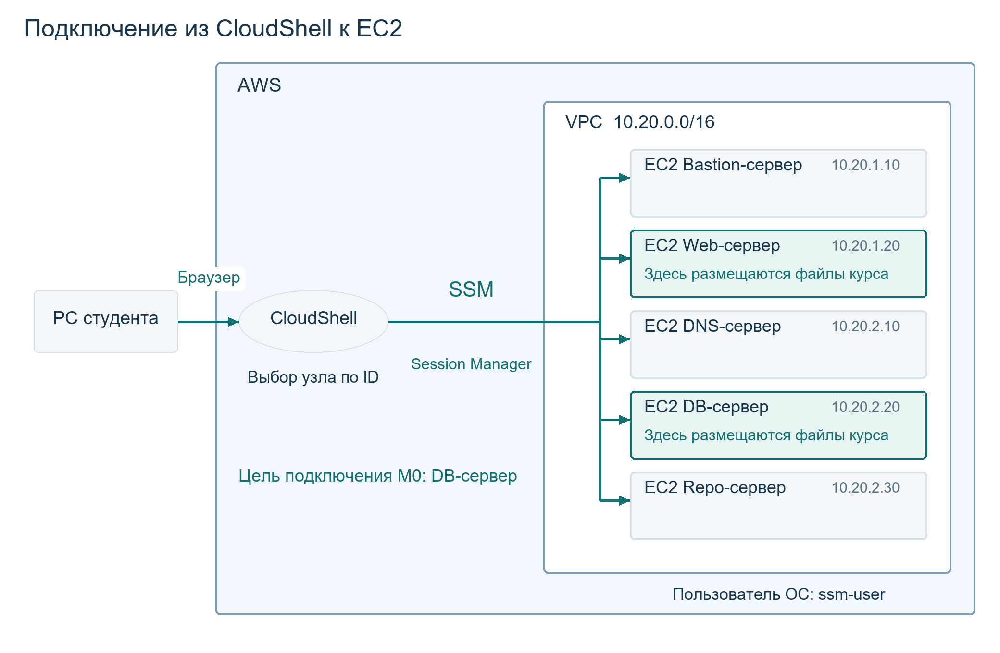

# M0 Своя среда и место выполнения команд

[Практика P0–P6](practice.md) · [Задания M0–M6](missions.md)

[日本語](../ja/m0.md) · [Русский](../ru/m0.md) · [O‘zbekcha](../uz/m0.md)

2026-11-13 · D12 P/M r1.5

Комплект действителен до конца 31 января 2027 года (UZT).

Связанное задание: [P0](p0.md).

## Требуемый результат

В P0 вы учились подключаться к Web-серверу. В M0 самостоятельно найдите свой DB-сервер в списке EC2 и подключитесь к нему через SSM из CloudShell по его instance ID. Убедитесь, что вы на DB-сервере (роль db) под пользователем ssm-user. Затем выберите M0 на странице заданий и проверьте готовность своей среды.

## Подключение к серверам и файлы курса

Откройте CloudShell в AWS из браузера на своём PC и подключитесь к нужному EC2 через SSM. Файлы курса размещаются на Web и DB. При установке по общему коду они размещаются во время создания среды, при подписанном комплекте - в P0.3.

Рисунок 3-4 из главы C3. Откройте EC2 → Instances и скопируйте Instance ID из строки нужного сервера.

## Проверка и отправка

1. Откройте страницу заданий по ссылке преподавателя, войдите через учебный аккаунт Google и выберите свой Lab и **M0**.
2. Запустите проверку выбранного задания.
3. Во время обработки обновляйте результат. Сверьте ID задания, время, каждый check и сохранение. Результат сохраняется автоматически; оценки M доступны в разделе сохранённых оценок.

---

[Предыдущее: P0](p0.md) · [Следующее: P1](p1.md)
