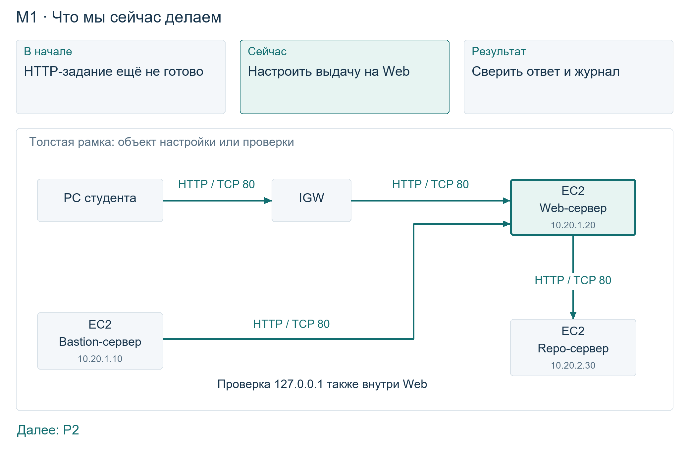

# M1 Выдача статического файла по HTTP (8)

[Практика P0–P5](practice.md) · [Задания M0–M5](missions.md)

[日本語](../ja/m1.md) · [Русский](../ru/m1.md) · [O‘zbekcha](../uz/m1.md)

Связанное задание: [P1](p1.md).


## Требуемый результат

На том же Web-сервере настройте выдачу `/mission.txt` по HTTP на TCP-порту 80. Сохраните доступ к `/practice.txt`.

1. **Web-сервер (P1.2-P1.3).** Создайте файл с указанным ниже текстом. Задайте владельца и группу `root:root` и права `0644`.
2. **Web-сервер и бастион (P1.4-P1.6).** Запросите `/mission.txt` через curl. На самом Web используйте `127.0.0.1`, а на бастионе - `10.20.1.20`. В обоих случаях проверьте HTTP 200 и указанный ниже текст. Найдите запросы в журнале доступа Web-сервера.

## Схема задания



- **Файл для публикации** `/var/www/html/mission.txt`
- **Путь URL** `/mission.txt`

```text
JDU WEB-02 mission: independent HTTP delivery.
```

## Критерии оценки

Каждый критерий даёт 1 балл.

| № | Условие |
| --- | --- |
| 1 | Nginx работает (active). |
| 2 | nginx -t успешно проверяет конфигурацию. |
| 3 | Порт 80 слушает private IP/все интерфейсы, не только loopback. |
| 4 | Обычный файл содержит точный текст, владелец root:root, права 0644. |
| 5 | Web получает HTTP 200 и точный текст через loopback. |
| 6 | Бастион получает HTTP 200 и точный текст через private IP. |
| 7 | CloudShell получает HTTP 200 и точный текст через public IP. |
| 8 | Access log содержит запрос с nonce именно этой проверки. |

## Проверка и отправка

1. Откройте страницу оценок и выберите **M1**.
2. Запустите проверку выбранного задания.
3. По завершении появятся число выполненных критериев и результат каждого. Исправьте пункты с пометкой «Исправить» и запустите проверку снова. «Не проверен» означает, что результат определить не удалось. Баллы отображаются в списке заданий.

---

[Предыдущее: P1](p1.md) · [Следующее: P2](p2.md)
