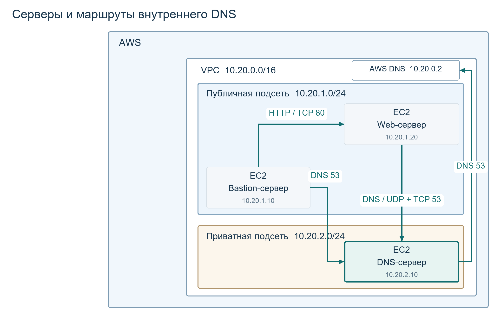

# M2 Внутренний DNS и системное разрешение имён (13)

[Практика P0–P5](practice.md) · [Задания M0–M5](missions.md)

[日本語](../ja/m2.md) · [Русский](../ru/m2.md) · [O‘zbekcha](../uz/m2.md)

Связанное задание: [P2](p2.md).

## Требуемый результат

Перед началом убедитесь на странице оценок, что за [M1](m1.md) получен полный балл.

Добавьте шесть имён из таблицы во внутренний DNS, настроенный в P2. С бастиона должен открываться адрес `http://web.lab.test/mission.txt`.

1. **DNS-сервер (P2.2-P2.4).** Добавьте A-записи в существующую зону `lab.test`. Увеличьте серийный номер зоны, проверьте синтаксис и перечитайте настройки. Имена из P2 можно сохранить.
2. **Бастион и Web-сервер (P2.5-P2.8).** Проверьте прямой запрос к внутреннему DNS и обычное разрешение имён ОС. На бастионе откройте текст M1 по имени `web.lab.test`. На Web проверьте, что `db.lab.test` разрешается в `10.20.2.20`.

## Схема задания

| DNS name | A / IPv4 |
| --- | --- |
| admin.lab.test | 10.20.1.20 |
| bastion.lab.test | 10.20.1.10 |
| db.lab.test | 10.20.2.20 |
| dns.lab.test | 10.20.2.10 |
| repo.lab.test | 10.20.2.30 |
| web.lab.test | 10.20.1.20 |

## Критерии оценки

Каждый критерий даёт 1 балл.

| № | Условие |
| --- | --- |
| 1 | BIND/named работает (active). |
| 2 | Проверки named и zone lab.test завершаются успешно. |
| 3 | SOA/NS zone lab.test и авторитетный ответ соответствуют схеме; NS - dns.lab.test. |
| 4 | Все заданные A-записи profile дают нужные private IP; это один пункт. |
| 5 | И бастион, и Web получают правильные ответы по UDP 53. |
| 6 | И бастион, и Web получают правильные ответы по TCP 53. |
| 7 | Обычный resolver бастиона/Web использует только BIND; нет подмены hosts или Firefox DoH. |
| 8 | С бастиона HTTP по имени profile и заданному пути возвращает 200 и правильный текст. |
| 9 | Обычный resolver Web разрешает имя DB profile в 10.20.2.20. |
| 10 | Forward only направлен только на 10.20.0.2; внешнее DNS-имя разрешается. Внешний HTTP не нужен. |
| 11 | Новое отсутствующее имя этого запуска получает авторитетный NXDOMAIN. |
| 12 | Query/recursion/cache разрешены только localhost, бастиону и Web в BIND; одного SG недостаточно. |
| 13 | AXFR с бастиона/Web явно отклоняется при успешных обычных запросах того же запуска; таймаут не подходит. |

## Проверка и отправка

1. Откройте страницу оценок и выберите **M2**.
2. Запустите проверку выбранного задания.
3. По завершении появятся число выполненных критериев и результат каждого. Исправьте пункты с пометкой «Исправить» и запустите проверку снова. «Не проверен» означает, что результат определить не удалось. Баллы отображаются в списке заданий.

---

[Предыдущее: P2](p2.md) · [Следующее: P3](p3.md)
