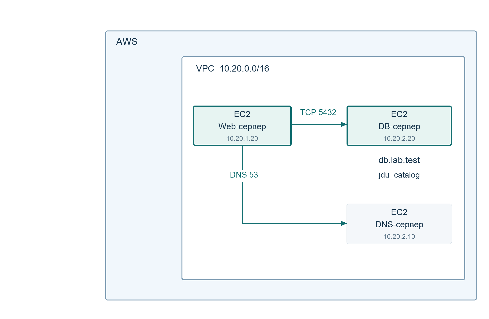

# M3 Подключение к PostgreSQL с аутентификацией (9)

[Практика P0–P5](practice.md) · [Задания M0–M5](missions.md)

[日本語](../ja/m3.md) · [Русский](../ru/m3.md) · [O‘zbekcha](../uz/m3.md)

Связанное задание: [P3](p3.md).

## Требуемый результат

Перед началом убедитесь на странице оценок, что за [M2](m2.md) получен полный балл.

В PostgreSQL из P3 создайте основную БД и две роли, указанные ниже. Таблицы приложения создаются в M4.

1. **DB-сервер (P3.2-P3.6).** Создайте БД и роли и разрешите подключение к нужной БД с указанными ролями только с Web-сервера (`10.20.1.20/32`). Используйте SCRAM, как в P3.
2. **Web-сервер (P3.7-P3.8).** Подключитесь к `db.lab.test` под рабочей ролью и выполните SELECT. Сохраните существующий пароль для профиля `mission` тем же способом, что и в P3.8.

## Схема задания

| Настройка | Значение |
| --- | --- |
| Имя базы данных | `jdu_catalog` |
| Роль настройки | `catalog_setup` |
| Рабочая роль | `catalog_app` |

## Критерии оценки

Каждый критерий даёт 1 балл.

| № | Условие |
| --- | --- |
| 1 | PostgreSQL 16/main работает (active). |
| 2 | Настройки 16/main, стандартный data directory и socket/peer для OS postgres корректны. |
| 3 | PostgreSQL слушает 10.20.2.20:5432. |
| 4 | Владельцем БД и schema public является соответствующая setup-role. |
| 5 | Runtime LOGIN; нет superuser/CREATEDB/CREATEROLE/REPLICATION/BYPASSRLS и повышающих membership. Setup LOGIN при сборке или NOLOGIN после неё. |
| 6 | HBA допускает SCRAM лишь для перечисленных DB/role с Web /32, без широких разрешений. |
| 7 | Новый аутентифицированный SELECT с Web возвращает нужные DB/user/значение; P по IP, M через обычный DNS. |
| 8 | Один неверный пароль явно отклонён в том же запуске, где правильный работает. |
| 9 | С Web запрещены postgres-role, посторонняя DB и чужой profile; ещё не созданная practice DB не обязательна. |

## Проверка и отправка

1. Откройте страницу оценок и выберите **M3**.
2. Запустите проверку выбранного задания.
3. По завершении появятся число выполненных критериев и результат каждого. Исправьте пункты с пометкой «Исправить» и запустите проверку снова. «Не проверен» означает, что результат определить не удалось. Баллы отображаются в списке заданий.

---

[Предыдущее: P3](p3.md) · [Следующее: P4](p4.md)
