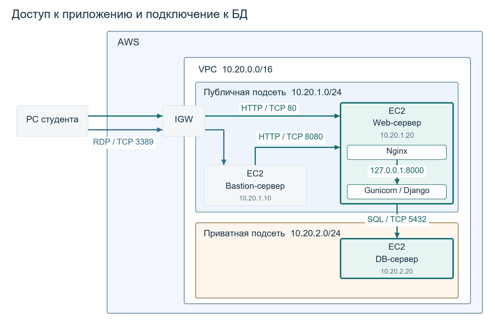

# M4 Соединить предоставленное приложение с Web и DB (13)

[Практика P0–P5](practice.md) · [Задания M0–M5](missions.md)

[日本語](../ja/m4.md) · [Русский](../ru/m4.md) · [O‘zbekcha](../uz/m4.md)

Связанное задание: [P4](p4.md).

## Требуемый результат

Перед началом убедитесь на странице оценок, что за [M2](m2.md), [M3](m3.md) получен полный балл.

Подключите приложение инвентаризации из P4 к основной БД из M3. Перед переключением завершите настройку тренировочного профиля в P5.

1. **Web-сервер (P5.3, P4.4-P4.5).** Остановите приложение и выберите профиль `mission`. Используйте уже развёрнутое приложение. Создайте таблицы, исходные данные и учётную запись администратора в основной БД.
2. **DB- и Web-серверы (P4.6-P4.8).** Назначьте права рабочей роли и запустите приложение. Откройте публичную и административную страницы. Убедитесь, что `/practice.txt` и `/mission.txt` всё ещё доступны.
3. **Бастион (P4.9).** Войдите в `http://admin.lab.test:8080/admin/` как `lab_admin` и внесите две записи из таблицы. На публичной странице проверьте опубликованную запись.

## Схема задания

| Код | Название | Количество | Место хранения | Публикация |
| --- | --- | --- | --- | --- |
| `M5-PUBLIC-001` | Mission monitor | 6 | Lab cabinet C | Да |
| `M5-PRIVATE-001` | Mission router | 1 | Lab cabinet D | Нет |

## Критерии оценки

Каждый критерий даёт 1 балл.

| № | Условие |
| --- | --- |
| 1 | Код и зависимости точно соответствуют предоставленной фиксированной версии. |
| 2 | jdu-catalog active и enabled, работает как catalog. |
| 3 | Gunicorn слушает только 127.0.0.1:8000. |
| 4 | Активный процесс использует DB и runtime-role нужного profile. |
| 5 | Фиксированные migrations, 11 таблиц и нужные sequence находятся в выбранной БД. |
| 6 | Обе обязательные записи совпадают с параметрами profile; дополнительные допустимые записи разрешены. |
| 7 | Обычный публичный URL получает правильные записи из действующей БД. |
| 8 | С бастиона через обычный DNS доступна настоящая форма /admin/ на admin.lab.test:8080. |
| 9 | Static-ресурсы доступны по предусмотренному маршруту. |
| 10 | Функциональный режим проходит настоящий password/CSRF/cookie login, без обхода аутентификации. |
| 11 | В этом запуске через admin HTTP создана одна CK-запись; значения совпали в DB и публичной странице. |
| 12 | Количество именно этой CK-записи изменено; DB и публичная страница подтверждают изменение. |
| 13 | POST logout завершает сессию: прежний cookie снова требует входа. |

## Проверка и отправка

1. Откройте страницу оценок и выберите **M4**.
2. Выберите функциональную проверку с правами, скрыто введите существующий пароль lab_admin в поле администратора приложения и запустите с этим паролем. Это не пароль RDP. Проверка только настроек не подтверждает функции.
3. По завершении появятся число выполненных критериев и результат каждого. Исправьте пункты с пометкой «Исправить» и запустите проверку снова. «Не проверен» означает, что результат определить не удалось. Баллы отображаются в списке заданий.

---

[Предыдущее: P5](p5.md) · [Следующее: M5](m5.md)
