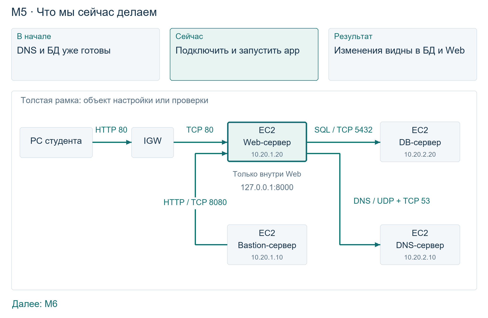

# M5 Минимальные права и границы публикации (16)

[Практика P0–P5](practice.md) · [Задания M0–M5](missions.md)

[日本語](../ja/m5.md) · [Русский](../ru/m5.md) · [O‘zbekcha](../uz/m5.md)

Связанное задание: [P5](p5.md).

## Требуемый результат

Перед началом убедитесь на странице оценок, что за [M4](m4.md) получен полный балл.

Переведите приложение M4 в обычный режим работы способом из P5. Закройте доступ, нужный только при настройке, и сохраните необходимые права приложения и администратора.

1. **DB-сервер (P5.1-P5.2).** Проверьте права `catalog_app`. Запретите вход для роли настройки `catalog_setup`, удалите её пароль и завершите оставшиеся соединения.
2. **Web-сервер (P5.3-P5.4).** Уберите временные настройки (`/etc/jdu-catalog/setup.env` и `/etc/jdu-catalog/profiles/mission.setup.env`) и запустите приложение с рабочим профилем `mission`. Пользователь сервиса не должен менять код. Файлы с секретами принадлежат `root:root` и имеют права `0600`.
3. **Открытая и административная страницы (P5.4-P5.5).** На порту 80 должна отображаться только публичная запись из M4. Откройте панель управления с бастиона на порту 8080 и проверьте, что `lab_admin` может просматривать, добавлять и изменять предметы.

## Схема задания

## Критерии оценки

Каждый критерий даёт 1 балл.

| № | Условие |
| --- | --- |
| 1 | Публичный порт 80 не открывает admin даже с поддельными Host/header; частный путь при этом работает. |
| 2 | Секреты - обычные root:root 0600 файлы, без ссылок и раскрытия значений. |
| 3 | catalog без login/sudo не может менять код, venv и их управляющие каталоги. |
| 4 | Проверяемые env/секретные пути не доступны через HTTP или static. |
| 5 | Setup-role NOLOGIN/password NULL, её сессии закрыты, временные setup.env удалены. |
| 6 | catalog_item: только SELECT/INSERT/UPDATE, без DELETE, TRUNCATE и передачи прав. |
| 7 | auth_user: SELECT и UPDATE только last_login/password, без создания/удаления пользователей. |
| 8 | Таблицы групп, permissions, связей и content type доступны только для SELECT. |
| 9 | django_session: только необходимые SELECT/INSERT/UPDATE/DELETE, без лишних прав. |
| 10 | django_admin_log: только SELECT/INSERT. |
| 11 | У runtime нет прав на django_migrations, schema CREATE, владения объектами и незаданных дополнительных прав. |
| 12 | USAGE только sequence оборудования и admin-log; без лишних SELECT/UPDATE/GRANT. |
| 13 | Активный staff, не superuser: только view/add/change оборудования, без delete/user management. |
| 14 | Анонимные добавление/изменение отклонены без изменения БД при успешном контрольном login; одного CSRF-403 мало. |
| 15 | Один неверный пароль приложения отклонён, при этом правильный login работает. |
| 16 | Все найденные непубличные коды скрыты на публичной странице при доступной БД. |

## Проверка и отправка

1. Откройте страницу оценок и выберите **M5**.
2. Выберите функциональную проверку с правами, скрыто введите существующий пароль lab_admin в поле администратора приложения и запустите с этим паролем. Это не пароль RDP. Проверка только настроек не подтверждает функции.
3. По завершении появятся число выполненных критериев и результат каждого. Исправьте пункты с пометкой «Исправить» и запустите проверку снова. «Не проверен» означает, что результат определить не удалось. Баллы отображаются в списке заданий.

---

[Предыдущее: M4](m4.md)
