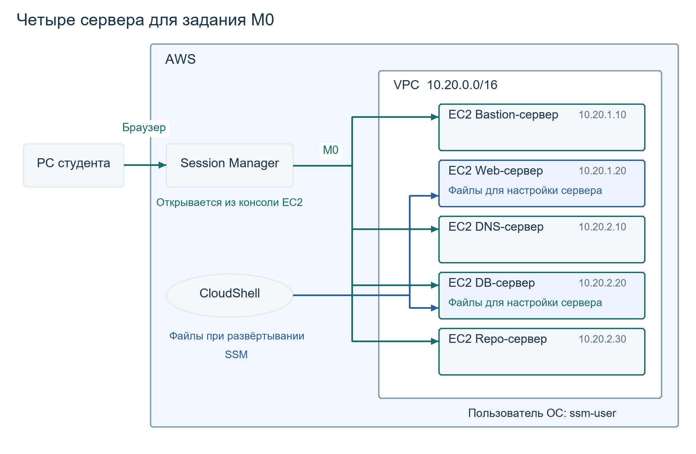

# Web Infrastructure: самостоятельные задания M0-M6

Первая редакция для проверки преподавателем. Полное прохождение по пособию студентом ещё не проверено.

Русский и узбекский тексты синхронизированы с японским оригиналом. Редактура носителями языка ещё не выполнена.

[日本語](../ja/missions-full.md) · [Русский](../ru/missions-full.md) · [O‘zbekcha](../uz/missions-full.md)

[Практика P0–P6](practice.md) · [Задания M0–M6](missions.md)

## Как пользоваться пособием

Сначала прочитайте задание P; при необходимости проходите подробный пример по шагам. P - тренировка с подробными шагами. В M самостоятельно используйте другие объекты/значения. Номера заданий не являются номерами занятий; идите в своём темпе. Выполнение P не означает выполнение M.

P0 → M0 → P1 → M1 → P2 → M2 → P4 → M4 → P5 → P6 → M5 → M6

P5 требует DNS из M2. В P4 потренируйтесь подключаться к БД по IP и имени. Приложение использует db.lab.test. Перед переключением practice → mission завершите setup в P6.

P0=1, M0=4, M1=8, M2=13, M4=9, M5=13, M6=16: всего 64 балла. Нет личной демонстрации, backup/restore, дополнительных дисков и разработки приложения. Пересчёт в 25 баллов делает преподаватель отдельно. Повторные отправки возможны до объявленного срока. PASS разных попыток не объединяются; максимум автоматически не выбирается.

## Среда и подготовка

Сначала завершите проверку подписи начального комплекта, создание пяти узлов либо install в существующую среду, внутренний SSH и личную регистрацию. Инструкция - distribution/STUDENT.md в zip. Не храните приватные ключи в общем Windows; используйте CloudShell личного Academy account. Преподаватель выдаёт личный анонимный Lab ID, fingerprint и срок действия.

Общие private IP ниже; public IPv4 не фиксируется. AWS region us-east-1, Ubuntu24.04/amd64. RDP: labuser; SSM: ssm-user; внутренний SSH: ubuntu. Не путайте пользователя и роль сервера.

| Role | Private IPv4 | Назначение |
| --- | --- | --- |
| bastion | 10.20.1.10 | RDP3389 / Firefox / SSH |
| web | 10.20.1.20 | HTTP80 / private8080 / loopback8000 |
| dns | 10.20.2.10 | BIND UDP/TCP53 |
| db | 10.20.2.20 | PostgreSQL5432 |
| repo | 10.20.2.30 | HTTP80 с заранее сохранёнными подписанными ресурсами |

В P0 и M0 открывайте Session Manager из списка EC2. Если в дальнейшем шаг требует подключения из CloudShell, выполните там `aws ssm start-session --target i-...`, подставив ID сервера. В обоих случаях на сервере используется `ssm-user`.

Редактор nano: открыть файл → ввести текст → Ctrl+O → Enter сохранить → Ctrl+X выйти. Блок конфигурации не выполняется как shell-команда. В psql меняется prompt; SQL/\password вводятся внутри, \q возвращает в Ubuntu. Не продолжайте после ошибки без проверки результата.

Нумерованные комментарии показывают порядок и цель внутри шага. # используется в shell, -- внутри psql. Комментарии менять не нужно. Выполняйте по одной команде, дожидаясь подключения, редактора и ввода пароля. Команда с продолжением строки остаётся одной командой.

## Как читать шаги

В каждом P идут задание, объяснение, шаги и вопросы. Выполняйте команды по одной и читайте результат, не вставляйте весь раздел сразу. Обратная косая черта в конце строки означает продолжение: эта и следующая строки составляют одну команду.

Блок bash вводится в терминале указанного узла. Блок text может содержать конфигурацию, ввод внутри psql или пример вывода: читайте пояснение перед ним. Строка с # - комментарий. Не добавляйте приглашение $ или postgres=# из своего терминала. Значения с YOUR- заменяйте своими.

Проверяйте по порядку: сохранённый файл, синтаксис, применение к службе, реальное соединение. Правильный файл ещё не доказывает, что работающая служба уже использует его. Сопоставляйте HTTP-ответ, DNS-ответ или SQL-результат с журналом.

## Система и пути соединений

| Источник | Назначение | Protocol / port | Цель |
| --- | --- | --- | --- |
| Windows PC | Web public IPv4 | TCP/80 | Публичный доступ через Internet Gateway к каталогу и статическим файлам. |
| Windows PC | bastion public IPv4 | TCP/3389 | RDP из разрешённого CIDR к рабочему столу бастиона. |
| bastion | Web/DNS/DB/repo | TCP/22 | Внутренний SSH для управления; приватный ключ остаётся на бастионе. |
| bastion / Web | DNS 10.20.2.10 | UDP+TCP/53 | Разрешение имён lab.test. DNS не выдаёт содержимое Web-страницы. |
| Web app | DB 10.20.2.20 | TCP/5432 | SQL от роли приложения. Прямое соединение Windows с DB не используется. |
| bastion | Web 10.20.1.20 | TCP/8080 | Администрирование через admin.lab.test отдельно от публичного порта 80. |
| Nginx on Web | 127.0.0.1 on Web | TCP/8000 | Передача приложению на том же Web; 127.0.0.1 - текущий локальный узел. |

SSM начальной среды - отдельный путь управления из CloudShell в EC2. Он не включён в путь обычного Web-запроса. Внутренние IP и порты таблицы заданы этим Lab, а не всеми Web-системами.

## Перед самостоятельной работой

Из требований выпишите, на каком сервере меняется файл, имя, БД или роль. Сравните значения P и M и выберите объекты задания M. Таблица проверок описывает требуемое состояние, а не порядок команд.

Затем решите, откуда и чем подтвердить каждое требование. Проверка файла и проверка соединения могут выполняться на разных узлах. Отдельно фиксируйте успех разрешённого пути и отказ запрещённого.

Выберите задание в браузере, проверьте результат и сохранение. Для функций M5/M6 скрыто введите существующий пароль администратора приложения. Оценки сохраняются автоматически. Вопросы на понимание и заметки не добавляют требований к оценке.

## M0 Своя среда и место выполнения команд (4)

### Требуемый результат

Воспользуйтесь способом подключения из P0 и откройте Session Manager для четырёх серверов. В списке EC2 нажмите **Instance ID** нужного сервера, затем стрелку справа от **Connect** и **Connect with SSM Session Manager**. На каждом сервере войдите как `ssm-user` и создайте в своём домашнем каталоге файл `m0-connection.txt` с одной строкой из таблицы.

| Сервер | Окончание имени в EC2 | Содержимое файла |
| --- | --- | --- |
| Сервер БД | `-db` | `db` |
| DNS-сервер | `-dns` | `dns` |
| Сервер пакетов | `-repo` | `repo` |
| Сервер Bastion | `-bastion` | `bastion` |

Выберите **M0** на странице заданий. За каждый верный файл начисляется 1 балл, всего можно получить 4 балла.

### Подключение к серверам и размещение файлов для настройки



Зелёные стрелки указывают на четыре сервера для подключения через Session Manager и создания файла. Синие стрелки показывают размещение файлов при создании среды.


Список Instances в EC2. Для P0 выберите строку с окончанием имени `-web`, для M0 - `-db`, `-dns`, `-repo` и `-bastion` по очереди.


Страница EC2. Нажмите стрелку справа от Connect и выберите Connect with SSM Session Manager. На снимке показан Web-сервер.

### Проверка и отправка

1. Откройте страницу заданий, которую использовали в P0. Войдите через учебный аккаунт Google и выберите свой Lab и **M0**.
2. Запустите проверку выбранного задания.
3. Во время обработки обновляйте результат. Сверьте ID задания, время, каждый check и сохранение. Результат сохраняется автоматически; оценки M доступны в разделе сохранённых оценок.

## M1 Выдача статического файла по HTTP (8)

### Требуемый результат

По навыкам P1 самостоятельно выдайте другой заданный файл и текст. Сохраните practice.txt. Проверяются файл, сервис, слушатель, local/bastion/public HTTP и журнал текущего запроса.

### Схема задания


Толстая рамка отмечает основной объект. Настраивайте в терминале, указанном в шаге; стрелки показывают направление подключения или проверки. Разрешения SG заданы начальным комплектом; здесь настраивается сервер. Слева Интернет, справа VPC в AWS. IGW стоит на границе VPC; все EC2, включая бастион, находятся в AWS. По схеме самостоятельно выберите настройки из требований.

- File: /var/www/html/mission.txt
- URL path: /mission.txt

```text
JDU WEB-02 mission: independent HTTP delivery.
```

### Условия: 1 исходный балл за проверку

| check ID (не менять) | Условие |
| --- | --- |
| WEB02_NGINX_ACTIVE | Nginx работает (active). |
| WEB02_CONFIG_VALID | nginx -t успешно проверяет конфигурацию. |
| WEB02_LISTEN_80 | Порт 80 слушает private IP/все интерфейсы, не только loopback. |
| WEB02_FILE | Обычный файл содержит точный текст, владелец root:root, права 0644. |
| WEB02_LOCAL_HTTP | Web получает HTTP 200 и точный текст через loopback. |
| WEB02_BASTION_HTTP | Бастион получает HTTP 200 и точный текст через private IP. |
| WEB02_PUBLIC_HTTP | CloudShell получает HTTP 200 и точный текст через public IP. |
| WEB02_ACCESS_LOG | Access log содержит запрос с nonce именно этой проверки. |

Проверки identity/управления/repo/сети/зависимостей не добавляют баллов. Частичные баллы не означают готовность следующего этапа при неисправных предпосылках.

### Проверка и отправка

1. Откройте страницу заданий, которую использовали в P0. Войдите через учебный аккаунт Google и выберите свой Lab и **M1**.
2. Запустите проверку выбранного задания.
3. Во время обработки обновляйте результат. Сверьте ID задания, время, каждый check и сохранение. Результат сохраняется автоматически; оценки M доступны в разделе сохранённых оценок.

## M2 Внутренний DNS и системное разрешение имён (13)

### Требуемый результат

Добавьте шесть основных имён в ту же zone lab.test. guide/practice-db можно сохранить. Нужны обычный resolver бастиона/Web, HTTP M1 по имени, имя DB, UDP/TCP, forwarding, NXDOMAIN, ACL и запрет AXFR.

### Схема задания


Толстая рамка отмечает основной объект. Настраивайте в терминале, указанном в шаге; стрелки показывают направление подключения или проверки. Разрешения SG заданы начальным комплектом; здесь настраивается сервер. По схеме самостоятельно выберите настройки из требований.

| DNS name | A / IPv4 |
| --- | --- |
| admin.lab.test | 10.20.1.20 |
| bastion.lab.test | 10.20.1.10 |
| db.lab.test | 10.20.2.20 |
| dns.lab.test | 10.20.2.10 |
| repo.lab.test | 10.20.2.30 |
| web.lab.test | 10.20.1.20 |

- Текущие предпосылки: M1

### Условия: 1 исходный балл за проверку

| check ID (не менять) | Условие |
| --- | --- |
| WEB03_SERVICE | BIND/named работает (active). |
| WEB03_CONFIG_VALID | Проверки named и zone lab.test завершаются успешно. |
| WEB03_ZONE_AUTHORITY | SOA/NS zone lab.test и авторитетный ответ соответствуют схеме; NS - dns.lab.test. |
| WEB03_REQUIRED_RECORDS | Все заданные A-записи profile дают нужные private IP; это один пункт. |
| WEB03_UDP_RESPONSE | И бастион, и Web получают правильные ответы по UDP 53. |
| WEB03_TCP_RESPONSE | И бастион, и Web получают правильные ответы по TCP 53. |
| WEB03_NORMAL_RESOLVER | Обычный resolver бастиона/Web использует только BIND; нет подмены hosts или Firefox DoH. |
| WEB03_NAMED_HTTP | С бастиона HTTP по имени profile и заданному пути возвращает 200 и правильный текст. |
| WEB03_DB_NAME | Обычный resolver Web разрешает имя DB profile в 10.20.2.20. |
| WEB03_FORWARD_ONLY | Forward only направлен только на 10.20.0.2; внешнее DNS-имя разрешается. Внешний HTTP не нужен. |
| WEB03_NXDOMAIN | Новое отсутствующее имя этого запуска получает авторитетный NXDOMAIN. |
| WEB03_CLIENT_ACL | Query/recursion/cache разрешены только localhost, бастиону и Web в BIND; одного SG недостаточно. |
| WEB03_AXFR_DENIED | AXFR с бастиона/Web явно отклоняется при успешных обычных запросах того же запуска; таймаут не подходит. |

Проверки identity/управления/repo/сети/зависимостей не добавляют баллов. Частичные баллы не означают готовность следующего этапа при неисправных предпосылках.

### Проверка и отправка

1. Откройте страницу заданий, которую использовали в P0. Войдите через учебный аккаунт Google и выберите свой Lab и **M2**.
2. Запустите проверку выбранного задания.
3. Во время обработки обновляйте результат. Сверьте ID задания, время, каждый check и сохранение. Результат сохраняется автоматически; оценки M доступны в разделе сохранённых оценок.

## M4 Подключение к PostgreSQL с аутентификацией (9)

### Требуемый результат

Самостоятельно настройте основную БД и роли. Используйте db.lab.test из M2 по аналогии с подключением по имени в P4.7 и выполните SELECT с Web runtime-role. HBA разрешает только Web/32 и правильную пару DB/role. Существующий пароль сохраните через helper mission на Web, отдельно от practice. Таблицы приложения пока не нужны.

### Схема задания


Толстая рамка отмечает основной объект. Настраивайте в терминале, указанном в шаге; стрелки показывают направление подключения или проверки. Разрешения SG заданы начальным комплектом; здесь настраивается сервер. Подключитесь из CloudShell к DB через SSM и настройте сервер. По схеме самостоятельно выберите настройки из требований.

- Profile: mission
- Database: jdu_catalog
- Setup role: catalog_setup
- Runtime role: catalog_app
- Текущие предпосылки: M2

### Условия: 1 исходный балл за проверку

| check ID (не менять) | Условие |
| --- | --- |
| WEB05_CLUSTER_ACTIVE | PostgreSQL 16/main работает (active). |
| WEB05_CLUSTER_CONFIG | Настройки 16/main, стандартный data directory и socket/peer для OS postgres корректны. |
| WEB05_LISTEN_5432 | PostgreSQL слушает 10.20.2.20:5432. |
| WEB05_DATABASE_OWNER | Владельцем БД и schema public является соответствующая setup-role. |
| WEB05_ROLE_ATTRIBUTES | Runtime LOGIN; нет superuser/CREATEDB/CREATEROLE/REPLICATION/BYPASSRLS и повышающих membership. Setup LOGIN при сборке или NOLOGIN после неё. |
| WEB05_HBA_SCRAM | HBA допускает SCRAM лишь для перечисленных DB/role с Web /32, без широких разрешений. |
| WEB05_WEB_SQL | Новый аутентифицированный SELECT с Web возвращает нужные DB/user/значение; P по IP, M через обычный DNS. |
| WEB05_BAD_PASSWORD_DENIED | Один неверный пароль явно отклонён в том же запуске, где правильный работает. |
| WEB05_WRONG_TARGET_DENIED | С Web запрещены postgres-role, посторонняя DB и чужой profile; ещё не созданная practice DB не обязательна. |

Проверки identity/управления/repo/сети/зависимостей не добавляют баллов. Частичные баллы не означают готовность следующего этапа при неисправных предпосылках.

### Проверка и отправка

1. Откройте страницу заданий, которую использовали в P0. Войдите через учебный аккаунт Google и выберите свой Lab и **M4**.
2. Запустите проверку выбранного задания.
3. Во время обработки обновляйте результат. Сверьте ID задания, время, каждый check и сохранение. Результат сохраняется автоматически; оценки M доступны в разделе сохранённых оценок.

## M5 Соединить предоставленное приложение с Web и DB (13)

### Требуемый результат

Подключите то же приложение к БД mission. Используйте навыки P5 с profile=mission, не копируйте заново app/venv. Остановите приложение по примеру P6.3. Используйте порядок P5.4-P5.5 для создания и активации runtime и подготовки временного setup, подставив профиль mission. Выполните migrations/seed/admin и grants в основной БД, добавьте две заданные записи. Сохраните P1/M1, оставьте mission активным.

### Схема задания

![M5: DNS и БД уже готовы → Подключить и запустить app → Изменения видны в БД и Web。 Толстая рамка отмечает основной объект. Настраивайте в терминале, указанном в шаге; стрелки показывают направление подключения или проверки. Разрешения SG заданы начальным комплектом; здесь настраивается сервер. 8000 доступен только внутри Web; 8080 используется для управления с бастиона. Слева Интернет, справа VPC в AWS. IGW стоит на границе VPC; все EC2, включая бастион, находятся в AWS. По схеме самостоятельно выберите настройки из требований.](../../assets/ru/m5.png)

Толстая рамка отмечает основной объект. Настраивайте в терминале, указанном в шаге; стрелки показывают направление подключения или проверки. Разрешения SG заданы начальным комплектом; здесь настраивается сервер. 8000 доступен только внутри Web; 8080 используется для управления с бастиона. Слева Интернет, справа VPC в AWS. IGW стоит на границе VPC; все EC2, включая бастион, находятся в AWS. По схеме самостоятельно выберите настройки из требований.

- Profile: mission
- Database: jdu_catalog
- Setup role: catalog_setup
- Runtime role: catalog_app
- Application administrator: lab_admin

| code | name | quantity | location | is_public |
| --- | --- | --- | --- | --- |
| M5-PUBLIC-001 | Mission monitor | 6 | Lab cabinet C | true |
| M5-PRIVATE-001 | Mission router | 1 | Lab cabinet D | false |

- Текущие предпосылки: M2, M4

### Условия: 1 исходный балл за проверку

| check ID (не менять) | Условие |
| --- | --- |
| WEB06_ARTIFACTS | Код и зависимости точно соответствуют предоставленной фиксированной версии. |
| WEB06_SERVICE | jdu-catalog active и enabled, работает как catalog. |
| WEB06_LOOPBACK | Gunicorn слушает только 127.0.0.1:8000. |
| WEB06_PROFILE_DATABASE | Активный процесс использует DB и runtime-role нужного profile. |
| WEB06_MIGRATIONS | Фиксированные migrations, 11 таблиц и нужные sequence находятся в выбранной БД. |
| WEB06_REQUIRED_RECORDS | Обе обязательные записи совпадают с параметрами profile; дополнительные допустимые записи разрешены. |
| WEB06_PUBLIC_DATA | Обычный публичный URL получает правильные записи из действующей БД. |
| WEB06_ADMIN_ENTRY | С бастиона через обычный DNS доступна настоящая форма /admin/ на admin.lab.test:8080. |
| WEB06_STATIC | Static-ресурсы доступны по предусмотренному маршруту. |
| WEB06_PASSWORD_LOGIN | Функциональный режим проходит настоящий password/CSRF/cookie login, без обхода аутентификации. |
| WEB06_CREATE_REFLECT | В этом запуске через admin HTTP создана одна CK-запись; значения совпали в DB и публичной странице. |
| WEB06_EDIT_REFLECT | Количество именно этой CK-записи изменено; DB и публичная страница подтверждают изменение. |
| WEB06_LOGOUT | POST logout завершает сессию: прежний cookie снова требует входа. |

Проверки identity/управления/repo/сети/зависимостей не добавляют баллов. Частичные баллы не означают готовность следующего этапа при неисправных предпосылках.

### Проверка и отправка

1. Откройте страницу заданий, которую использовали в P0. Войдите через учебный аккаунт Google и выберите свой Lab и **M5**.
2. Выберите функциональную проверку с правами, скрыто введите существующий пароль lab_admin в поле администратора приложения и запустите с этим паролем. Это не пароль RDP. Проверка только настроек не подтверждает функции.
3. Во время обработки обновляйте результат. Сверьте ID задания, время, каждый check и сохранение. Результат сохраняется автоматически; оценки M доступны в разделе сохранённых оценок.

## M6 Минимальные права и границы публикации (16)

### Требуемый результат

Завершите минимальные права mission: catalog_setup NOLOGIN/password NULL, временные setup-файлы удалены. Проверьте root-код/venv, секреты 600, запрет admin на 80, успешный private8080, права admin только view/add/change, разделение публичных данных и SQL-права. Функциональная проверка в браузере автоматическая; личная демонстрация не нужна.

### Схема задания

![M6: Приложение уже работает → Убрать лишние права и доступ → Разрешённое работает, лишнее нет。 Толстая рамка отмечает основной объект. Настраивайте в терминале, указанном в шаге; стрелки показывают направление подключения или проверки. Разрешения SG заданы начальным комплектом; здесь настраивается сервер. 8000 доступен только внутри Web; 8080 используется для управления с бастиона. Слева Интернет, справа VPC в AWS. IGW стоит на границе VPC; все EC2, включая бастион, находятся в AWS. По схеме самостоятельно выберите настройки из требований.](../../assets/ru/m6.png)

Толстая рамка отмечает основной объект. Настраивайте в терминале, указанном в шаге; стрелки показывают направление подключения или проверки. Разрешения SG заданы начальным комплектом; здесь настраивается сервер. 8000 доступен только внутри Web; 8080 используется для управления с бастиона. Слева Интернет, справа VPC в AWS. IGW стоит на границе VPC; все EC2, включая бастион, находятся в AWS. По схеме самостоятельно выберите настройки из требований.

- Profile: mission
- Database: jdu_catalog
- Setup role: catalog_setup
- Runtime role: catalog_app
- Application administrator: lab_admin

| code | name | quantity | location | is_public |
| --- | --- | --- | --- | --- |
| M5-PUBLIC-001 | Mission monitor | 6 | Lab cabinet C | true |
| M5-PRIVATE-001 | Mission router | 1 | Lab cabinet D | false |

- Текущие предпосылки: M5

### Условия: 1 исходный балл за проверку

| check ID (не менять) | Условие |
| --- | --- |
| WEB07_PUBLIC_ADMIN_DENIED | Публичный порт 80 не открывает admin даже с поддельными Host/header; частный путь при этом работает. |
| WEB07_SECRET_PERMISSIONS | Секреты - обычные root:root 0600 файлы, без ссылок и раскрытия значений. |
| WEB07_CODE_PROTECTED | catalog без login/sudo не может менять код, venv и их управляющие каталоги. |
| WEB07_SECRET_HTTP_DENIED | Проверяемые env/секретные пути не доступны через HTTP или static. |
| WEB07_SETUP_RETIRED | Setup-role NOLOGIN/password NULL, её сессии закрыты, временные setup.env удалены. |
| WEB07_ITEM_PRIVILEGES | catalog_item: только SELECT/INSERT/UPDATE, без DELETE, TRUNCATE и передачи прав. |
| WEB07_AUTH_USER_PRIVILEGES | auth_user: SELECT и UPDATE только last_login/password, без создания/удаления пользователей. |
| WEB07_AUTH_LOOKUP_PRIVILEGES | Таблицы групп, permissions, связей и content type доступны только для SELECT. |
| WEB07_SESSION_PRIVILEGES | django_session: только необходимые SELECT/INSERT/UPDATE/DELETE, без лишних прав. |
| WEB07_AUDIT_PRIVILEGES | django_admin_log: только SELECT/INSERT. |
| WEB07_MIGRATION_PRIVILEGES | У runtime нет прав на django_migrations, schema CREATE, владения объектами и незаданных дополнительных прав. |
| WEB07_SEQUENCE_PRIVILEGES | USAGE только sequence оборудования и admin-log; без лишних SELECT/UPDATE/GRANT. |
| WEB07_ADMIN_PERMISSIONS | Активный staff, не superuser: только view/add/change оборудования, без delete/user management. |
| WEB07_ANONYMOUS_DENIED | Анонимные добавление/изменение отклонены без изменения БД при успешном контрольном login; одного CSRF-403 мало. |
| WEB07_BAD_PASSWORD_DENIED | Один неверный пароль приложения отклонён, при этом правильный login работает. |
| WEB07_PRIVATE_DATA_HIDDEN | Все найденные непубличные коды скрыты на публичной странице при доступной БД. |

Проверки identity/управления/repo/сети/зависимостей не добавляют баллов. Частичные баллы не означают готовность следующего этапа при неисправных предпосылках.

### Проверка и отправка

1. Откройте страницу заданий, которую использовали в P0. Войдите через учебный аккаунт Google и выберите свой Lab и **M6**.
2. Выберите функциональную проверку с правами, скрыто введите существующий пароль lab_admin в поле администратора приложения и запустите с этим паролем. Это не пароль RDP. Проверка только настроек не подтверждает функции.
3. Во время обработки обновляйте результат. Сверьте ID задания, время, каждый check и сохранение. Результат сохраняется автоматически; оценки M доступны в разделе сохранённых оценок.

## Продолжение и результаты

В следующий раз запустите свой Lab и те же пять узлов, проверьте running/SSM Online и текущие public IP. Войдите в Web Portal через школьный Google и начните с готовности M0. Не повторяйте создание, ключи и регистрацию каждый раз. При истечении срока запросите обновление у преподавателя.

Результаты сохраняются автоматически. Во время обработки обновляйте результат; оценки смотрите в разделе сохранённых оценок. Сверяйте задание, время и сохранение. UNKNOWN означает невозможность измерения, а не успех или подтверждённый ноль. Подтверждённые баллы непроверенных M сохраняются. Используется последний оцениваемый результат, без объединения PASS разных запусков и автоматического выбора максимума.

Не отправляйте пароль/token/cookie/приватный ключ/env в отчёт или чат.

## Справочные материалы

- [Nginx Beginner’s Guide](https://nginx.org/en/docs/beginners_guide.html)
- [BIND 9: configurations and zones](https://bind9.readthedocs.io/en/v9.18.39/chapter3.html)
- [PostgreSQL 16: pg_hba.conf](https://www.postgresql.org/docs/16/auth-pg-hba-conf.html)
- [EC2 instance states](https://docs.aws.amazon.com/AWSEC2/latest/UserGuide/ec2-instance-lifecycle.html)
