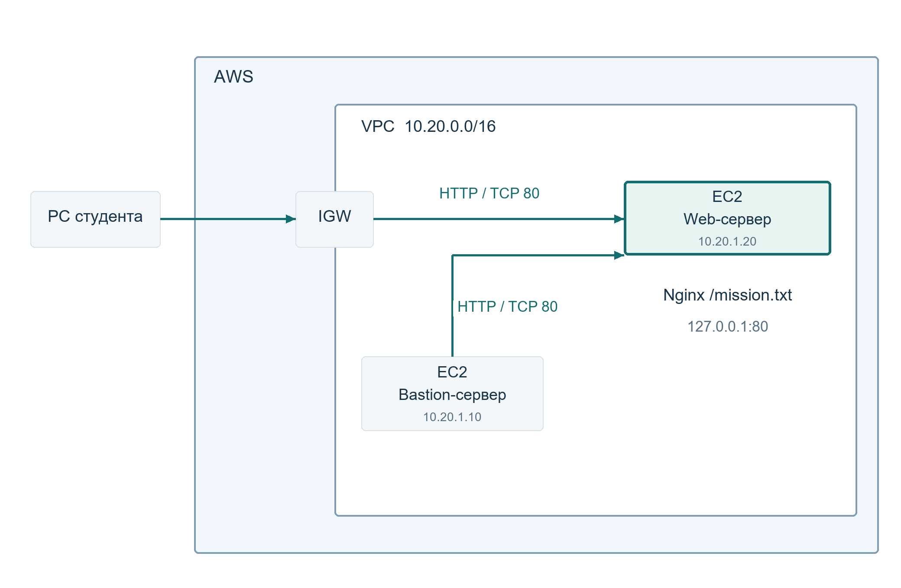
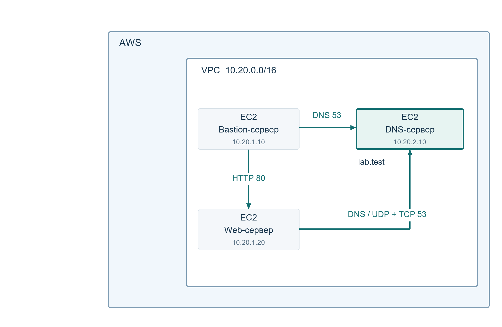
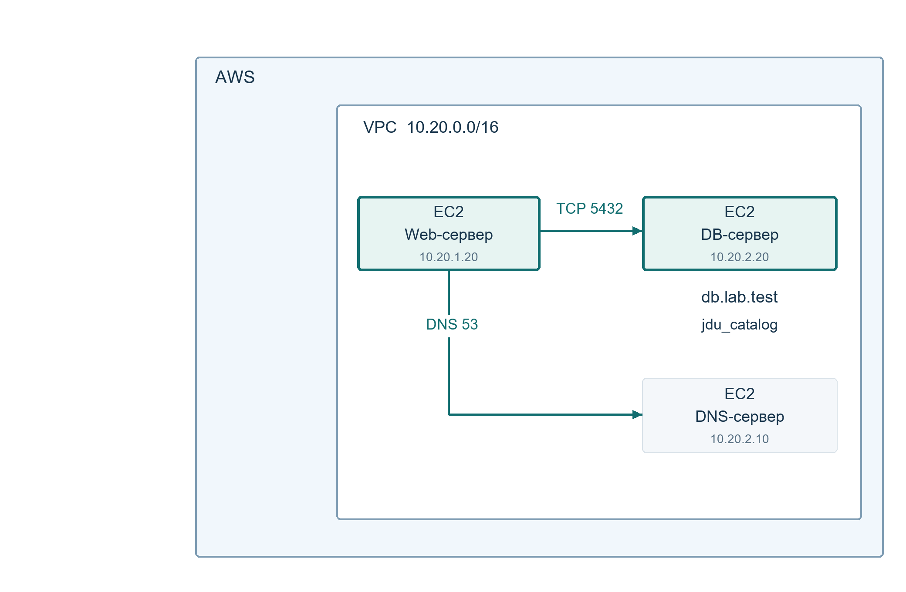
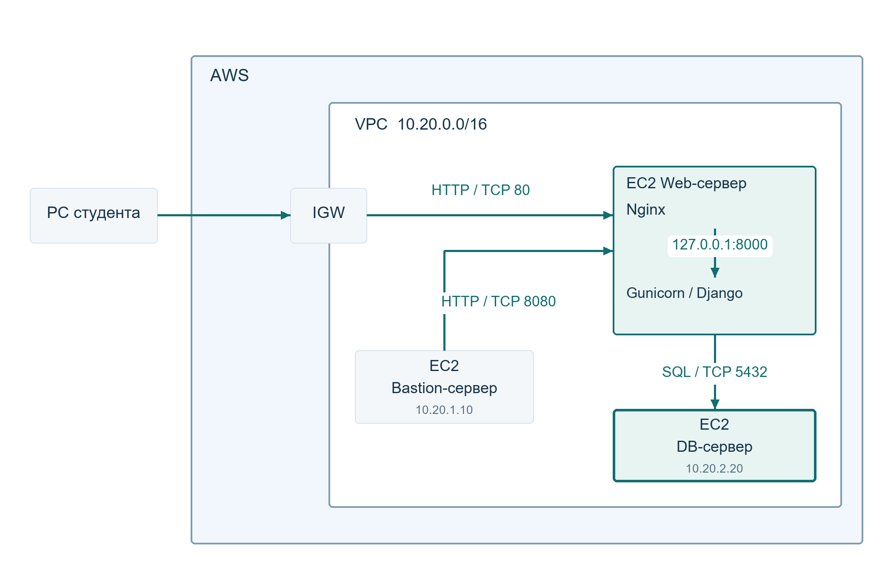
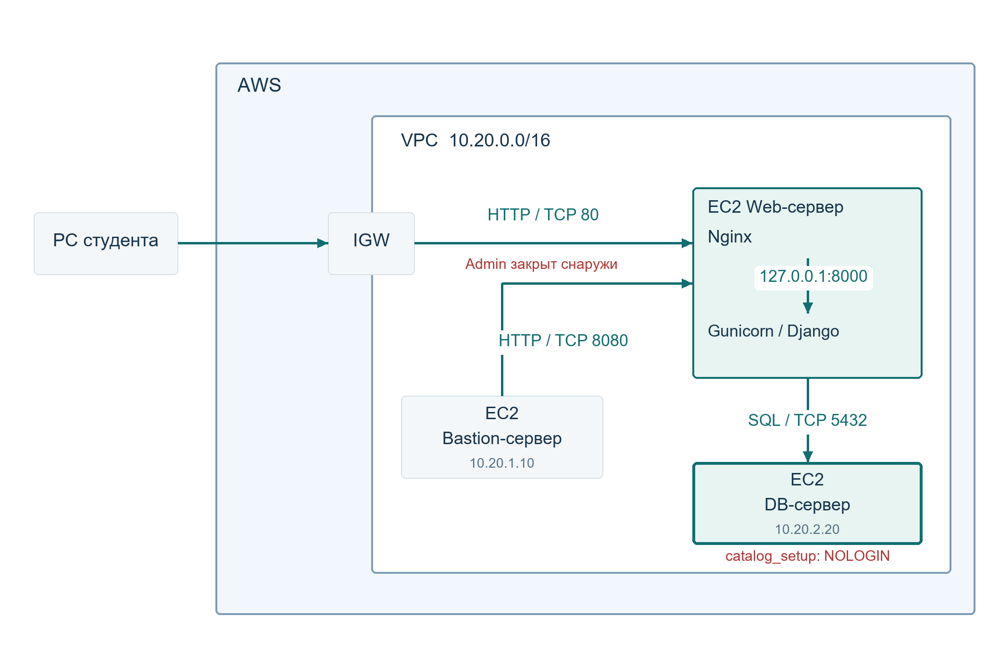

# Web Infrastructure: самостоятельные задания M0-M5

Первая редакция для проверки преподавателем. Полное прохождение по пособию студентом ещё не проверено.

Русский и узбекский тексты синхронизированы с японским оригиналом. Редактура носителями языка ещё не выполнена.

[日本語](../ja/missions-full.md) · [Русский](../ru/missions-full.md) · [O‘zbekcha](../uz/missions-full.md)

[Практика P0–P6](practice.md) · [Задания M0–M5](missions.md)

## Как пользоваться пособием

Используйте шаги из практики P, чтобы добавить файлы и настройки задания в ту же учебную среду. Сверяйтесь со значениями в каждом M и соответствующими шагами P.

P0 → M0 → P1 → M1 → P2 → M2 → P4 → M3 → P5 → P6 → M4 → M5

Завершите тренировочные настройки в P6. Затем в M4 подключите то же приложение к основной базе.

## M0 Своя среда и место выполнения команд (4)

### Требуемый результат

Воспользуйтесь способом подключения из P0 и откройте Session Manager для четырёх серверов. В списке EC2 нажмите **Instance ID** нужного сервера, затем стрелку справа от **Connect** и **Connect with SSM Session Manager**. На каждом сервере войдите как `ssm-user` и создайте в своём домашнем каталоге файл `m0-connection.txt` с одной строкой из таблицы.

| Сервер | Окончание имени в EC2 | Содержимое файла |
| --- | --- | --- |
| Сервер БД | `-db` | `db` |
| DNS-сервер | `-dns` | `dns` |
| Сервер пакетов | `-repo` | `repo` |
| Сервер Bastion | `-bastion` | `bastion` |

Выберите **M0** на странице заданий. За каждый верный файл начисляется 1 балл, всего можно получить 4 балла.

### Подключение к серверам


Зелёные стрелки ведут к четырём серверам для M0.


Список Instances в EC2. Для P0 выберите строку с окончанием имени `-web`, для M0 - `-db`, `-dns`, `-repo` и `-bastion` по очереди.


Страница EC2. Нажмите стрелку справа от Connect и выберите Connect with SSM Session Manager. На снимке показан Web-сервер.

### Проверка и отправка

1. Откройте страницу заданий, которую использовали в P0. Войдите через учебный аккаунт Google и выберите свой Lab и **M0**.
2. Запустите проверку выбранного задания.
3. Во время обработки обновляйте результат. Посмотрите, сколько критериев выполнено. Внесите нужные исправления и проверьте снова. Результат сохраняется автоматически.

## M1 Выдача статического файла по HTTP (8)

### Требуемый результат

На том же Web-сервере настройте выдачу `/mission.txt` по HTTP на TCP-порту 80. Сохраните доступ к `/practice.txt`.

1. **Web-сервер (P1.2-P1.3).** Создайте файл с указанным ниже текстом. Задайте владельца и группу `root:root` и права `0644`.
2. **Web-сервер и бастион (P1.4-P1.6).** Запросите `/mission.txt` через curl. На самом Web используйте `127.0.0.1`, а на бастионе - `10.20.1.20`. В обоих случаях проверьте HTTP 200 и указанный ниже текст. Найдите запросы в журнале доступа Web-сервера.

### Схема задания



- **Файл для публикации** `/var/www/html/mission.txt`
- **Путь URL** `/mission.txt`

```text
JDU WEB-02 mission: independent HTTP delivery.
```

### Критерии оценки

Каждый критерий даёт 1 балл.

| № | Условие |
| --- | --- |
| 1 | Nginx работает (active). |
| 2 | nginx -t успешно проверяет конфигурацию. |
| 3 | Порт 80 слушает private IP/все интерфейсы, не только loopback. |
| 4 | Обычный файл содержит точный текст, владелец root:root, права 0644. |
| 5 | Web получает HTTP 200 и точный текст через loopback. |
| 6 | Бастион получает HTTP 200 и точный текст через private IP. |
| 7 | CloudShell получает HTTP 200 и точный текст через public IP. |
| 8 | Access log содержит запрос с nonce именно этой проверки. |

### Проверка и отправка

1. Откройте страницу оценок и выберите **M1**.
2. Запустите проверку выбранного задания.
3. По завершении появятся число выполненных критериев и результат каждого. Исправьте пункты с пометкой «Исправить» и запустите проверку снова. «Не проверен» означает, что результат определить не удалось. Баллы отображаются в списке заданий.

## M2 Внутренний DNS и системное разрешение имён (13)

### Требуемый результат

Перед началом убедитесь на странице оценок, что за [M1](m1.md) получен полный балл.

Добавьте шесть имён из таблицы во внутренний DNS, настроенный в P2. С бастиона должен открываться адрес `http://web.lab.test/mission.txt`.

1. **DNS-сервер (P2.2-P2.4).** Добавьте A-записи в существующую зону `lab.test`. Увеличьте серийный номер зоны, проверьте синтаксис и перечитайте настройки. Имена из P2 можно сохранить.
2. **Бастион и Web-сервер (P2.5-P2.8).** Проверьте прямой запрос к внутреннему DNS и обычное разрешение имён ОС. На бастионе откройте текст M1 по имени `web.lab.test`. На Web проверьте, что `db.lab.test` разрешается в `10.20.2.20`.

### Схема задания



| DNS name | A / IPv4 |
| --- | --- |
| admin.lab.test | 10.20.1.20 |
| bastion.lab.test | 10.20.1.10 |
| db.lab.test | 10.20.2.20 |
| dns.lab.test | 10.20.2.10 |
| repo.lab.test | 10.20.2.30 |
| web.lab.test | 10.20.1.20 |

### Критерии оценки

Каждый критерий даёт 1 балл.

| № | Условие |
| --- | --- |
| 1 | BIND/named работает (active). |
| 2 | Проверки named и zone lab.test завершаются успешно. |
| 3 | SOA/NS zone lab.test и авторитетный ответ соответствуют схеме; NS - dns.lab.test. |
| 4 | Все заданные A-записи profile дают нужные private IP; это один пункт. |
| 5 | И бастион, и Web получают правильные ответы по UDP 53. |
| 6 | И бастион, и Web получают правильные ответы по TCP 53. |
| 7 | Обычный resolver бастиона/Web использует только BIND; нет подмены hosts или Firefox DoH. |
| 8 | С бастиона HTTP по имени profile и заданному пути возвращает 200 и правильный текст. |
| 9 | Обычный resolver Web разрешает имя DB profile в 10.20.2.20. |
| 10 | Forward only направлен только на 10.20.0.2; внешнее DNS-имя разрешается. Внешний HTTP не нужен. |
| 11 | Новое отсутствующее имя этого запуска получает авторитетный NXDOMAIN. |
| 12 | Query/recursion/cache разрешены только localhost, бастиону и Web в BIND; одного SG недостаточно. |
| 13 | AXFR с бастиона/Web явно отклоняется при успешных обычных запросах того же запуска; таймаут не подходит. |

### Проверка и отправка

1. Откройте страницу оценок и выберите **M2**.
2. Запустите проверку выбранного задания.
3. По завершении появятся число выполненных критериев и результат каждого. Исправьте пункты с пометкой «Исправить» и запустите проверку снова. «Не проверен» означает, что результат определить не удалось. Баллы отображаются в списке заданий.

## M3 Подключение к PostgreSQL с аутентификацией (9)

### Требуемый результат

Перед началом убедитесь на странице оценок, что за [M2](m2.md) получен полный балл.

В PostgreSQL из P4 создайте основную БД и две роли, указанные ниже. Таблицы приложения создаются в M4.

1. **DB-сервер (P4.2-P4.6).** Создайте БД и роли и разрешите подключение к нужной БД с указанными ролями только с Web-сервера (`10.20.1.20/32`). Используйте SCRAM, как в P4.
2. **Web-сервер (P4.7-P4.8).** Подключитесь к `db.lab.test` под рабочей ролью и выполните SELECT. Сохраните существующий пароль для профиля `mission` тем же способом, что и в P4.8.

### Схема задания



| Настройка | Значение |
| --- | --- |
| Имя базы данных | `jdu_catalog` |
| Роль настройки | `catalog_setup` |
| Рабочая роль | `catalog_app` |

### Критерии оценки

Каждый критерий даёт 1 балл.

| № | Условие |
| --- | --- |
| 1 | PostgreSQL 16/main работает (active). |
| 2 | Настройки 16/main, стандартный data directory и socket/peer для OS postgres корректны. |
| 3 | PostgreSQL слушает 10.20.2.20:5432. |
| 4 | Владельцем БД и schema public является соответствующая setup-role. |
| 5 | Runtime LOGIN; нет superuser/CREATEDB/CREATEROLE/REPLICATION/BYPASSRLS и повышающих membership. Setup LOGIN при сборке или NOLOGIN после неё. |
| 6 | HBA допускает SCRAM лишь для перечисленных DB/role с Web /32, без широких разрешений. |
| 7 | Новый аутентифицированный SELECT с Web возвращает нужные DB/user/значение; P по IP, M через обычный DNS. |
| 8 | Один неверный пароль явно отклонён в том же запуске, где правильный работает. |
| 9 | С Web запрещены postgres-role, посторонняя DB и чужой profile; ещё не созданная practice DB не обязательна. |

### Проверка и отправка

1. Откройте страницу оценок и выберите **M3**.
2. Запустите проверку выбранного задания.
3. По завершении появятся число выполненных критериев и результат каждого. Исправьте пункты с пометкой «Исправить» и запустите проверку снова. «Не проверен» означает, что результат определить не удалось. Баллы отображаются в списке заданий.

## M4 Соединить предоставленное приложение с Web и DB (13)

### Требуемый результат

Перед началом убедитесь на странице оценок, что за [M2](m2.md), [M3](m3.md) получен полный балл.

Подключите приложение инвентаризации из P5 к основной БД из M3. Перед переключением завершите настройку тренировочного профиля в P6.

1. **Web-сервер (P6.3, P5.4-P5.5).** Остановите приложение и выберите профиль `mission`. Используйте уже развёрнутое приложение. Создайте таблицы, исходные данные и учётную запись администратора в основной БД.
2. **DB- и Web-серверы (P5.6-P5.8).** Назначьте права рабочей роли и запустите приложение. Откройте публичную и административную страницы. Убедитесь, что `/practice.txt` и `/mission.txt` всё ещё доступны.
3. **Бастион (P5.9).** Войдите в `http://admin.lab.test:8080/admin/` как `lab_admin` и внесите две записи из таблицы. На публичной странице проверьте опубликованную запись.

### Схема задания



| Код | Название | Количество | Место хранения | Публикация |
| --- | --- | --- | --- | --- |
| `M5-PUBLIC-001` | Mission monitor | 6 | Lab cabinet C | Да |
| `M5-PRIVATE-001` | Mission router | 1 | Lab cabinet D | Нет |

### Критерии оценки

Каждый критерий даёт 1 балл.

| № | Условие |
| --- | --- |
| 1 | Код и зависимости точно соответствуют предоставленной фиксированной версии. |
| 2 | jdu-catalog active и enabled, работает как catalog. |
| 3 | Gunicorn слушает только 127.0.0.1:8000. |
| 4 | Активный процесс использует DB и runtime-role нужного profile. |
| 5 | Фиксированные migrations, 11 таблиц и нужные sequence находятся в выбранной БД. |
| 6 | Обе обязательные записи совпадают с параметрами profile; дополнительные допустимые записи разрешены. |
| 7 | Обычный публичный URL получает правильные записи из действующей БД. |
| 8 | С бастиона через обычный DNS доступна настоящая форма /admin/ на admin.lab.test:8080. |
| 9 | Static-ресурсы доступны по предусмотренному маршруту. |
| 10 | Функциональный режим проходит настоящий password/CSRF/cookie login, без обхода аутентификации. |
| 11 | В этом запуске через admin HTTP создана одна CK-запись; значения совпали в DB и публичной странице. |
| 12 | Количество именно этой CK-записи изменено; DB и публичная страница подтверждают изменение. |
| 13 | POST logout завершает сессию: прежний cookie снова требует входа. |

### Проверка и отправка

1. Откройте страницу оценок и выберите **M4**.
2. Выберите функциональную проверку с правами, скрыто введите существующий пароль lab_admin в поле администратора приложения и запустите с этим паролем. Это не пароль RDP. Проверка только настроек не подтверждает функции.
3. По завершении появятся число выполненных критериев и результат каждого. Исправьте пункты с пометкой «Исправить» и запустите проверку снова. «Не проверен» означает, что результат определить не удалось. Баллы отображаются в списке заданий.

## M5 Минимальные права и границы публикации (16)

### Требуемый результат

Перед началом убедитесь на странице оценок, что за [M4](m4.md) получен полный балл.

Переведите приложение M4 в обычный режим работы способом из P6. Закройте доступ, нужный только при настройке, и сохраните необходимые права приложения и администратора.

1. **DB-сервер (P6.1-P6.2).** Проверьте права `catalog_app`. Запретите вход для роли настройки `catalog_setup`, удалите её пароль и завершите оставшиеся соединения.
2. **Web-сервер (P6.3-P6.4).** Уберите временные настройки (`/etc/jdu-catalog/setup.env` и `/etc/jdu-catalog/profiles/mission.setup.env`) и запустите приложение с рабочим профилем `mission`. Пользователь сервиса не должен менять код. Файлы с секретами принадлежат `root:root` и имеют права `0600`.
3. **Открытая и административная страницы (P6.4-P6.5).** На порту 80 должна отображаться только публичная запись из M4. Откройте панель управления с бастиона на порту 8080 и проверьте, что `lab_admin` может просматривать, добавлять и изменять предметы.

### Схема задания



### Критерии оценки

Каждый критерий даёт 1 балл.

| № | Условие |
| --- | --- |
| 1 | Публичный порт 80 не открывает admin даже с поддельными Host/header; частный путь при этом работает. |
| 2 | Секреты - обычные root:root 0600 файлы, без ссылок и раскрытия значений. |
| 3 | catalog без login/sudo не может менять код, venv и их управляющие каталоги. |
| 4 | Проверяемые env/секретные пути не доступны через HTTP или static. |
| 5 | Setup-role NOLOGIN/password NULL, её сессии закрыты, временные setup.env удалены. |
| 6 | catalog_item: только SELECT/INSERT/UPDATE, без DELETE, TRUNCATE и передачи прав. |
| 7 | auth_user: SELECT и UPDATE только last_login/password, без создания/удаления пользователей. |
| 8 | Таблицы групп, permissions, связей и content type доступны только для SELECT. |
| 9 | django_session: только необходимые SELECT/INSERT/UPDATE/DELETE, без лишних прав. |
| 10 | django_admin_log: только SELECT/INSERT. |
| 11 | У runtime нет прав на django_migrations, schema CREATE, владения объектами и незаданных дополнительных прав. |
| 12 | USAGE только sequence оборудования и admin-log; без лишних SELECT/UPDATE/GRANT. |
| 13 | Активный staff, не superuser: только view/add/change оборудования, без delete/user management. |
| 14 | Анонимные добавление/изменение отклонены без изменения БД при успешном контрольном login; одного CSRF-403 мало. |
| 15 | Один неверный пароль приложения отклонён, при этом правильный login работает. |
| 16 | Все найденные непубличные коды скрыты на публичной странице при доступной БД. |

### Проверка и отправка

1. Откройте страницу оценок и выберите **M5**.
2. Выберите функциональную проверку с правами, скрыто введите существующий пароль lab_admin в поле администратора приложения и запустите с этим паролем. Это не пароль RDP. Проверка только настроек не подтверждает функции.
3. По завершении появятся число выполненных критериев и результат каждого. Исправьте пункты с пометкой «Исправить» и запустите проверку снова. «Не проверен» означает, что результат определить не удалось. Баллы отображаются в списке заданий.
