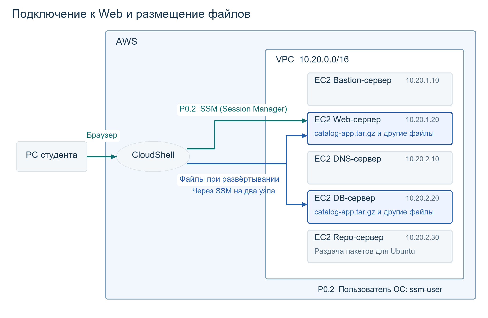
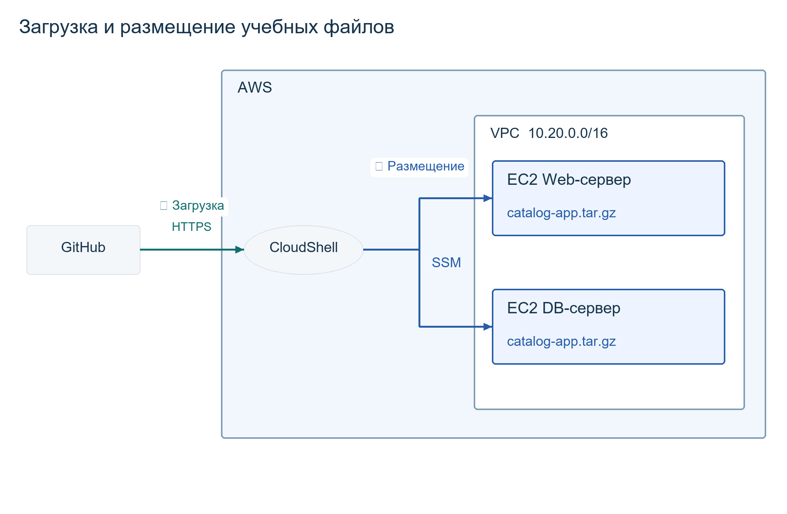

# P0 Своя среда и место выполнения команд

[Практика P0–P6](practice.md) · [Задания M0–M6](missions.md)

[日本語](../ja/p0.md) · [Русский](../ru/p0.md) · [O‘zbekcha](../uz/p0.md)

Связанное задание: [M0](m0.md).


## Что изучаем

Различать CloudShell, Windows и пять Ubuntu-серверов; подключаться через SSM к нужному узлу и запускать самопроверку.

## Задание

В своей готовой среде проверьте идентификаторы и роли пяти серверов, затем проверьте, к какому серверу и под каким пользователем вы подключились.

## Подключение к серверам и файлы курса



Зелёная стрелка показывает подключение к терминалу в P0.2. Синие стрелки показывают копирование файлов в P0.3. Архив с приложением учёта оборудования и SQL помещают на Web- и DB-серверы. Repo-сервер раздаёт пакеты для Ubuntu.

**Что сделать в Practice0**

Проверьте свой AWS-аккаунт, роль каждого сервера и среду выполнения команд. При использовании подписанного комплекта разместите файлы приложения и настройки БД на Web- и DB-серверах.

## Пример решения (порядок действий)

### P0.1 Проверить instance ID пяти серверов

**Среда выполнения:**

AWS Console своего студенческого аккаунта

**Цель и действия:**

Введите EC2 в поле Search в верхней части AWS Console и откройте консоль EC2. Откройте EC2 → Instances и найдите пять серверов своей среды в столбце Name. В той же строке проверьте полный идентификатор с префиксом i- в столбце Instance ID.


Рисунок 3-4 из главы C3. Откройте EC2 → Instances и проверьте Instance ID в строке нужного сервера.

### P0.2 Подключиться к Web-серверу через SSM из CloudShell

**Среда выполнения:**

CloudShell в личном AWS-аккаунте студента

**Цель и действия:**

В первой команде замените i-YOUR-WEB-INSTANCE-ID на Instance ID Web-сервера из P0.1 и выполните её в CloudShell. После подключения прочитайте роль из /etc/jdu-web/bootstrap.json, созданного при настройке сервера. Поле role содержит назначение сервера. Значение web подтверждает подключение к Web-серверу.

Команды: нумерация внутри этого шага

```bash
# 1. Из CloudShell открыть SSM к выбранному EC2; дождаться подключения.
aws ssm start-session --target i-YOUR-WEB-INSTANCE-ID
# 2. Показать имя пользователя ОС в этом терминале.
id -un
# 3. Прочитать только role из bootstrap, чтобы проверить выбранный сервер.
python3 -c 'import json;print(json.load(open("/etc/jdu-web/bootstrap.json"))["role"])'
# 4. Закрыть сеанс текущего сервера и вернуться в CloudShell.
exit
```

**Ожидаемый результат и его смысл:**

id -un выводит ssm-user, а роль из файла имеет значение web.

Пример вывода терминала после подключения

```text
$ id -un
ssm-user
$ python3 -c …
web
```

### P0.3 Разместить учебные файлы приложения и SQL

**Среда выполнения:**

CloudShell в личном AWS-аккаунте студента

**Цель и действия:**

Для следующих упражнений на Web- и DB-серверах в каталог `/var/lib/jdu-web/lesson-resources-r1` помещают архив `catalog-app.tar.gz` с кодом приложения учёта оборудования и SQL для настройки БД. В тот же каталог помещают программу для ввода пароля подключения к БД без отображения символов на экране.

В целях безопасности исходящие HTTPS-подключения с Web-сервера к сайтам в интернете ограничены. При создании среды по общему коду регистрации CloudShell загружает учебные файлы с GitHub по HTTPS и копирует их на Web-сервер и сервер базы данных через AWS Systems Manager (SSM).

Если среда создана по общему коду регистрации, переходите к P0.4.

При ручном размещении файлов загрузите учебный ZIP через CloudShell → Actions → Upload file и выполните `unzip web-lab-pm-r1.zip` в домашнем каталоге. Замените `YOUR-INSTALLATION-DIRECTORY` путём к каталогу с файлом `activate.sh` из начальной установки.



При создании среды по общему коду CloudShell загружает учебные файлы с GitHub и размещает их на Web- и DB-серверах через SSM.

Команды: нумерация внутри этого шага

```bash
# 1. Перейти в рабочий каталог $HOME/web-lab-pm-r1/resources.
cd "$HOME/web-lab-pm-r1/resources"
# 2. Сверить подписанный комплект и свои пять узлов, разместить материалы на Web/DB.
python3 -B stage_resources.py --installation 'YOUR-INSTALLATION-DIRECTORY'
```

**Смысл команд и настроек:**

Stage_resources.py проверяет развёрнутую среду и копирует файлы для следующих упражнений на два нужных сервера. Приложение запускают и БД создают в следующих упражнениях.

**Ожидаемый результат и его смысл:**

После размещения появятся PUBLIC_LESSON_RESOURCES_READY=web и PUBLIC_LESSON_RESOURCES_READY=db.

**Если не получилось:**

Если каталог установки не найден, проверьте путь к каталогу с activate.sh. При ошибке комплекта сообщите преподавателю текст ошибки.

### P0.4 Проверить готовность в браузере

**Среда выполнения:**

Браузер на своём PC: Web Portal

**Цель и действия:**

Откройте страницу заданий по ссылке преподавателя. Войдите через школьный Google, завершите привязку своего AWS, выберите P0 и запустите проверку. Если обработка продолжается, обновите результат.

**Смысл команд и настроек:**

Браузер сохраняет результат автоматически. Различайте PASS/FAIL/UNKNOWN и статус обработки/сохранения.

**Ожидаемый результат и его смысл:**

Проверьте свой Lab, ID задания и время. Прочитайте результаты check и статус сохранения; дождитесь завершения и сохранения. UNKNOWN означает невозможность измерения, а не успех.

**Если не получилось:**

Для обращения запишите check ID, время и роль узла. Не передавайте token, пароль и личный URL.

### P0.5 Открыть рабочий стол бастиона по RDP

**Среда выполнения:**

Windows PC студента (общая учётная запись)

**Цель и действия:**

Используйте текущий public IPv4 бастиона из EC2. Нажмите Windows+R, введите mstsc /prompt и Enter. В Computer укажите IP, пользователь labuser, пароль - свой RDP из начальной установки, не пароль Windows. Не выбирайте сохранение credentials. Если появится синий login xrdp, выберите Session=Xorg и labuser.

Команды: нумерация внутри этого шага

```powershell
# 1. Открыть RDP Windows с запросом учётных данных.
mstsc /prompt
```

**Смысл команд и настроек:**

RDP передаёт экран и ввод бастиона. Запрос Firefox внутри RDP идёт от бастиона, а не Windows. Раскладка клавиатуры влияет на символы пароля; язык интерфейса и раскладка - разные настройки.

**Ожидаемый результат и его смысл:**

Открываются Xfce и Firefox внутри Ubuntu-бастиона. Это не браузер Windows. labuser не имеет sudo: настройку выполняйте через CloudShell → SSM/ssm-user.

**Если не получилось:**

При Login failed проверьте имя и раскладку клавиатуры. Не отправляйте пароль в чат. При недоступности сверьте текущий IP и разрешённый CIDR с преподавателем; не открывайте 3389 для всех. Перед закрытием RDP сохраните работу.

## Проверка понимания (без баллов)

Какой узел изменится, если выполнить шаги DB в открытом SSM-сеансе Web?

**Объяснение:**

Изменится Web. Вернитесь через exit в CloudShell и подключитесь к instance ID DB.

---

[Следующее: M0](m0.md)
