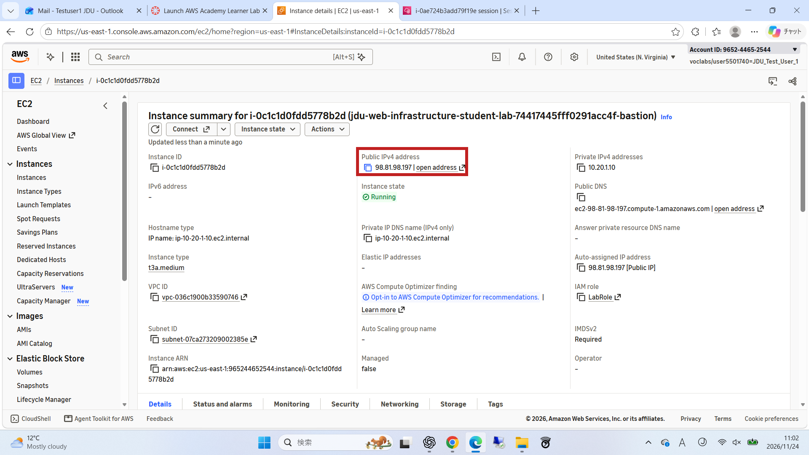

# P0 Своя среда и место выполнения команд

[Практика P0–P6](practice.md) · [Задания M0–M5](missions.md)

[日本語](../ja/p0.md) · [Русский](../ru/p0.md) · [O‘zbekcha](../uz/p0.md)

Связанное задание: [M0](m0.md).


## Что изучаем

Выбрать нужный сервер в списке EC2, подключиться через Session Manager и проверить результат задания.

## Задание

В своей готовой среде проверьте идентификаторы и роли пяти серверов, затем проверьте, к какому серверу и под каким пользователем вы подключились.

## Подключение к серверам


Зелёная стрелка ведёт к Web-серверу в P0.2.

**Что сделать в Practice0**

Проверьте свой AWS-аккаунт, роль каждого сервера и среду выполнения команд.

## Пример решения (порядок действий)

### P0.1 Проверить instance ID пяти серверов

**Среда выполнения:**

AWS Console своего студенческого аккаунта

**Цель и действия:**

Введите EC2 в поле Search в верхней части AWS Console и откройте консоль EC2. Откройте EC2 → Instances и найдите пять серверов своей среды в столбце Name. В той же строке проверьте полный идентификатор с префиксом i- в столбце Instance ID.


Список Instances в EC2. Для P0 выберите строку с окончанием имени `-web`, для M0 - `-db`, `-dns`, `-repo` и `-bastion` по очереди.

### P0.2 Подключиться к Web-серверу через Session Manager

**Среда выполнения:**

SSM-терминал Web-сервера: ssm-user

**Цель и действия:**

Нажмите **Instance ID** Web-сервера, найденного в P0.1. На странице сведений нажмите стрелку справа от **Connect** и выберите **Connect with SSM Session Manager**. В терминале новой вкладки выполняйте команды по одной. Выведите файл `/etc/jdu-web/bootstrap.json`, созданный при начальной настройке, командой `cat` и найдите `"role": "web"`. Убедившись, что это Web-сервер, создайте проверочный файл в домашнем каталоге через `nano`.


Страница EC2. Нажмите стрелку справа от Connect и выберите Connect with SSM Session Manager. На снимке показан Web-сервер.

Команды: нумерация внутри этого шага

```bash
# 1. Показать имя пользователя ОС в этом терминале.
id -un
# 2. Перейти в свой домашний каталог.
cd ~
# 3. Показать текущий рабочий каталог.
pwd
# 4. Вывести файл и проверить, что поле role имеет значение web.
cat /etc/jdu-web/bootstrap.json
# 5. Введите только web. Сохраните через Ctrl+O и Enter, выйдите через Ctrl+X.
nano p0-connection.txt
# 6. Прочитать p0-connection.txt без изменения.
cat p0-connection.txt
```

**Ожидаемый результат и его смысл:**

Команда `id -un` выводит `ssm-user`, а `pwd` - `/home/ssm-user`. В JSON-файле есть `"role": "web"`, а последняя команда `cat` выводит только строку `web`.

### P0.3 Открыть рабочий стол бастиона по RDP

**Среда выполнения:**

Windows PC студента (общая учётная запись)

**Цель и действия:**

Откройте рабочий стол своего бастиона через приложение Windows «Подключение к удалённому рабочему столу».

**1. Выберите бастион**

Откройте EC2 → Instances, найдите в своей учебной среде строку с окончанием имени `-bastion` и нажмите **Instance ID** в этой строке.


**2. Скопируйте публичный IPv4-адрес**

На странице экземпляра нажмите значок копирования рядом с **Public IPv4 address**. На следующем шаге используйте текущий адрес из своей консоли. Адрес на снимке приведён для примера.




Нажмите Windows+R, чтобы открыть окно «Выполнить». Введите `mstsc /prompt` в поле «Открыть» и нажмите **OK**.

Команды: нумерация внутри этого шага

```bash
# 1. Открыть RDP Windows с запросом учётных данных.
mstsc /prompt
```

**3. Введите публичный IPv4-адрес и подключитесь**

В окне «Подключение к удалённому рабочему столу» вставьте скопированный на шаге 2 публичный IPv4-адрес в поле **Компьютер** и нажмите **Подключить**.


**4. Проверьте предупреждение о сертификате**

Если появилось это окно, сверьте адрес назначения с публичным IPv4 из шага 2. Нажмите **Да**, когда преподаватель подтвердит, что это ваш бастион и сертификат учебной среды. Если подтвердить это не удалось, нажмите **Нет** и обратитесь к преподавателю.


**5. Войдите на бастион**

В окне входа xrdp проверьте, что в поле **Session** выбрано `Xorg`. Введите `labuser` в поле **username**, свой пароль RDP из начальной настройки в поле **password** и нажмите **OK**.


**6. Убедитесь, что рабочий стол открылся**

Если в окне удалённого рабочего стола видно меню **Applications** слева вверху и значок **Home**, вы подключены к бастиону.


**Смысл команд и настроек:**

RDP передаёт экран и ввод бастиона. Запрос Firefox внутри RDP идёт от бастиона, а не Windows. Раскладка клавиатуры влияет на символы пароля; язык интерфейса и раскладка - разные настройки.

**Ожидаемый результат и его смысл:**

Откроется рабочий стол Ubuntu (Xfce) бастиона. Чтобы открыть Firefox и другие программы, используйте меню Applications.

**Если не получилось:**

При Login failed проверьте имя и раскладку клавиатуры. Не отправляйте пароль в чат. При недоступности сверьте текущий IP и разрешённый CIDR с преподавателем; не открывайте 3389 для всех. Перед закрытием RDP сохраните работу.

## Проверка и сдача

Откройте адрес портала из объявления преподавателя в браузере на своём компьютере и войдите с учебным аккаунтом Google. При первом входе выберите регистрацию своей среды AWS и следуйте указаниям на экране.

В строке P0 нажмите **Проверить это задание**. Посмотрите результат на этой же странице и убедитесь, что в строке P0 сохранён **1 / 1**.

---

[Следующее: M0](m0.md)
