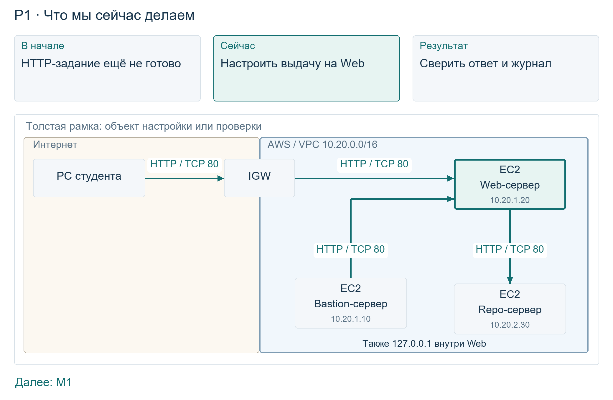
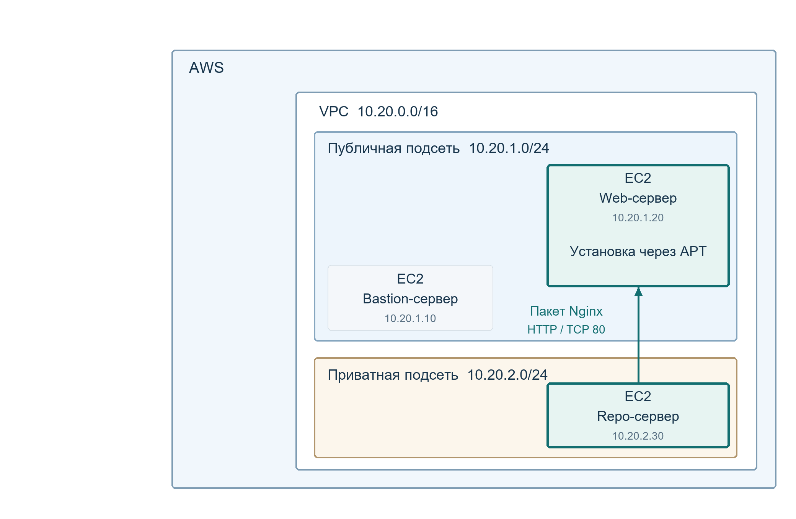
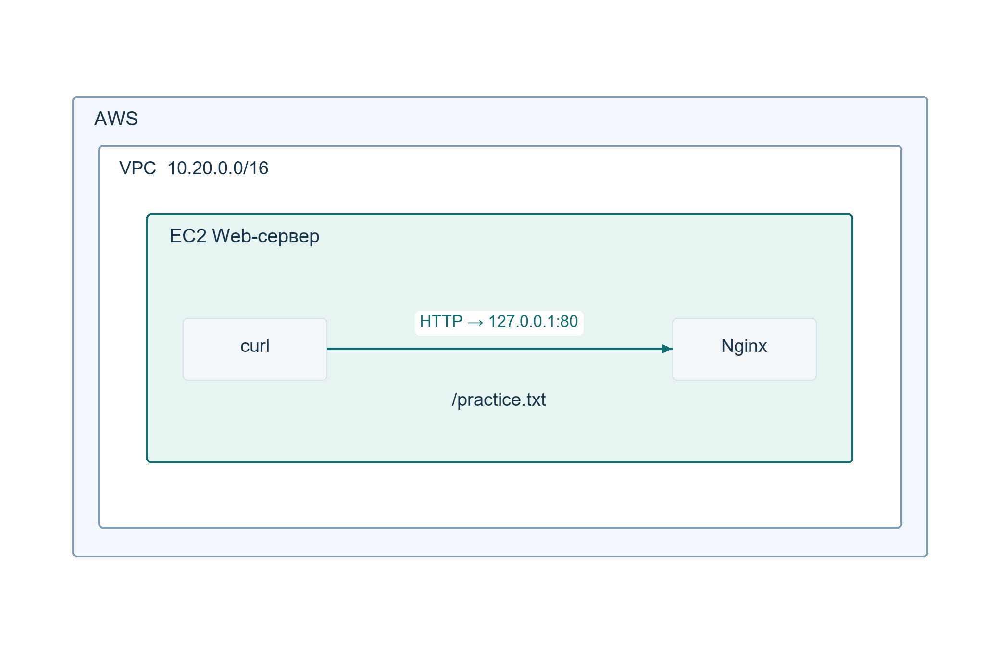
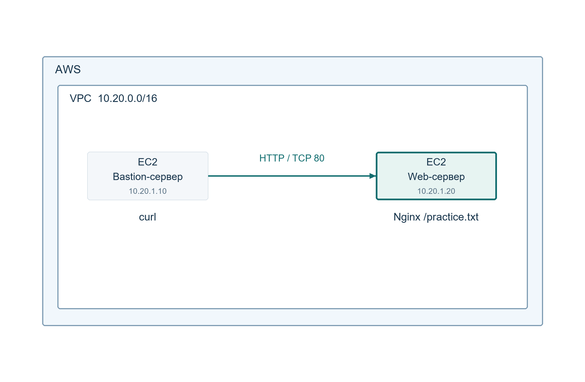

# P1 Выдача статического файла по HTTP

[Практика P0–P6](practice.md) · [Задания M0–M5](missions.md)

[日本語](../ja/p1.md) · [Русский](../ru/p1.md) · [O‘zbekcha](../uz/p1.md)

Связанное задание: [M1](m1.md).


## Что изучаем

Связать Nginx, файл, прослушивание порта, HTTP-ответ и access log.

## Задание

Настройте выдачу файла /var/www/html/practice.txt с ответом HTTP 200.

## Схема задания




- File: /var/www/html/practice.txt
- URL path: /practice.txt

```text
JDU WEB-02 practice: HTTP response verified.
```

**Что сделать в Practice1**

Настройте Nginx для выдачи текста файла по HTTP на TCP-порту 80 по пути `/practice.txt`. Выполните запросы из терминалов Web-сервера и бастиона, затем найдите их в журнале доступа Nginx.

## Пример решения (порядок действий)

### P1.1 Установить Nginx из внутреннего APT

**Среда выполнения:**

SSM-терминал Web-сервера: ssm-user

**Цель и действия:**

Подключитесь к Web-серверу через SSM, как в P0. Скачайте пакет Nginx с внутреннего Repo-сервера (`10.20.2.30`) и установите его на Web-сервере.



Команды: нумерация внутри этого шага

```bash
# 1. Обновить список пакетов с внутреннего сервера.
sudo apt-get update
# 2. Установить nginx с внутреннего сервера пакетов.
sudo apt-get install nginx
```

**Смысл команд и настроек:**

`apt-get update` обновляет список доступных пакетов. `apt-get install nginx` использует этот список для установки Nginx.

**Ожидаемый результат и его смысл:**

При обновлении списка в строке внутреннего сервера появляется `Hit:` или `Get:`. Сообщение `N: Ignoring file ... ubuntu.sources.jdu-disabled` означает, что APT пропустил стандартный источник Ubuntu, отключённый при начальной настройке. Если ошибок загрузки или проверки подписи нет, продолжайте установку. Если APT запросит подтверждение, введите `Y`.

**Если не получилось:**

Если не удалось получить список пакетов, проверьте состояние и IP-адрес внутреннего сервера пакетов.

### P1.2 Создать точный текст и права файла

**Среда выполнения:**

SSM-терминал Web-сервера: ssm-user

**Цель и действия:**

Запишите текст в рабочий файл, затем скопируйте его в каталог, из которого Nginx выдаёт файлы.

Команды: нумерация внутри этого шага

```bash
# 1. Перейти в свой домашний каталог.
cd ~
# 2. Создать рабочий каталог; существующий сохранить.
mkdir -p jdu-web-practice/p1
# 3. Перейти в рабочий каталог jdu-web-practice/p1.
cd jdu-web-practice/p1
# 4. Показать текущий рабочий каталог.
pwd
# 5. Открыть practice.txt: ввести текст, сохранить и выйти.
nano practice.txt
```

**Текст для ввода в nano**

```text
JDU WEB-02 practice: HTTP response verified.
```

Введите в nano ровно эту строку и нажмите Enter в конце. Сохраните файл клавишами Ctrl+O, затем Enter, и выйдите через Ctrl+X. В терминале продолжите с шага 6.

Команды: нумерация внутри этого шага

```bash
# 6. Скопировать practice.txt в каталог публикации Web-сервера.
sudo cp practice.txt /var/www/html/practice.txt
# 7. Назначить root владельцем и группой скопированного файла.
sudo chown root:root /var/www/html/practice.txt
# 8. Установить для скопированного файла права 0644.
sudo chmod 0644 /var/www/html/practice.txt
# 9. Прочитать владельца, группу, права и имя указанных файлов.
stat -c '%U:%G %a %n' /var/www/html/practice.txt
# 10. Прочитать /var/www/html/practice.txt без изменения.
cat /var/www/html/practice.txt
```

**Смысл команд и настроек:**

`cp` копирует текст в файл для публикации. `chown root:root` назначает root владельцем и группой копии. `chmod 0644` даёт владельцу право чтения и записи, а группе и остальным - право чтения.

**Ожидаемый результат и его смысл:**

Отображаются владелец, группа и права `root:root 644` и строка `JDU WEB-02 practice: HTTP response verified.`.

**Если не получилось:**

Если nano ещё открыт, сохраните файл и выйдите перед следующей командой.

### P1.3 Проверить Web root и запустить сервис

**Среда выполнения:**

SSM-терминал Web-сервера: ssm-user

**Цель и действия:**

Выведите действующую конфигурацию командой `nginx -T` и найдите `root /var/www/html` и `listen 80` в `/etc/nginx/sites-enabled/default`. При необходимости отредактируйте файл в `sudo nano` и перечитайте настройки после успешной проверки синтаксиса.

Команды: нумерация внутри этого шага

```bash
# 1. Вывести полную конфигурацию Nginx и посмотреть, как она записана.
sudo nginx -T
# 2. Проверить синтаксис и файлы конфигурации Nginx.
sudo nginx -t
# 3. Запустить nginx сейчас и включить автозапуск.
sudo systemctl enable --now nginx
# 4. Перечитать настройки nginx без остановки.
sudo systemctl reload nginx
# 5. Прочитать текущее состояние nginx.
systemctl is-active nginx
# 6. Убедиться, что Nginx слушает TCP-порт 80, например 0.0.0.0:80.
sudo ss -lntp
```

**Смысл команд и настроек:**

Nginx -T выводит конфигурацию, -t проверяет синтаксис. В systemctl enable включает запуск при загрузке, --now запускает сейчас. После сохранения файла проверьте reload, состояние службы и порт.

**Ожидаемый результат и его смысл:**

Проверка синтаксиса выводит `syntax is ok` и `test is successful`, а служба показывает `active`. Проверьте, что Nginx слушает TCP-порт 80, например `0.0.0.0:80`.

**Если не получилось:**

При ошибке синтаксиса исправьте файл и строку, указанные в выводе `nginx -t`.

### P1.4 Посмотреть ответ на самом Web

**Среда выполнения:**

SSM-терминал Web-сервера: ssm-user

**Цель и действия:**

Отправьте HTTP-запрос командой `curl` в терминале Web-сервера. Адрес `127.0.0.1` указывает на этот же сервер.



Команды: нумерация внутри этого шага

```bash
# 1. Отправить HTTP-запрос по адресу http://127.0.0.1/practice.txt.
curl -i http://127.0.0.1/practice.txt
```

**Смысл команд и настроек:**

`127.0.0.1` - адрес обратной петли. Запрос приходит в Nginx на том же Web-сервере.

**Ожидаемый результат и его смысл:**

Отображаются HTTP 200 и строка из practice.txt: `JDU WEB-02 practice: HTTP response verified.`

**Если не получилось:**

Если показано «Welcome to nginx», проверьте путь `/practice.txt` в команде curl. По адресу `http://127.0.0.1/` может открыться начальная страница Nginx.

### P1.5 Проверить тот же файл с бастиона

**Среда выполнения:**

SSM-терминал бастиона: ssm-user

**Цель и действия:**

Подключитесь к бастиону через SSM и отправьте HTTP-запрос к Web-серверу командой `curl`. Из внутренней сети используйте внутренний IP Web-сервера `10.20.1.20`.



Команды: нумерация внутри этого шага

```bash
# 1. Отправить HTTP-запрос по адресу http://10.20.1.20/practice.txt.
curl -i http://10.20.1.20/practice.txt
```

**Смысл команд и настроек:**

Адрес назначения меняется на внутренний IP Web-сервера. Путь к файлу остаётся тем же, что и в P1.4, - `/practice.txt`.

**Ожидаемый результат и его смысл:**

Отображаются HTTP 200 и строка `JDU WEB-02 practice: HTTP response verified.`

### P1.6 Связать запрос с журналом и отправить

**Среда выполнения:**

SSM-терминал Web-сервера: ssm-user

**Цель и действия:**

Вернитесь на Web. В access log найдите время, IP клиента, путь и статус. Это доказательство обработки запроса, не только наличия файла. После exit в CloudShell выберите P1 в Web Portal на PC и запустите проверку.

Команды: нумерация внутри этого шага

```bash
# 1. Прочитать последние 20 строк access log и найти свой HTTP-запрос.
sudo tail -n 20 /var/log/nginx/access.log
# 2. Закрыть сеанс текущего сервера и вернуться в CloudShell.
exit
```

**Смысл команд и настроек:**

Сопоставьте время, путь и статус в access log с недавним curl. Tail читает последние строки и не меняет журнал. После exit проверьте P1 в браузере PC.

**Ожидаемый результат и его смысл:**

На экране показываются результаты восьми проверок и число выполненных критериев. Система автоматически проверяет HTTP-доступ по публичному IP.

**Если не получилось:**

Если идёт обработка, обновите результат. При ошибке сохранения прочитайте причину. Не меняйте ожидаемый текст checker.

## Пример чтения вывода (не вводить)

```text
HTTP/1.1 200 OK

JDU WEB-02 practice: HTTP response verified.
```

Показаны только нужные строки; реальный ответ содержит и другие заголовки. Проверьте 200, текст и путь/статус в access log.

## Проверка понимания (без баллов)

На Web ответ 200, а с бастиона соединение не проходит. Что проверить до изменения файла?

**Объяснение:**

Адрес назначения, адрес/порт прослушивания и разрешение пути bastion → Web. Содержимое файла и доступность - разные проверки.

---

[Предыдущее: M0](m0.md) · [Следующее: M1](m1.md)
