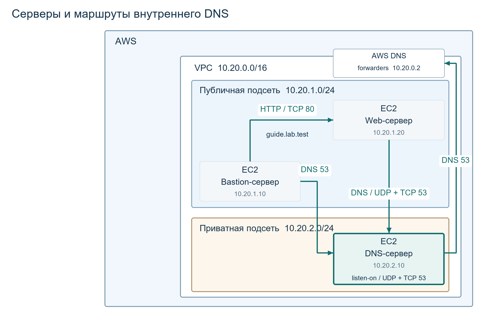

# P2 Внутренний DNS и системное разрешение имён

[Практика P0–P5](practice.md) · [Задания M0–M5](missions.md)

[日本語](../ja/p2.md) · [Русский](../ru/p2.md) · [O‘zbekcha](../uz/p2.md)

Связанное задание: [M2](m2.md).


**Что сделать в Practice2**

Запишите имена Web и DB во внутреннем DNS. Настройте бастион и Web на этот DNS и откройте файл P1 по имени.

## Схема задания



## Пример решения (порядок действий)

### P2.1 Установить BIND с сервера пакетов

**Среда выполнения:**

SSM-терминал DNS-сервера: ssm-user

На DNS-сервере обновите список пакетов, установите BIND и инструменты проверки. Сделайте копии двух файлов перед редактированием.

Команды: нумерация внутри этого шага

```bash
# 1. Обновить список пакетов с внутреннего сервера.
sudo apt-get update
# 2. Установить bind9 bind9-utils и обязательные зависимости с сервера пакетов.
sudo apt-get install bind9 bind9-utils
# 3. Скопировать исходный файл в резервную копию, не затирая существующую.
sudo cp -an /etc/bind/named.conf.options /etc/bind/named.conf.options.before-p2
# 4. Скопировать исходный файл в резервную копию, не затирая существующую.
sudo cp -an /etc/bind/named.conf.local /etc/bind/named.conf.local.before-p2
```

**Ожидаемый результат и его смысл:**

Установлены `bind9` и `bind9-utils`, появились две копии `.before-p2`.

### P2.2 Настроить адрес DNS и источники запросов

**Среда выполнения:**

SSM-терминал DNS-сервера: ssm-user

Измените настройки самого DNS-сервера. IP источника запроса, адрес DNS-сервера для приёма запросов и адрес DNS для внешних имён выполняют разные роли.

| Параметр | Что означает IP | Значения в этой работе |
| --- | --- | --- |
| `jdu_clients` | Разрешённые источники запросов | Проверка с самого DNS: `127.0.0.1`; бастион: `10.20.1.10`; Web-сервер: `10.20.1.20` |
| `listen-on` | Собственные адреса DNS-сервера для приёма запросов | `127.0.0.1` и внутренний IP DNS-сервера `10.20.2.10` |
| `forwarders` | DNS для передачи запросов о внешних именах | DNS AWS `10.20.0.2` |

В `jdu_clients` указывают источники запросов, а в `listen-on` — адреса самого DNS-сервера. Чтобы принимать запросы бастиона и Web-сервера, укажите в `listen-on` адрес `10.20.2.10`.

Замените содержимое файлом настроек ниже. В nano для поиска используйте Ctrl+W, для сохранения Ctrl+O и Enter, для выхода Ctrl+X.

```bash
sudo nano /etc/bind/named.conf.options
```

**Текст для ввода в nano**

```text
acl "jdu_clients" { 127.0.0.1; 10.20.1.10; 10.20.1.20; };
options {
    directory "/var/cache/bind";
    listen-on { 127.0.0.1; 10.20.2.10; };
    listen-on-v6 { none; };
    allow-query { jdu_clients; };
    allow-recursion { jdu_clients; };
    allow-query-cache { jdu_clients; };
    recursion yes;
    forward only;
    forwarders { 10.20.0.2; };
    dnssec-validation no;
    allow-transfer { none; };
};
```

**Ожидаемый результат и его смысл:**

В `listen-on` указан внутренний IP DNS-сервера `10.20.2.10`, в `forwarders` - DNS AWS `10.20.0.2`.

### P2.3 Записать имена и адреса IPv4

**Среда выполнения:**

SSM-терминал DNS-сервера: ssm-user

В `named.conf.local` укажите BIND путь к файлу зоны `lab.test`. В `db.lab.test` запишите A-записи, связывающие имена с адресами IPv4.

Добавьте этот блок в конец `named.conf.local`. Если блок `lab.test` уже есть, отредактируйте его.

```bash
sudo nano /etc/bind/named.conf.local
```

**Текст для ввода в nano**

```text
zone "lab.test" {
    type primary;
    file "/etc/bind/zones/db.lab.test";
    allow-transfer { none; };
    allow-update { none; };
};
```

Откройте `/etc/bind/zones/db.lab.test` в nano, введите настройки ниже и сохраните файл.

```bash
sudo mkdir -p /etc/bind/zones
sudo chmod 0755 /etc/bind/zones
sudo nano /etc/bind/zones/db.lab.test
```

**Текст для ввода в nano**

```text
$TTL 300
@ IN SOA dns.lab.test. hostmaster.lab.test. (
    2026102301 3600 600 604800 300 )
@ IN NS dns.lab.test.
dns IN A 10.20.2.10
guide IN A 10.20.1.20
practice-db IN A 10.20.2.20
```

**Ожидаемый результат и его смысл:**

`guide.lab.test` указывает на Web `10.20.1.20`, а `practice-db.lab.test` - на DB `10.20.2.20`.

**Если не получилось:**

Если файл зоны уже существует, сохраните его имена и добавьте две учебные записи. При каждом изменении записей увеличивайте серийный номер SOA.

### P2.4 Запустить BIND и сделать запрос с DNS-сервера

**Среда выполнения:**

SSM-терминал DNS-сервера: ssm-user

Проверьте конфигурацию и файл зоны, затем запустите BIND. Команда `dig` отправляет DNS-запрос и выводит ответ. Адрес `127.0.0.1` указывает на сам DNS-сервер.

Команды: нумерация внутри этого шага

```bash
# 1. Проверить конфигурацию BIND и подключённые zone.
sudo named-checkconf -z
# 2. Проверить zone-файл lab.test.
sudo named-checkzone lab.test /etc/bind/zones/db.lab.test
# 3. Включить автозапуск named при загрузке ОС.
sudo systemctl enable named
# 4. Перезапустить named с обновлённой настройкой.
sudo systemctl restart named
# 5. Запросить guide.lab.test по UDP 53 и прочитать ответ.
dig @127.0.0.1 guide.lab.test A
# 6. Запросить guide.lab.test по TCP 53 и прочитать ответ.
dig @127.0.0.1 guide.lab.test A +tcp
```

**Ожидаемый результат и его смысл:**

Проверка зоны выводит `OK`. По UDP и TCP ожидаются `NOERROR` и адрес `10.20.1.20` для `guide.lab.test`.

**Если не получилось:**

При ошибке изучите sudo journalctl -u named -n 30 --no-pager, исправьте конфигурацию и проверьте снова.

### P2.5 Проверить BIND с бастиона и Web-сервера

**Среда выполнения:**

SSM-терминалы бастиона и Web-сервера

Выполните команды на обоих серверах. `@10.20.2.10` в `dig` задаёт DNS только для данного запроса. `AXFR` запрашивает передачу записей зоны целиком. Проверьте, что передача запрещена.

`@10.20.2.10` — адрес DNS-сервера, которому отправляют запрос. IP Web-сервера `10.20.1.20` и БД `10.20.2.20` возвращаются в ответах и выполняют другую роль. Строка `SERVER` показывает адрес DNS, а A-запись в `ANSWER SECTION` — IP запрошенного имени.

Команды: нумерация внутри этого шага

```bash
# 1. Запросить guide.lab.test по UDP 53 и прочитать ответ.
dig @10.20.2.10 guide.lab.test A
# 2. Запросить practice-db.lab.test по TCP 53 и прочитать ответ.
dig @10.20.2.10 practice-db.lab.test A +tcp
# 3. Запросить absent-p2.lab.test по UDP 53 и прочитать ответ.
dig @10.20.2.10 absent-p2.lab.test A
# 4. Запросить aws.amazon.com по UDP 53 и прочитать ответ.
dig @10.20.2.10 aws.amazon.com A
# 5. Запросить AXFR всей zone и проверить явный отказ.
dig @10.20.2.10 lab.test AXFR
```

**Ожидаемый результат и его смысл:**

`guide.lab.test` даёт `10.20.1.20`, `practice-db.lab.test` - `10.20.2.20`. Незарегистрированное имя даёт `NXDOMAIN`, `aws.amazon.com` возвращает IP, передача зоны отклоняется.

### P2.6 Задать DNS по умолчанию в Ubuntu

**Среда выполнения:**

SSM-терминалы бастиона и Web-сервера

Настройте бастион и Web-сервер по одному. В Netplan укажите `10.20.2.10` как DNS, которым Ubuntu пользуется для браузера и приложений.

Сначала найдите имя сетевого интерфейса и имя файла Netplan.

```bash
ip -br link
ls /etc/netplan
```

Подставьте фактические имена вместо `ens5` и `YOUR-NETPLAN-FILE.yaml`. Поле `Network File` команды `networkctl status` помогает найти нужный файл Netplan.

```bash
networkctl status ens5
```

Ниже пример правки существующего файла. В блоке своего интерфейса добавьте или исправьте `dhcp4-overrides` и `nameservers`. Сохраните имя интерфейса и остальные настройки.

```bash
sudo cp -an /etc/netplan/YOUR-NETPLAN-FILE.yaml /etc/netplan/YOUR-NETPLAN-FILE.yaml.before-p2
sudo nano /etc/netplan/YOUR-NETPLAN-FILE.yaml
```

**Текст для ввода в nano**

```text
network:
  version: 2
  ethernets:
    ens5:
      dhcp4: true
      dhcp4-overrides:
        use-dns: false
      nameservers:
        addresses: [10.20.2.10]
```

**Ожидаемый результат и его смысл:**

Сохраните получение IP по DHCP и отключите автоматическое получение только DNS. Выровняйте отступы YAML.

**Если не получилось:**

Несколько YAML одного интерфейса объединяются. Если resolvectl dns показывает ещё AWS DNS, проверьте все соответствующие YAML и действующую конфигурацию.

### P2.7 Применить DNS и открыть страницу по имени

**Среда выполнения:**

SSM-терминалы бастиона и Web-сервера

Примените Netplan. В `resolvectl dns` проверьте DNS, а через `getent` - разрешение имён в Ubuntu. Затем получите файл P1 по имени.

Команды: нумерация внутри этого шага

```bash
# 1. Сгенерировать конфигурацию netplan и проверить YAML перед применением.
sudo netplan generate
# 2. Применить сохранённые настройки netplan к сети.
sudo netplan apply
# 3. Перезапустить systemd-resolved с обновлённой настройкой.
sudo systemctl restart systemd-resolved
# 4. Показать DNS-серверы системного resolver.
resolvectl dns
# 5. Получить IPv4 guide.lab.test через системный resolver.
getent ahostsv4 guide.lab.test
# 6. Получить IPv4 practice-db.lab.test через системный resolver.
getent ahostsv4 practice-db.lab.test
# 7. Отправить HTTP-запрос по адресу http://guide.lab.test/practice.txt.
curl -i http://guide.lab.test/practice.txt
```

**Ожидаемый результат и его смысл:**

DNS в `resolvectl dns` - `10.20.2.10`. Имена дают `10.20.1.20` и `10.20.2.20`. HTTP возвращает `200` и `JDU WEB-02 practice: HTTP response verified.`

**Если не получилось:**

Если dig успешен, а getent нет, проверяйте resolver клиента. Сохраняйте настройку Firefox с отключённым DoH.

### P2.8 Проверить страницу в браузере бастиона

**Среда выполнения:**

Firefox на рабочем столе бастиона через RDP

Подключитесь к бастиону по RDP как в P0. В его Firefox откройте `http://10.20.1.20/practice.txt`, затем `http://guide.lab.test/practice.txt`. На своём компьютере запустите проверку P2 на странице оценок.

**Ожидаемый результат и его смысл:**

По обоим адресам видно `JDU WEB-02 practice: HTTP response verified.` На странице оценок отображаются 13 критериев P2.

## Пример чтения вывода (не вводить)

```text
status: NOERROR
guide.lab.test.  300  IN  A  10.20.1.20
```

Сокращённый пример dig: после A стоит IPv4, 300 - TTL. Отдельно проверьте, что SERVER запроса - 10.20.2.10.

---

[Предыдущее: M1](m1.md) · [Следующее: M2](m2.md)
