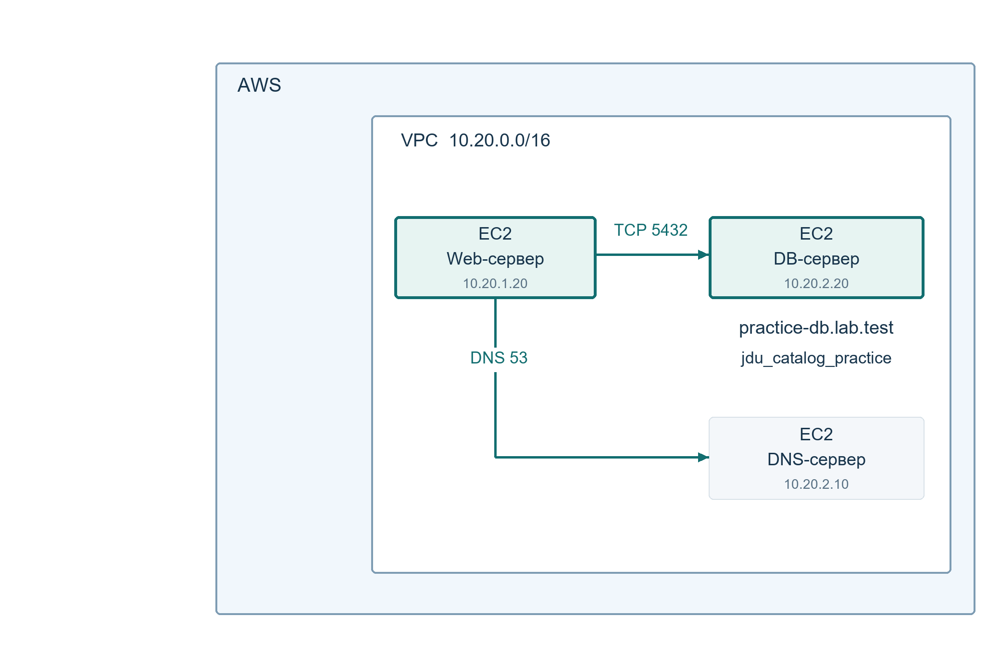

# P4 Подключение к PostgreSQL с аутентификацией

[Практика P0–P6](practice.md) · [Задания M0–M5](missions.md)

[日本語](../ja/p4.md) · [Русский](../ru/p4.md) · [O‘zbekcha](../uz/p4.md)

Связанное задание: [M3](m3.md).


**Что сделать в Practice4**

Настройте PostgreSQL на DB-сервере и подключитесь к учебной БД с Web по паролю.

## Схема задания



## Пример решения (порядок действий)

### P4.1 Установить PostgreSQL с сервера пакетов

**Среда выполнения:**

SSM-терминал DB-сервера: ssm-user

Установите PostgreSQL 16 на DB-сервере. Затем распакуйте файлы SQL для следующих шагов.

Команды: нумерация внутри этого шага

```bash
# 1. Обновить список пакетов с внутреннего сервера.
sudo apt-get update
# 2. Установить postgresql-16 postgresql-client-16 и обязательные зависимости с сервера пакетов.
sudo apt-get install --no-install-recommends postgresql-16 postgresql-client-16
# 3. Сверить фиксированный hash и распаковать приложение/SQL преподавателя.
sudo python3 -B /var/lib/jdu-web/lesson-resources-r1/offline_assets.py
# 4. Показать версию, кластер, порт и состояние PostgreSQL.
pg_lsclusters
# 5. Прочитать настройку БД от postgres: SHOW data_directory;
sudo -u postgres psql -X -d postgres -c "SHOW data_directory;"
```

**Ожидаемый результат и его смысл:**

В `pg_lsclusters` видны версия `16` и кластер `main`. Каталог данных - `/var/lib/postgresql/16/main`.

### P4.2 Настроить адрес и порт PostgreSQL

**Среда выполнения:**

SSM-терминал DB-сервера: ssm-user

В `postgresql.conf` укажите внутренний IP DB `10.20.2.20` и порт 5432. Для паролей задайте SCRAM-SHA-256.

Найдите нужные параметры, задайте значения ниже и снимите `#` в начале этих строк.

```bash
sudo cp -an /etc/postgresql/16/main/postgresql.conf /etc/postgresql/16/main/postgresql.conf.before-p4
sudo nano /etc/postgresql/16/main/postgresql.conf
```

**Текст для ввода в nano**

```text
listen_addresses = '10.20.2.20'
port = 5432
password_encryption = 'scram-sha-256'
```

**Ожидаемый результат и его смысл:**

Сохраните три параметра в одном файле. Перезапуск выполняется в P4.4 после настройки доступа.

### P4.3 Разрешить соединения с БД от Web-сервера

**Среда выполнения:**

SSM-терминал DB-сервера: ssm-user

В `pg_hba.conf` задайте источники, БД и роли. Разрешите указанные пары БД и ролей для практики и задания с внутреннего IP Web `10.20.1.20`.

Замените правила подключения приведёнными ниже и сохраните файл.

```bash
sudo cp -an /etc/postgresql/16/main/pg_hba.conf /etc/postgresql/16/main/pg_hba.conf.before-p4
sudo nano /etc/postgresql/16/main/pg_hba.conf
```

**Текст для ввода в nano**

```text
local all postgres peer
local all all reject
host jdu_catalog_practice catalog_practice_setup 10.20.1.20/32 scram-sha-256
host jdu_catalog_practice catalog_practice_app 10.20.1.20/32 scram-sha-256
host jdu_catalog catalog_setup 10.20.1.20/32 scram-sha-256
host jdu_catalog catalog_app 10.20.1.20/32 scram-sha-256
host all all 0.0.0.0/0 reject
host all all ::/0 reject
```

**Ожидаемый результат и его смысл:**

PostgreSQL применяет первую совпавшую строку сверху. Сначала расположены разрешения, затем строки `reject` для остальных соединений.

### P4.4 Перезапустить PostgreSQL и проверить настройки

**Среда выполнения:**

SSM-терминал DB-сервера: ssm-user

Перезапустите PostgreSQL, чтобы применить сохранённые параметры и правила доступа.

Команды: нумерация внутри этого шага

```bash
# 1. Перезапустить postgresql@16-main с обновлённой настройкой.
sudo systemctl restart postgresql@16-main
# 2. Прочитать текущее состояние postgresql@16-main.
systemctl is-active postgresql@16-main
# 3. Убедиться, что PostgreSQL слушает 10.20.2.20:5432.
sudo ss -lntp
# 4. Прочитать настройку БД от postgres: SHOW password_encryption;
sudo -u postgres psql -X -d postgres -c "SHOW password_encryption;"
# 5. Найти ошибки HBA; в норме 0 строк.
sudo -u postgres psql -X -d postgres -c \
  "SELECT line_number,error FROM pg_hba_file_rules WHERE error IS NOT NULL;"
```

**Ожидаемый результат и его смысл:**

Служба - `active`, адрес и порт - `10.20.2.20:5432`, способ хранения пароля - `scram-sha-256`, ошибки правил доступа - `(0 rows)`.

### P4.5 Создать учебную БД и две роли

**Среда выполнения:**

SSM-терминал DB-сервера: ssm-user

Готовые SQL создают БД `jdu_catalog_practice`. Роль `catalog_practice_setup` подготавливает таблицы, `catalog_practice_app` нужна для обычной работы. Сначала выведите SQL, затем передайте его в `psql`.

Команды: нумерация внутри этого шага

```bash
# 1. Перейти в рабочий каталог /var/lib/jdu-web/lesson-resources-r1/app.
cd /var/lib/jdu-web/lesson-resources-r1/app
# 2. Показать SQL создания учебных ролей без выполнения.
python3 -B profile_sql.py --profile practice 01_create_roles.sql
# 3. Сформировать SQL создания учебных ролей и применить через postgres к нужной БД.
python3 -B profile_sql.py --profile practice 01_create_roles.sql | sudo -u postgres \
  psql -X -v ON_ERROR_STOP=1 -d postgres
# 4. Сформировать SQL создания учебной БД и схемы и применить через postgres к нужной БД.
python3 -B profile_sql.py --profile practice 02_prepare_schema.sql | sudo -u postgres \
  psql -X -v ON_ERROR_STOP=1 -d jdu_catalog_practice
```

**Ожидаемый результат и его смысл:**

`CREATE ROLE` появляется дважды, `CREATE DATABASE` - один раз.

**Если не получилось:**

При already exists возможен повторный запуск. Не используйте DROP; проверьте роли и БД через \du и \l. Убедитесь, что psql справа от pipe не сообщил SQL error.

### P4.6 Задать пароль каждой роли БД

**Среда выполнения:**

SSM-терминал DB-сервера: ssm-user

Откройте `psql` на DB-сервере. Выполняйте `\password` по одной строке и дважды введите выбранный пароль каждой роли. Символы скрыты. Оба пароля понадобятся в P5. Задайте разные пароли длиной не менее 16 символов.

Команды: нумерация внутри этого шага

```bash
# 1. В терминале DB открыть psql от postgres; следующие действия внутри psql.
sudo -u postgres psql -X -d postgres
```

Далее вводить внутри psql

```sql
-- 2. В psql скрыто задать пароль роли catalog_practice_setup.
\password catalog_practice_setup
-- 3. В psql скрыто задать пароль роли catalog_practice_app.
\password catalog_practice_app
-- 4. В psql проверить атрибуты и права учебных ролей.
\du catalog_practice_*
-- 5. Выйти из psql в терминал ОС того же DB-сервера.
\q
```

**Ожидаемый результат и его смысл:**

В выводе `\du` есть `catalog_practice_setup` и `catalog_practice_app`.

### P4.7 Подключиться к учебной БД с Web-сервера

**Среда выполнения:**

SSM-терминал Web-сервера: ssm-user

Откройте Session Manager для Web-сервера как в P0. В `psql` сначала укажите внутренний IP DB, затем имя `practice-db.lab.test` из P2. В обоих случаях используйте пароль `catalog_practice_app` из P4.6.

Команды: нумерация внутри этого шага

```bash
# 1. Установить postgresql-client-16 и обязательные зависимости с сервера пакетов.
sudo apt-get install --no-install-recommends postgresql-client-16
# 2. Подключиться с Web к нужной БД с существующим паролем и выполнить SELECT.
psql -X -h 10.20.2.20 -U catalog_practice_app -d jdu_catalog_practice -W -c \
  'SELECT current_database(),current_user,1 AS value;'
# 3. Получить IPv4 practice-db.lab.test через системный resolver.
getent ahostsv4 practice-db.lab.test
# 4. Подключиться с Web к нужной БД с существующим паролем и выполнить SELECT.
psql -X -h practice-db.lab.test -U catalog_practice_app -d jdu_catalog_practice -W -c \
  'SELECT current_database(),current_user,1 AS value;'
```

**Ожидаемый результат и его смысл:**

В обоих случаях результат показывает БД `jdu_catalog_practice`, роль `catalog_practice_app` и значение `1`.

**Если не получилось:**

Если по IP подключение работает, а по имени нет, проверьте системный DNS и учебное имя DB из P2. При отказе аутентификации проверьте источник, БД, роль и пароль. Не публикуйте DB в Internet для диагностики.

### P4.8 Сохранить пароль БД для проверки на Web-сервере

**Среда выполнения:**

SSM-терминал Web-сервера: ssm-user

Запустите команду и дважды введите пароль `catalog_practice_app`. Ввод скрыт, пароль сохраняется на Web в защищённом файле для проверки подключения. Откройте страницу оценок на своём компьютере и проверьте P4.

Команды: нумерация внутри этого шага

```bash
# 1. Скрыто ввести существующий пароль учебной БД и сохранить только на Web.
sudo python3 -B /var/lib/jdu-web/lesson-resources-r1/database_secret.py --profile \
  practice
```

**Ожидаемый результат и его смысл:**

Терминал выводит `D11_EXISTING_DB_PASSWORD_STORED_LOCALLY`. На странице оценок видны девять критериев P4.

**Если не получилось:**

Если файл уже есть, не создавайте заново. В P5 тот же пароль вводится в настройку приложения. M3 использует отдельные БД/роли mission.

## Пример чтения вывода (не вводить)

```text
current_database    | current_user         | value
jdu_catalog_practice | catalog_practice_app | 1
```

Пример чтения SELECT; ширина столбцов может отличаться. Сверьте БД, роль и value=1. Это не доказательство права менять таблицы.

---

[Предыдущее: M2](m2.md) · [Следующее: M3](m3.md)
