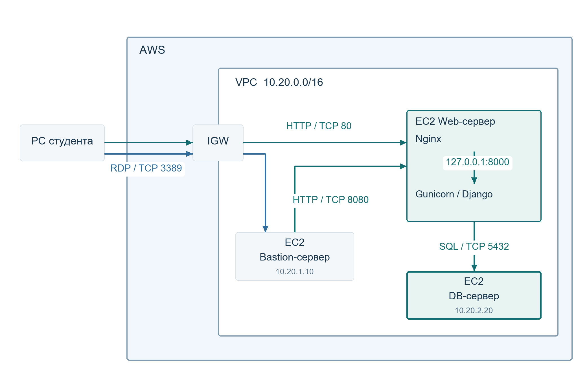

# P5 Соединить предоставленное приложение с Web и DB

[Практика P0–P6](practice.md) · [Задания M0–M5](missions.md)

[日本語](../ja/p5.md) · [Русский](../ru/p5.md) · [O‘zbekcha](../uz/p5.md)

Связанное задание: [M4](m4.md).


**Что сделать в Practice5**

Запустите приложение на Web и подключите его к DB. Настройте публичный список и управление с бастиона.

## Схема задания



## Пример решения (порядок действий)

### P5.1 Проверить DNS и подготовить пакеты Python

**Среда выполнения:**

SSM-терминал Web-сервера: ssm-user

Сначала разрешите имена БД и админки с Web-сервера. Затем установите инструменты Python с сервера пакетов и распакуйте приложение и пакеты Python.

Команды: нумерация внутри этого шага

```bash
# 1. Получить IPv4 db.lab.test через системный resolver.
getent ahostsv4 db.lab.test
# 2. Получить IPv4 admin.lab.test через системный resolver.
getent ahostsv4 admin.lab.test
# 3. Установить python3-venv python3-pip и обязательные зависимости с сервера пакетов.
sudo apt-get install --no-install-recommends python3-venv python3-pip
# 4. Проверить подпись/hash, подготовить приложение и фиксированные wheel.
sudo python3 -B /var/lib/jdu-web/lesson-resources-r1/offline_assets.py --wheels
# 5. Показать файлы для настройки серверов в /var/lib/jdu-web/lesson-resources-r1/app.
ls /var/lib/jdu-web/lesson-resources-r1/app
# 6. Показать файлы для настройки серверов в /var/lib/jdu-web/lesson-resources-r1/wheels.
ls /var/lib/jdu-web/lesson-resources-r1/wheels
```

**Ожидаемый результат и его смысл:**

`db.lab.test` даёт `10.20.2.20`, `admin.lab.test` - `10.20.1.20`. В терминале появляются `PUBLIC_APP_RESOURCES_VERIFIED` и `SIGNED_OFFLINE_WHEELS_READY=7`.

### P5.2 Разместить приложение и создать его окружение Python

**Среда выполнения:**

SSM-терминал Web-сервера: ssm-user

Скопируйте файлы в `/opt/jdu-catalog/app`. Создайте окружение приложения через `venv` и установите подготовленные пакеты. `pip` проверяет хеши файлов и работает без обращения к внешнему сайту.

Команды: нумерация внутри этого шага

```bash
# 1. Создать каталог /opt/jdu-catalog/app.
sudo mkdir -p /opt/jdu-catalog/app
# 2. Задать владельца и группу root:root для /opt/jdu-catalog/app.
sudo chown root:root /opt/jdu-catalog/app
# 3. Задать права 0755 для /opt/jdu-catalog/app.
sudo chmod 0755 /opt/jdu-catalog/app
# 4. Скопировать файлы в /opt/jdu-catalog/app/.
sudo cp -a /var/lib/jdu-web/lesson-resources-r1/app/. /opt/jdu-catalog/app/
# 5. Создать отдельное Python venv приложения.
sudo python3 -m venv /opt/jdu-catalog/venv
# 6. Установить зависимости только из локальных wheel с lock/hash.
sudo /opt/jdu-catalog/venv/bin/python -m pip --isolated --no-cache-dir install \
  --no-index --find-links=/var/lib/jdu-web/lesson-resources-r1/wheels \
  --only-binary=:all: --require-hashes -r \
  /var/lib/jdu-web/lesson-resources-r1/requirements.lock
# 7. Проверить совместимость установленных Python-зависимостей.
sudo /opt/jdu-catalog/venv/bin/python -m pip check
```

**Ожидаемый результат и его смысл:**

Последний `pip check` выводит `No broken requirements found.`.

### P5.3 Создать системного пользователя приложения

**Среда выполнения:**

SSM-терминал Web-сервера: ssm-user

Создайте на Web системного пользователя `catalog` для запуска приложения. Подготовьте каталог для CSS и других файлов и дайте `catalog` право записи в него.

Команды: нумерация внутри этого шага

```bash
# 1. Создать системного catalog для приложения без login shell и home.
sudo useradd --system --user-group --home-dir /nonexistent --no-create-home --shell \
  /usr/sbin/nologin catalog
# 2. Создать каталог /var/lib/jdu-catalog.
sudo mkdir -p /var/lib/jdu-catalog
# 3. Задать владельца и группу root:root для /var/lib/jdu-catalog.
sudo chown root:root /var/lib/jdu-catalog
# 4. Задать права 0755 для /var/lib/jdu-catalog.
sudo chmod 0755 /var/lib/jdu-catalog
# 5. Создать каталог /var/lib/jdu-catalog/static.
sudo mkdir -p /var/lib/jdu-catalog/static
# 6. Задать владельца и группу catalog:catalog для /var/lib/jdu-catalog/static.
sudo chown catalog:catalog /var/lib/jdu-catalog/static
# 7. Задать права 0755 для /var/lib/jdu-catalog/static.
sudo chmod 0755 /var/lib/jdu-catalog/static
# 8. Проверить UID, GID и группы пользователя catalog.
id catalog
# 9. Проверить home и login shell пользователя catalog.
getent passwd catalog
```

**Ожидаемый результат и его смысл:**

Вывод показывает пользователя `catalog` и оболочку `/usr/sbin/nologin`. Владелец и группа `/var/lib/jdu-catalog/static` - `catalog`.

**Если не получилось:**

Не исправляйте права через chmod -R 777 или добавление catalog в sudo. Проверьте конкретный каталог и владельца.

### P5.4 Настроить обычное подключение приложения к БД

**Среда выполнения:**

SSM-терминал Web-сервера: ssm-user

Замените `YOUR-CURRENT-WEB-PUBLIC-IP` на текущий публичный IPv4 Web из AWS Console. При запросе введите пароль `catalog_practice_app` из P4. Выберите созданные учебные настройки для приложения. Вводимые символы скрыты.

Команды: нумерация внутри этого шага

```bash
# 1. Указать текущий public IPv4 Web из AWS Console.
PUBLIC_WEB_IPV4='YOUR-CURRENT-WEB-PUBLIC-IP'
# 2. Скрыто ввести существующий пароль БД и создать runtime practice.
sudo python3 -B /opt/jdu-catalog/app/configuration.py create-runtime --profile \
  practice --public-web-ipv4 "$PUBLIC_WEB_IPV4"
# 3. Выбрать сохранённый учебный профиль для следующего запуска приложения.
sudo python3 -B /opt/jdu-catalog/app/configuration.py activate --profile practice
# 4. Проверить runtime-конфигурацию без вывода секретов.
sudo python3 -B /opt/jdu-catalog/app/configuration.py check --phase runtime
# 5. Прочитать владельца, группу, права и имя указанных файлов.
sudo stat -c '%U:%G %a %n' /etc/jdu-catalog/app.env
```

**Ожидаемый результат и его смысл:**

Вывод содержит `CATALOG_ENV_CREATED=practice`, `CATALOG_PROFILE_ACTIVATED=practice` и `VALID`. Для `app.env` ожидаются `root:root` и `600`.

### P5.5 Подготовить таблицы и администратора приложения

**Среда выполнения:**

SSM-терминал Web-сервера: ssm-user

При создании временных настроек введите пароль `catalog_practice_setup` из P4. Выполняйте команды по одной, чтобы создать таблицы и примеры оборудования. В конце выберите и введите пароль `practice_admin`. Вводимые символы скрыты.

Команды: нумерация внутри этого шага

```bash
# 1. Скрыто ввести существующий пароль setup и создать временную настройку.
sudo python3 -B /opt/jdu-catalog/app/configuration.py create-setup --profile practice
# 2. Проверить ошибки приложения в режиме setup.
sudo /opt/jdu-catalog/venv/bin/python -B /opt/jdu-catalog/app/manage_secure.py \
  --phase setup check
# 3. Применить migrations преподавателя и создать таблицы нужной БД.
sudo /opt/jdu-catalog/venv/bin/python -B /opt/jdu-catalog/app/manage_secure.py \
  --phase setup migrate
# 4. Загрузить фиксированные начальные данные в учебную БД.
sudo /opt/jdu-catalog/venv/bin/python -B /opt/jdu-catalog/app/manage_secure.py \
  --phase setup seed_catalog
# 5. Создать администратора приложения со скрытым вводом пароля.
sudo /opt/jdu-catalog/venv/bin/python -B /opt/jdu-catalog/app/manage_secure.py \
  --phase setup create_lab_admin
```

**Ожидаемый результат и его смысл:**

Создаются 11 таблиц приложения и три примера. Для входа в админку используется `practice_admin`.

### P5.6 Выдать роли приложения необходимые права в БД

**Среда выполнения:**

SSM-терминал DB-сервера: ssm-user

Откройте Session Manager на DB-сервере. Выдайте `catalog_practice_app` права для работы с уже созданными таблицами. Сначала просмотрите SQL, затем примените его следующей командой.

Команды: нумерация внутри этого шага

```bash
# 1. Перейти в рабочий каталог /var/lib/jdu-web/lesson-resources-r1/app.
cd /var/lib/jdu-web/lesson-resources-r1/app
# 2. Показать SQL необходимых прав runtime без выполнения.
python3 -B profile_sql.py --profile practice 03_runtime_grants.sql
# 3. Сформировать SQL необходимых прав runtime и применить через postgres к нужной БД.
python3 -B profile_sql.py --profile practice 03_runtime_grants.sql | sudo -u postgres \
  psql -X -v ON_ERROR_STOP=1 -d jdu_catalog_practice
```

**Ожидаемый результат и его смысл:**

Вывод заканчивается `COMMIT`. Для `catalog_item` разрешены чтение, добавление и изменение.

### P5.7 Запустить приложение как службу systemd

**Среда выполнения:**

SSM-терминал Web-сервера: ssm-user

На Web соберите CSS и другие файлы в каталог для Nginx. Скопируйте описание службы в `/etc/systemd/system` и загрузите его в systemd. `enable --now` запускает службу сейчас и настраивает запуск при загрузке ОС.

Команды: нумерация внутри этого шага

```bash
# 1. Собрать CSS и другую статику в каталог выдачи с runtime-настройкой.
sudo /opt/jdu-catalog/venv/bin/python -B /opt/jdu-catalog/app/manage_secure.py \
  --phase runtime collectstatic
# 2. Прочитать /opt/jdu-catalog/app/config/jdu-catalog.service без изменения.
cat /opt/jdu-catalog/app/config/jdu-catalog.service
# 3. Скопировать файлы в /etc/systemd/system/jdu-catalog.service.
sudo cp /opt/jdu-catalog/app/config/jdu-catalog.service \
  /etc/systemd/system/jdu-catalog.service
# 4. Задать владельца и группу root:root для /etc/systemd/system/jdu-catalog.service.
sudo chown root:root /etc/systemd/system/jdu-catalog.service
# 5. Задать права 0644 для /etc/systemd/system/jdu-catalog.service.
sudo chmod 0644 /etc/systemd/system/jdu-catalog.service
# 6. Перечитать установленные unit-файлы systemd.
sudo systemctl daemon-reload
# 7. Запустить jdu-catalog сейчас и включить автозапуск.
sudo systemctl enable --now jdu-catalog
# 8. Прочитать текущее состояние jdu-catalog.
systemctl is-active jdu-catalog
# 9. Убедиться, что Gunicorn слушает 127.0.0.1:8000.
sudo ss -lntp
```

**Ожидаемый результат и его смысл:**

Служба - `active`. Gunicorn слушает `127.0.0.1:8000` для соединений от Nginx на том же Web-сервере.

**Если не получилось:**

При ошибке смотрите journalctl -u jdu-catalog. Не копируйте env в журнал; формат проверяется configuration.py check.

### P5.8 Настроить публичный и административный входы Nginx

**Среда выполнения:**

SSM-терминал Web-сервера: ssm-user

Скопируйте конфигурацию и добавьте символическую ссылку в `sites-enabled`. После применения порт 80 открывает список, а порт 8080 с бастиона - админку. Nginx передаёт запросы приложения в Gunicorn.

Команды: нумерация внутри этого шага

```bash
# 1. Прочитать /opt/jdu-catalog/app/config/jdu-catalog.nginx.conf без изменения.
cat /opt/jdu-catalog/app/config/jdu-catalog.nginx.conf
# 2. Скопировать файлы в /etc/nginx/sites-available/jdu-catalog.
sudo cp /opt/jdu-catalog/app/config/jdu-catalog.nginx.conf \
  /etc/nginx/sites-available/jdu-catalog
# 3. Задать владельца и группу root:root для /etc/nginx/sites-available/jdu-catalog.
sudo chown root:root /etc/nginx/sites-available/jdu-catalog
# 4. Задать права 0644 для /etc/nginx/sites-available/jdu-catalog.
sudo chmod 0644 /etc/nginx/sites-available/jdu-catalog
# 5. Переместить ссылку стандартного сайта в копию без перезаписи.
sudo mv -n /etc/nginx/sites-enabled/default /etc/nginx/default-site.before-p5
# 6. Создать ссылку включения конфигурации сайта приложения.
sudo ln -s /etc/nginx/sites-available/jdu-catalog /etc/nginx/sites-enabled/jdu-catalog
# 7. Проверить синтаксис и файлы конфигурации Nginx.
sudo nginx -t
# 8. Перечитать настройки nginx без остановки.
sudo systemctl reload nginx
# 9. Отправить HTTP-запрос по адресу http://127.0.0.1/practice.txt.
curl -i http://127.0.0.1/practice.txt
```

**Ожидаемый результат и его смысл:**

`nginx -t` проходит. `/practice.txt` возвращает HTTP `200` и `JDU WEB-02 practice: HTTP response verified.` Тем же способом откройте `http://127.0.0.1/mission.txt` и проверьте текст M1.

### P5.9 Добавить через админку открытую и скрытую записи

**Среда выполнения:**

Firefox на рабочем столе бастиона через RDP

Подключитесь к бастиону по RDP и откройте в его Firefox `http://admin.lab.test:8080/admin/`. Войдите как `practice_admin` с паролем из P5.5. Откройте «備品» (оборудование) и сохраните две записи по таблице. У опубликованной записи измените количество, сохраните и верните его к 4.

| Код | Название | Количество | Место хранения | Опубликовать |
| --- | --- | --- | --- | --- |
| P5-PUBLIC-001 | Practice keyboard | 4 | Training shelf A | Да |
| P5-PRIVATE-001 | Practice mouse | 2 | Training shelf B | Нет |

**Ожидаемый результат и его смысл:**

В админке видны `P5-PUBLIC-001` и `P5-PRIVATE-001`. В публичном списке из новых записей появляется `P5-PUBLIC-001`.

### P5.10 Проверить сохранение обеих записей в БД

**Среда выполнения:**

SSM-терминал Web-сервера: ssm-user

В терминале Web прочитайте через `psql` две записи, добавленные в админке. Используйте пароль `catalog_practice_app` из P4.6.

Команды: нумерация внутри этого шага

```bash
# 1. Сохранить SELECT двух заданных записей; пока не отправлять в БД.
QUERY="SELECT code,name,quantity,location,is_public
FROM catalog_item
WHERE code IN ('P5-PUBLIC-001','P5-PRIVATE-001')
ORDER BY code;"
# 2. Подключиться с Web к нужной БД с существующим паролем и выполнить SELECT.
psql -X -h db.lab.test -U catalog_practice_app -d jdu_catalog_practice -W -c "$QUERY"
```

**Ожидаемый результат и его смысл:**

У `P5-PUBLIC-001` количество `4` и признак `t`, у `P5-PRIVATE-001` - `2` и `f`. Сверьте также название и место хранения с таблицей P5.9.

### P5.11 Проверить работу приложения на странице оценок

**Среда выполнения:**

Браузер на своём PC: Web Portal

На своём компьютере откройте P5 на странице оценок и выберите проверку функций и прав. Введите пароль `practice_admin` и запустите проверку. Она создаёт одну контрольную запись и проверяет изменение количества.

**Ожидаемый результат и его смысл:**

Появятся результаты 13 критериев P5. Контрольная запись остаётся в админке.

---

[Предыдущее: M3](m3.md) · [Следующее: P6](p6.md)
