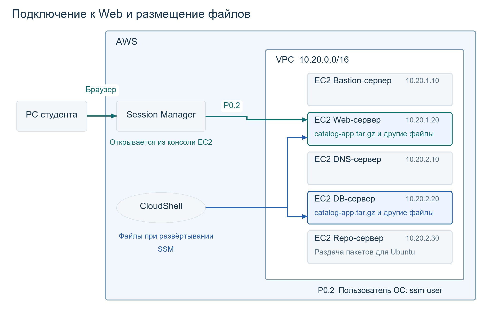
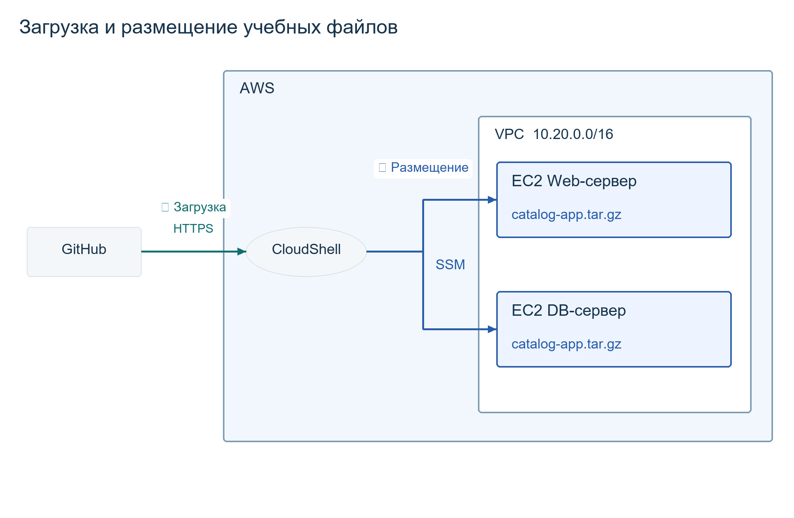

# Web Infrastructure: практика P0-P6 с подробными шагами

Первая редакция для проверки преподавателем. Полное прохождение по пособию студентом ещё не проверено.

Русский и узбекский тексты синхронизированы с японским оригиналом. Редактура носителями языка ещё не выполнена.

[日本語](../ja/practice-full.md) · [Русский](../ru/practice-full.md) · [O‘zbekcha](../uz/practice-full.md)

[Практика P0–P6](practice.md) · [Задания M0–M6](missions.md)

## Как пользоваться пособием

Сначала прочитайте задание P; при необходимости проходите подробный пример по шагам. P - тренировка с подробными шагами. В M самостоятельно используйте другие объекты/значения. Номера заданий не являются номерами занятий; идите в своём темпе. Выполнение P не означает выполнение M.

P0 → M0 → P1 → M1 → P2 → M2 → P4 → M4 → P5 → P6 → M5 → M6

P5 требует DNS из M2. В P4 потренируйтесь подключаться к БД по IP и имени. Приложение использует db.lab.test. Перед переключением practice → mission завершите setup в P6.

P0=1, M0=1, M1=8, M2=13, M4=9, M5=13, M6=16: всего 61 балл. Нет личной демонстрации, backup/restore, дополнительных дисков и разработки приложения. Пересчёт в 25 баллов делает преподаватель отдельно. Повторные отправки возможны до объявленного срока. PASS разных попыток не объединяются; максимум автоматически не выбирается.

## Среда и подготовка

Сначала завершите проверку подписи начального комплекта, создание пяти узлов либо install в существующую среду, внутренний SSH и личную регистрацию. Инструкция - distribution/STUDENT.md в zip. Не храните приватные ключи в общем Windows; используйте CloudShell личного Academy account. Преподаватель выдаёт личный анонимный Lab ID, fingerprint и срок действия.

Общие private IP ниже; public IPv4 не фиксируется. AWS region us-east-1, Ubuntu24.04/amd64. RDP: labuser; SSM: ssm-user; внутренний SSH: ubuntu. Не путайте пользователя и роль сервера.

| Role | Private IPv4 | Назначение |
| --- | --- | --- |
| bastion | 10.20.1.10 | RDP3389 / Firefox / SSH |
| web | 10.20.1.20 | HTTP80 / private8080 / loopback8000 |
| dns | 10.20.2.10 | BIND UDP/TCP53 |
| db | 10.20.2.20 | PostgreSQL5432 |
| repo | 10.20.2.30 | HTTP80 с заранее сохранёнными подписанными ресурсами |

В P0 и M0 открывайте Session Manager из списка EC2. Если в дальнейшем шаг требует подключения из CloudShell, выполните там `aws ssm start-session --target i-...`, подставив ID сервера. В обоих случаях на сервере используется `ssm-user`.

Редактор nano: открыть файл → ввести текст → Ctrl+O → Enter сохранить → Ctrl+X выйти. Блок конфигурации не выполняется как shell-команда. В psql меняется prompt; SQL/\password вводятся внутри, \q возвращает в Ubuntu. Не продолжайте после ошибки без проверки результата.

Нумерованные комментарии показывают порядок и цель внутри шага. # используется в shell, -- внутри psql. Комментарии менять не нужно. Выполняйте по одной команде, дожидаясь подключения, редактора и ввода пароля. Команда с продолжением строки остаётся одной командой.

## Как читать шаги

В каждом P идут задание, объяснение, шаги и вопросы. Выполняйте команды по одной и читайте результат, не вставляйте весь раздел сразу. Обратная косая черта в конце строки означает продолжение: эта и следующая строки составляют одну команду.

Блок bash вводится в терминале указанного узла. Блок text может содержать конфигурацию, ввод внутри psql или пример вывода: читайте пояснение перед ним. Строка с # - комментарий. Не добавляйте приглашение $ или postgres=# из своего терминала. Значения с YOUR- заменяйте своими.

Проверяйте по порядку: сохранённый файл, синтаксис, применение к службе, реальное соединение. Правильный файл ещё не доказывает, что работающая служба уже использует его. Сопоставляйте HTTP-ответ, DNS-ответ или SQL-результат с журналом.

## Система и пути соединений

| Источник | Назначение | Protocol / port | Цель |
| --- | --- | --- | --- |
| Windows PC | Web public IPv4 | TCP/80 | Публичный доступ через Internet Gateway к каталогу и статическим файлам. |
| Windows PC | bastion public IPv4 | TCP/3389 | RDP из разрешённого CIDR к рабочему столу бастиона. |
| bastion | Web/DNS/DB/repo | TCP/22 | Внутренний SSH для управления; приватный ключ остаётся на бастионе. |
| bastion / Web | DNS 10.20.2.10 | UDP+TCP/53 | Разрешение имён lab.test. DNS не выдаёт содержимое Web-страницы. |
| Web app | DB 10.20.2.20 | TCP/5432 | SQL от роли приложения. Прямое соединение Windows с DB не используется. |
| bastion | Web 10.20.1.20 | TCP/8080 | Администрирование через admin.lab.test отдельно от публичного порта 80. |
| Nginx on Web | 127.0.0.1 on Web | TCP/8000 | Передача приложению на том же Web; 127.0.0.1 - текущий локальный узел. |

SSM начальной среды - отдельный путь управления из CloudShell в EC2. Он не включён в путь обычного Web-запроса. Внутренние IP и порты таблицы заданы этим Lab, а не всеми Web-системами.

## P0 Своя среда и место выполнения команд

### Что изучаем

Выбрать нужный сервер в списке EC2, подключиться через Session Manager и проверить результат задания.

### Задание

В своей готовой среде проверьте идентификаторы и роли пяти серверов, затем проверьте, к какому серверу и под каким пользователем вы подключились.

### Подключение к серверам и файлы курса



Зелёная стрелка показывает подключение к терминалу в P0.2. Синие стрелки показывают размещение файлов при создании среды. Repo-сервер раздаёт пакеты для Ubuntu.

**Что сделать в Practice0**

Проверьте свой AWS-аккаунт, роль каждого сервера и среду выполнения команд.

### Учебные файлы, размещённые при создании среды

После создания среды по общему коду архив `catalog-app.tar.gz` с приложением и SQL для настройки БД уже находится в `/var/lib/jdu-web/lesson-resources-r1` на Web- и DB-серверах. В целях безопасности исходящие HTTPS-подключения с Web-сервера к интернету ограничены, поэтому скрипт доставляет файлы по показанному маршруту.



При создании среды по общему коду CloudShell загружает учебные файлы с GitHub и размещает их на Web- и DB-серверах через SSM.

### Пример решения (порядок действий)

#### P0.1 Проверить instance ID пяти серверов

**Среда выполнения:**

AWS Console своего студенческого аккаунта

**Цель и действия:**

Введите EC2 в поле Search в верхней части AWS Console и откройте консоль EC2. Откройте EC2 → Instances и найдите пять серверов своей среды в столбце Name. В той же строке проверьте полный идентификатор с префиксом i- в столбце Instance ID.


Список Instances в EC2. Для P0 выберите строку с окончанием имени `-web`, для M0 - `-db`.

#### P0.2 Подключиться к Web-серверу через Session Manager

**Среда выполнения:**

SSM-терминал Web-сервера: ssm-user

**Цель и действия:**

Нажмите **Instance ID** Web-сервера, найденного в P0.1. На странице сведений нажмите стрелку справа от **Connect** и выберите **Connect with SSM Session Manager**. Выполните команды ниже в терминале новой вкладки. `id -un` показывает пользователя ОС, а `pwd` - текущий каталог. Значение `web` в поле `role` файла `/etc/jdu-web/bootstrap.json` подтверждает, что открыт Web-сервер. Создайте в своём домашнем каталоге файл `p0-connection.txt` с одной строкой `web`.


Страница EC2. Нажмите стрелку справа от Connect и выберите Connect with SSM Session Manager. На снимке показан Web-сервер.

Команды: нумерация внутри этого шага

```bash
# 1. Показать имя пользователя ОС в этом терминале.
id -un
# 2. Перейти в рабочий каталог $HOME.
cd "$HOME"
# 3. Показать текущий рабочий каталог.
pwd
# 4. Прочитать только role из bootstrap, чтобы проверить выбранный сервер.
python3 -c 'import json;print(json.load(open("/etc/jdu-web/bootstrap.json"))["role"])'
# 5. Записать одну строку web в проверочный файл домашнего каталога.
printf '%s\n' web > "$HOME/p0-connection.txt"
# 6. Прочитать $HOME/p0-connection.txt без изменения.
cat "$HOME/p0-connection.txt"
```

**Ожидаемый результат и его смысл:**

Команда `id -un` выводит `ssm-user`, команда `pwd` после перехода в домашний каталог выводит `/home/ssm-user`, а роль и содержимое файла имеют значение `web`.

В приглашении видны имя пользователя, имя узла и текущий каталог. `~` означает домашний каталог, а `pwd` показывает полный путь. Если настройка не смогла включить это отображение и видно только `$`, выполните следующую строку. Завершите сеанс командой `exit`.

```bash
exec env PS1='\u@\h:\w\$ ' bash --norc -i
```


Терминал Session Manager. После настройки приглашение обновляет текущий каталог при переходе.

#### P0.3 Открыть рабочий стол бастиона по RDP

**Среда выполнения:**

Windows PC студента (общая учётная запись)

**Цель и действия:**

Используйте текущий public IPv4 бастиона из EC2. Нажмите Windows+R, введите mstsc /prompt и Enter. В Computer укажите IP, пользователь labuser, пароль - свой RDP из начальной установки, не пароль Windows. Не выбирайте сохранение credentials. Если появится синий login xrdp, выберите Session=Xorg и labuser.

Команды: нумерация внутри этого шага

```bash
# 1. Открыть RDP Windows с запросом учётных данных.
mstsc /prompt
```

**Смысл команд и настроек:**

RDP передаёт экран и ввод бастиона. Запрос Firefox внутри RDP идёт от бастиона, а не Windows. Раскладка клавиатуры влияет на символы пароля; язык интерфейса и раскладка - разные настройки.

**Ожидаемый результат и его смысл:**

Открываются Xfce и Firefox внутри Ubuntu-бастиона. Это не браузер Windows. labuser не имеет sudo: настройку выполняйте через CloudShell → SSM/ssm-user.

**Если не получилось:**

При Login failed проверьте имя и раскладку клавиатуры. Не отправляйте пароль в чат. При недоступности сверьте текущий IP и разрешённый CIDR с преподавателем; не открывайте 3389 для всех. Перед закрытием RDP сохраните работу.

### Проверка и сдача

Скрипт начальной настройки создаёт в AWS сервис проверки заданий (Lambda). После упражнения с RDP войдите на указанную преподавателем страницу через учебный аккаунт Google, выберите свой Lab и P0 и запустите проверку. Верный файл из одной строки `web` в вашем домашнем каталоге на Web-сервере даёт 1 балл. Проверьте, что балл сохранён.

### Проверка понимания (без баллов)

Какой узел изменится, если выполнить шаги DB в открытом SSM-сеансе Web?

**Объяснение:**

Команды выполняются на подключённом Web-сервере. Для работы с DB выберите DB-сервер в списке EC2 и откройте новый терминал через Session Manager.

## P1 Выдача статического файла по HTTP

### Что изучаем

Связать Nginx, файл, прослушивание порта, HTTP-ответ и access log.

### Задание

Файл /var/www/html/practice.txt на Web должен возвращать заданный текст с HTTP 200: локально, с бастиона и извне.

### Схема задания


Толстая рамка отмечает основной объект. Настраивайте в терминале, указанном в шаге; стрелки показывают направление подключения или проверки. Разрешения SG заданы начальным комплектом; здесь настраивается сервер. Слева Интернет, справа VPC в AWS. IGW стоит на границе VPC; все EC2, включая бастион, находятся в AWS.

- File: /var/www/html/practice.txt
- URL path: /practice.txt

```text
JDU WEB-02 practice: HTTP response verified.
```

### Как это работает

**Состояние перед началом:**

Web уже создан, но учебный файл ещё не выдаётся.

**Что сделать в Practice1**

Nginx выдаёт practice.txt на порту 80 и записывает запрос в журнал.

Путь URL /practice.txt соответствует файлу /var/www/html/practice.txt на Web. Успех через 127.0.0.1 проверяет только сам Web. Чтение того же текста с бастиона и Windows проверяет другие участки пути. См. [документацию Nginx](https://nginx.org/en/docs/beginners_guide.html).

### Пример решения (порядок действий)

#### P1.1 Установить Nginx из внутреннего APT

**Среда выполнения:**

SSM-терминал Web-сервера: ssm-user

**Цель и действия:**

Подключитесь по SSM к Web как в P0 и проверьте role=web. Проверьте APT source: используется только подписанный repo 10.20.2.30. update получает индекс, install устанавливает пакет. Не добавляйте внешние источники.

Команды: нумерация внутри этого шага

```bash
# 1. Прочитать /etc/apt/sources.list.d/jdu-web.sources без изменения.
cat /etc/apt/sources.list.d/jdu-web.sources
# 2. Обновить индекс пакетов внутреннего repo; считать ошибки загрузки сбоем.
sudo apt-get update -o APT::Update::Error-Mode=any
# 3. Установить nginx из внутреннего repo без рекомендуемых дополнений.
sudo apt-get install --no-install-recommends nginx
```

**Смысл команд и настроек:**

Apt-get update обновляет список пакетов, install устанавливает выбранный пакет. --no-install-recommends исключает рекомендованные дополнения. Signed-By задаёт доверенный ключ: доступ к repo ещё не доказывает успешную проверку подписи.

**Ожидаемый результат и его смысл:**

В source указаны внутренний IP и Signed-By; установка завершается без ошибки подписи. На запрос установки ответьте Y.

**Если не получилось:**

При ошибке получения проверьте repo, его running/SSM и IP. Не обходите подпись через --allow-unauthenticated или внешний pip.

#### P1.2 Создать точный текст и права файла

**Среда выполнения:**

SSM-терминал Web-сервера: ssm-user

**Цель и действия:**

Создайте текст через nano: одна точная строка, указанная ниже, с переводом строки в конце. Ctrl+O → Enter сохраняет, Ctrl+X закрывает редактор. install копирует файл; -o/-g задают владельца и группу, -m - права.

Команды: нумерация внутри этого шага

```bash
# 1. Перейти в рабочий каталог ~.
cd ~
# 2. Создать рабочий каталог; существующий сохранить.
mkdir -p jdu-web-practice/p1
# 3. Перейти в рабочий каталог jdu-web-practice/p1.
cd jdu-web-practice/p1
# 4. Показать текущий рабочий каталог.
pwd
# 5. Открыть practice.txt: ввести текст, сохранить и выйти.
nano practice.txt
# File content: JDU WEB-02 practice: HTTP response verified.
# 6. Установить файл с нужными владельцем, группой и правами.
sudo install -o root -g root -m 0644 practice.txt /var/www/html/practice.txt
# 7. Прочитать владельца, группу, права и имя указанных файлов.
stat -c '%U:%G %a %n' /var/www/html/practice.txt
# 8. Прочитать /var/www/html/practice.txt без изменения.
cat /var/www/html/practice.txt
```

**Смысл команд и настроек:**

Разделите рабочий файл nano и файл выдачи Nginx. Здесь install копирует файл с владельцем root:root и режимом 0644, а не устанавливает пакет. Писать может владелец, остальные могут читать. Завершающий перевод строки входит в содержимое.

**Ожидаемый результат и его смысл:**

Ожидается root:root 644 и ровно строка JDU WEB-02 practice: HTTP response verified. Регистр, пробелы, точка и конечный перевод строки важны.

**Если не получилось:**

Если вы ещё в nano, сначала сохраните и выйдите. Не меняйте существующий mission.txt.

#### P1.3 Проверить Web root и запустить сервис

**Среда выполнения:**

SSM-терминал Web-сервера: ssm-user

**Цель и действия:**

Начальный сайт Ubuntu использует root /var/www/html. Через nginx -T найдите включённый /etc/nginx/sites-enabled/default, root и listen 80. При необходимости редактируйте sudo nano; reload выполняйте после успешной проверки. enable --now запускает сейчас и включает автозапуск.

Команды: нумерация внутри этого шага

```bash
# 1. Показать полную конфигурацию Nginx; не передавать секреты.
sudo nginx -T
# 2. Проверить синтаксис и файлы конфигурации Nginx.
sudo nginx -t
# 3. Запустить nginx сейчас и включить автозапуск.
sudo systemctl enable --now nginx
# 4. Перечитать настройки nginx без остановки.
sudo systemctl reload nginx
# 5. Прочитать текущее состояние nginx.
systemctl is-active nginx
# 6. Показать IP, порты и процессы слушающих TCP-сокетов.
sudo ss -lntp
```

**Смысл команд и настроек:**

Nginx -T выводит конфигурацию, -t проверяет синтаксис. В systemctl enable включает запуск при загрузке, --now запускает сейчас. После сохранения файла проверьте reload, состояние службы и порт.

**Ожидаемый результат и его смысл:**

Ожидаются успешный синтаксис, active и слушатель вроде 0.0.0.0:80. Только 127.0.0.1:80 недоступен другим узлам.

**Если не получилось:**

При ошибке используйте имя файла и строку из nginx -t. Изменение SG не исправит синтаксис.

#### P1.4 Посмотреть ответ на самом Web

**Среда выполнения:**

SSM-терминал Web-сервера: ssm-user

**Цель и действия:**

curl - HTTP-клиент; -i показывает статус, заголовки и тело. 127.0.0.1 означает этот Web-сервер, не его public IP. Сравните ответ, а не только код завершения команды.

Команды: нумерация внутри этого шага

```bash
# 1. Отправить HTTP к http://127.0.0.1/practice.txt; показать статус, заголовки и тело.
curl --noproxy '*' -i http://127.0.0.1/practice.txt
```

**Смысл команд и настроек:**

Curl -i показывает HTTP-заголовки вместе с телом. Адрес 127.0.0.1 означает сам Web, запрос не идёт через Internet. Проверяйте и код 200, и заданный текст; ответ другой страницы не подходит.

**Ожидаемый результат и его смысл:**

HTTP 200 и заданный текст. При 404 проверяйте файл/root/URL; при connection refused - сервис и слушатель.

**Если не получилось:**

При Welcome to nginx проверьте, что запросили /practice.txt, а не /.

#### P1.5 Проверить тот же файл с бастиона и извне

**Среда выполнения:**

SSM-терминал бастиона: ssm-user

**Цель и действия:**

Выйдите из Web через exit, откройте SSM бастиона из CloudShell и запросите URL ниже. Затем exit возвращает в CloudShell; там запросите тот же путь командой curl -i по текущему public IPv4 Web из EC2. Не путайте private 10.20.1.20 с public IPv4.

Команды: нумерация внутри этого шага

```bash
# 1. Отправить HTTP к http://10.20.1.20/practice.txt; показать статус, заголовки и тело.
curl --noproxy '*' -i http://10.20.1.20/practice.txt
```

**Смысл команд и настроек:**

Тот же curl с бастиона проверяет внутренний путь. В браузере Windows нужен текущий public IP Web. Недоступность 10.20.1.20 с Windows сама по себе не означает остановку Web.

**Ожидаемый результат и его смысл:**

На обоих маршрутах 200 и одинаковый текст. HTTP 80 открыт, управляющий 8080 и DB 5432 не публикуются.

**Если не получилось:**

Если внутренний запрос успешен, а внешний нет, проверьте текущий public IP и Lab. Не ослабляйте базовые SG.

#### P1.6 Связать запрос с журналом и отправить

**Среда выполнения:**

SSM-терминал Web-сервера: ssm-user

**Цель и действия:**

Вернитесь на Web. В access log найдите время, IP клиента, путь и статус. Это доказательство обработки запроса, не только наличия файла. После exit в CloudShell выберите P1 в Web Portal на PC и запустите проверку.

Команды: нумерация внутри этого шага

```bash
# 1. Прочитать последние 20 строк access log и найти свой HTTP-запрос.
sudo tail -n 20 /var/log/nginx/access.log
# 2. Закрыть сеанс текущего сервера и вернуться в CloudShell.
exit
```

**Смысл команд и настроек:**

Сопоставьте время, путь и статус в access log с недавним curl. Tail читает последние строки и не меняет журнал. После exit проверьте P1 в браузере PC.

**Ожидаемый результат и его смысл:**

Результаты восьми учебных проверок и готовности показаны и сохранены. P1 не даёт оценочных баллов; M1 требует другого файла и текста.

**Если не получилось:**

Если идёт обработка, обновите результат. При ошибке сохранения прочитайте причину. Не меняйте ожидаемый текст checker.

### Пример чтения вывода (не вводить)

```text
HTTP/1.1 200 OK

JDU WEB-02 practice: HTTP response verified.
```

Показаны только нужные строки; реальный ответ содержит и другие заголовки. Проверьте 200, текст и путь/статус в access log.

### Проверка понимания (без баллов)

На Web ответ 200, а с бастиона соединение не проходит. Что проверить до изменения файла?

**Объяснение:**

Адрес назначения, адрес/порт прослушивания и разрешение пути bastion → Web. Содержимое файла и доступность - разные проверки.

## P2 Внутренний DNS и системное разрешение имён

### Что изучаем

Последовательно настроить zone, A-записи, ACL BIND и resolver клиентов.

### Задание

Настройте guide.lab.test → 10.20.1.20 и practice-db.lab.test → 10.20.2.20; откройте HTTP из P1 по имени. Фиксированные IP не меняются.

### Схема задания


Толстая рамка отмечает основной объект. Настраивайте в терминале, указанном в шаге; стрелки показывают направление подключения или проверки. Разрешения SG заданы начальным комплектом; здесь настраивается сервер.

| DNS name | A / IPv4 |
| --- | --- |
| guide.lab.test | 10.20.1.20 |
| practice-db.lab.test | 10.20.2.20 |

### Как это работает

**Состояние перед началом:**

HTTP из P1 работает по IP; DNS ещё предстоит настроить.

**Что сделать в Practice2**

Учебные имена BIND доступны обычному резолверу бастиона и Web.

DNS отвечает на запрос имени, а не выдаёт Web-страницу. BIND ведёт зону lab.test; A-запись возвращает IPv4. Различайте dig с явным сервером и getent/браузер с настройками ОС. После DNS выполняется отдельное HTTP-соединение. [Документация BIND](https://bind9.readthedocs.io/en/v9.18.39/chapter3.html).

### Пример решения (порядок действий)

#### P2.1 Установить BIND и сохранить исходные настройки

**Среда выполнения:**

SSM-терминал DNS-сервера: ssm-user

**Цель и действия:**

Подключитесь к DNS, проверьте role=dns. cp -a сохраняет атрибуты исходного файла, -n не заменяет прежнюю копию. Это страховка при редактировании, не задание по backup/restore БД.

Команды: нумерация внутри этого шага

```bash
# 1. Обновить индекс пакетов внутреннего repo; считать ошибки загрузки сбоем.
sudo apt-get update -o APT::Update::Error-Mode=any
# 2. Установить bind9 bind9-utils из внутреннего repo без рекомендуемых дополнений.
sudo apt-get install --no-install-recommends bind9 bind9-utils
# 3. Скопировать исходный файл в резервную копию, не затирая существующую.
sudo cp -an /etc/bind/named.conf.options /etc/bind/named.conf.options.before-p2
# 4. Скопировать исходный файл в резервную копию, не затирая существующую.
sudo cp -an /etc/bind/named.conf.local /etc/bind/named.conf.local.before-p2
```

**Смысл команд и настроек:**

Named - имя службы BIND; named-checkconf и другие команды проверяют конфигурацию. Опция -n в cp -an не перезаписывает существующую резервную копию при повторном запуске.

**Ожидаемый результат и его смысл:**

Установка использует внутренний repo. В M2 добавляйте записи в этот же DNS, сохраняя P2.

**Если не получилось:**

Не копируйте целиком named.conf из чужого Lab. Если своя zone уже есть, сначала изучите её.

#### P2.2 Настроить клиентов и forwarder

**Среда выполнения:**

SSM-терминал DNS-сервера: ssm-user

**Цель и действия:**

Откройте sudo nano /etc/bind/named.conf.options, введите и сохраните текст ниже. acl задаёт разрешённых клиентов; listen-on - адреса DNS; forward only передаёт внешние имена AWS DNS. И query, и recursion ограничены тремя источниками. dnssec-validation no соответствует изолированной учебной схеме forwarding.

Конфигурация или данные: не выполнять как команды

```text
acl "jdu_clients" { 127.0.0.1; 10.20.1.10; 10.20.1.20; };
options {
    directory "/var/cache/bind";
    listen-on { 127.0.0.1; 10.20.2.10; };
    listen-on-v6 { none; };
    allow-query { jdu_clients; };
    allow-recursion { jdu_clients; };
    allow-query-cache { jdu_clients; };
    recursion yes;
    forward only;
    forwarders { 10.20.0.2; };
    dnssec-validation no;
    allow-transfer { none; };
};
```

**Смысл команд и настроек:**

Allow-query задаёт клиентов запросов, allow-recursion - клиентов рекурсивного поиска. Имена lab.test берутся из своей зоны, внешние передаются forwarder. В этом Lab клиенты ограничены бастионом, Web и localhost.

**Ожидаемый результат и его смысл:**

Это содержимое файла, не команды shell. 10.20.0.2 - resolver AWS, 10.20.2.10 - ваш BIND.

**Если не получилось:**

Точки с запятой и фигурные скобки обязательны. Не расширяйте ACL до any или 0.0.0.0/0.

#### P2.3 Объявить zone и создать A-записи

**Среда выполнения:**

SSM-терминал DNS-сервера: ssm-user

**Цель и действия:**

В sudo nano /etc/bind/named.conf.local запишите первый блок zone. Создайте каталог командой sudo install -d -m 0755 /etc/bind/zones, затем откройте sudo nano /etc/bind/zones/db.lab.test и запишите остальной текст. SOA - служебные данные, NS - авторитетный DNS, A - имя/IPv4. Точка в конце обозначает полное имя; увеличивайте serial при изменениях.

Конфигурация или данные: не выполнять как команды

```text
// /etc/bind/named.conf.local
zone "lab.test" {
    type primary;
    file "/etc/bind/zones/db.lab.test";
    allow-transfer { none; };
    allow-update { none; };
};

; /etc/bind/zones/db.lab.test
$TTL 300
@ IN SOA dns.lab.test. hostmaster.lab.test. (
    2026102301 3600 600 604800 300 )
@ IN NS dns.lab.test.
dns IN A 10.20.2.10
guide IN A 10.20.1.20
practice-db IN A 10.20.2.20
```

**Смысл команд и настроек:**

Объявление зоны и её записи сохраняются в разные файлы. Guide дополняется до guide.lab.test; dns.lab.test. с точкой - полное имя. TTL задаёт время кеша, serial SOA - номер версии зоны, а не IP.

**Ожидаемый результат и его смысл:**

Сохраните как два отдельных файла. Запись dns задаёт адрес имени NS. Resolver клиентов пока не меняйте.

**Если не получилось:**

Если M2 уже настроен, добавьте две учебные записи, не заменяя zone. Не объявляйте zone дважды.

#### P2.4 Проверить синтаксис и локальный DNS-ответ

**Среда выполнения:**

SSM-терминал DNS-сервера: ssm-user

**Цель и действия:**

Переключение клиентов на неисправный DNS нарушит разрешение имён. Сначала добейтесь успешных named-checkconf и named-checkzone, затем проверьте UDP и TCP.

Команды: нумерация внутри этого шага

```bash
# 1. Проверить конфигурацию BIND и подключённые zone.
sudo named-checkconf -z
# 2. Проверить zone-файл lab.test.
sudo named-checkzone lab.test /etc/bind/zones/db.lab.test
# 3. Запустить named сейчас и включить автозапуск.
sudo systemctl enable --now named
# 4. Перезапустить named с обновлённой настройкой.
sudo systemctl restart named
# 5. Запросить guide.lab.test по UDP 53 и прочитать ответ.
dig @127.0.0.1 guide.lab.test A
# 6. Запросить guide.lab.test по TCP 53 и прочитать ответ.
dig @127.0.0.1 guide.lab.test A +tcp
```

**Смысл команд и настроек:**

Применяйте настройку после успешной проверки синтаксиса. В dig знак @ задаёт DNS-сервер, A - тип записи IPv4. Проверка с +tcp использует TCP53 и рассматривается отдельно от UDP.

**Ожидаемый результат и его смысл:**

Ожидаются zone loaded/OK, NOERROR, флаг aa и A=10.20.1.20. aa означает авторитетный ответ этой zone.

**Если не получилось:**

При ошибке изучите sudo journalctl -u named -n 30 --no-pager, исправьте конфигурацию и проверьте снова.

#### P2.5 Запросить DNS с бастиона и Web

**Среда выполнения:**

SSM-терминал бастиона: ssm-user

**Цель и действия:**

Выполните команды и на бастионе, и на Web. @10.20.2.10 задаёт DNS только для данного запроса. Это ещё не доказывает, что браузер и приложение используют его по умолчанию.

Команды: нумерация внутри этого шага

```bash
# 1. Запросить guide.lab.test по UDP 53 и прочитать ответ.
dig @10.20.2.10 guide.lab.test A
# 2. Запросить practice-db.lab.test по TCP 53 и прочитать ответ.
dig @10.20.2.10 practice-db.lab.test A +tcp
# 3. Запросить absent-p2.lab.test по UDP 53 и прочитать ответ.
dig @10.20.2.10 absent-p2.lab.test A
# 4. Запросить aws.amazon.com по UDP 53 и прочитать ответ.
dig @10.20.2.10 aws.amazon.com A
# 5. Запросить AXFR всей zone и проверить явный отказ.
dig @10.20.2.10 lab.test AXFR
```

**Смысл команд и настроек:**

Отдельно проверьте существующее внутреннее имя, отсутствующее имя, внешнее имя и перенос зоны. NXDOMAIN - корректный отрицательный ответ, не timeout. AXFR запрашивает всю зону; здесь перенос должен быть запрещён.

**Ожидаемый результат и его смысл:**

Нужные имена дают правильные A; absent-p2 - авторитетный NXDOMAIN; внешнее имя - ответ; AXFR запрещён. Таймаут не считается доказанным отказом.

**Если не получилось:**

При недоступности различайте источник, UDP и TCP 53. Не добавляйте остальные private-узлы в ACL клиентов.

#### P2.6 Переключить системный resolver только на BIND

**Среда выполнения:**

SSM-терминал бастиона: ssm-user

**Цель и действия:**

На бастионе и Web по одному узлу выполните ip -br link, затем networkctl status ИМЯ для определения интерфейса и Network File. Найдите его YAML через ls /etc/netplan и сохраните копию sudo cp -an. Через sudo nano добавьте к тому же интерфейсу dhcp4-overrides/use-dns:false и nameservers. Ниже схема: имя интерфейса и имеющиеся match/set-name/renderer сохраняйте из своего файла.

Конфигурация или данные: не выполнять как команды

```text
network:
  version: 2
  ethernets:
    ens5:
      dhcp4: true
      dhcp4-overrides:
        use-dns: false
      nameservers:
        addresses: [10.20.2.10]
```

**Смысл команд и настроек:**

Этот Netplan нужен клиентам - бастиону и Web, а не DNS-серверу. Dhcp4 сохраняет получение IP, use-dns: false отключает принятие DNS от DHCP. Адрес DNS в addresses не является адресом самого EC2.

**Ожидаемый результат и его смысл:**

DHCP сохраняет IP и gateway. Не добавляйте резервный DNS, не заменяйте /etc/resolv.conf и не прописывайте имена задания в /etc/hosts. Оставьте SSM открытым.

**Если не получилось:**

Несколько YAML одного интерфейса объединяются. Если resolvectl dns показывает ещё AWS DNS, проверьте все соответствующие YAML и действующую конфигурацию.

#### P2.7 После применения проверить обычный resolver и HTTP

**Среда выполнения:**

SSM-терминал бастиона: ssm-user

**Цель и действия:**

На бастионе и Web сначала создайте конфигурацию, затем примените и проверьте. Оставьте второе окно SSH/RDP; при разрыве вернитесь по SSM и сравните с сохранённой копией. Применяйте apply только после проверки файла и успешного generate.

Команды: нумерация внутри этого шага

```bash
# 1. Сгенерировать конфигурацию netplan и проверить YAML перед применением.
sudo netplan generate
# 2. Применить сохранённые настройки netplan к сети.
sudo netplan apply
# 3. Перезапустить systemd-resolved с обновлённой настройкой.
sudo systemctl restart systemd-resolved
# 4. Показать DNS-серверы системного resolver.
resolvectl dns
# 5. Получить IPv4 guide.lab.test через системный resolver.
getent ahostsv4 guide.lab.test
# 6. Получить IPv4 practice-db.lab.test через системный resolver.
getent ahostsv4 practice-db.lab.test
# 7. Отправить HTTP к http://guide.lab.test/practice.txt; показать статус, заголовки и тело.
curl --noproxy '*' -i http://guide.lab.test/practice.txt
```

**Смысл команд и настроек:**

Netplan generate формирует конфигурацию, apply применяет её. При разрыве SSM подключитесь к тому же instance. Resolvectl показывает выбранный DNS, getent использует обычный путь ОС; затем проверяется HTTP по имени.

**Ожидаемый результат и его смысл:**

Единственный upstream DNS - 10.20.2.10. getent выдаёт нужные IP, HTTP - 200 и текст P1. 127.0.0.53 - локальный stub; upstream смотрите в resolvectl.

**Если не получилось:**

Если dig успешен, а getent нет, проверяйте resolver клиента. Сохраняйте настройку Firefox с отключённым DoH.

#### P2.8 Сравнить IP и имя в браузере, затем отправить

**Среда выполнения:**

Firefox на рабочем столе бастиона через RDP

**Цель и действия:**

Откройте Firefox на бастионе через RDP. Сравните http://10.20.1.20/practice.txt и http://guide.lab.test/practice.txt. lab.test разрешается внутренним DNS бастиона, а не DNS школьного PC. Затем выберите P2 в Web Portal на PC и проверьте результат.

**Смысл команд и настроек:**

Firefox на бастионе использует внутреннее имя guide.lab.test. Браузер Windows не настроен на тот же внутренний DNS. Сравните доступ по IP и имени и проверьте тот же файл P1 перед отправкой.

**Ожидаемый результат и его смысл:**

13 учебных проверок; текущий P1 тоже должен работать. Перед DB/app добавьте шесть основных имён в M2.

**Если не получилось:**

Не считайте любую ошибку имени остановкой HTTP: сравните IP → dig → getent → HTTP.

### Пример чтения вывода (не вводить)

```text
status: NOERROR
guide.lab.test.  300  IN  A  10.20.1.20
```

Сокращённый пример dig: после A стоит IPv4, 300 - TTL. Отдельно проверьте, что SERVER запроса - 10.20.2.10.

### Проверка понимания (без баллов)

dig @10.20.2.10 работает, а getent - нет. Обязательно ли ошибка в зоне?

**Объяснение:**

Нет. Явно выбранный DNS и обычный резолвер ОС могут различаться. Проверьте применённые настройки Netplan и resolvectl.

## P4 Подключение к PostgreSQL с аутентификацией

### Что изучаем

Различать database, role и schema; выполнять SQL с Web по установленному паролю.

### Задание

Создайте jdu_catalog_practice, catalog_practice_setup и catalog_practice_app. Разрешите SCRAM только с Web 10.20.1.20/32. Таблицы приложения на этапе P4 не нужны.

### Схема задания


Толстая рамка отмечает основной объект. Настраивайте в терминале, указанном в шаге; стрелки показывают направление подключения или проверки. Разрешения SG заданы начальным комплектом; здесь настраивается сервер. Подключитесь из CloudShell к DB через SSM и настройте сервер.

- Profile: practice
- Database: jdu_catalog_practice
- Setup role: catalog_practice_setup
- Runtime role: catalog_practice_app
### Как это работает

**Состояние перед началом:**

На DB есть учебные файлы; используется разрешённый путь Web → DB.

**Что сделать в Practice4**

Созданы учебная БД и роли setup/runtime; SQL с Web проходит с паролем.

Нужны сетевой доступ, прослушивание DB, разрешение HBA, пароль и SQL-права. ssm-user - пользователь ОС, catalog_practice_app - роль БД. В HBA применяется первая совпавшая строка. Возможность подключиться не означает право создавать таблицы. [HBA](https://www.postgresql.org/docs/16/auth-pg-hba-conf.html) и [права SQL](https://www.postgresql.org/docs/16/sql-grant.html).

### Пример решения (порядок действий)

#### P4.1 Установить PostgreSQL и распаковать учебный SQL

**Среда выполнения:**

SSM-терминал DB-сервера: ssm-user

**Цель и действия:**

Подключитесь к DB по SSM, проверьте role=db. Cluster PostgreSQL 16 - единица работы сервера БД. Инструмент распаковки проверяет приложение и извлекает SQL; сам он не создаёт БД или роли.

Команды: нумерация внутри этого шага

```bash
# 1. Обновить индекс пакетов внутреннего repo; считать ошибки загрузки сбоем.
sudo apt-get update -o APT::Update::Error-Mode=any
# 2. Установить postgresql-16 postgresql-client-16 из внутреннего repo без рекомендуемых дополнений.
sudo apt-get install --no-install-recommends postgresql-16 postgresql-client-16
# 3. Сверить фиксированный hash и распаковать приложение/SQL преподавателя.
sudo python3 -B /var/lib/jdu-web/lesson-resources-r1/offline_assets.py
# 4. Показать версию, кластер, порт и состояние PostgreSQL.
pg_lsclusters
# 5. Прочитать настройку БД от postgres: SHOW data_directory;
sudo -u postgres psql -X -d postgres -c "SHOW data_directory;"
```

**Смысл команд и настроек:**

Установка пакета и создание учебных объектов в БД - разные этапы. Pg_lsclusters показывает версию, кластер, порт и состояние. Sudo -u postgres запускает команду от системного postgres; -X отключает личную настройку psql.

**Ожидаемый результат и его смысл:**

Cluster 16/main, data directory /var/lib/postgresql/16/main. Учебный SQL находится в /var/lib/jdu-web/lesson-resources-r1/app/sql.

**Если не получилось:**

Не удаляйте существующие БД и роли. Если уже настроено, изучите состояние и выполняйте только недостающие шаги.

#### P4.2 Настроить прослушивание и SCRAM

**Среда выполнения:**

SSM-терминал DB-сервера: ssm-user

**Цель и действия:**

Сохраните postgresql.conf через sudo cp -an. В sudo nano /etc/postgresql/16/main/postgresql.conf задайте три значения ниже. Если параметр встречается несколько раз, проверьте действующее значение через SHOW. Слушать нужно только private IP БД на 5432; password_encryption определяет хранение новых паролей.

Конфигурация или данные: не выполнять как команды

```text
listen_addresses = '10.20.2.20'
port = 5432
password_encryption = 'scram-sha-256'
```

**Смысл команд и настроек:**

Listen_addresses задаёт локальный адрес прослушивания DB, а не список клиентов. Password_encryption задаёт формат для вновь устанавливаемых паролей. Сохранение файла не доказывает изменение работающего listener или прежних паролей.

**Ожидаемый результат и его смысл:**

Не используйте * для всех адресов. Пароли задаются после настройки HBA и restart.

**Если не получилось:**

Это текст postgresql.conf, не SQL. SG и адрес прослушивания ОС - разные средства контроля.

#### P4.3 Ограничить источник, database и role в HBA

**Среда выполнения:**

SSM-терминал DB-сервера: ssm-user

**Цель и действия:**

Сохраните pg_hba.conf, затем в sudo nano /etc/postgresql/16/main/pg_hba.conf запишите правила ниже. Действует первая совпавшая строка, поэтому прежние широкие разрешения не оставляйте. Системный postgres управляет через Unix socket/peer. Роли будущего M4 перечислены отдельно; учебной роли доступ к основной БД не даётся.

Конфигурация или данные: не выполнять как команды

```text
local all postgres peer
local all all reject
host jdu_catalog_practice catalog_practice_setup 10.20.1.20/32 scram-sha-256
host jdu_catalog_practice catalog_practice_app 10.20.1.20/32 scram-sha-256
host jdu_catalog catalog_setup 10.20.1.20/32 scram-sha-256
host jdu_catalog catalog_app 10.20.1.20/32 scram-sha-256
host all all 0.0.0.0/0 reject
host all all ::/0 reject
```

**Смысл команд и настроек:**

Строка host задаёт сочетание БД, роли, адреса клиента и метода аутентификации. /32 у 10.20.1.20 означает только Web. Разрешающие строки должны быть раньше завершающего reject. Local peer для системного postgres отличается от TCP-входа с паролем.

**Ожидаемый результат и его смысл:**

Разрешение зависит от сочетания database/role/источник. Строка 0.0.0.0/0 содержит reject, то есть запрет.

**Если не получилось:**

Не заменяйте метод на trust. Базовый SG также разрешает DB 5432 только с Web.

#### P4.4 Перезапустить и проверить действующие значения

**Среда выполнения:**

SSM-терминал DB-сервера: ssm-user

**Цель и действия:**

restart перечитывает настройки. SHOW и pg_hba_file_rules проверяют действующие значения, а не только текст файла. Параметр psql -X отключает личные startup-файлы.

Команды: нумерация внутри этого шага

```bash
# 1. Перезапустить postgresql@16-main с обновлённой настройкой.
sudo systemctl restart postgresql@16-main
# 2. Прочитать текущее состояние postgresql@16-main.
systemctl is-active postgresql@16-main
# 3. Показать IP, порты и процессы слушающих TCP-сокетов.
sudo ss -lntp
# 4. Прочитать настройку БД от postgres: SHOW password_encryption;
sudo -u postgres psql -X -d postgres -c "SHOW password_encryption;"
# 5. Найти ошибки HBA; в норме 0 строк.
sudo -u postgres psql -X -d postgres -c \
  "SELECT line_number,error FROM pg_hba_file_rules WHERE error IS NOT NULL;"
```

**Смысл команд и настроек:**

Postgresql@16-main - служба нужного кластера. После restart сопоставьте состояние службы, listener и действующее значение SHOW. Отсутствие error в pg_hba_file_rules ещё не заменяет реальное соединение клиента.

**Ожидаемый результат и его смысл:**

active, 10.20.2.20:5432, scram-sha-256, ошибок HBA - 0 строк.

**Если не получилось:**

active(exited) у postgresql.service не доказывает работу cluster. Изучайте journalctl -u postgresql@16-main.

#### P4.5 Создать учебную БД и две роли

**Среда выполнения:**

SSM-терминал DB-сервера: ssm-user

**Цель и действия:**

profile_sql.py только выводит фиксированный SQL с учебными именами. Сначала прочитайте вывод, затем передайте тот же текст psql. setup владеет БД/schema и создаёт таблицы; app используется приложением. Используйте предоставленный SQL: программировать приложение не требуется.

Команды: нумерация внутри этого шага

```bash
# 1. Перейти в рабочий каталог /var/lib/jdu-web/lesson-resources-r1/app.
cd /var/lib/jdu-web/lesson-resources-r1/app
# 2. Показать SQL создания учебных ролей без выполнения.
python3 -B profile_sql.py --profile practice 01_create_roles.sql
# 3. Сформировать SQL создания учебных ролей и применить через postgres к нужной БД.
python3 -B profile_sql.py --profile practice 01_create_roles.sql | sudo -u postgres \
  psql -X -v ON_ERROR_STOP=1 -d postgres
# 4. Сформировать SQL создания учебной БД и схемы и применить через postgres к нужной БД.
python3 -B profile_sql.py --profile practice 02_prepare_schema.sql | sudo -u postgres \
  psql -X -v ON_ERROR_STOP=1 -d jdu_catalog_practice
```

**Смысл команд и настроек:**

Первый запуск profile_sql.py только показывает SQL. БД изменяется при передаче через | в psql. --profile practice выбирает учебные имена, ON_ERROR_STOP=1 останавливает обработку при SQL-ошибке. Не повторяйте создание в уже созданной БД.

**Ожидаемый результат и его смысл:**

Два CREATE ROLE, CREATE DATABASE, права schema/CONNECT/USAGE. app не получает superuser/CREATEDB.

**Если не получилось:**

При already exists возможен повторный запуск. Не используйте DROP; проверьте роли и БД через \du и \l. Убедитесь, что psql справа от pipe не сообщил SQL error.

#### P4.6 Задать два пароля БД скрытым вводом

**Среда выполнения:**

psql на DB-сервере от имени системного postgres

**Цель и действия:**

Первая строка запускается в shell DB и открывает psql с postgres=#. Команды \password вводятся внутри psql. Для setup/app задайте разные пароли длиной от 16 символов, каждый дважды скрытым вводом. Не пишите значения в команду или отчёт. \q возвращает в shell DB.

Команды: нумерация внутри этого шага

```bash
# 1. В терминале DB открыть psql от postgres; следующие действия внутри psql.
sudo -u postgres psql -X -d postgres
```

Далее вводить внутри psql

```sql
-- 2. В psql скрыто задать пароль роли catalog_practice_setup.
\password catalog_practice_setup
-- 3. В psql скрыто задать пароль роли catalog_practice_app.
\password catalog_practice_app
-- 4. В psql проверить атрибуты и права учебных ролей.
\du catalog_practice_*
-- 5. Выйти из psql в терминал ОС того же DB-сервера.
\q
```

**Смысл команд и настроек:**

Строку sudo выполните в ОС, затем вводите \password, \du и \q по одной строке внутри psql. Setup и app - разные роли БД, различайте их пароли. Отсутствие символов на экране при вводе пароля нормально.

**Ожидаемый результат и его смысл:**

Нет Superuser/Create role/Create DB. Это отдельные секреты, не пароль RDP, не пароль администратора приложения и не token оценивания.

**Если не получилось:**

Учитывайте раскладку клавиатуры. Не записывайте пароль в чат или редактор для проверки. При потере используйте личную процедуру восстановления с преподавателем.

#### P4.7 Выполнить SELECT с Web по паролю

**Среда выполнения:**

SSM-терминал Web-сервера: ssm-user

**Цель и действия:**

Закройте SSM DB через exit, вернитесь в CloudShell и откройте Web. У psql -h задаёт узел, -U - роль, -d - БД, -W запрашивает пароль. Сначала подключитесь по внутреннему IP, затем выполните тот же SELECT по учебному имени DB из P2. Сверьте имя БД, роль и результат.

Команды: нумерация внутри этого шага

```bash
# 1. Установить postgresql-client-16 из внутреннего repo без рекомендуемых дополнений.
sudo apt-get install --no-install-recommends postgresql-client-16
# 2. Подключиться с Web к нужной БД с существующим паролем и выполнить SELECT.
psql -X -h 10.20.2.20 -U catalog_practice_app -d jdu_catalog_practice -W -c \
  'SELECT current_database(),current_user,1 AS value;'
# 3. Получить IPv4 practice-db.lab.test через системный resolver.
getent ahostsv4 practice-db.lab.test
# 4. Подключиться с Web к нужной БД с существующим паролем и выполнить SELECT.
psql -X -h practice-db.lab.test -U catalog_practice_app -d jdu_catalog_practice -W -c \
  'SELECT current_database(),current_user,1 AS value;'
```

**Смысл команд и настроек:**

В psql -h задаёт сервер, -U - роль БД, -d - БД, -W запрашивает пароль, -c задаёт SQL. Выполняйте на Web. Имена БД и пользователя в результате подтверждают подключение к учебному профилю. При подключении по имени IP берётся из системного DNS.

**Ожидаемый результат и его смысл:**

Результат jdu_catalog_practice / catalog_practice_app / 1. Открытый порт или успех pg_isready не заменяют этот SQL с аутентификацией.

**Если не получилось:**

Если по IP подключение работает, а по имени нет, проверьте системный DNS и учебное имя DB из P2. При отказе аутентификации проверьте источник, БД, роль и пароль. Не публикуйте DB в Internet для диагностики.

#### P4.8 Сохранить существующий пароль для checker только на Web

**Среда выполнения:**

SSM-терминал Web-сервера: ssm-user

**Цель и действия:**

Инструмент дважды скрыто запрашивает существующий пароль catalog_practice_app и сохраняет его только на Web в root-файл 0600. Пароль БД не меняется. Не выводите env через cat и не выполняйте source. После exit проверьте P4 в Web Portal на PC.

Команды: нумерация внутри этого шага

```bash
# 1. Скрыто ввести существующий пароль учебной БД и сохранить только на Web.
sudo python3 -B /var/lib/jdu-web/lesson-resources-r1/database_secret.py --profile \
  practice
# 2. Закрыть сеанс текущего сервера и вернуться в CloudShell.
exit
```

**Смысл команд и настроек:**

Database_secret.py повторно принимает уже заданный runtime-пароль и сохраняет его в защищённой настройке Web. Это не создание и не смена пароля. Нужен пароль catalog_practice_app, не setup или RDP.

**Ожидаемый результат и его смысл:**

Вывод D11_EXISTING_DB_PASSWORD_STORED_LOCALLY и девять учебных проверок. Неверный пароль и запрещённые DB/admin-role проверяются вместе с успешным контрольным подключением.

**Если не получилось:**

Если файл уже есть, не создавайте заново. В P5 тот же пароль вводится в настройку приложения. M4 использует отдельные БД/роли mission.

### Пример чтения вывода (не вводить)

```text
current_database    | current_user         | value
jdu_catalog_practice | catalog_practice_app | 1
```

Пример чтения SELECT; ширина столбцов может отличаться. Сверьте БД, роль и value=1. Это не доказательство права менять таблицы.

### Проверка понимания (без баллов)

Пароль принят, но CREATE TABLE запрещён. Обязательно ли неверен пароль?

**Объяснение:**

Аутентификация и SQL-права различны. Для runtime отказ в setup-операции может быть правильным.

## P5 Соединить предоставленное приложение с Web и DB

### Что изучаем

Без программирования связать offline-зависимости, сервисного пользователя, инициализацию БД, Nginx/systemd и реальный HTTP.

### Задание

Постройте каталог в profile practice. Нужны действующие DNS из M2 и P4. БД/администраторы P и M различны, но приложение и порты на том же Web общие.

### Схема задания


Толстая рамка отмечает основной объект. Настраивайте в терминале, указанном в шаге; стрелки показывают направление подключения или проверки. Разрешения SG заданы начальным комплектом; здесь настраивается сервер. 8000 доступен только внутри Web; 8080 используется для управления с бастиона. Слева Интернет, справа VPC в AWS. IGW стоит на границе VPC; все EC2, включая бастион, находятся в AWS.

- Profile: practice
- Database: jdu_catalog_practice
- Setup role: catalog_practice_setup
- Runtime role: catalog_practice_app
- Application administrator: practice_admin

| code | name | quantity | location | is_public |
| --- | --- | --- | --- | --- |
| P5-PUBLIC-001 | Practice keyboard | 4 | Training shelf A | true |
| P5-PRIVATE-001 | Practice mouse | 2 | Training shelf B | false |

### Как это работает

**Состояние перед началом:**

Сейчас работают DNS из M2 и учебная БД из P4.

**Что сделать в Practice5**

Предоставленное приложение на Web связывает каталог и управление с БД.

Nginx принимает HTTP, Gunicorn исполняет Python-приложение, PostgreSQL хранит данные. В отличие от статического P1, каталог получает содержимое из БД. Venv отделяет Python-среду приложения, unit systemd описывает запуск. Размещайте предоставленный код, переписывать программу не требуется.

### Пример решения (порядок действий)

#### P5.1 Проверить DNS и получить открытые ресурсы

**Среда выполнения:**

SSM-терминал Web-сервера: ssm-user

**Цель и действия:**

На Web обычный resolver должен дать db.lab.test=10.20.2.20 и admin.lab.test=10.20.1.20. offline_assets получает семь wheel и lock из внутреннего repo, сверяя исходную подпись/hash. Он не запускает внешний pip и не настраивает DB/app.

Команды: нумерация внутри этого шага

```bash
# 1. Получить IPv4 db.lab.test через системный resolver.
getent ahostsv4 db.lab.test
# 2. Получить IPv4 admin.lab.test через системный resolver.
getent ahostsv4 admin.lab.test
# 3. Установить python3-venv python3-pip из внутреннего repo без рекомендуемых дополнений.
sudo apt-get install --no-install-recommends python3-venv python3-pip
# 4. Проверить подпись/hash, подготовить приложение и фиксированные wheel.
sudo python3 -B /var/lib/jdu-web/lesson-resources-r1/offline_assets.py --wheels
# 5. Показать учебные файлы в /var/lib/jdu-web/lesson-resources-r1/app.
ls /var/lib/jdu-web/lesson-resources-r1/app
# 6. Показать учебные файлы в /var/lib/jdu-web/lesson-resources-r1/wheels.
ls /var/lib/jdu-web/lesson-resources-r1/wheels
```

**Смысл команд и настроек:**

P5 использует обычный DNS из M2, не заменяйте имя DB вручную на IP. --wheels подготавливает пакеты Python фиксированных версий, но не запускает приложение. Открытые файлы и создаваемые далее секретные настройки различаются.

**Ожидаемый результат и его смысл:**

PUBLIC_APP_RESOURCES_VERIFIED и SIGNED_OFFLINE_WHEELS_READY=7. Файлы приложения открытые и контролируются root.

**Если не получилось:**

Нужно и имя db.lab.test, не только practice-db. P5 зависит от M2, но не требует завершения основных заданий по каталогу.

#### P5.2 Разместить код и создать отдельный venv

**Среда выполнения:**

SSM-терминал Web-сервера: ssm-user

**Цель и действия:**

Код и venv контролирует root; пользователь catalog не должен их менять. Если app или venv уже существуют, не повторяйте создание - проверьте версию. cp переносит только проверенные открытые ресурсы. venv отделяет зависимости приложения от системного Python.

Команды: нумерация внутри этого шага

```bash
# 1. Создать каталог с указанными владельцем, группой и правами.
sudo install -d -o root -g root -m 0755 /opt/jdu-catalog/app
# 2. Скопировать приложение преподавателя в /opt с сохранением атрибутов.
sudo cp -a /var/lib/jdu-web/lesson-resources-r1/app/. /opt/jdu-catalog/app/
# 3. Создать отдельное Python venv приложения.
sudo python3 -m venv /opt/jdu-catalog/venv
# 4. Установить зависимости только из локальных wheel с lock/hash.
sudo /opt/jdu-catalog/venv/bin/python -m pip --isolated --no-cache-dir install \
  --no-index --find-links=/var/lib/jdu-web/lesson-resources-r1/wheels \
  --only-binary=:all: --require-hashes -r \
  /var/lib/jdu-web/lesson-resources-r1/requirements.lock
# 5. Проверить совместимость установленных Python-зависимостей.
sudo /opt/jdu-catalog/venv/bin/python -m pip check
```

**Смысл команд и настроек:**

Код находится в /opt/jdu-catalog/app, Python-среда - в соседнем venv. --no-index отключает индекс пакетов, --find-links задаёт локальные wheel, --require-hashes требует совпадения хешей. Pip check проверяет зависимости после установки.

**Ожидаемый результат и его смысл:**

--no-index запрещает внешний index; --require-hashes требует hash из lock. pip check не находит конфликтов.

**Если не получилось:**

Недостающую зависимость решают через комплект преподавателя. Не обновляйте до latest через pip и не меняйте код приложения.

#### P5.3 Создать сервисного пользователя и каталог static

**Среда выполнения:**

SSM-терминал Web-сервера: ssm-user

**Цель и действия:**

catalog предназначен для Gunicorn, не для входа человека. Создайте его с nologin и без sudo. Только каталог static принадлежит catalog для collectstatic; код/venv остаются root. Если catalog уже есть, проверьте id и shell вместо повторного useradd.

Команды: нумерация внутри этого шага

```bash
# 1. Создать системного catalog для приложения без login shell и home.
sudo useradd --system --user-group --home-dir /nonexistent --no-create-home --shell \
  /usr/sbin/nologin catalog
# 2. Создать каталог с указанными владельцем, группой и правами.
sudo install -d -o root -g root -m 0755 /var/lib/jdu-catalog
# 3. Создать каталог с указанными владельцем, группой и правами.
sudo install -d -o catalog -g catalog -m 0755 /var/lib/jdu-catalog/static
# 4. Проверить UID, GID и группы пользователя catalog.
id catalog
# 5. Проверить home и login shell пользователя catalog.
getent passwd catalog
```

**Смысл команд и настроек:**

Catalog - системный пользователь службы, не роль БД catalog_practice_app. Nologin запрещает интерактивную оболочку, но не запуск службы. Если id catalog уже найден, сначала проверьте, не выполнялся ли шаг ранее.

**Ожидаемый результат и его смысл:**

catalog не входит в sudo, shell /usr/sbin/nologin. Это не labuser и не ssm-user.

**Если не получилось:**

Не исправляйте права через chmod -R 777 или добавление catalog в sudo. Проверьте конкретный каталог и владельца.

#### P5.4 Создать и активировать runtime-настройки

**Среда выполнения:**

SSM-терминал Web-сервера: ssm-user

**Цель и действия:**

Подставьте текущий public IPv4 Web из EC2. Runtime-инструмент дважды запрашивает существующий пароль catalog_practice_app из P4. Django secret генерируется для вашего Lab. Создайте runtime-настройки, затем выберите practice командой activate до запуска приложения. После успешной проверки создайте временные настройки setup в P5.5.

Команды: нумерация внутри этого шага

```bash
# 1. Указать текущий public IPv4 Web из AWS Console.
PUBLIC_WEB_IPV4='YOUR-CURRENT-WEB-PUBLIC-IP'
# 2. Скрыто ввести существующий пароль БД и создать runtime practice.
sudo python3 -B /opt/jdu-catalog/app/configuration.py create-runtime --profile \
  practice --public-web-ipv4 "$PUBLIC_WEB_IPV4"
# 3. Выбрать сохранённый учебный профиль для следующего запуска приложения.
sudo python3 -B /opt/jdu-catalog/app/configuration.py activate --profile practice
# 4. Проверить runtime-конфигурацию без вывода секретов.
sudo python3 -B /opt/jdu-catalog/app/configuration.py check --phase runtime
# 5. Прочитать владельца, группу, права и имя указанных файлов.
sudo stat -c '%U:%G %a %n' /etc/jdu-catalog/app.env
```

**Смысл команд и настроек:**

Runtime-настройка содержит обычное соединение с БД и разрешённый публичный host. Используйте текущий PUBLIC_WEB_IPV4. Create-runtime сохраняет настройки, activate выбирает их для приложения, check проверяет настройки, stat показывает владельца и права.

**Ожидаемый результат и его смысл:**

CATALOG_ENV_CREATED=practice, CATALOG_PROFILE_ACTIVATED=practice, VALID, root:root 600. Выбраны учебная БД и учебная app-role.

**Если не получилось:**

Не вводите пароль RDP или администратора приложения. При продолжении начните с первого незавершённого действия. При ошибке activate проверьте, работает ли приложение и остались ли временные настройки setup, прежде чем идти дальше.

#### P5.5 Создать таблицы и администратора через временный setup

**Среда выполнения:**

SSM-терминал Web-сервера: ssm-user

**Цель и действия:**

В create-setup введите пароль catalog_practice_setup из P4. migrate создаёт предоставленную структуру БД; seed однократно добавляет три вымышленных образца в пустой каталог. create_lab_admin создаёт practice_admin со скрытым вводом пароля. Обычное приложение не работает через setup.

Команды: нумерация внутри этого шага

```bash
# 1. Скрыто ввести существующий пароль setup и создать временную настройку.
sudo python3 -B /opt/jdu-catalog/app/configuration.py create-setup --profile practice
# 2. Проверить ошибки приложения в режиме setup.
sudo /opt/jdu-catalog/venv/bin/python -B /opt/jdu-catalog/app/manage_secure.py \
  --phase setup check
# 3. Применить migrations преподавателя и создать таблицы нужной БД.
sudo /opt/jdu-catalog/venv/bin/python -B /opt/jdu-catalog/app/manage_secure.py \
  --phase setup migrate
# 4. Загрузить фиксированные начальные данные в учебную БД.
sudo /opt/jdu-catalog/venv/bin/python -B /opt/jdu-catalog/app/manage_secure.py \
  --phase setup seed_catalog
# 5. Создать администратора приложения со скрытым вводом пароля.
sudo /opt/jdu-catalog/venv/bin/python -B /opt/jdu-catalog/app/manage_secure.py \
  --phase setup create_lab_admin
```

**Смысл команд и настроек:**

Migrate создаёт структуру таблиц, seed_catalog - начальные записи, create_lab_admin - администратора приложения. Его пароль отличается от паролей DB и RDP. Setup используется для подготовки, а не обычного запуска.

**Ожидаемый результат и его смысл:**

Фиксированные 11 таблиц, три образца и staff-администратор без superuser. Операции выполняются с правами системного catalog.

**Если не получилось:**

already exists при seed/admin защищает существующие данные. Не делайте reset; проверьте текущее состояние.

#### P5.6 Выдать runtime-роли необходимые SQL-права

**Среда выполнения:**

SSM-терминал DB-сервера: ssm-user

**Цель и действия:**

Выйдите из Web в CloudShell и откройте DB через SSM. Прочитайте SQL03: после проверки 11 таблиц и владельцев он выдаёт права по таблицам, столбцам и sequence. Владение и ALL PRIVILEGES роли app не даются.

Команды: нумерация внутри этого шага

```bash
# 1. Перейти в рабочий каталог /var/lib/jdu-web/lesson-resources-r1/app.
cd /var/lib/jdu-web/lesson-resources-r1/app
# 2. Показать SQL необходимых прав runtime без выполнения.
python3 -B profile_sql.py --profile practice 03_runtime_grants.sql
# 3. Сформировать SQL необходимых прав runtime и применить через postgres к нужной БД.
python3 -B profile_sql.py --profile practice 03_runtime_grants.sql | sudo -u postgres \
  psql -X -v ON_ERROR_STOP=1 -d jdu_catalog_practice
```

**Смысл команд и настроек:**

Вернитесь на DB и выдайте рабочей роли права на созданные таблицы. Подключение к БД и доступ к таблицам/sequence - разные права. Сначала прочитайте SQL practice; не решайте проблему превращением runtime в superuser.

**Ожидаемый результат и его смысл:**

Успех до COMMIT. catalog_item: SELECT/INSERT/UPDATE; auth_user: чтение и UPDATE только last_login/password; session и другие объекты - по назначению.

**Если не получилось:**

Ошибка guard требует проверить migrations/owner. Не удаляйте защиту ради продолжения.

#### P5.7 Разместить static и unit systemd

**Среда выполнения:**

SSM-терминал Web-сервера: ssm-user

**Цель и действия:**

Вернитесь на Web. collectstatic собирает CSS и другие ресурсы для Nginx. Разместите unit и выполните daemon-reload. Прочитайте User=catalog, EnvironmentFile и bind 127.0.0.1:8000.

Команды: нумерация внутри этого шага

```bash
# 1. Собрать CSS и другую статику в каталог выдачи с runtime-настройкой.
sudo /opt/jdu-catalog/venv/bin/python -B /opt/jdu-catalog/app/manage_secure.py \
  --phase runtime collectstatic
# 2. Прочитать /opt/jdu-catalog/app/config/jdu-catalog.service без изменения.
cat /opt/jdu-catalog/app/config/jdu-catalog.service
# 3. Установить файл с нужными владельцем, группой и правами.
sudo install -o root -g root -m 0644 /opt/jdu-catalog/app/config/jdu-catalog.service \
  /etc/systemd/system/jdu-catalog.service
# 4. Перечитать установленные unit-файлы systemd.
sudo systemctl daemon-reload
# 5. Запустить jdu-catalog сейчас и включить автозапуск.
sudo systemctl enable --now jdu-catalog
# 6. Прочитать текущее состояние jdu-catalog.
systemctl is-active jdu-catalog
# 7. Показать IP, порты и процессы слушающих TCP-сокетов.
sudo ss -lntp
```

**Смысл команд и настроек:**

Collectstatic собирает CSS и другие статические файлы. Daemon-reload после установки unit перечитывает определение systemd, а не настройки приложения. Порт 8000 должен слушать только 127.0.0.1 внутри Web.

**Ожидаемый результат и его смысл:**

active; приложение слушает 8000 только на 127.0.0.1. Не публикуйте его через 0.0.0.0:8000.

**Если не получилось:**

При ошибке смотрите journalctl -u jdu-catalog. Не копируйте env в журнал; формат проверяется configuration.py check.

#### P5.8 Разделить публичный и управляющий входы Nginx

**Среда выполнения:**

SSM-терминал Web-сервера: ssm-user

**Цель и действия:**

Прочитайте conf: 80 - список, private8080 - только /admin/, upstream - 8000. Сохраните ссылку начального default site под другим именем и отключите её. Если jdu-catalog уже включён, проверьте состояние вместо повторных переносов. Статические URL P1/M1 сохраняются.

Команды: нумерация внутри этого шага

```bash
# 1. Прочитать /opt/jdu-catalog/app/config/jdu-catalog.nginx.conf без изменения.
cat /opt/jdu-catalog/app/config/jdu-catalog.nginx.conf
# 2. Установить файл с нужными владельцем, группой и правами.
sudo install -o root -g root -m 0644 \
  /opt/jdu-catalog/app/config/jdu-catalog.nginx.conf \
  /etc/nginx/sites-available/jdu-catalog
# 3. Переместить ссылку стандартного сайта в копию без перезаписи.
sudo mv -n /etc/nginx/sites-enabled/default /etc/nginx/default-site.before-p5
# 4. Создать ссылку включения конфигурации сайта приложения.
sudo ln -s /etc/nginx/sites-available/jdu-catalog /etc/nginx/sites-enabled/jdu-catalog
# 5. Проверить синтаксис и файлы конфигурации Nginx.
sudo nginx -t
# 6. Перечитать настройки nginx без остановки.
sudo systemctl reload nginx
# 7. Отправить HTTP к http://127.0.0.1/practice.txt; показать статус, заголовки и тело.
curl --noproxy '*' -i http://127.0.0.1/practice.txt
```

**Смысл команд и настроек:**

Sites-available хранит настройку, ссылка в sites-enabled включает её. Исходный default сохраняется отдельно. После nginx -t выполните reload и убедитесь, что статический файл P1 по-прежнему выдаётся.

**Ожидаемый результат и его смысл:**

Синтаксис успешен, practice.txt по-прежнему даёт 200. Публичный журнал теперь jdu-catalog-public.access.log.

**Если не получилось:**

При duplicate default server проверьте старый site. До reload исправьте -t. Управляющий port не должен слушать public IP.

#### P5.9 Добавить две учебные записи через admin

**Среда выполнения:**

Firefox на рабочем столе бастиона через RDP

**Цель и действия:**

В Firefox бастиона откройте http://admin.lab.test:8080/admin/, войдите как practice_admin со своим паролем приложения. Через Add добавьте две строки ниже с точными code/name/quantity/location. Is public включите только у публичной записи. На http://web.lab.test/ должна быть только публичная строка.

Конфигурация или данные: не выполнять как команды

```text
P5-PUBLIC-001 | Practice keyboard | 4 | Training shelf A | is_public=true
P5-PRIVATE-001 | Practice mouse | 2 | Training shelf B | is_public=false
```

**Смысл команд и настроек:**

Две записи различаются полями code, name, quantity, location и is_public. Is_public управляет выдачей в каталоге, а не SG. Непубличная запись тоже должна храниться в БД, но отсутствовать в публичном списке.

**Ожидаемый результат и его смысл:**

Удалять три demo не нужно. Две заданные записи - обязательное подмножество; другие корректные публичные записи разрешены. Непубличная запись не видна в списке.

**Если не получилось:**

Открывайте admin.lab.test в Firefox внутри RDP, не на школьном PC. При CSRF проверьте host/port/proxy.

#### P5.10 Прочитать реальные строки БД и сравнить с экраном

**Среда выполнения:**

SSM-терминал Web-сервера: ssm-user

**Цель и действия:**

На Web выполните SELECT учебной app-role. Так проверяется, что сохранение из admin действительно дошло до PostgreSQL. Для этой проверки не нужны UPDATE/DELETE.

Команды: нумерация внутри этого шага

```bash
# 1. Сохранить SELECT двух заданных записей; пока не отправлять в БД.
QUERY="SELECT code,name,quantity,location,is_public
FROM catalog_item
WHERE code IN ('P5-PUBLIC-001','P5-PRIVATE-001')
ORDER BY code;"
# 2. Подключиться с Web к нужной БД с существующим паролем и выполнить SELECT.
psql -X -h db.lab.test -U catalog_practice_app -d jdu_catalog_practice -W -c "$QUERY"
```

**Смысл команд и настроек:**

SELECT читает данные, WHERE выбирает две нужные записи, ORDER BY задаёт порядок. Другие корректные записи удалять не нужно. Сравнение браузера и SQL подтверждает реальные данные БД, а не только вид страницы.

**Ожидаемый результат и его смысл:**

Обе строки совпадают с заданием. Не подменяйте страницу фиксированным HTML при отказе БД.

**Если не получилось:**

При permission denied проверьте profile и database SQL03. Не заменяйте обычную роль на superuser.

#### P5.11 Запустить функциональную проверку и отправить

**Среда выполнения:**

Браузер на своём PC: Web Portal

**Цель и действия:**

После exit с Web выберите P5 в Web Portal на PC и функциональную проверку с правами. В скрытое поле введите существующий пароль practice_admin и запустите проверку с этим паролем. Это не пароль RDP. Автоматика выполняет HTTP login, создаёт одну запись CK-P-, меняет количество, сверяет DB/страницу и выполняет logout. Две заданные записи не меняются; проверочная остаётся. Личная демонстрация не нужна.

**Смысл команд и настроек:**

Функциональная проверка проверяет HTTP-действия и обновление БД, а не только файл настройки. Поле предназначено для существующего пароля администратора приложения, не RDP. Читайте результат и статус сохранения.

**Ожидаемый результат и его смысл:**

Показаны 13 учебных пунктов и статус сохранения. Различайте проверку конфигурации и функций.

**Если не получилось:**

При неверном пароле повторите с правильным существующим. Для просмотра текущего запуска обновите результат. Каждый новый функциональный запуск добавляет одну запись CK.

### Проверка понимания (без баллов)

Можно ли считать ответ 200 правильным, если каталог показывает непубличную запись?

**Объяснение:**

Нет. Проверяйте доступность HTTP, значения БД и фильтрацию по is_public отдельно.

## P6 Минимальные права и границы публикации

### Что изучаем

Сохранить штатную работу, запретив лишние admin-маршруты, SQL-права и раскрытие секретов.

### Задание

Используйте practice из P5. Отключите setup-role, уберите временную конфигурацию и проверьте отказы при наличии успешного контрольного login. Не расширяйте SG/IAM.

### Схема задания


Толстая рамка отмечает основной объект. Настраивайте в терминале, указанном в шаге; стрелки показывают направление подключения или проверки. Разрешения SG заданы начальным комплектом; здесь настраивается сервер. 8000 доступен только внутри Web; 8080 используется для управления с бастиона. Слева Интернет, справа VPC в AWS. IGW стоит на границе VPC; все EC2, включая бастион, находятся в AWS.

- Profile: practice
- Database: jdu_catalog_practice
- Setup role: catalog_practice_setup
- Runtime role: catalog_practice_app
- Application administrator: practice_admin

| code | name | quantity | location | is_public |
| --- | --- | --- | --- | --- |
| P5-PUBLIC-001 | Practice keyboard | 4 | Training shelf A | true |
| P5-PRIVATE-001 | Practice mouse | 2 | Training shelf B | false |

### Как это работает

**Состояние перед началом:**

Учебное приложение P5 работает; временный setup-доступ ещё существует.

**Что сделать в Practice6**

Setup завершён; нормальная работа и отказы ненужного доступа проверены вместе.

Разделите временные права setup и рабочие права runtime. После NOLOGIN и удаления временной настройки приложение должно работать через runtime. Публичный 80, административный 8080 и локальный 8000 - разные границы. Проверяйте успешную разрешённую операцию вместе с отказом конкретного ненужного доступа.

### Пример решения (порядок действий)

#### P6.1 Прочитать роли и права таблиц

**Среда выполнения:**

psql на DB-сервере от имени системного postgres

**Цель и действия:**

Откройте psql как postgres на DB. \dp показывает права таблиц, \du - атрибуты ролей. Сверьте с SQL03: UPDATE auth_user только last_login/password, без DELETE catalog_item; lookup только чтение, django_migrations без прав. Не вызывайте nextval/setval ради проверки.

Команды: нумерация внутри этого шага

```bash
# 1. В терминале DB открыть psql от postgres; следующие действия внутри psql.
sudo -u postgres psql -X -d jdu_catalog_practice
```

Далее вводить внутри psql

```sql
-- 2. В psql проверить атрибуты и права учебных ролей.
\du catalog_practice_*
-- 3. В psql прочитать права таблиц схемы public.
\dp public.*
-- 4. Выйти из psql в терминал ОС того же DB-сервера.
\q
```

**Смысл команд и настроек:**

\du показывает атрибуты ролей БД, \dp - права объектов. Это не файловые права ls -l. Сравните setup и runtime и объясните, почему рабочей роли не нужны права изменения структуры.

**Ожидаемый результат и его смысл:**

Runtime не владелец и не superuser. DELETE для Django session нужен, но не означает право удаления оборудования.

**Если не получилось:**

При лишних правах пересмотрите SQL03 с сохранением guard. Не пробуйте отказ удалением реальных строк.

#### P6.2 Отключить вход setup-роли

**Среда выполнения:**

SSM-терминал DB-сервера: ssm-user

**Цель и действия:**

После инициализации вход setup не нужен. SQL04 задаёт NOLOGIN/password NULL и закрывает оставшиеся setup-подключения profile. Владельцем DB/table остаётся setup; роль не удаляется и владение app не передаётся.

Команды: нумерация внутри этого шага

```bash
# 1. Перейти в рабочий каталог /var/lib/jdu-web/lesson-resources-r1/app.
cd /var/lib/jdu-web/lesson-resources-r1/app
# 2. Показать SQL отключения входа setup без выполнения.
python3 -B profile_sql.py --profile practice 04_disable_setup.sql
# 3. Сформировать SQL отключения входа setup и применить через postgres к нужной БД.
python3 -B profile_sql.py --profile practice 04_disable_setup.sql | sudo -u postgres \
  psql -X -v ON_ERROR_STOP=1 -d jdu_catalog_practice
```

**Смысл команд и настроек:**

NOLOGIN запрещает новые прямые входы setup-роли, но не удаляет БД и таблицы. Runtime остаётся. Перед применением проверьте SQL профиля practice, затем подтвердите работу обычного приложения.

**Ожидаемый результат и его смысл:**

ALTER ROLE успешен, работа catalog_practice_app сохраняется.

**Если не получилось:**

Не включайте setup обратно для обычной работы. M5 инициализируется отдельной setup-role mission.

#### P6.3 Убрать временные настройки и заново выбрать runtime

**Среда выполнения:**

SSM-терминал Web-сервера: ssm-user

**Цель и действия:**

На Web проверьте только metadata. Удалите ровно два файла setup practice. app.env, practice.app.env, DB runtime, command-state, SSH-ключи и данные оценивания сохраняются. Затем остановите приложение, явно выберите существующий профиль practice и запустите приложение. Тот же порядок пригодится в M5 при выборе mission.

Команды: нумерация внутри этого шага

```bash
# 1. Прочитать владельца, группу, права и имя указанных файлов.
sudo stat -c '%U:%G %a %n' /etc/jdu-catalog/setup.env \
  /etc/jdu-catalog/profiles/practice.setup.env
# 2. Удалить только два проверенных временных секретных файла setup.
sudo rm -- /etc/jdu-catalog/setup.env /etc/jdu-catalog/profiles/practice.setup.env
# 3. Прочитать владельца, группу, права и имя указанных файлов.
sudo stat -c '%U:%G %a %n' /etc/jdu-catalog/app.env \
  /etc/jdu-catalog/profiles/practice.app.env /etc/jdu-web/db-practice.runtime.env
# 4. Остановить jdu-catalog перед выбором настроек.
sudo systemctl stop jdu-catalog
# 5. Выбрать сохранённый учебный профиль для следующего запуска приложения.
sudo python3 -B /opt/jdu-catalog/app/configuration.py activate --profile practice
# 6. Проверить runtime-конфигурацию без вывода секретов.
sudo python3 -B /opt/jdu-catalog/app/configuration.py check --phase runtime
# 7. Запустить jdu-catalog с выбранными настройками.
sudo systemctl start jdu-catalog
# 8. Прочитать текущее состояние jdu-catalog.
systemctl is-active jdu-catalog
```

**Смысл команд и настроек:**

Setup.env и practice.setup.env временные; app.env и runtime-настройка DB нужны для работы. Rm относится только к двум указанным файлам. Activate выбирает сохранённый профиль для следующего запуска. Смена недоступна при работающем приложении или оставшихся временных настройках setup.

**Ожидаемый результат и его смысл:**

Файлы runtime имеют root:root 600. Ожидаются CATALOG_PROFILE_ACTIVATED=practice, успешная проверка и статус active. В следующем шаге проверьте записи учебной БД в списке.

**Если не получилось:**

Если активен другой профиль, остановитесь. Не повторяйте удаление отсутствующих файлов. При ошибке остановки, выбора профиля или проверки выясните причину до запуска приложения.

#### P6.4 Проверить запрет admin и секретов на публичном 80

**Среда выполнения:**

SSM-терминал бастиона: ssm-user

**Цель и действия:**

В SSM бастиона запросите обычный список на 80, затем /admin/ и env. Отдельно подтвердите штатный admin на 8080 в Firefox через RDP. Нужны нормальный ответ и явный отказ 404/403; таймаута недостаточно.

Команды: нумерация внутри этого шага

```bash
# 1. Отправить HTTP к http://web.lab.test/; показать статус, заголовки и тело.
curl --noproxy '*' -i http://web.lab.test/
# 2. Отправить HTTP к http://web.lab.test/admin/; показать статус, заголовки и тело.
curl --noproxy '*' -i http://web.lab.test/admin/
# 3. Отправить HTTP к http://web.lab.test/app.env; показать статус, заголовки и тело.
curl --noproxy '*' -i http://web.lab.test/app.env
# 4. Отправить HTTP к http://web.lab.test/static/app.env; показать статус, заголовки и тело.
curl --noproxy '*' -i http://web.lab.test/static/app.env
```

**Смысл команд и настроек:**

Этот curl с бастиона проверяет поведение публичного порта 80. Путь / должен работать; /admin/ и секретные пути не должны раскрывать данные. Один сбой соединения не отличает правильный запрет от остановки службы.

**Ожидаемый результат и его смысл:**

Список - 200; admin/env отклоняются без секретов. Публичный Nginx перезаписывает X-JDU-Entry и не допускает подмену входа.

**Если не получилось:**

Если виден текст env, не распространяйте его: сообщите преподавателю и исправьте публикацию.

#### P6.5 Отправить успешный вход и отказы в одной проверке

**Среда выполнения:**

Браузер на своём PC: Web Portal

**Цель и действия:**

В Web Portal выберите P6, функциональную проверку с правами и скрыто введите существующий пароль practice_admin. Успешный login служит контролем: анонимные операции и неверный пароль должны отклоняться без изменения БД. Один CSRF-403 не доказывает авторизацию. Staff имеет только view/add/change оборудования, без delete и управления пользователями.

**Смысл команд и настроек:**

Проверьте разрешённое управление вместе с отказами неверного пароля, setup и ненужных путей. Одних отказов недостаточно. Переходите к mission после P6; checker сам профиль назад не переключает.

**Ожидаемый результат и его смысл:**

Прочитайте 16 учебных пунктов и статус сохранения. M6 проверяется отдельно в mission. Сохранённые оценки M доступны в разделе оценок.

**Если не получилось:**

Во время обработки обновляйте результат. Устраните причину UNKNOWN и проверьте заново. Не редактируйте grade-файлы ради баллов.

### Проверка понимания (без баллов)

После закрытия setup приложение перестало работать. Нужно ли просто снова открыть setup?

**Объяснение:**

Нет. Проверьте runtime-настройку, роль и необходимые права таблиц; обычная работа должна обходиться без setup.

## Продолжение и результаты

В следующий раз запустите свой Lab и те же пять узлов, проверьте running/SSM Online и текущие public IP. Войдите в Web Portal через школьный Google и начните с готовности M0. Не повторяйте создание, ключи и регистрацию каждый раз. При истечении срока запросите обновление у преподавателя.

Результаты сохраняются автоматически. Во время обработки обновляйте результат; оценки смотрите в разделе сохранённых оценок. Сверяйте задание, время и сохранение. UNKNOWN означает невозможность измерения, а не успех или подтверждённый ноль. Подтверждённые баллы непроверенных M сохраняются. Используется последний оцениваемый результат, без объединения PASS разных запусков и автоматического выбора максимума.

Не отправляйте пароль/token/cookie/приватный ключ/env в отчёт или чат.

## Справочные материалы

- [Nginx Beginner’s Guide](https://nginx.org/en/docs/beginners_guide.html)
- [BIND 9: configurations and zones](https://bind9.readthedocs.io/en/v9.18.39/chapter3.html)
- [PostgreSQL 16: pg_hba.conf](https://www.postgresql.org/docs/16/auth-pg-hba-conf.html)
- [EC2 instance states](https://docs.aws.amazon.com/AWSEC2/latest/UserGuide/ec2-instance-lifecycle.html)
