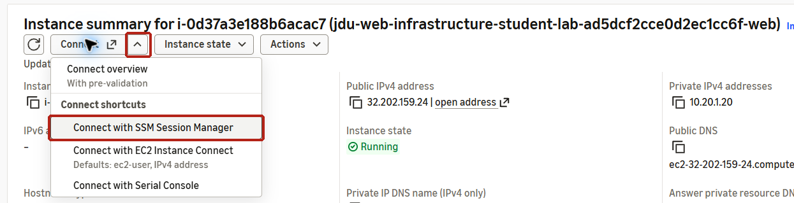
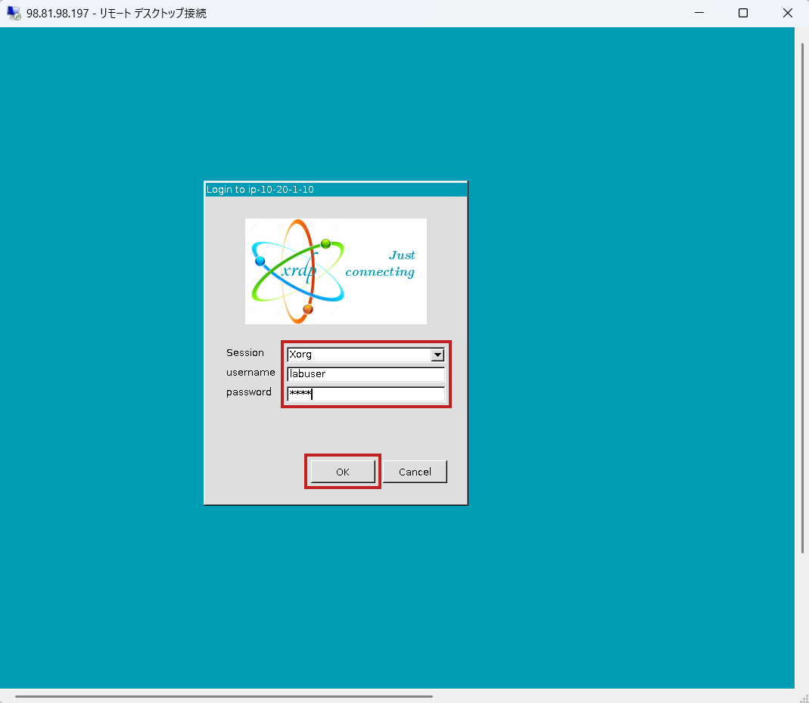
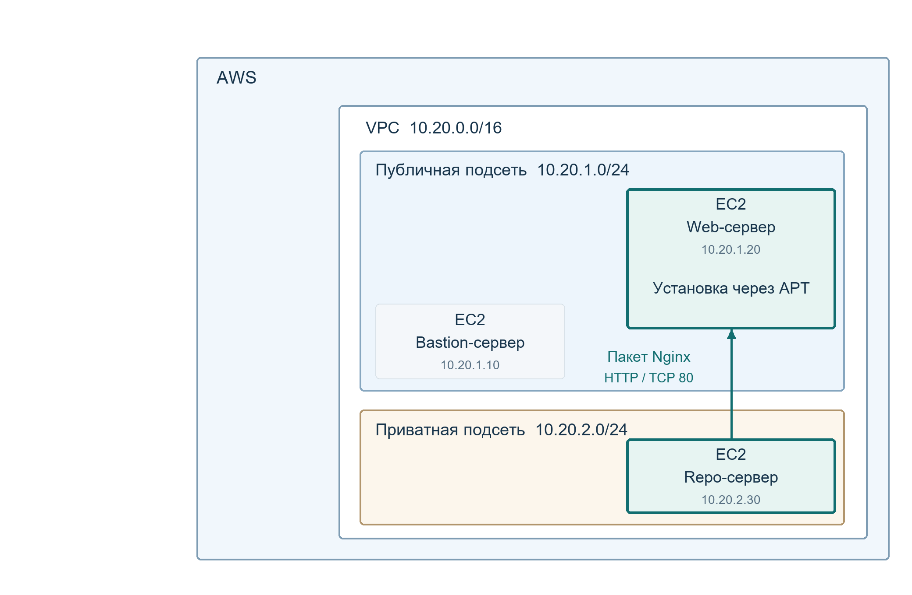
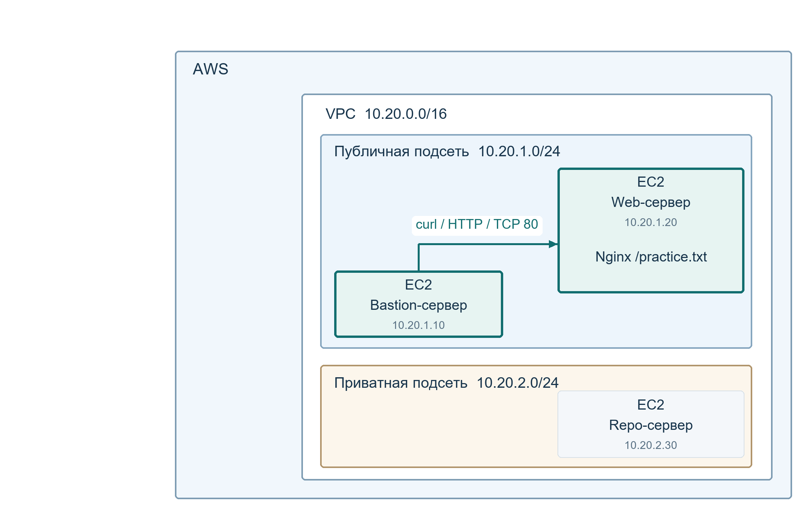
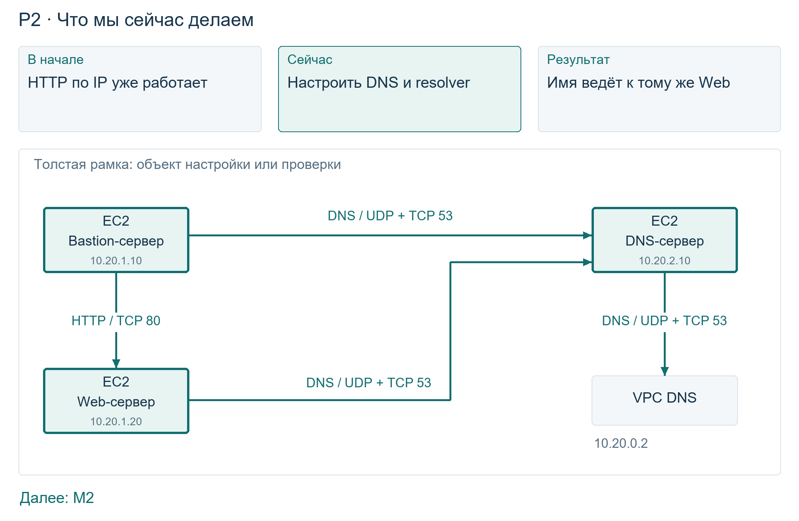
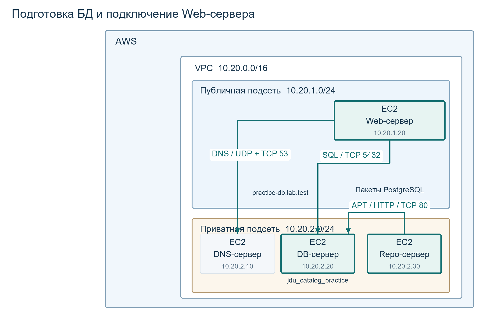
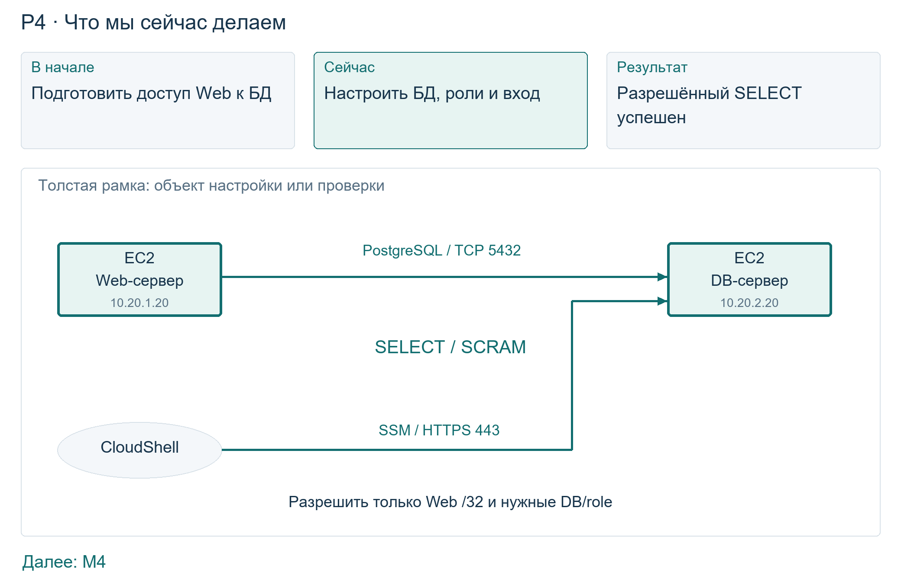

# Web Infrastructure: практика P0-P5 с подробными шагами

Первая редакция для проверки преподавателем. Полное прохождение по пособию студентом ещё не проверено.

Русский и узбекский тексты синхронизированы с японским оригиналом. Редактура носителями языка ещё не выполнена.

[日本語](../ja/practice-full.md) · [Русский](../ru/practice-full.md) · [O‘zbekcha](../uz/practice-full.md)

[Практика P0–P5](practice.md) · [Задания M0–M5](missions.md)

## Как пользоваться пособием

Сначала прочитайте задание P; при необходимости проходите подробный пример по шагам. P - тренировка с подробными шагами. В M самостоятельно используйте другие объекты/значения. Номера заданий не являются номерами занятий; идите в своём темпе. Выполнение P не означает выполнение M.

P0 → M0 → P1 → M1 → P2 → M2 → P3 → M3 → P4 → P5 → M4 → M5

P4 требует DNS из M2. В P3 потренируйтесь подключаться к БД по IP и имени. Приложение использует db.lab.test. Перед переключением practice → mission завершите setup в P5.

P0=1, M0=4, M1=8, M2=13, M3=9, M4=13, M5=16: всего 64 балла. Нет личной демонстрации, backup/restore, дополнительных дисков и разработки приложения. Пересчёт в 25 баллов делает преподаватель отдельно. Повторные отправки возможны до объявленного срока. PASS разных попыток не объединяются; максимум автоматически не выбирается.

## Среда и подготовка

Сначала завершите проверку подписи начального комплекта, создание пяти узлов либо install в существующую среду, внутренний SSH и личную регистрацию. Инструкция - distribution/STUDENT.md в zip. Не храните приватные ключи в общем Windows; используйте CloudShell личного Academy account. Преподаватель выдаёт личный анонимный Lab ID, fingerprint и срок действия.

Общие private IP ниже; public IPv4 не фиксируется. AWS region us-east-1, Ubuntu24.04/amd64. RDP: labuser; SSM: ssm-user; внутренний SSH: ubuntu. Не путайте пользователя и роль сервера.

| Role | Private IPv4 | Назначение |
| --- | --- | --- |
| bastion | 10.20.1.10 | RDP3389 / Firefox / SSH |
| web | 10.20.1.20 | HTTP80 / private8080 / loopback8000 |
| dns | 10.20.2.10 | BIND UDP/TCP53 |
| db | 10.20.2.20 | PostgreSQL5432 |
| repo | 10.20.2.30 | HTTP80 с заранее сохранёнными подписанными ресурсами |

В P0 и M0 открывайте Session Manager из списка EC2. Если в дальнейшем шаг требует подключения из CloudShell, выполните там `aws ssm start-session --target i-...`, подставив ID сервера. В обоих случаях на сервере используется `ssm-user`.

Редактор nano: открыть файл → ввести текст → Ctrl+O → Enter сохранить → Ctrl+X выйти. Блок конфигурации не выполняется как shell-команда. В psql меняется prompt; SQL/\password вводятся внутри, \q возвращает в Ubuntu. Не продолжайте после ошибки без проверки результата.

Нумерованные комментарии показывают порядок и цель внутри шага. # используется в shell, -- внутри psql. Комментарии менять не нужно. Выполняйте по одной команде, дожидаясь подключения, редактора и ввода пароля. Команда с продолжением строки остаётся одной командой.

## Как читать шаги

Сначала прочитайте описание работы и схему Practice. Проверьте, где нужно выполнять шаги. Запускайте команды по одной и проверяйте вывод. Обратная косая черта в конце строки продолжает команду на следующей строке.

Блок bash вводится в терминале указанного узла. Блок text может содержать конфигурацию, ввод внутри psql или пример вывода: читайте пояснение перед ним. Строка с # - комментарий. Не добавляйте приглашение $ или postgres=# из своего терминала. Значения с YOUR- заменяйте своими.

Проверяйте по порядку: сохранённый файл, синтаксис, применение к службе, реальное соединение. Правильный файл ещё не доказывает, что работающая служба уже использует его. Сопоставляйте HTTP-ответ, DNS-ответ или SQL-результат с журналом.

## Система и пути соединений

| Источник | Назначение | Protocol / port | Цель |
| --- | --- | --- | --- |
| Windows PC | Web public IPv4 | TCP/80 | Публичный доступ через Internet Gateway к каталогу и статическим файлам. |
| Windows PC | bastion public IPv4 | TCP/3389 | RDP из разрешённого CIDR к рабочему столу бастиона. |
| bastion | Web/DNS/DB/repo | TCP/22 | Внутренний SSH для управления; приватный ключ остаётся на бастионе. |
| bastion / Web | DNS 10.20.2.10 | UDP+TCP/53 | Разрешение имён lab.test. DNS не выдаёт содержимое Web-страницы. |
| Web app | DB 10.20.2.20 | TCP/5432 | SQL от роли приложения. Прямое соединение Windows с DB не используется. |
| bastion | Web 10.20.1.20 | TCP/8080 | Администрирование через admin.lab.test отдельно от публичного порта 80. |
| Nginx on Web | 127.0.0.1 on Web | TCP/8000 | Передача приложению на том же Web; 127.0.0.1 - текущий локальный узел. |

SSM начальной среды - отдельный путь управления из CloudShell в EC2. Он не включён в путь обычного Web-запроса. Внутренние IP и порты таблицы заданы этим Lab, а не всеми Web-системами.

## P0 Своя среда и место выполнения команд

### Что изучаем

Выбрать нужный сервер в списке EC2, подключиться через Session Manager и проверить результат задания.

### Задание

В своей готовой среде проверьте идентификаторы и роли пяти серверов, затем проверьте, к какому серверу и под каким пользователем вы подключились.

### Подключение к серверам


Зелёная стрелка ведёт к Web-серверу в P0.2.

**Что сделать в Practice0**

Проверьте свой AWS-аккаунт, роль каждого сервера и среду выполнения команд.

### Пример решения (порядок действий)

#### P0.1 Проверить instance ID пяти серверов

**Среда выполнения:**

AWS Console своего студенческого аккаунта

**Цель и действия:**

Введите EC2 в поле Search в верхней части AWS Console и откройте консоль EC2. Откройте EC2 → Instances и найдите пять серверов своей среды в столбце Name. В той же строке проверьте полный идентификатор с префиксом i- в столбце Instance ID.


Список Instances в EC2. Для P0 выберите строку с окончанием имени `-web`, для M0 - `-db`, `-dns`, `-repo` и `-bastion` по очереди.

#### P0.2 Подключиться к Web-серверу через Session Manager

**Среда выполнения:**

SSM-терминал Web-сервера: ssm-user

**Цель и действия:**

Нажмите **Instance ID** Web-сервера, найденного в P0.1. На странице сведений нажмите стрелку справа от **Connect** и выберите **Connect with SSM Session Manager**. В терминале новой вкладки выполняйте команды по одной. Выведите файл `/etc/jdu-web/bootstrap.json`, созданный при начальной настройке, командой `cat` и найдите `"role": "web"`. Убедившись, что это Web-сервер, создайте проверочный файл в домашнем каталоге через `nano`.



Страница EC2. Нажмите стрелку справа от Connect и выберите Connect with SSM Session Manager. На снимке показан Web-сервер.

Команды: нумерация внутри этого шага

```bash
# 1. Показать имя пользователя ОС в этом терминале.
id -un
# 2. Перейти в свой домашний каталог.
cd ~
# 3. Показать текущий рабочий каталог.
pwd
# 4. Вывести файл и проверить, что поле role имеет значение web.
cat /etc/jdu-web/bootstrap.json
# 5. Введите только web. Сохраните через Ctrl+O и Enter, выйдите через Ctrl+X.
nano p0-connection.txt
# 6. Прочитать p0-connection.txt без изменения.
cat p0-connection.txt
```

**Ожидаемый результат и его смысл:**

Команда `id -un` выводит `ssm-user`, а `pwd` - `/home/ssm-user`. В JSON-файле есть `"role": "web"`, а последняя команда `cat` выводит только строку `web`.

#### P0.3 Открыть рабочий стол бастиона по RDP

**Среда выполнения:**

Windows PC студента (общая учётная запись)

**Цель и действия:**

Откройте рабочий стол своего бастиона через приложение Windows «Подключение к удалённому рабочему столу».

**1. Выберите бастион**

Откройте EC2 → Instances, найдите в своей учебной среде строку с окончанием имени `-bastion` и нажмите **Instance ID** в этой строке.


**2. Скопируйте публичный IPv4-адрес**

На странице экземпляра нажмите значок копирования рядом с **Public IPv4 address**. На следующем шаге используйте текущий адрес из своей консоли. Адрес на снимке приведён для примера.


Нажмите Windows+R, чтобы открыть окно «Выполнить». Введите `mstsc /prompt` в поле «Открыть» и нажмите **OK**.

Команды: нумерация внутри этого шага

```bash
# 1. Открыть RDP Windows с запросом учётных данных.
mstsc /prompt
```

**3. Введите публичный IPv4-адрес и подключитесь**

В окне «Подключение к удалённому рабочему столу» вставьте скопированный на шаге 2 публичный IPv4-адрес в поле **Компьютер** и нажмите **Подключить**.


**4. Проверьте предупреждение о сертификате**

Если появилось это окно, сверьте адрес назначения с публичным IPv4 из шага 2. Нажмите **Да**, когда преподаватель подтвердит, что это ваш бастион и сертификат учебной среды. Если подтвердить это не удалось, нажмите **Нет** и обратитесь к преподавателю.


**5. Войдите на бастион**

В окне входа xrdp проверьте, что в поле **Session** выбрано `Xorg`. Введите `labuser` в поле **username**, свой пароль RDP из начальной настройки в поле **password** и нажмите **OK**.



**6. Убедитесь, что рабочий стол открылся**

Если в окне удалённого рабочего стола видно меню **Applications** слева вверху и значок **Home**, вы подключены к бастиону.


**Смысл команд и настроек:**

RDP передаёт экран и ввод бастиона. Запрос Firefox внутри RDP идёт от бастиона, а не Windows. Раскладка клавиатуры влияет на символы пароля; язык интерфейса и раскладка - разные настройки.

**Ожидаемый результат и его смысл:**

Откроется рабочий стол Ubuntu (Xfce) бастиона. Чтобы открыть Firefox и другие программы, используйте меню Applications.

**Если не получилось:**

При Login failed проверьте имя и раскладку клавиатуры. Не отправляйте пароль в чат. При недоступности сверьте текущий IP и разрешённый CIDR с преподавателем; не открывайте 3389 для всех. Перед закрытием RDP сохраните работу.

### Проверка и сдача

Откройте адрес портала из объявления преподавателя в браузере на своём компьютере и войдите с учебным аккаунтом Google. При первом входе выберите регистрацию своей среды AWS и следуйте указаниям на экране.

В строке P0 нажмите **Проверить это задание**. Посмотрите результат на этой же странице и убедитесь, что в строке P0 сохранён **1 / 1**.

## P1 Выдача статического файла по HTTP

### Что изучаем

Связать Nginx, файл, прослушивание порта, HTTP-ответ и access log.

### Задание

Настройте выдачу файла /var/www/html/practice.txt с ответом HTTP 200.

### Схема задания


- File: /var/www/html/practice.txt
- URL path: /practice.txt

```text
JDU WEB-02 practice: HTTP response verified.
```

**Что сделать в Practice1**

Настройте Nginx для выдачи текста файла по HTTP на TCP-порту 80 по пути `/practice.txt`. Выполните запросы из терминалов Web-сервера и бастиона, затем найдите их в журнале доступа Nginx.

### Пример решения (порядок действий)

#### P1.1 Установить Nginx из внутреннего APT

**Среда выполнения:**

SSM-терминал Web-сервера: ssm-user

**Цель и действия:**

Подключитесь к Web-серверу через SSM, как в P0. Скачайте пакет Nginx с внутреннего Repo-сервера (`10.20.2.30`) и установите его на Web-сервере.



Команды: нумерация внутри этого шага

```bash
# 1. Обновить список пакетов с внутреннего сервера.
sudo apt-get update
# 2. Установить nginx с внутреннего сервера пакетов.
sudo apt-get install nginx
```

**Смысл команд и настроек:**

`apt-get update` обновляет список доступных пакетов. `apt-get install nginx` использует этот список для установки Nginx.

**Ожидаемый результат и его смысл:**

При обновлении списка в строке внутреннего сервера появляется `Hit:` или `Get:`. Сообщение `N: Ignoring file ... ubuntu.sources.jdu-disabled` означает, что APT пропустил стандартный источник Ubuntu, отключённый при начальной настройке. Если ошибок загрузки или проверки подписи нет, продолжайте установку. Если APT запросит подтверждение, введите `Y`.

**Если не получилось:**

Если не удалось получить список пакетов, проверьте состояние и IP-адрес внутреннего сервера пакетов.

#### P1.2 Создать точный текст и права файла

**Среда выполнения:**

SSM-терминал Web-сервера: ssm-user

**Цель и действия:**

Запишите текст в рабочий файл, затем скопируйте его в каталог, из которого Nginx выдаёт файлы.

Команды: нумерация внутри этого шага

```bash
# 1. Перейти в свой домашний каталог.
cd ~
# 2. Создать рабочий каталог; существующий сохранить.
mkdir -p jdu-web-practice/p1
# 3. Перейти в рабочий каталог jdu-web-practice/p1.
cd jdu-web-practice/p1
# 4. Показать текущий рабочий каталог.
pwd
# 5. Открыть practice.txt: ввести текст, сохранить и выйти.
nano practice.txt
```

**Текст для ввода в nano**

```text
JDU WEB-02 practice: HTTP response verified.
```

Введите в nano ровно эту строку и нажмите Enter в конце. Сохраните файл клавишами Ctrl+O, затем Enter, и выйдите через Ctrl+X. В терминале продолжите с шага 6.

Команды: нумерация внутри этого шага

```bash
# 6. Скопировать practice.txt в каталог публикации Web-сервера.
sudo cp practice.txt /var/www/html/practice.txt
# 7. Задать владельца и группу root:root для /var/www/html/practice.txt.
sudo chown root:root /var/www/html/practice.txt
# 8. Задать права 0644 для /var/www/html/practice.txt.
sudo chmod 0644 /var/www/html/practice.txt
# 9. Прочитать владельца, группу, права и имя указанных файлов.
stat -c '%U:%G %a %n' /var/www/html/practice.txt
# 10. Прочитать /var/www/html/practice.txt без изменения.
cat /var/www/html/practice.txt
```

**Смысл команд и настроек:**

`cp` копирует текст в файл для публикации. `chown root:root` назначает root владельцем и группой копии. `chmod 0644` даёт владельцу право чтения и записи, а группе и остальным - право чтения.

**Ожидаемый результат и его смысл:**

Отображаются владелец, группа и права `root:root 644` и строка `JDU WEB-02 practice: HTTP response verified.`.

**Если не получилось:**

Если nano ещё открыт, сохраните файл и выйдите перед следующей командой.

#### P1.3 Проверить Web root и запустить сервис

**Среда выполнения:**

SSM-терминал Web-сервера: ssm-user

**Цель и действия:**

Выведите действующую конфигурацию командой `nginx -T` и найдите `root /var/www/html` и `listen 80` в `/etc/nginx/sites-enabled/default`. При необходимости отредактируйте файл в `sudo nano` и перечитайте настройки после успешной проверки синтаксиса.

Команды: нумерация внутри этого шага

```bash
# 1. Вывести полную конфигурацию Nginx и посмотреть, как она записана.
sudo nginx -T
# 2. Проверить синтаксис и файлы конфигурации Nginx.
sudo nginx -t
# 3. Запустить nginx сейчас и включить автозапуск.
sudo systemctl enable --now nginx
# 4. Перечитать настройки nginx без остановки.
sudo systemctl reload nginx
# 5. Прочитать текущее состояние nginx.
systemctl is-active nginx
# 6. Убедиться, что Nginx слушает TCP-порт 80, например 0.0.0.0:80.
sudo ss -lntp
```

**Смысл команд и настроек:**

Nginx -T выводит конфигурацию, -t проверяет синтаксис. В systemctl enable включает запуск при загрузке, --now запускает сейчас. После сохранения файла проверьте reload, состояние службы и порт.

**Ожидаемый результат и его смысл:**

Проверка синтаксиса выводит `syntax is ok` и `test is successful`, а служба показывает `active`. Проверьте, что Nginx слушает TCP-порт 80, например `0.0.0.0:80`.

**Если не получилось:**

При ошибке синтаксиса исправьте файл и строку, указанные в выводе `nginx -t`.

#### P1.4 Посмотреть ответ на самом Web

**Среда выполнения:**

SSM-терминал Web-сервера: ssm-user

**Цель и действия:**

Отправьте HTTP-запрос командой `curl` в терминале Web-сервера. Адрес `127.0.0.1` указывает на этот же сервер.


Команды: нумерация внутри этого шага

```bash
# 1. Отправить HTTP-запрос по адресу http://127.0.0.1/practice.txt.
curl -i http://127.0.0.1/practice.txt
```

**Смысл команд и настроек:**

`127.0.0.1` - адрес обратной петли. Запрос приходит в Nginx на том же Web-сервере.

**Ожидаемый результат и его смысл:**

Отображаются HTTP 200 и строка из practice.txt: `JDU WEB-02 practice: HTTP response verified.`

**Если не получилось:**

Если показано «Welcome to nginx», проверьте путь `/practice.txt` в команде curl. По адресу `http://127.0.0.1/` может открыться начальная страница Nginx.

#### P1.5 Проверить тот же файл с бастиона

**Среда выполнения:**

SSM-терминал бастиона: ssm-user

**Цель и действия:**

Подключитесь к бастиону через SSM и отправьте HTTP-запрос к Web-серверу командой `curl`. Из внутренней сети используйте внутренний IP Web-сервера `10.20.1.20`.



Команды: нумерация внутри этого шага

```bash
# 1. Отправить HTTP-запрос по адресу http://10.20.1.20/practice.txt.
curl -i http://10.20.1.20/practice.txt
```

**Смысл команд и настроек:**

Адрес назначения меняется на внутренний IP Web-сервера. Путь к файлу остаётся тем же, что и в P1.4, - `/practice.txt`.

**Ожидаемый результат и его смысл:**

Отображаются HTTP 200 и строка `JDU WEB-02 practice: HTTP response verified.`

#### P1.6 Связать запрос с журналом и отправить

**Среда выполнения:**

SSM-терминал Web-сервера: ssm-user

**Цель и действия:**

Вернитесь на Web. В access log найдите время, IP клиента, путь и статус. Это доказательство обработки запроса, не только наличия файла. После exit в CloudShell выберите P1 в Web Portal на PC и запустите проверку.

Команды: нумерация внутри этого шага

```bash
# 1. Прочитать последние 20 строк access log и найти свой HTTP-запрос.
sudo tail -n 20 /var/log/nginx/access.log
# 2. Закрыть сеанс текущего сервера и вернуться в CloudShell.
exit
```

**Смысл команд и настроек:**

Сопоставьте время, путь и статус в access log с недавним curl. Tail читает последние строки и не меняет журнал. После exit проверьте P1 в браузере PC.

**Ожидаемый результат и его смысл:**

На экране показываются результаты восьми проверок и число выполненных критериев. Система автоматически проверяет HTTP-доступ по публичному IP.

**Если не получилось:**

Если идёт обработка, обновите результат. При ошибке сохранения прочитайте причину. Не меняйте ожидаемый текст checker.

### Пример чтения вывода (не вводить)

```text
HTTP/1.1 200 OK

JDU WEB-02 practice: HTTP response verified.
```

Показаны только нужные строки; реальный ответ содержит и другие заголовки. Проверьте 200, текст и путь/статус в access log.

### Проверка понимания (без баллов)

На Web ответ 200, а с бастиона соединение не проходит. Что проверить до изменения файла?

**Объяснение:**

Адрес назначения, адрес/порт прослушивания и разрешение пути bastion → Web. Содержимое файла и доступность - разные проверки.

## P2 Внутренний DNS и системное разрешение имён

**Что сделать в Practice2**

Запишите имена Web и DB во внутреннем DNS. Настройте бастион и Web на этот DNS и откройте файл P1 по имени.

### Схема задания



### Пример решения (порядок действий)

#### P2.1 Установить BIND с сервера пакетов

**Среда выполнения:**

SSM-терминал DNS-сервера: ssm-user

На DNS-сервере обновите список пакетов, установите BIND и инструменты проверки. Сделайте копии двух файлов перед редактированием.

Команды: нумерация внутри этого шага

```bash
# 1. Обновить список пакетов с внутреннего сервера.
sudo apt-get update
# 2. Установить bind9 bind9-utils и обязательные зависимости с сервера пакетов.
sudo apt-get install --no-install-recommends bind9 bind9-utils
# 3. Скопировать исходный файл в резервную копию, не затирая существующую.
sudo cp -an /etc/bind/named.conf.options /etc/bind/named.conf.options.before-p2
# 4. Скопировать исходный файл в резервную копию, не затирая существующую.
sudo cp -an /etc/bind/named.conf.local /etc/bind/named.conf.local.before-p2
```

**Ожидаемый результат и его смысл:**

Установлены `bind9` и `bind9-utils`, появились две копии `.before-p2`.

#### P2.2 Указать, от кого DNS принимает запросы

**Среда выполнения:**

SSM-терминал DNS-сервера: ssm-user

Разрешите запросы от DNS-сервера, бастиона и Web-сервера. Имена вне учебной зоны передаются DNS AWS (`10.20.0.2`).

Замените содержимое файлом настроек ниже. В nano для поиска используйте Ctrl+W, для сохранения Ctrl+O и Enter, для выхода Ctrl+X.

```bash
sudo nano /etc/bind/named.conf.options
```

**Текст для ввода в nano**

```text
acl "jdu_clients" { 127.0.0.1; 10.20.1.10; 10.20.1.20; };
options {
    directory "/var/cache/bind";
    listen-on { 127.0.0.1; 10.20.2.10; };
    listen-on-v6 { none; };
    allow-query { jdu_clients; };
    allow-recursion { jdu_clients; };
    allow-query-cache { jdu_clients; };
    recursion yes;
    forward only;
    forwarders { 10.20.0.2; };
    dnssec-validation no;
    allow-transfer { none; };
};
```

**Ожидаемый результат и его смысл:**

В `listen-on` указан внутренний IP DNS-сервера `10.20.2.10`, в `forwarders` - DNS AWS `10.20.0.2`.

#### P2.3 Записать имена и адреса IPv4

**Среда выполнения:**

SSM-терминал DNS-сервера: ssm-user

В `named.conf.local` укажите BIND путь к файлу зоны `lab.test`. В `db.lab.test` запишите A-записи, связывающие имена с адресами IPv4.

Добавьте этот блок в конец `named.conf.local`. Если блок `lab.test` уже есть, отредактируйте его.

```bash
sudo nano /etc/bind/named.conf.local
```

**Текст для ввода в nano**

```text
zone "lab.test" {
    type primary;
    file "/etc/bind/zones/db.lab.test";
    allow-transfer { none; };
    allow-update { none; };
};
```

Откройте `/etc/bind/zones/db.lab.test` в nano, введите настройки ниже и сохраните файл.

```bash
sudo mkdir -p /etc/bind/zones
sudo chmod 0755 /etc/bind/zones
sudo nano /etc/bind/zones/db.lab.test
```

**Текст для ввода в nano**

```text
$TTL 300
@ IN SOA dns.lab.test. hostmaster.lab.test. (
    2026102301 3600 600 604800 300 )
@ IN NS dns.lab.test.
dns IN A 10.20.2.10
guide IN A 10.20.1.20
practice-db IN A 10.20.2.20
```

**Ожидаемый результат и его смысл:**

`guide.lab.test` указывает на Web `10.20.1.20`, а `practice-db.lab.test` - на DB `10.20.2.20`.

**Если не получилось:**

Если файл зоны уже существует, сохраните его имена и добавьте две учебные записи. При каждом изменении записей увеличивайте серийный номер SOA.

#### P2.4 Запустить BIND и сделать запрос с DNS-сервера

**Среда выполнения:**

SSM-терминал DNS-сервера: ssm-user

Проверьте конфигурацию и файл зоны, затем запустите BIND. Команда `dig` отправляет DNS-запрос и выводит ответ. Адрес `127.0.0.1` указывает на сам DNS-сервер.

Команды: нумерация внутри этого шага

```bash
# 1. Проверить конфигурацию BIND и подключённые zone.
sudo named-checkconf -z
# 2. Проверить zone-файл lab.test.
sudo named-checkzone lab.test /etc/bind/zones/db.lab.test
# 3. Включить автозапуск named при загрузке ОС.
sudo systemctl enable named
# 4. Перезапустить named с обновлённой настройкой.
sudo systemctl restart named
# 5. Запросить guide.lab.test по UDP 53 и прочитать ответ.
dig @127.0.0.1 guide.lab.test A
# 6. Запросить guide.lab.test по TCP 53 и прочитать ответ.
dig @127.0.0.1 guide.lab.test A +tcp
```

**Ожидаемый результат и его смысл:**

Проверка зоны выводит `OK`. По UDP и TCP ожидаются `NOERROR` и адрес `10.20.1.20` для `guide.lab.test`.

**Если не получилось:**

При ошибке изучите sudo journalctl -u named -n 30 --no-pager, исправьте конфигурацию и проверьте снова.

#### P2.5 Проверить BIND с бастиона и Web-сервера

**Среда выполнения:**

SSM-терминалы бастиона и Web-сервера

Выполните команды на обоих серверах. `@10.20.2.10` в `dig` задаёт DNS только для данного запроса. `AXFR` запрашивает передачу записей зоны целиком. Проверьте, что передача запрещена.

Команды: нумерация внутри этого шага

```bash
# 1. Запросить guide.lab.test по UDP 53 и прочитать ответ.
dig @10.20.2.10 guide.lab.test A
# 2. Запросить practice-db.lab.test по TCP 53 и прочитать ответ.
dig @10.20.2.10 practice-db.lab.test A +tcp
# 3. Запросить absent-p2.lab.test по UDP 53 и прочитать ответ.
dig @10.20.2.10 absent-p2.lab.test A
# 4. Запросить aws.amazon.com по UDP 53 и прочитать ответ.
dig @10.20.2.10 aws.amazon.com A
# 5. Запросить AXFR всей zone и проверить явный отказ.
dig @10.20.2.10 lab.test AXFR
```

**Ожидаемый результат и его смысл:**

`guide.lab.test` даёт `10.20.1.20`, `practice-db.lab.test` - `10.20.2.20`. Незарегистрированное имя даёт `NXDOMAIN`, `aws.amazon.com` возвращает IP, передача зоны отклоняется.

#### P2.6 Задать DNS по умолчанию в Ubuntu

**Среда выполнения:**

SSM-терминалы бастиона и Web-сервера

Настройте бастион и Web-сервер по одному. В Netplan укажите `10.20.2.10` как DNS, которым Ubuntu пользуется для браузера и приложений.

Сначала найдите имя сетевого интерфейса и имя файла Netplan.

```bash
ip -br link
ls /etc/netplan
```

Подставьте фактические имена вместо `ens5` и `YOUR-NETPLAN-FILE.yaml`. Поле `Network File` команды `networkctl status` помогает найти нужный файл Netplan.

```bash
networkctl status ens5
```

Ниже пример правки существующего файла. В блоке своего интерфейса добавьте или исправьте `dhcp4-overrides` и `nameservers`. Сохраните имя интерфейса и остальные настройки.

```bash
sudo cp -an /etc/netplan/YOUR-NETPLAN-FILE.yaml /etc/netplan/YOUR-NETPLAN-FILE.yaml.before-p2
sudo nano /etc/netplan/YOUR-NETPLAN-FILE.yaml
```

**Текст для ввода в nano**

```text
network:
  version: 2
  ethernets:
    ens5:
      dhcp4: true
      dhcp4-overrides:
        use-dns: false
      nameservers:
        addresses: [10.20.2.10]
```

**Ожидаемый результат и его смысл:**

Сохраните получение IP по DHCP и отключите автоматическое получение только DNS. Выровняйте отступы YAML.

**Если не получилось:**

Несколько YAML одного интерфейса объединяются. Если resolvectl dns показывает ещё AWS DNS, проверьте все соответствующие YAML и действующую конфигурацию.

#### P2.7 Применить DNS и открыть страницу по имени

**Среда выполнения:**

SSM-терминалы бастиона и Web-сервера

Примените Netplan. В `resolvectl dns` проверьте DNS, а через `getent` - разрешение имён в Ubuntu. Затем получите файл P1 по имени.

Команды: нумерация внутри этого шага

```bash
# 1. Сгенерировать конфигурацию netplan и проверить YAML перед применением.
sudo netplan generate
# 2. Применить сохранённые настройки netplan к сети.
sudo netplan apply
# 3. Перезапустить systemd-resolved с обновлённой настройкой.
sudo systemctl restart systemd-resolved
# 4. Показать DNS-серверы системного resolver.
resolvectl dns
# 5. Получить IPv4 guide.lab.test через системный resolver.
getent ahostsv4 guide.lab.test
# 6. Получить IPv4 practice-db.lab.test через системный resolver.
getent ahostsv4 practice-db.lab.test
# 7. Отправить HTTP-запрос по адресу http://guide.lab.test/practice.txt.
curl -i http://guide.lab.test/practice.txt
```

**Ожидаемый результат и его смысл:**

DNS в `resolvectl dns` - `10.20.2.10`. Имена дают `10.20.1.20` и `10.20.2.20`. HTTP возвращает `200` и `JDU WEB-02 practice: HTTP response verified.`

**Если не получилось:**

Если dig успешен, а getent нет, проверяйте resolver клиента. Сохраняйте настройку Firefox с отключённым DoH.

#### P2.8 Проверить страницу в браузере бастиона

**Среда выполнения:**

Firefox на рабочем столе бастиона через RDP

Подключитесь к бастиону по RDP как в P0. В его Firefox откройте `http://10.20.1.20/practice.txt`, затем `http://guide.lab.test/practice.txt`. На своём компьютере запустите проверку P2 на странице оценок.

**Ожидаемый результат и его смысл:**

По обоим адресам видно `JDU WEB-02 practice: HTTP response verified.` На странице оценок отображаются 13 критериев P2.

### Пример чтения вывода (не вводить)

```text
status: NOERROR
guide.lab.test.  300  IN  A  10.20.1.20
```

Сокращённый пример dig: после A стоит IPv4, 300 - TTL. Отдельно проверьте, что SERVER запроса - 10.20.2.10.

## P3 Подключение к PostgreSQL с аутентификацией

**Что сделать в Practice3**

Настройте PostgreSQL на DB-сервере и подключитесь к учебной БД с Web по паролю.

### Схема задания



### Пример решения (порядок действий)

#### P3.1 Установить PostgreSQL с сервера пакетов

**Среда выполнения:**

SSM-терминал DB-сервера: ssm-user

Установите PostgreSQL 16 на DB-сервере. Затем распакуйте файлы SQL для следующих шагов.

Команды: нумерация внутри этого шага

```bash
# 1. Обновить список пакетов с внутреннего сервера.
sudo apt-get update
# 2. Установить postgresql-16 postgresql-client-16 и обязательные зависимости с сервера пакетов.
sudo apt-get install --no-install-recommends postgresql-16 postgresql-client-16
# 3. Сверить фиксированный hash и распаковать приложение/SQL преподавателя.
sudo python3 -B /var/lib/jdu-web/lesson-resources-r1/offline_assets.py
# 4. Показать версию, кластер, порт и состояние PostgreSQL.
pg_lsclusters
# 5. Прочитать настройку БД от postgres: SHOW data_directory;
sudo -u postgres psql -X -d postgres -c "SHOW data_directory;"
```

**Ожидаемый результат и его смысл:**

В `pg_lsclusters` видны версия `16` и кластер `main`. Каталог данных - `/var/lib/postgresql/16/main`.

#### P3.2 Настроить адрес и порт PostgreSQL

**Среда выполнения:**

SSM-терминал DB-сервера: ssm-user

В `postgresql.conf` укажите внутренний IP DB `10.20.2.20` и порт 5432. Для паролей задайте SCRAM-SHA-256.

Найдите нужные параметры, задайте значения ниже и снимите `#` в начале этих строк.

```bash
sudo cp -an /etc/postgresql/16/main/postgresql.conf /etc/postgresql/16/main/postgresql.conf.before-p4
sudo nano /etc/postgresql/16/main/postgresql.conf
```

**Текст для ввода в nano**

```text
listen_addresses = '10.20.2.20'
port = 5432
password_encryption = 'scram-sha-256'
```

**Ожидаемый результат и его смысл:**

Сохраните три параметра в одном файле. Перезапуск выполняется в P3.4 после настройки доступа.

#### P3.3 Разрешить соединения с БД от Web-сервера

**Среда выполнения:**

SSM-терминал DB-сервера: ssm-user

В `pg_hba.conf` задайте источники, БД и роли. Разрешите указанные пары БД и ролей для практики и задания с внутреннего IP Web `10.20.1.20`.

Замените правила подключения приведёнными ниже и сохраните файл.

```bash
sudo cp -an /etc/postgresql/16/main/pg_hba.conf /etc/postgresql/16/main/pg_hba.conf.before-p4
sudo nano /etc/postgresql/16/main/pg_hba.conf
```

**Текст для ввода в nano**

```text
local all postgres peer
local all all reject
host jdu_catalog_practice catalog_practice_setup 10.20.1.20/32 scram-sha-256
host jdu_catalog_practice catalog_practice_app 10.20.1.20/32 scram-sha-256
host jdu_catalog catalog_setup 10.20.1.20/32 scram-sha-256
host jdu_catalog catalog_app 10.20.1.20/32 scram-sha-256
host all all 0.0.0.0/0 reject
host all all ::/0 reject
```

**Ожидаемый результат и его смысл:**

PostgreSQL применяет первую совпавшую строку сверху. Сначала расположены разрешения, затем строки `reject` для остальных соединений.

#### P3.4 Перезапустить PostgreSQL и проверить настройки

**Среда выполнения:**

SSM-терминал DB-сервера: ssm-user

Перезапустите PostgreSQL, чтобы применить сохранённые параметры и правила доступа.

Команды: нумерация внутри этого шага

```bash
# 1. Перезапустить postgresql@16-main с обновлённой настройкой.
sudo systemctl restart postgresql@16-main
# 2. Прочитать текущее состояние postgresql@16-main.
systemctl is-active postgresql@16-main
# 3. Убедиться, что PostgreSQL слушает 10.20.2.20:5432.
sudo ss -lntp
# 4. Прочитать настройку БД от postgres: SHOW password_encryption;
sudo -u postgres psql -X -d postgres -c "SHOW password_encryption;"
# 5. Найти ошибки HBA; в норме 0 строк.
sudo -u postgres psql -X -d postgres -c \
  "SELECT line_number,error FROM pg_hba_file_rules WHERE error IS NOT NULL;"
```

**Ожидаемый результат и его смысл:**

Служба - `active`, адрес и порт - `10.20.2.20:5432`, способ хранения пароля - `scram-sha-256`, ошибки правил доступа - `(0 rows)`.

#### P3.5 Создать учебную БД и две роли

**Среда выполнения:**

SSM-терминал DB-сервера: ssm-user

Готовые SQL создают БД `jdu_catalog_practice`. Роль `catalog_practice_setup` подготавливает таблицы, `catalog_practice_app` нужна для обычной работы. Сначала выведите SQL, затем передайте его в `psql`.

Команды: нумерация внутри этого шага

```bash
# 1. Перейти в рабочий каталог /var/lib/jdu-web/lesson-resources-r1/app.
cd /var/lib/jdu-web/lesson-resources-r1/app
# 2. Показать SQL создания учебных ролей без выполнения.
python3 -B profile_sql.py --profile practice 01_create_roles.sql
# 3. Сформировать SQL создания учебных ролей и применить через postgres к нужной БД.
python3 -B profile_sql.py --profile practice 01_create_roles.sql | sudo -u postgres \
  psql -X -v ON_ERROR_STOP=1 -d postgres
# 4. Сформировать SQL создания учебной БД и схемы и применить через postgres к нужной БД.
python3 -B profile_sql.py --profile practice 02_prepare_schema.sql | sudo -u postgres \
  psql -X -v ON_ERROR_STOP=1 -d jdu_catalog_practice
```

**Ожидаемый результат и его смысл:**

`CREATE ROLE` появляется дважды, `CREATE DATABASE` - один раз.

**Если не получилось:**

При already exists возможен повторный запуск. Не используйте DROP; проверьте роли и БД через \du и \l. Убедитесь, что psql справа от pipe не сообщил SQL error.

#### P3.6 Задать пароль каждой роли БД

**Среда выполнения:**

SSM-терминал DB-сервера: ssm-user

Откройте `psql` на DB-сервере. Выполняйте `\password` по одной строке и дважды введите выбранный пароль каждой роли. Символы скрыты. Оба пароля понадобятся в P4. Задайте разные пароли длиной не менее 16 символов.

Команды: нумерация внутри этого шага

```bash
# 1. В терминале DB открыть psql от postgres; следующие действия внутри psql.
sudo -u postgres psql -X -d postgres
```

Далее вводить внутри psql

```sql
-- 2. В psql скрыто задать пароль роли catalog_practice_setup.
\password catalog_practice_setup
-- 3. В psql скрыто задать пароль роли catalog_practice_app.
\password catalog_practice_app
-- 4. В psql проверить атрибуты и права учебных ролей.
\du catalog_practice_*
-- 5. Выйти из psql в терминал ОС того же DB-сервера.
\q
```

**Ожидаемый результат и его смысл:**

В выводе `\du` есть `catalog_practice_setup` и `catalog_practice_app`.

#### P3.7 Подключиться к учебной БД с Web-сервера

**Среда выполнения:**

SSM-терминал Web-сервера: ssm-user

Откройте Session Manager для Web-сервера как в P0. В `psql` сначала укажите внутренний IP DB, затем имя `practice-db.lab.test` из P2. В обоих случаях используйте пароль `catalog_practice_app` из P3.6.

Команды: нумерация внутри этого шага

```bash
# 1. Установить postgresql-client-16 и обязательные зависимости с сервера пакетов.
sudo apt-get install --no-install-recommends postgresql-client-16
# 2. Подключиться с Web к нужной БД с существующим паролем и выполнить SELECT.
psql -X -h 10.20.2.20 -U catalog_practice_app -d jdu_catalog_practice -W -c \
  'SELECT current_database(),current_user,1 AS value;'
# 3. Получить IPv4 practice-db.lab.test через системный resolver.
getent ahostsv4 practice-db.lab.test
# 4. Подключиться с Web к нужной БД с существующим паролем и выполнить SELECT.
psql -X -h practice-db.lab.test -U catalog_practice_app -d jdu_catalog_practice -W -c \
  'SELECT current_database(),current_user,1 AS value;'
```

**Ожидаемый результат и его смысл:**

В обоих случаях результат показывает БД `jdu_catalog_practice`, роль `catalog_practice_app` и значение `1`.

**Если не получилось:**

Если по IP подключение работает, а по имени нет, проверьте системный DNS и учебное имя DB из P2. При отказе аутентификации проверьте источник, БД, роль и пароль. Не публикуйте DB в Internet для диагностики.

#### P3.8 Сохранить пароль БД для проверки на Web-сервере

**Среда выполнения:**

SSM-терминал Web-сервера: ssm-user

Запустите команду и дважды введите пароль `catalog_practice_app`. Ввод скрыт, пароль сохраняется на Web в защищённом файле для проверки подключения. Откройте страницу оценок на своём компьютере и проверьте P3.

Команды: нумерация внутри этого шага

```bash
# 1. Скрыто ввести существующий пароль учебной БД и сохранить только на Web.
sudo python3 -B /var/lib/jdu-web/lesson-resources-r1/database_secret.py --profile \
  practice
```

**Ожидаемый результат и его смысл:**

Терминал выводит `D11_EXISTING_DB_PASSWORD_STORED_LOCALLY`. На странице оценок видны девять критериев P3.

**Если не получилось:**

Если файл уже есть, не создавайте заново. В P4 тот же пароль вводится в настройку приложения. M3 использует отдельные БД/роли mission.

### Пример чтения вывода (не вводить)

```text
current_database    | current_user         | value
jdu_catalog_practice | catalog_practice_app | 1
```

Пример чтения SELECT; ширина столбцов может отличаться. Сверьте БД, роль и value=1. Это не доказательство права менять таблицы.

## P4 Соединить предоставленное приложение с Web и DB

**Что сделать в Practice4**

Запустите приложение на Web и подключите его к DB. Настройте публичный список и управление с бастиона.

### Схема задания



### Пример решения (порядок действий)

#### P4.1 Проверить DNS и подготовить пакеты Python

**Среда выполнения:**

SSM-терминал Web-сервера: ssm-user

Сначала разрешите имена БД и админки с Web-сервера. Затем установите инструменты Python с сервера пакетов и распакуйте приложение и пакеты Python.

Команды: нумерация внутри этого шага

```bash
# 1. Получить IPv4 db.lab.test через системный resolver.
getent ahostsv4 db.lab.test
# 2. Получить IPv4 admin.lab.test через системный resolver.
getent ahostsv4 admin.lab.test
# 3. Установить python3-venv python3-pip и обязательные зависимости с сервера пакетов.
sudo apt-get install --no-install-recommends python3-venv python3-pip
# 4. Проверить подпись/hash, подготовить приложение и фиксированные wheel.
sudo python3 -B /var/lib/jdu-web/lesson-resources-r1/offline_assets.py --wheels
# 5. Показать файлы для настройки серверов в /var/lib/jdu-web/lesson-resources-r1/app.
ls /var/lib/jdu-web/lesson-resources-r1/app
# 6. Показать файлы для настройки серверов в /var/lib/jdu-web/lesson-resources-r1/wheels.
ls /var/lib/jdu-web/lesson-resources-r1/wheels
```

**Ожидаемый результат и его смысл:**

`db.lab.test` даёт `10.20.2.20`, `admin.lab.test` - `10.20.1.20`. В терминале появляются `PUBLIC_APP_RESOURCES_VERIFIED` и `SIGNED_OFFLINE_WHEELS_READY=7`.

#### P4.2 Разместить приложение и создать его окружение Python

**Среда выполнения:**

SSM-терминал Web-сервера: ssm-user

Скопируйте файлы в `/opt/jdu-catalog/app`. Создайте окружение приложения через `venv` и установите подготовленные пакеты. `pip` проверяет хеши файлов и работает без обращения к внешнему сайту.

Команды: нумерация внутри этого шага

```bash
# 1. Создать каталог /opt/jdu-catalog/app.
sudo mkdir -p /opt/jdu-catalog/app
# 2. Задать владельца и группу root:root для /opt/jdu-catalog/app.
sudo chown root:root /opt/jdu-catalog/app
# 3. Задать права 0755 для /opt/jdu-catalog/app.
sudo chmod 0755 /opt/jdu-catalog/app
# 4. Скопировать файлы в /opt/jdu-catalog/app/.
sudo cp -a /var/lib/jdu-web/lesson-resources-r1/app/. /opt/jdu-catalog/app/
# 5. Создать отдельное Python venv приложения.
sudo python3 -m venv /opt/jdu-catalog/venv
# 6. Установить зависимости только из локальных wheel с lock/hash.
sudo /opt/jdu-catalog/venv/bin/python -m pip --isolated --no-cache-dir install \
  --no-index --find-links=/var/lib/jdu-web/lesson-resources-r1/wheels \
  --only-binary=:all: --require-hashes -r \
  /var/lib/jdu-web/lesson-resources-r1/requirements.lock
# 7. Проверить совместимость установленных Python-зависимостей.
sudo /opt/jdu-catalog/venv/bin/python -m pip check
```

**Ожидаемый результат и его смысл:**

Последний `pip check` выводит `No broken requirements found.`.

#### P4.3 Создать системного пользователя приложения

**Среда выполнения:**

SSM-терминал Web-сервера: ssm-user

Создайте на Web системного пользователя `catalog` для запуска приложения. Подготовьте каталог для CSS и других файлов и дайте `catalog` право записи в него.

Команды: нумерация внутри этого шага

```bash
# 1. Создать системного catalog для приложения без login shell и home.
sudo useradd --system --user-group --home-dir /nonexistent --no-create-home --shell \
  /usr/sbin/nologin catalog
# 2. Создать каталог /var/lib/jdu-catalog.
sudo mkdir -p /var/lib/jdu-catalog
# 3. Задать владельца и группу root:root для /var/lib/jdu-catalog.
sudo chown root:root /var/lib/jdu-catalog
# 4. Задать права 0755 для /var/lib/jdu-catalog.
sudo chmod 0755 /var/lib/jdu-catalog
# 5. Создать каталог /var/lib/jdu-catalog/static.
sudo mkdir -p /var/lib/jdu-catalog/static
# 6. Задать владельца и группу catalog:catalog для /var/lib/jdu-catalog/static.
sudo chown catalog:catalog /var/lib/jdu-catalog/static
# 7. Задать права 0755 для /var/lib/jdu-catalog/static.
sudo chmod 0755 /var/lib/jdu-catalog/static
# 8. Проверить UID, GID и группы пользователя catalog.
id catalog
# 9. Проверить home и login shell пользователя catalog.
getent passwd catalog
```

**Ожидаемый результат и его смысл:**

Вывод показывает пользователя `catalog` и оболочку `/usr/sbin/nologin`. Владелец и группа `/var/lib/jdu-catalog/static` - `catalog`.

**Если не получилось:**

Не исправляйте права через chmod -R 777 или добавление catalog в sudo. Проверьте конкретный каталог и владельца.

#### P4.4 Настроить обычное подключение приложения к БД

**Среда выполнения:**

SSM-терминал Web-сервера: ssm-user

Замените `YOUR-CURRENT-WEB-PUBLIC-IP` на текущий публичный IPv4 Web из AWS Console. При запросе введите пароль `catalog_practice_app` из P3. Выберите созданные учебные настройки для приложения. Вводимые символы скрыты.

Команды: нумерация внутри этого шага

```bash
# 1. Указать текущий public IPv4 Web из AWS Console.
PUBLIC_WEB_IPV4='YOUR-CURRENT-WEB-PUBLIC-IP'
# 2. Скрыто ввести существующий пароль БД и создать runtime practice.
sudo python3 -B /opt/jdu-catalog/app/configuration.py create-runtime --profile \
  practice --public-web-ipv4 "$PUBLIC_WEB_IPV4"
# 3. Выбрать сохранённый учебный профиль для следующего запуска приложения.
sudo python3 -B /opt/jdu-catalog/app/configuration.py activate --profile practice
# 4. Проверить runtime-конфигурацию без вывода секретов.
sudo python3 -B /opt/jdu-catalog/app/configuration.py check --phase runtime
# 5. Прочитать владельца, группу, права и имя указанных файлов.
sudo stat -c '%U:%G %a %n' /etc/jdu-catalog/app.env
```

**Ожидаемый результат и его смысл:**

Вывод содержит `CATALOG_ENV_CREATED=practice`, `CATALOG_PROFILE_ACTIVATED=practice` и `VALID`. Для `app.env` ожидаются `root:root` и `600`.

#### P4.5 Подготовить таблицы и администратора приложения

**Среда выполнения:**

SSM-терминал Web-сервера: ssm-user

При создании временных настроек введите пароль `catalog_practice_setup` из P3. Выполняйте команды по одной, чтобы создать таблицы и примеры оборудования. В конце выберите и введите пароль `practice_admin`. Вводимые символы скрыты.

Команды: нумерация внутри этого шага

```bash
# 1. Скрыто ввести существующий пароль setup и создать временную настройку.
sudo python3 -B /opt/jdu-catalog/app/configuration.py create-setup --profile practice
# 2. Проверить ошибки приложения в режиме setup.
sudo /opt/jdu-catalog/venv/bin/python -B /opt/jdu-catalog/app/manage_secure.py \
  --phase setup check
# 3. Применить migrations преподавателя и создать таблицы нужной БД.
sudo /opt/jdu-catalog/venv/bin/python -B /opt/jdu-catalog/app/manage_secure.py \
  --phase setup migrate
# 4. Загрузить фиксированные начальные данные в учебную БД.
sudo /opt/jdu-catalog/venv/bin/python -B /opt/jdu-catalog/app/manage_secure.py \
  --phase setup seed_catalog
# 5. Создать администратора приложения со скрытым вводом пароля.
sudo /opt/jdu-catalog/venv/bin/python -B /opt/jdu-catalog/app/manage_secure.py \
  --phase setup create_lab_admin
```

**Ожидаемый результат и его смысл:**

Создаются 11 таблиц приложения и три примера. Для входа в админку используется `practice_admin`.

#### P4.6 Выдать роли приложения необходимые права в БД

**Среда выполнения:**

SSM-терминал DB-сервера: ssm-user

Откройте Session Manager на DB-сервере. Выдайте `catalog_practice_app` права для работы с уже созданными таблицами. Сначала просмотрите SQL, затем примените его следующей командой.

Команды: нумерация внутри этого шага

```bash
# 1. Перейти в рабочий каталог /var/lib/jdu-web/lesson-resources-r1/app.
cd /var/lib/jdu-web/lesson-resources-r1/app
# 2. Показать SQL необходимых прав runtime без выполнения.
python3 -B profile_sql.py --profile practice 03_runtime_grants.sql
# 3. Сформировать SQL необходимых прав runtime и применить через postgres к нужной БД.
python3 -B profile_sql.py --profile practice 03_runtime_grants.sql | sudo -u postgres \
  psql -X -v ON_ERROR_STOP=1 -d jdu_catalog_practice
```

**Ожидаемый результат и его смысл:**

Вывод заканчивается `COMMIT`. Для `catalog_item` разрешены чтение, добавление и изменение.

#### P4.7 Запустить приложение как службу systemd

**Среда выполнения:**

SSM-терминал Web-сервера: ssm-user

На Web соберите CSS и другие файлы в каталог для Nginx. Скопируйте описание службы в `/etc/systemd/system` и загрузите его в systemd. `enable --now` запускает службу сейчас и настраивает запуск при загрузке ОС.

Команды: нумерация внутри этого шага

```bash
# 1. Собрать CSS и другую статику в каталог выдачи с runtime-настройкой.
sudo /opt/jdu-catalog/venv/bin/python -B /opt/jdu-catalog/app/manage_secure.py \
  --phase runtime collectstatic
# 2. Прочитать /opt/jdu-catalog/app/config/jdu-catalog.service без изменения.
cat /opt/jdu-catalog/app/config/jdu-catalog.service
# 3. Скопировать файлы в /etc/systemd/system/jdu-catalog.service.
sudo cp /opt/jdu-catalog/app/config/jdu-catalog.service \
  /etc/systemd/system/jdu-catalog.service
# 4. Задать владельца и группу root:root для /etc/systemd/system/jdu-catalog.service.
sudo chown root:root /etc/systemd/system/jdu-catalog.service
# 5. Задать права 0644 для /etc/systemd/system/jdu-catalog.service.
sudo chmod 0644 /etc/systemd/system/jdu-catalog.service
# 6. Перечитать установленные unit-файлы systemd.
sudo systemctl daemon-reload
# 7. Запустить jdu-catalog сейчас и включить автозапуск.
sudo systemctl enable --now jdu-catalog
# 8. Прочитать текущее состояние jdu-catalog.
systemctl is-active jdu-catalog
# 9. Убедиться, что Gunicorn слушает 127.0.0.1:8000.
sudo ss -lntp
```

**Ожидаемый результат и его смысл:**

Служба - `active`. Gunicorn слушает `127.0.0.1:8000` для соединений от Nginx на том же Web-сервере.

**Если не получилось:**

При ошибке смотрите journalctl -u jdu-catalog. Не копируйте env в журнал; формат проверяется configuration.py check.

#### P4.8 Настроить публичный и административный входы Nginx

**Среда выполнения:**

SSM-терминал Web-сервера: ssm-user

Скопируйте конфигурацию и добавьте символическую ссылку в `sites-enabled`. После применения порт 80 открывает список, а порт 8080 с бастиона - админку. Nginx передаёт запросы приложения в Gunicorn.

Команды: нумерация внутри этого шага

```bash
# 1. Прочитать /opt/jdu-catalog/app/config/jdu-catalog.nginx.conf без изменения.
cat /opt/jdu-catalog/app/config/jdu-catalog.nginx.conf
# 2. Скопировать файлы в /etc/nginx/sites-available/jdu-catalog.
sudo cp /opt/jdu-catalog/app/config/jdu-catalog.nginx.conf \
  /etc/nginx/sites-available/jdu-catalog
# 3. Задать владельца и группу root:root для /etc/nginx/sites-available/jdu-catalog.
sudo chown root:root /etc/nginx/sites-available/jdu-catalog
# 4. Задать права 0644 для /etc/nginx/sites-available/jdu-catalog.
sudo chmod 0644 /etc/nginx/sites-available/jdu-catalog
# 5. Переместить ссылку стандартного сайта в копию без перезаписи.
sudo mv -n /etc/nginx/sites-enabled/default /etc/nginx/default-site.before-p5
# 6. Создать ссылку включения конфигурации сайта приложения.
sudo ln -s /etc/nginx/sites-available/jdu-catalog /etc/nginx/sites-enabled/jdu-catalog
# 7. Проверить синтаксис и файлы конфигурации Nginx.
sudo nginx -t
# 8. Перечитать настройки nginx без остановки.
sudo systemctl reload nginx
# 9. Отправить HTTP-запрос по адресу http://127.0.0.1/practice.txt.
curl -i http://127.0.0.1/practice.txt
```

**Ожидаемый результат и его смысл:**

`nginx -t` проходит. `/practice.txt` возвращает HTTP `200` и `JDU WEB-02 practice: HTTP response verified.` Тем же способом откройте `http://127.0.0.1/mission.txt` и проверьте текст M1.

#### P4.9 Добавить через админку открытую и скрытую записи

**Среда выполнения:**

Firefox на рабочем столе бастиона через RDP

Подключитесь к бастиону по RDP и откройте в его Firefox `http://admin.lab.test:8080/admin/`. Войдите как `practice_admin` с паролем из P4.5. Откройте «備品» (оборудование) и сохраните две записи по таблице. У опубликованной записи измените количество, сохраните и верните его к 4.

| Код | Название | Количество | Место хранения | Опубликовать |
| --- | --- | --- | --- | --- |
| P5-PUBLIC-001 | Practice keyboard | 4 | Training shelf A | Да |
| P5-PRIVATE-001 | Practice mouse | 2 | Training shelf B | Нет |

**Ожидаемый результат и его смысл:**

В админке видны `P5-PUBLIC-001` и `P5-PRIVATE-001`. В публичном списке из новых записей появляется `P5-PUBLIC-001`.

#### P4.10 Проверить сохранение обеих записей в БД

**Среда выполнения:**

SSM-терминал Web-сервера: ssm-user

В терминале Web прочитайте через `psql` две записи, добавленные в админке. Используйте пароль `catalog_practice_app` из P3.6.

Команды: нумерация внутри этого шага

```bash
# 1. Сохранить SELECT двух заданных записей; пока не отправлять в БД.
QUERY="SELECT code,name,quantity,location,is_public
FROM catalog_item
WHERE code IN ('P5-PUBLIC-001','P5-PRIVATE-001')
ORDER BY code;"
# 2. Подключиться с Web к нужной БД с существующим паролем и выполнить SELECT.
psql -X -h db.lab.test -U catalog_practice_app -d jdu_catalog_practice -W -c "$QUERY"
```

**Ожидаемый результат и его смысл:**

У `P5-PUBLIC-001` количество `4` и признак `t`, у `P5-PRIVATE-001` - `2` и `f`. Сверьте также название и место хранения с таблицей P4.9.

#### P4.11 Проверить работу приложения на странице оценок

**Среда выполнения:**

Браузер на своём PC: Web Portal

На своём компьютере откройте P4 на странице оценок и выберите проверку функций и прав. Введите пароль `practice_admin` и запустите проверку. Она создаёт одну контрольную запись и проверяет изменение количества.

**Ожидаемый результат и его смысл:**

Появятся результаты 13 критериев P4. Контрольная запись остаётся в админке.

## P5 Минимальные права и границы публикации

**Что сделать в Practice5**

Отключите вход роли настройки БД. Проверьте работу приложения с обычными правами и закрытие админки и настроек с публичного входа.

### Схема задания


### Пример решения (порядок действий)

#### P5.1 Посмотреть, что приложение может делать в БД

**Среда выполнения:**

SSM-терминал DB-сервера: ssm-user

Откройте `psql` в терминале DB. `\du` показывает атрибуты учебных ролей, `\dp` - права по таблицам.

Команды: нумерация внутри этого шага

```bash
# 1. В терминале DB открыть psql от postgres; следующие действия внутри psql.
sudo -u postgres psql -X -d jdu_catalog_practice
```

Далее вводить внутри psql

```sql
-- 2. В psql проверить атрибуты и права учебных ролей.
\du catalog_practice_*
-- 3. В psql прочитать права таблиц схемы public.
\dp public.*
-- 4. Выйти из psql в терминал ОС того же DB-сервера.
\q
```

**Ожидаемый результат и его смысл:**

У `catalog_practice_app` есть чтение, добавление и изменение оборудования. Удаление оборудования не разрешено.

#### P5.2 Запретить вход роли, созданной для настройки

**Среда выполнения:**

SSM-терминал DB-сервера: ssm-user

Если оставить вход для `catalog_practice_setup`, утечка его пароля даёт повышенные права. Просмотрите SQL, найдите `NOLOGIN` и примените его через `psql`.

Команды: нумерация внутри этого шага

```bash
# 1. Перейти в рабочий каталог /var/lib/jdu-web/lesson-resources-r1/app.
cd /var/lib/jdu-web/lesson-resources-r1/app
# 2. Показать SQL отключения входа setup без выполнения.
python3 -B profile_sql.py --profile practice 04_disable_setup.sql
# 3. Сформировать SQL отключения входа setup и применить через postgres к нужной БД.
python3 -B profile_sql.py --profile practice 04_disable_setup.sql | sudo -u postgres \
  psql -X -v ON_ERROR_STOP=1 -d jdu_catalog_practice
```

**Ожидаемый результат и его смысл:**

Появляется `ALTER ROLE`. Вход `catalog_practice_setup` отключён, а приложение продолжает подключаться как `catalog_practice_app`.

#### P5.3 Убрать временные файлы настройки на Web

**Среда выполнения:**

SSM-терминал Web-сервера: ssm-user

Удалите два временных файла настройки. Остановите приложение, выберите профиль `practice` из P4 и запустите приложение. Проверьте, что пользователь ОС `catalog` не может записывать в каталог кода.

Команды: нумерация внутри этого шага

```bash
# 1. Прочитать владельца, группу, права и имя указанных файлов.
sudo stat -c '%U:%G %a %n' /etc/jdu-catalog/setup.env \
  /etc/jdu-catalog/profiles/practice.setup.env
# 2. Удалить только два проверенных временных секретных файла setup.
sudo rm -- /etc/jdu-catalog/setup.env /etc/jdu-catalog/profiles/practice.setup.env
# 3. Прочитать владельца, группу, права и имя указанных файлов.
sudo stat -c '%U:%G %a %n' /etc/jdu-catalog/app.env \
  /etc/jdu-catalog/profiles/practice.app.env /etc/jdu-web/db-practice.runtime.env
# 4. Остановить jdu-catalog перед выбором настроек.
sudo systemctl stop jdu-catalog
# 5. Выбрать сохранённый учебный профиль для следующего запуска приложения.
sudo python3 -B /opt/jdu-catalog/app/configuration.py activate --profile practice
# 6. Проверить runtime-конфигурацию без вывода секретов.
sudo python3 -B /opt/jdu-catalog/app/configuration.py check --phase runtime
# 7. Запустить jdu-catalog с выбранными настройками.
sudo systemctl start jdu-catalog
# 8. Прочитать текущее состояние jdu-catalog.
systemctl is-active jdu-catalog
# 9. Найти файлы и каталоги приложения, доступные на запись пользователю catalog.
sudo -u catalog find /opt/jdu-catalog/app -writable -print
```

**Ожидаемый результат и его смысл:**

Появляются `CATALOG_PROFILE_ACTIVATED=practice` и `VALID`, приложение переходит в `active`. У рабочих файлов указано `root:root 600`. Последняя команда `find` ничего не выводит.

**Если не получилось:**

Если активен другой профиль, остановитесь. Не повторяйте удаление отсутствующих файлов. При ошибке остановки, выбора профиля или проверки выясните причину до запуска приложения.

#### P5.4 Проверить, что видно через публичный порт 80

**Среда выполнения:**

SSM-терминал бастиона: ssm-user

Из терминала бастиона отправьте запросы на порт 80 Web. Проверьте доступ к списку и отсутствие публичного доступа к админке и внутренним настройкам. Админку откройте на бастионе через RDP в Firefox по `http://admin.lab.test:8080/admin/`.

Команды: нумерация внутри этого шага

```bash
# 1. Отправить HTTP к http://web.lab.test/; показать статус, заголовки и тело.
curl -i http://web.lab.test/
# 2. Отправить HTTP к http://web.lab.test/admin/; показать статус, заголовки и тело.
curl -i http://web.lab.test/admin/
# 3. Отправить HTTP к http://web.lab.test/app.env; показать статус, заголовки и тело.
curl -i http://web.lab.test/app.env
# 4. Отправить HTTP к http://web.lab.test/static/app.env; показать статус, заголовки и тело.
curl -i http://web.lab.test/static/app.env
```

**Ожидаемый результат и его смысл:**

Список возвращает HTTP `200`, адреса `/admin/` и файлов настроек - `403` или `404`. На 8080 видна форма входа в админку.

**Если не получилось:**

Если виден текст env, не распространяйте его: сообщите преподавателю и исправьте публикацию.

#### P5.5 Проверить ограничения доступа на странице оценок

**Среда выполнения:**

Браузер на своём PC: Web Portal

Откройте P5 на странице оценок и выберите проверку функций и прав. Введите пароль `practice_admin` и запустите её. Проверка сравнит успешный вход и отказ добавить или изменить оборудование без входа.

**Ожидаемый результат и его смысл:**

Появляются результаты 16 критериев P5.

## Продолжение и результаты

В следующий раз запустите свой Lab и те же пять узлов, проверьте running/SSM Online и текущие public IP. Войдите в Web Portal через школьный Google и начните с готовности M0. Не повторяйте создание, ключи и регистрацию каждый раз. При истечении срока запросите обновление у преподавателя.

Результаты сохраняются автоматически. Во время обработки обновляйте результат; оценки смотрите в разделе сохранённых оценок. Смотрите, сколько критериев выполнено и что нужно исправить. UNKNOWN означает невозможность измерения, а не успех или подтверждённый ноль. Подтверждённые баллы непроверенных M сохраняются. Используется последний оцениваемый результат, без объединения PASS разных запусков и автоматического выбора максимума.

Не отправляйте пароль/token/cookie/приватный ключ/env в отчёт или чат.

## Справочные материалы

- [Nginx Beginner’s Guide](https://nginx.org/en/docs/beginners_guide.html)
- [BIND 9: configurations and zones](https://bind9.readthedocs.io/en/v9.18.39/chapter3.html)
- [PostgreSQL 16: pg_hba.conf](https://www.postgresql.org/docs/16/auth-pg-hba-conf.html)
- [EC2 instance states](https://docs.aws.amazon.com/AWSEC2/latest/UserGuide/ec2-instance-lifecycle.html)
