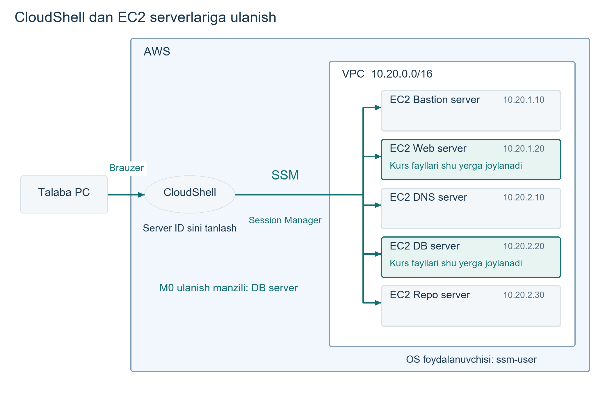
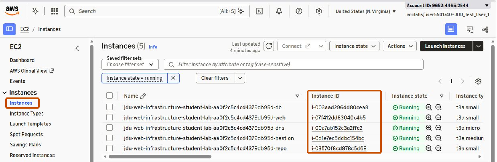

# M0 Shaxsiy muhit va buyruqlarni bajarish joyi

[Mashqlar P0–P6](practice.md) · [Topshiriqlar M0–M6](missions.md)

[日本語](../ja/m0.md) · [Русский](../ru/m0.md) · [O‘zbekcha](../uz/m0.md)

2026-11-13 · D12 P/M r1.5

Tarqatma 2027-yil 31-yanvar oxirigacha amal qiladi (UZT).

Mos topshiriq: [P0](p0.md).

## Tayyor holat talablari

P0 da Web serverga ulanishni mashq qildingiz. M0 da EC2 ro‘yxatidan o‘z DB serveringizni toping va uning instance ID si orqali CloudShell dan SSM bilan ulaning. DB serverda (roli db) ssm-user foydalanuvchisi bilan ishlayotganingizni tekshiring. So‘ng topshiriqlar sahifasida M0 ni tanlab, muhitingiz tayyorligini tekshiring.

## Serverlarga ulanish va kurs fayllari

O‘z PC brauzerida AWS CloudShell ni oching va kerakli EC2 ga SSM orqali ulaning. Kurs fayllari Web va DB serverlariga joylanadi. Umumiy kod orqali o‘rnatishda fayllar muhit yaratilganda, imzolangan tarqatmada esa P0.3 da joylanadi.

C3 bobidagi 3-4-rasm. EC2 → Instances ni oching va kerakli server qatoridan Instance ID ni nusxalang.

## Tekshirish va yuborish

1. O‘qituvchi bergan havola orqali topshiriqlar sahifasini oching, ta’lim muassasasining Google hisobi bilan kiring va o‘z Lab muhitingiz hamda **M0** ni tanlang.
2. Tanlangan topshiriq tekshiruvini boshlang.
3. Ishlov davom etsa natijani yangilab kuting. Topshiriq ID, vaqt, har check va saqlash holatini o‘qing. Natija avtomatik saqlanadi; M baholari saqlangan baholar bo‘limida.

---

[Oldingi: P0](p0.md) · [Keyingi: P1](p1.md)
