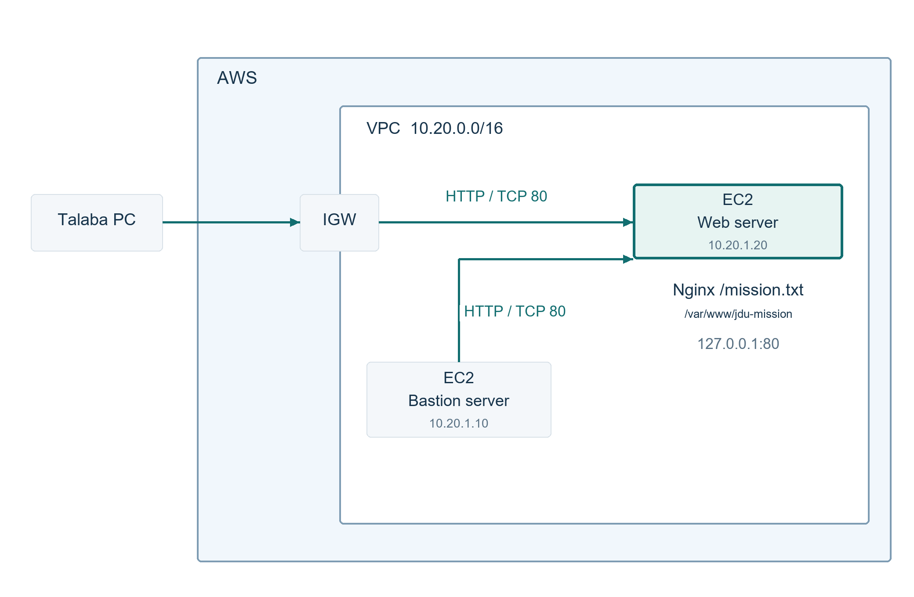

# M1 HTTP orqali statik faylni qaytarish (8)

[Mashqlar P0–P5](practice.md) · [Topshiriqlar M0–M5](missions.md)

[日本語](../ja/m1.md) · [Русский](../ru/m1.md) · [O‘zbekcha](../uz/m1.md)

Mos topshiriq: [P1](p1.md).


## Tayyor holat talablari

P1 dagi Web serverda `/var/www/jdu-mission/mission.txt` ni TCP 80 orqali `/mission.txt` sifatida tarqating. P1 fayli va sozlamasini saqlang: `/practice.txt` ham ochilsin.

1. **Fayl (P1.2).** `/var/www/jdu-mission` katalogini yarating va quyidagi matnli `mission.txt` ni joylang. Egasi `root`, guruhi `www-data`, ruxsati `0640` bo‘lsin.
2. **Nginx sozlamasi (P1.3).** `/etc/nginx/sites-available/default` ichidagi 80-portni qabul qiladigan mavjud `server` ga `/mission.txt` bilan aniq mos keladigan `location` qo‘shing. Uning root qiymati `/var/www/jdu-mission` bo‘lsin. P1 blokini saqlang, sintaksisni tekshiring va sozlamani qayta yuklang.
3. **HTTP va log (P1.4-P1.6).** Web va Bastiondan `/mission.txt` ni oching: HTTP 200 va quyidagi matn qaytsin. `/practice.txt` ham ochilishini va so‘rovlar access log ga yozilishini tekshiring.

## Topshiriq diagrammasi



- **Tarqatiladigan fayl** `/var/www/jdu-mission/mission.txt`
- **URL yo‘li** `/mission.txt`

```text
JDU WEB-02 mission: independent HTTP delivery.
```

## Baholash mezonlari

Har bir mezon 1 ball.

| № | Shart |
| --- | --- |
| 1 | Nginx ishlaydi (active). |
| 2 | nginx -t muvaffaqiyatli; /mission.txt location ichida root /var/www/jdu-mission. M1 da P1 sozlamasi ham saqlangan. |
| 3 | 80 port private IP/barcha interface da tinglaydi, faqat loopback emas. |
| 4 | /var/www/jdu-mission/mission.txt: oddiy fayl, belgilangan matn, egasi root, guruhi www-data, ruxsati 0640. |
| 5 | Web serverning o‘zi HTTP 200 va belgilangan matnni oladi; M1 da /practice.txt ham ochiladi. |
| 6 | Bastion private IP orqali HTTP 200 va aniq matn oladi. |
| 7 | CloudShell public IP orqali HTTP 200 va aniq matn oladi. |
| 8 | Access log aynan shu tekshiruv nonce li so‘rovni saqlaydi. |

## Tekshirish va yuborish

1. Baholash sahifasini oching va **M1** ni tanlang.
2. Tanlangan topshiriq tekshiruvini boshlang.
3. Tekshiruv tugagach, bajarilgan mezonlar soni va har bir natija chiqadi. «Tuzating» deb belgilangan sozlamani to‘g‘rilab, yana tekshiring. «Tekshirilmagan» band natijasi aniqlanmagan. Ballarni topshiriqlar ro‘yxatidan ko‘ring.

---

[Oldingi: P1](p1.md) · [Keyingi: P2](p2.md)
