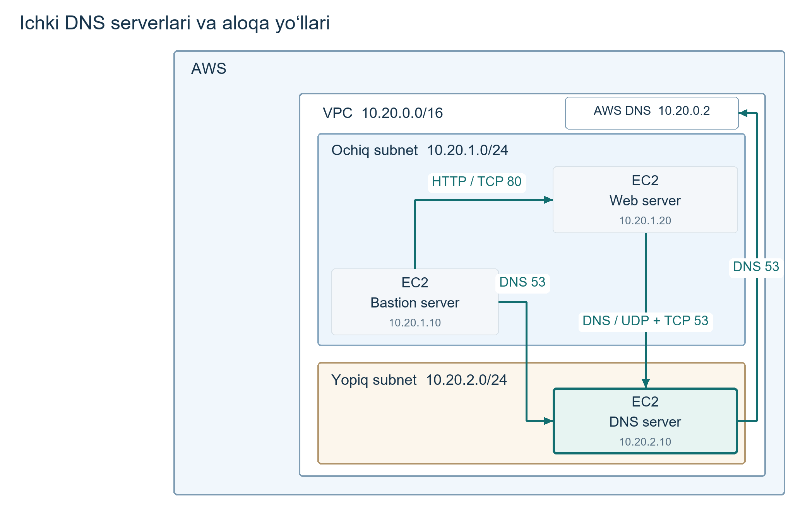

# M2 Ichki DNS va odatiy nom yechimi (13)

[Mashqlar P0–P5](practice.md) · [Topshiriqlar M0–M5](missions.md)

[日本語](../ja/m2.md) · [Русский](../ru/m2.md) · [O‘zbekcha](../uz/m2.md)

Mos topshiriq: [P2](p2.md).

## Tayyor holat talablari

Boshlashdan oldin baholash sahifasida [M1](m1.md) uchun to‘liq ball olinganini tekshiring.

P2 da sozlangan ichki DNS ga jadvaldagi oltita nomni qo‘shing. Bastion serveridan `http://web.lab.test/mission.txt` ochilsin.

1. **DNS server (P2.2-P2.4).** Mavjud `lab.test` zonasiga A yozuvlarini qo‘shing. Zona seriya raqamini oshiring, sintaksisni tekshiring va sozlamani qayta yuklang. P2 nomlarini saqlash mumkin.
2. **Bastion va Web serverlari (P2.5-P2.8).** Ichki DNS ga to‘g‘ridan to‘g‘ri so‘rovni va OS ning odatiy nom yechimini tekshiring. Bastionda `web.lab.test` orqali M1 matnini oching. Web serverda `db.lab.test` manzili `10.20.2.20` bo‘lishini tekshiring.

## Topshiriq diagrammasi

| DNS name | A / IPv4 |
| --- | --- |
| admin.lab.test | 10.20.1.20 |
| bastion.lab.test | 10.20.1.10 |
| db.lab.test | 10.20.2.20 |
| dns.lab.test | 10.20.2.10 |
| repo.lab.test | 10.20.2.30 |
| web.lab.test | 10.20.1.20 |

## Baholash mezonlari

Har bir mezon 1 ball.

| № | Shart |
| --- | --- |
| 1 | BIND/named ishlaydi (active). |
| 2 | Named va lab.test zone tekshiruvlari muvaffaqiyatli. |
| 3 | Lab.test SOA/NS va vakolatli javob tuzilmaga mos; NS - dns.lab.test. |
| 4 | Profile dagi barcha A record kerakli private IP beradi; bu bitta band. |
| 5 | Bastion ham, Web ham UDP 53 orqali to‘g‘ri javob oladi. |
| 6 | Bastion ham, Web ham TCP 53 orqali to‘g‘ri javob oladi. |
| 7 | Bastion/Web odatiy resolver faqat BIND dan foydalanadi; hosts yoki Firefox DoH bilan almashtirilmaydi. |
| 8 | Bastiondan profile nomi va belgilangan path orqali HTTP 200 hamda to‘g‘ri matn qaytadi. |
| 9 | Web odatiy resolver profile DB nomini 10.20.2.20 ga yechadi. |
| 10 | Forward only faqat 10.20.0.2 ga yo‘naltirilgan; tashqi DNS nomi yechiladi. Tashqi HTTP shart emas. |
| 11 | Shu ishga tushirishdagi yangi mavjud bo‘lmagan nom vakolatli NXDOMAIN oladi. |
| 12 | BIND query/recursion/cache faqat localhost, bastion va Web ga ruxsat; SG ning o‘zi yetmaydi. |
| 13 | Ayni tekshiruv oddiy so‘rovlari o‘tgan holda bastion/Web AXFR aniq rad etiladi; timeout yetmaydi. |

## Tekshirish va yuborish

1. Baholash sahifasini oching va **M2** ni tanlang.
2. Tanlangan topshiriq tekshiruvini boshlang.
3. Tekshiruv tugagach, bajarilgan mezonlar soni va har bir natija chiqadi. «Tuzating» deb belgilangan sozlamani to‘g‘rilab, yana tekshiring. «Tekshirilmagan» band natijasi aniqlanmagan. Ballarni topshiriqlar ro‘yxatidan ko‘ring.

---

[Oldingi: P2](p2.md) · [Keyingi: P3](p3.md)
