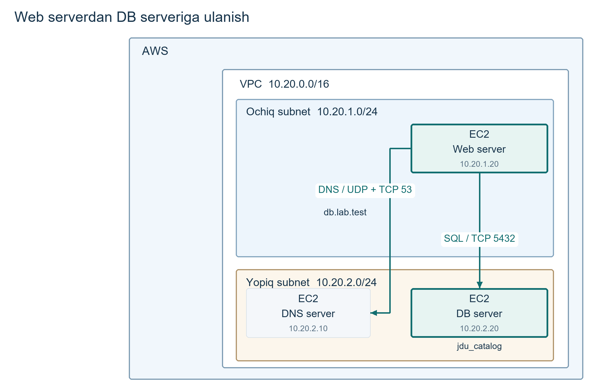

# M3 PostgreSQL ga autentifikatsiya bilan ulanish (9)

[Mashqlar P0–P5](practice.md) · [Topshiriqlar M0–M5](missions.md)

[日本語](../ja/m3.md) · [Русский](../ru/m3.md) · [O‘zbekcha](../uz/m3.md)

Mos topshiriq: [P3](p3.md).

## Tayyor holat talablari

Boshlashdan oldin baholash sahifasida [M2](m2.md) uchun to‘liq ball olinganini tekshiring.

P3 dagi PostgreSQL da quyida ko‘rsatilgan topshiriq ma’lumotlar bazasi va ikkita rolni yarating. Ilova jadvallari M4 da yaratiladi.

1. **DB server (P3.2-P3.6).** Baza va rollarni yarating. Tegishli bazaga ko‘rsatilgan rollar bilan faqat Web serverdan (`10.20.1.20/32`) ulanishga ruxsat bering. P3 dagidek SCRAM ishlating.
2. **Web server (P3.7-P3.8).** Oddiy ish rejimi roli bilan `db.lab.test` ga ulanib, SELECT bajarilishini tekshiring. Mavjud parolni P3.8 dagi usul bilan `mission` profili uchun saqlang.

## Topshiriq diagrammasi

| Sozlama | Qiymat |
| --- | --- |
| Baza nomi | `jdu_catalog` |
| Sozlash roli | `catalog_setup` |
| Oddiy ish rejimi roli | `catalog_app` |

## Baholash mezonlari

Har bir mezon 1 ball.

| № | Shart |
| --- | --- |
| 1 | PostgreSQL 16/main ishlaydi (active). |
| 2 | 16/main sozlamasi, standart data directory va OS postgres socket/peer to‘g‘ri. |
| 3 | PostgreSQL 10.20.2.20:5432 da tinglaydi. |
| 4 | DB va public schema egasi tegishli setup role. |
| 5 | Runtime LOGIN; superuser/CREATEDB/CREATEROLE/REPLICATION/BYPASSRLS va huquq oshiruvchi membership yo‘q. Setup qurishda LOGIN yoki tugagach NOLOGIN. |
| 6 | HBA faqat ko‘rsatilgan DB/role va Web /32 uchun SCRAM ga ruxsat beradi; keng ruxsat yo‘q. |
| 7 | Web dan yangi autentifikatsiyali SELECT kerakli DB/user/qiymatni qaytaradi; P IP bilan, M odatiy DNS orqali. |
| 8 | To‘g‘ri parol ishlagan ayni tekshiruvda bitta noto‘g‘ri parol aniq rad etiladi. |
| 9 | Web dan postgres role, begona DB va boshqa profile taqiqlangan; hali yaratilmagan practice DB majburiy emas. |

## Tekshirish va yuborish

1. Baholash sahifasini oching va **M3** ni tanlang.
2. Tanlangan topshiriq tekshiruvini boshlang.
3. Tekshiruv tugagach, bajarilgan mezonlar soni va har bir natija chiqadi. «Tuzating» deb belgilangan sozlamani to‘g‘rilab, yana tekshiring. «Tekshirilmagan» band natijasi aniqlanmagan. Ballarni topshiriqlar ro‘yxatidan ko‘ring.

---

[Oldingi: P3](p3.md) · [Keyingi: P4](p4.md)
