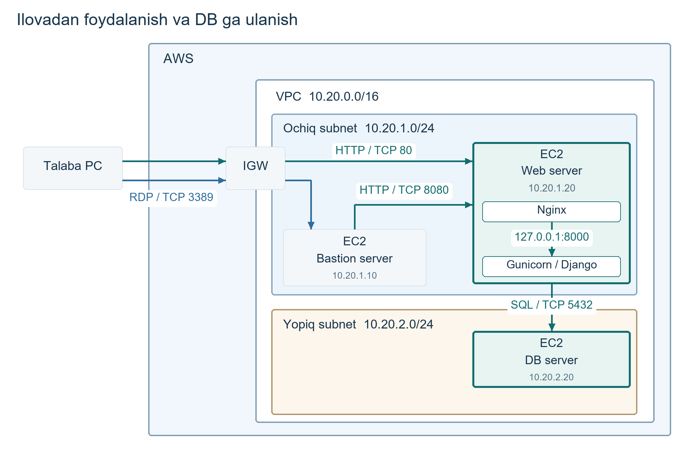

# M4 Berilgan app ni Web va DB bilan bog‘lash (13)

[Mashqlar P0–P5](practice.md) · [Topshiriqlar M0–M5](missions.md)

[日本語](../ja/m4.md) · [Русский](../ru/m4.md) · [O‘zbekcha](../uz/m4.md)

Mos topshiriq: [P4](p4.md).

## Tayyor holat talablari

Boshlashdan oldin baholash sahifasida [M2](m2.md), [M3](m3.md) uchun to‘liq ball olinganini tekshiring.

P4 dagi jihozlar ilovasini M3 da tayyorlangan topshiriq bazasiga ulang. Profilni almashtirishdan oldin P5 da mashq sozlamasini yakunlang.

1. **Web server (P5.3, P4.4-P4.5).** Ilovani to‘xtating va `mission` profilini tanlang. Mavjud ilovadan foydalanib, topshiriq bazasida jadvallar, boshlang‘ich ma’lumotlar va administratorni yarating.
2. **DB va Web serverlari (P4.6-P4.8).** Oddiy ish rejimi roliga huquqlarni bering va ilovani ishga tushiring. Ochiq sahifa hamda boshqaruv sahifasini oching. `/practice.txt` va `/mission.txt` ham ochilishini tekshiring.
3. **Bastion serveri (P4.9).** `http://admin.lab.test:8080/admin/` manziliga `lab_admin` bilan kiring va jadvaldagi ikki yozuvni kiriting. Ochiq sahifada e’lon qilingan yozuvni tekshiring.

## Topshiriq diagrammasi

| Kod | Nomi | Soni | Saqlash joyi | Ochiq |
| --- | --- | --- | --- | --- |
| `M5-PUBLIC-001` | Mission monitor | 6 | Lab cabinet C | Ha |
| `M5-PRIVATE-001` | Mission router | 1 | Lab cabinet D | Yo‘q |

## Baholash mezonlari

Har bir mezon 1 ball.

| № | Shart |
| --- | --- |
| 1 | Kod va bog‘liqliklar berilgan aniq versiyaga mos. |
| 2 | jdu-catalog active va enabled, catalog nomidan ishlaydi. |
| 3 | Gunicorn faqat 127.0.0.1:8000 da tinglaydi. |
| 4 | Faol process kerakli profile DB va runtime role dan foydalanadi. |
| 5 | Belgilangan migrations, 11 jadval va zarur sequence tanlangan DB da mavjud. |
| 6 | Ikkala majburiy yozuv profile qiymatlariga mos; boshqa to‘g‘ri yozuvlar mumkin. |
| 7 | Odatiy ochiq URL ishlayotgan DB dan to‘g‘ri yozuvlarni oladi. |
| 8 | Bastiondan odatiy DNS orqali admin.lab.test:8080/admin/ haqiqiy login shakli ochiladi. |
| 9 | Static resurslar belgilangan yo‘l orqali ochiladi. |
| 10 | Funksional rejim haqiqiy password/CSRF/cookie login dan o‘tadi, autentifikatsiya chetlab o‘tilmaydi. |
| 11 | Shu tekshiruvda admin HTTP orqali bitta CK yozuv yaratilib, DB va ochiq sahifa qiymatlari mos keladi. |
| 12 | Aynan shu CK yozuv miqdori o‘zgartiriladi; DB va ochiq sahifa o‘zgarishni tasdiqlaydi. |
| 13 | POST logout session ni tugatadi: eski cookie bilan yana login talab etiladi. |

## Tekshirish va yuborish

1. Baholash sahifasini oching va **M4** ni tanlang.
2. Funksiya/huquq tekshiruvini tanlang, lab_admin mavjud parolini app administratorining yashirin maydoniga kiritib, shu parol bilan tekshiring. Bu RDP paroli emas. Faqat sozlama tekshiruvi funksiyalarni tasdiqlamaydi.
3. Tekshiruv tugagach, bajarilgan mezonlar soni va har bir natija chiqadi. «Tuzating» deb belgilangan sozlamani to‘g‘rilab, yana tekshiring. «Tekshirilmagan» band natijasi aniqlanmagan. Ballarni topshiriqlar ro‘yxatidan ko‘ring.

---

[Oldingi: P5](p5.md) · [Keyingi: M5](m5.md)
