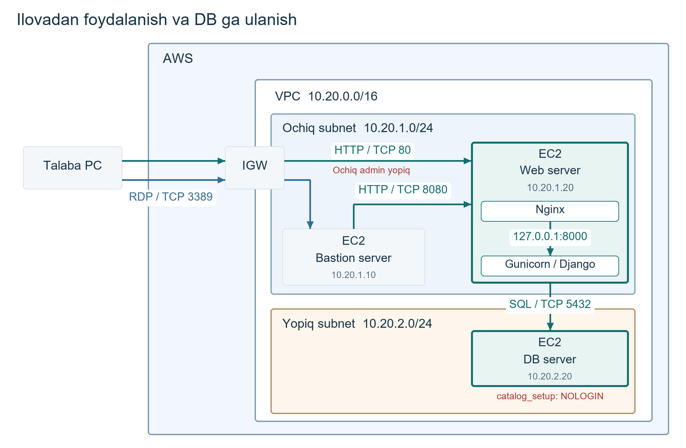

# M5 Eng kam huquq va ochiq kirish chegarasi (16)

[Mashqlar P0–P5](practice.md) · [Topshiriqlar M0–M5](missions.md)

[日本語](../ja/m5.md) · [Русский](../ru/m5.md) · [O‘zbekcha](../uz/m5.md)

Mos topshiriq: [P5](p5.md).

## Tayyor holat talablari

Boshlashdan oldin baholash sahifasida [M4](m4.md) uchun to‘liq ball olinganini tekshiring.

M4 ilovasini P5 dagi usul bilan oddiy ish rejimiga o‘tkazing. Faqat sozlashda kerak bo‘lgan kirishni yoping, ilova va administrator uchun zarur huquqlarni qoldiring.

1. **DB server (P5.1-P5.2).** `catalog_app` huquqlarini tekshiring. Sozlash roli `catalog_setup` uchun kirishni yoping, parolini olib tashlang va qolgan ulanishlarini yakunlang.
2. **Web server (P5.3-P5.4).** Vaqtinchalik sozlamalarni (`/etc/jdu-catalog/setup.env` va `/etc/jdu-catalog/profiles/mission.setup.env`) olib tashlang va ilovani oddiy ish uchun `mission` profili bilan ishga tushiring. Xizmat foydalanuvchisi kodni o‘zgartira olmasin. Maxfiy sozlamalar `root:root` ga tegishli bo‘lsin va `0600` ruxsatiga ega bo‘lsin.
3. **Ochiq va boshqaruv sahifalari (P5.4-P5.5).** 80-portda M4 dagi faqat ochiq yozuv ko‘rinsin. Bastion orqali 8080-portdagi boshqaruv sahifasini oching. `lab_admin` jihozlarni ko‘rishi, qo‘shishi va o‘zgartirishi mumkinligini tekshiring.

## Topshiriq diagrammasi

## Baholash mezonlari

Har bir mezon 1 ball.

| № | Shart |
| --- | --- |
| 1 | Ochiq 80 soxta Host/header bilan ham admin ni ochmaydi; private yo‘l esa ishlaydi. |
| 2 | Maxfiy fayllar oddiy root:root 0600, link va qiymat ochilishi yo‘q. |
| 3 | Login/sudo siz catalog kod, venv va ularning boshqaruv kataloglarini o‘zgartira olmaydi. |
| 4 | Tekshiriladigan env/maxfiy path lar HTTP yoki static orqali ochilmaydi. |
| 5 | Setup role NOLOGIN/password NULL, session lari yopilgan, vaqtinchalik setup.env lar o‘chirilgan. |
| 6 | catalog_item: faqat SELECT/INSERT/UPDATE; DELETE, TRUNCATE va huquq uzatish yo‘q. |
| 7 | auth_user: SELECT va faqat last_login/password UPDATE; user yaratish/o‘chirish yo‘q. |
| 8 | Guruh, permission, bog‘lanish va content type jadvallari faqat SELECT uchun. |
| 9 | django_session: faqat kerakli SELECT/INSERT/UPDATE/DELETE; ortiqcha huquq yo‘q. |
| 10 | django_admin_log: faqat SELECT/INSERT. |
| 11 | Runtime da django_migrations huquqi, schema CREATE, obyekt egaligi va belgilanmagan qo‘shimcha huquq yo‘q. |
| 12 | USAGE faqat jihoz va admin-log sequence lariga; ortiqcha SELECT/UPDATE/GRANT yo‘q. |
| 13 | Faol staff, superuser emas: faqat jihoz view/add/change; delete/user management yo‘q. |
| 14 | Nazorat login o‘tgan holda anonim add/change DB ni o‘zgartirmay rad etiladi; faqat CSRF-403 yetmaydi. |
| 15 | Bitta noto‘g‘ri app paroli rad etiladi, ayni paytda to‘g‘ri login ishlaydi. |
| 16 | DB ishlagan holda topilgan barcha yopiq kodlar ochiq sahifada ko‘rinmaydi. |

## Tekshirish va yuborish

1. Baholash sahifasini oching va **M5** ni tanlang.
2. Funksiya/huquq tekshiruvini tanlang, lab_admin mavjud parolini app administratorining yashirin maydoniga kiritib, shu parol bilan tekshiring. Bu RDP paroli emas. Faqat sozlama tekshiruvi funksiyalarni tasdiqlamaydi.
3. Tekshiruv tugagach, bajarilgan mezonlar soni va har bir natija chiqadi. «Tuzating» deb belgilangan sozlamani to‘g‘rilab, yana tekshiring. «Tekshirilmagan» band natijasi aniqlanmagan. Ballarni topshiriqlar ro‘yxatidan ko‘ring.

---

[Oldingi: M4](m4.md)
