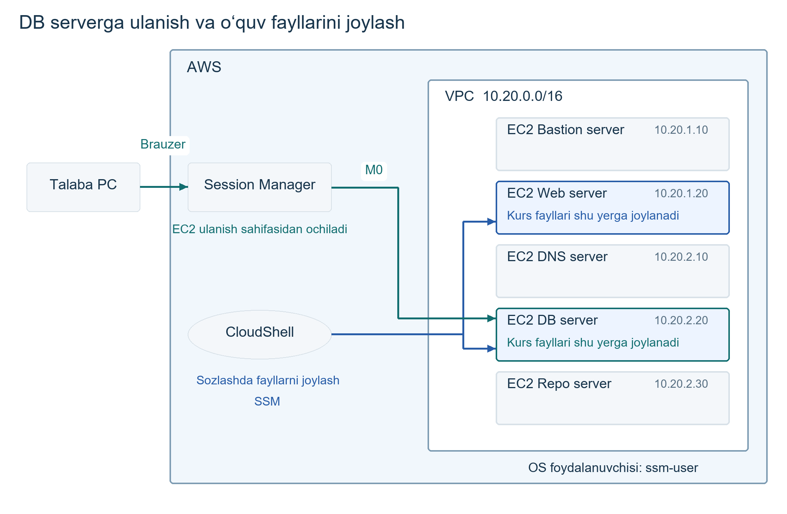
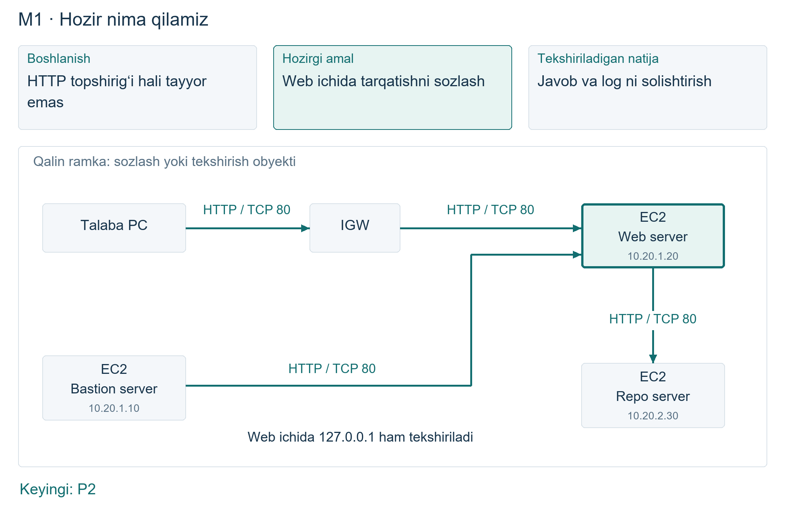
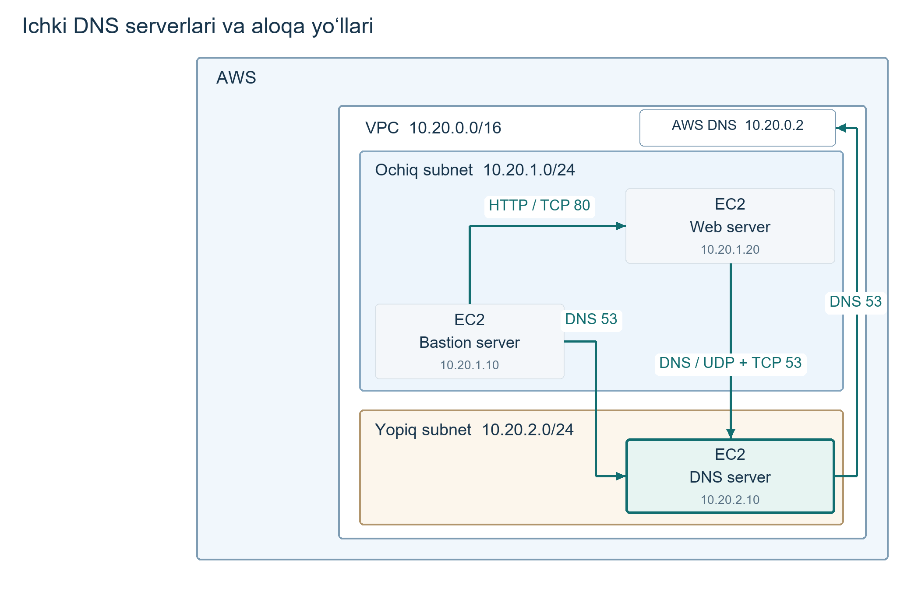
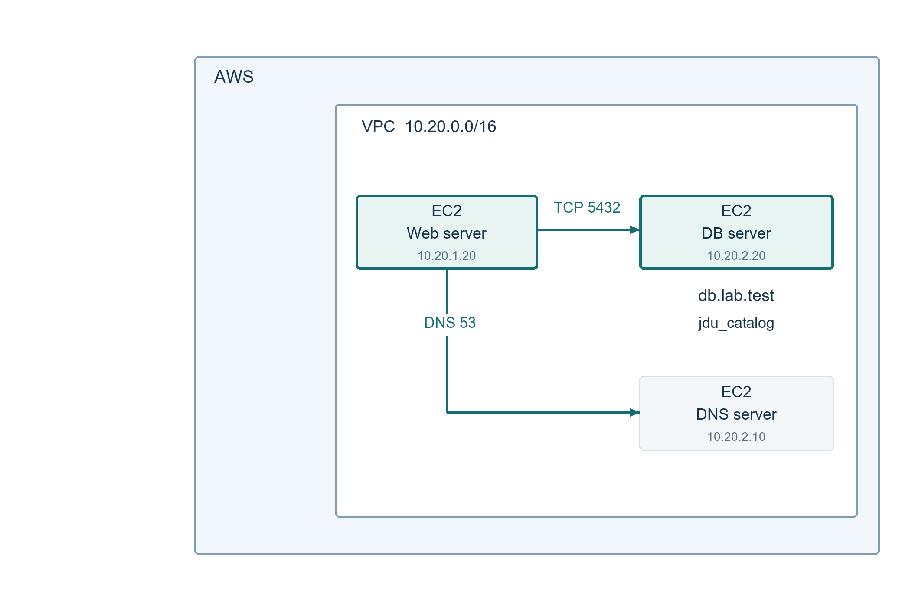
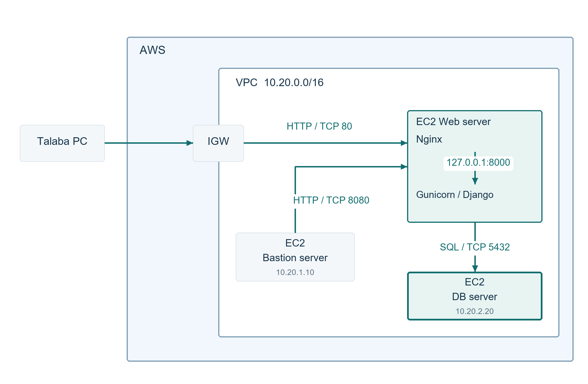
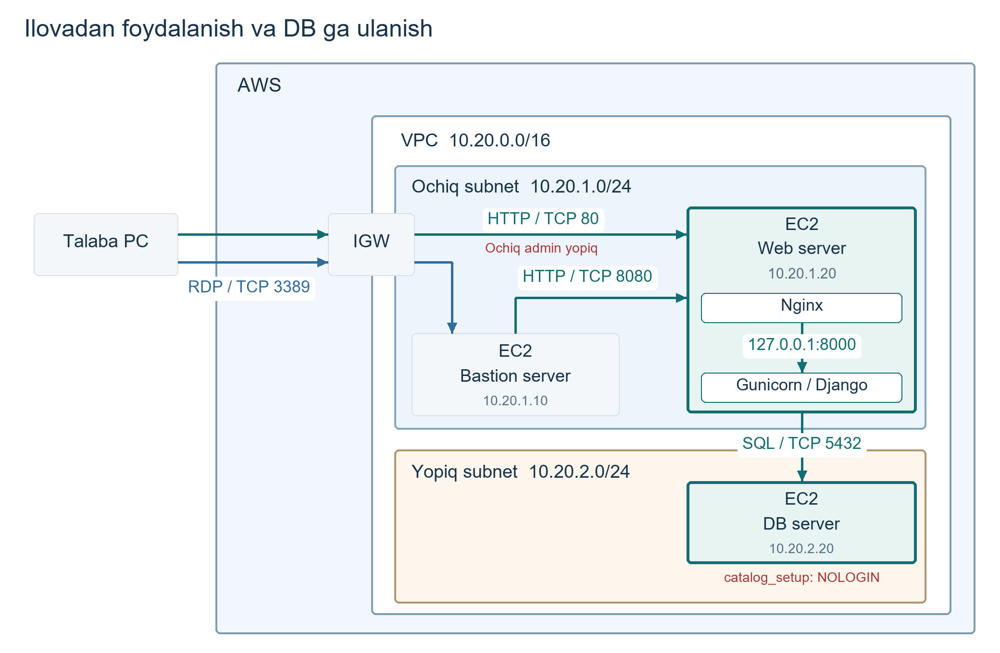

# Web Infrastructure: M0-M5 mustaqil topshiriqlar

O‘qituvchi tekshiruvi uchun birinchi nashr. Talabaning qo‘llanma bo‘yicha boshidan oxirigacha o‘tishi hali tekshirilmagan.

Ruscha va o‘zbekcha matn yaponcha asl nusxa bilan bir xil qadam va shartlarga ega. Ona tili mutaxassisi tahriri hali bajarilmagan.

[日本語](../ja/missions-full.md) · [Русский](../ru/missions-full.md) · [O‘zbekcha](../uz/missions-full.md)

[Mashqlar P0–P5](practice.md) · [Topshiriqlar M0–M5](missions.md)

## Qo‘llanmadan foydalanish

P da mashq qilingan usul bilan shu muhitga topshiriq fayllari va sozlamalarini qo‘shing. Har bir M dagi qiymatlar va mos P qadamlariga qarang.

P0 → M0 → P1 → M1 → P2 → M2 → P3 → M3 → P4 → P5 → M4 → M5

P5 da mashq sozlamalarini yakunlang. Keyin M4 da ayni ilovani topshiriq bazasiga ulang.

## M0 Shaxsiy muhit va buyruqlarni bajarish joyi (4)

### Tayyor holat talablari

P0 dagi ulanish tartibini qo‘llab, to‘rtta server uchun Session Manager’ni oching. EC2 ro‘yxatida kerakli serverning **Instance ID** sini, so‘ng **Connect** yonidagi strelkani va **Connect with SSM Session Manager** bandini bosing. Har bir serverga `ssm-user` sifatida ulanib, uy katalogingizda `m0-connection.txt` faylini yarating va jadvaldagi qiymatni bitta qatorga yozing.

| Server | EC2 dagi nomining oxiri | Fayl mazmuni |
| --- | --- | --- |
| DB server | `-db` | `db` |
| DNS server | `-dns` | `dns` |
| Repo server | `-repo` | `repo` |
| Bastion server | `-bastion` | `bastion` |

Topshiriqlar sahifasida **M0** ni tanlang. Har bir to‘g‘ri fayl uchun 1 ball beriladi. Jami 4 ball.

### Ulaniladigan serverlar



Yashil strelkalar M0 da ulaniladigan to‘rtta serverga olib boradi.


EC2 dagi Instances ro‘yxati. P0 uchun nomi `-web`, M0 uchun `-db`, `-dns`, `-repo` va `-bastion` bilan tugaydigan qatorlarni navbat bilan tanlang.


EC2 tafsilot oynasi. Connect yonidagi o‘ng strelkadan Connect with SSM Session Manager ni tanlang. Rasmda Web server ko‘rsatilgan.

### Tekshirish va yuborish

1. P0 da ishlatgan topshiriqlar sahifasiga ta’lim muassasasining Google hisobi bilan kiring va o‘z Lab muhitingiz hamda **M0** ni tanlang.
2. Tanlangan topshiriq tekshiruvini boshlang.
3. Ishlov davom etsa natijani yangilab kuting. Nechta band bajarilganini ko‘ring. Tuzatish kerak bo‘lgan bandlarni tuzatib, yana tekshiring. Natija avtomatik saqlanadi.

## M1 HTTP orqali statik faylni qaytarish (8)

### Tayyor holat talablari

Ayni Web serverda TCP 80 porti orqali `/mission.txt` faylini HTTP da tarqating. `/practice.txt` ham ochiq qolsin.

1. **Web server (P1.2-P1.3).** Quyidagi matn bilan topshiriq faylini yarating. Egasi va guruhini `root:root`, ruxsatlarini `0644` qiling.
2. **Web va Bastion serverlari (P1.4-P1.6).** curl bilan `/mission.txt` ni so‘rang. Web serverning o‘zida `127.0.0.1`, Bastion serverida `10.20.1.20` ni ishlating. Har ikkala joyda HTTP 200 va quyidagi matn qaytishini tekshiring. So‘rovlarni Web serverning access log faylidan toping.

### Topshiriq diagrammasi



- **Tarqatiladigan fayl** `/var/www/html/mission.txt`
- **URL yo‘li** `/mission.txt`

```text
JDU WEB-02 mission: independent HTTP delivery.
```

### Baholash mezonlari

Har bir mezon 1 ball.

| № | Shart |
| --- | --- |
| 1 | Nginx ishlaydi (active). |
| 2 | nginx -t sozlamani muvaffaqiyatli tekshiradi. |
| 3 | 80 port private IP/barcha interface da tinglaydi, faqat loopback emas. |
| 4 | Oddiy faylda aniq matn bor, egasi root:root, ruxsat 0644. |
| 5 | Web loopback orqali HTTP 200 va aniq matn oladi. |
| 6 | Bastion private IP orqali HTTP 200 va aniq matn oladi. |
| 7 | CloudShell public IP orqali HTTP 200 va aniq matn oladi. |
| 8 | Access log aynan shu tekshiruv nonce li so‘rovni saqlaydi. |

### Tekshirish va yuborish

1. Baholash sahifasini oching va **M1** ni tanlang.
2. Tanlangan topshiriq tekshiruvini boshlang.
3. Tekshiruv tugagach, bajarilgan mezonlar soni va har bir natija chiqadi. «Tuzating» deb belgilangan sozlamani to‘g‘rilab, yana tekshiring. «Tekshirilmagan» band natijasi aniqlanmagan. Ballarni topshiriqlar ro‘yxatidan ko‘ring.

## M2 Ichki DNS va odatiy nom yechimi (13)

### Tayyor holat talablari

Boshlashdan oldin baholash sahifasida [M1](m1.md) uchun to‘liq ball olinganini tekshiring.

P2 da sozlangan ichki DNS ga jadvaldagi oltita nomni qo‘shing. Bastion serveridan `http://web.lab.test/mission.txt` ochilsin.

1. **DNS server (P2.2-P2.4).** Mavjud `lab.test` zonasiga A yozuvlarini qo‘shing. Zona seriya raqamini oshiring, sintaksisni tekshiring va sozlamani qayta yuklang. P2 nomlarini saqlash mumkin.
2. **Bastion va Web serverlari (P2.5-P2.8).** Ichki DNS ga to‘g‘ridan to‘g‘ri so‘rovni va OS ning odatiy nom yechimini tekshiring. Bastionda `web.lab.test` orqali M1 matnini oching. Web serverda `db.lab.test` manzili `10.20.2.20` bo‘lishini tekshiring.

### Topshiriq diagrammasi



| DNS name | A / IPv4 |
| --- | --- |
| admin.lab.test | 10.20.1.20 |
| bastion.lab.test | 10.20.1.10 |
| db.lab.test | 10.20.2.20 |
| dns.lab.test | 10.20.2.10 |
| repo.lab.test | 10.20.2.30 |
| web.lab.test | 10.20.1.20 |

### Baholash mezonlari

Har bir mezon 1 ball.

| № | Shart |
| --- | --- |
| 1 | BIND/named ishlaydi (active). |
| 2 | Named va lab.test zone tekshiruvlari muvaffaqiyatli. |
| 3 | Lab.test SOA/NS va vakolatli javob tuzilmaga mos; NS - dns.lab.test. |
| 4 | Profile dagi barcha A record kerakli private IP beradi; bu bitta band. |
| 5 | Bastion ham, Web ham UDP 53 orqali to‘g‘ri javob oladi. |
| 6 | Bastion ham, Web ham TCP 53 orqali to‘g‘ri javob oladi. |
| 7 | Bastion/Web odatiy resolver faqat BIND dan foydalanadi; hosts yoki Firefox DoH bilan almashtirilmaydi. |
| 8 | Bastiondan profile nomi va belgilangan path orqali HTTP 200 hamda to‘g‘ri matn qaytadi. |
| 9 | Web odatiy resolver profile DB nomini 10.20.2.20 ga yechadi. |
| 10 | Forward only faqat 10.20.0.2 ga yo‘naltirilgan; tashqi DNS nomi yechiladi. Tashqi HTTP shart emas. |
| 11 | Shu ishga tushirishdagi yangi mavjud bo‘lmagan nom vakolatli NXDOMAIN oladi. |
| 12 | BIND query/recursion/cache faqat localhost, bastion va Web ga ruxsat; SG ning o‘zi yetmaydi. |
| 13 | Ayni tekshiruv oddiy so‘rovlari o‘tgan holda bastion/Web AXFR aniq rad etiladi; timeout yetmaydi. |

### Tekshirish va yuborish

1. Baholash sahifasini oching va **M2** ni tanlang.
2. Tanlangan topshiriq tekshiruvini boshlang.
3. Tekshiruv tugagach, bajarilgan mezonlar soni va har bir natija chiqadi. «Tuzating» deb belgilangan sozlamani to‘g‘rilab, yana tekshiring. «Tekshirilmagan» band natijasi aniqlanmagan. Ballarni topshiriqlar ro‘yxatidan ko‘ring.

## M3 PostgreSQL ga autentifikatsiya bilan ulanish (9)

### Tayyor holat talablari

Boshlashdan oldin baholash sahifasida [M2](m2.md) uchun to‘liq ball olinganini tekshiring.

P3 dagi PostgreSQL da quyida ko‘rsatilgan topshiriq ma’lumotlar bazasi va ikkita rolni yarating. Ilova jadvallari M4 da yaratiladi.

1. **DB server (P3.2-P3.6).** Baza va rollarni yarating. Tegishli bazaga ko‘rsatilgan rollar bilan faqat Web serverdan (`10.20.1.20/32`) ulanishga ruxsat bering. P3 dagidek SCRAM ishlating.
2. **Web server (P3.7-P3.8).** Oddiy ish rejimi roli bilan `db.lab.test` ga ulanib, SELECT bajarilishini tekshiring. Mavjud parolni P3.8 dagi usul bilan `mission` profili uchun saqlang.

### Topshiriq diagrammasi



| Sozlama | Qiymat |
| --- | --- |
| Baza nomi | `jdu_catalog` |
| Sozlash roli | `catalog_setup` |
| Oddiy ish rejimi roli | `catalog_app` |

### Baholash mezonlari

Har bir mezon 1 ball.

| № | Shart |
| --- | --- |
| 1 | PostgreSQL 16/main ishlaydi (active). |
| 2 | 16/main sozlamasi, standart data directory va OS postgres socket/peer to‘g‘ri. |
| 3 | PostgreSQL 10.20.2.20:5432 da tinglaydi. |
| 4 | DB va public schema egasi tegishli setup role. |
| 5 | Runtime LOGIN; superuser/CREATEDB/CREATEROLE/REPLICATION/BYPASSRLS va huquq oshiruvchi membership yo‘q. Setup qurishda LOGIN yoki tugagach NOLOGIN. |
| 6 | HBA faqat ko‘rsatilgan DB/role va Web /32 uchun SCRAM ga ruxsat beradi; keng ruxsat yo‘q. |
| 7 | Web dan yangi autentifikatsiyali SELECT kerakli DB/user/qiymatni qaytaradi; P IP bilan, M odatiy DNS orqali. |
| 8 | To‘g‘ri parol ishlagan ayni tekshiruvda bitta noto‘g‘ri parol aniq rad etiladi. |
| 9 | Web dan postgres role, begona DB va boshqa profile taqiqlangan; hali yaratilmagan practice DB majburiy emas. |

### Tekshirish va yuborish

1. Baholash sahifasini oching va **M3** ni tanlang.
2. Tanlangan topshiriq tekshiruvini boshlang.
3. Tekshiruv tugagach, bajarilgan mezonlar soni va har bir natija chiqadi. «Tuzating» deb belgilangan sozlamani to‘g‘rilab, yana tekshiring. «Tekshirilmagan» band natijasi aniqlanmagan. Ballarni topshiriqlar ro‘yxatidan ko‘ring.

## M4 Berilgan app ni Web va DB bilan bog‘lash (13)

### Tayyor holat talablari

Boshlashdan oldin baholash sahifasida [M2](m2.md), [M3](m3.md) uchun to‘liq ball olinganini tekshiring.

P4 dagi jihozlar ilovasini M3 da tayyorlangan topshiriq bazasiga ulang. Profilni almashtirishdan oldin P5 da mashq sozlamasini yakunlang.

1. **Web server (P5.3, P4.4-P4.5).** Ilovani to‘xtating va `mission` profilini tanlang. Mavjud ilovadan foydalanib, topshiriq bazasida jadvallar, boshlang‘ich ma’lumotlar va administratorni yarating.
2. **DB va Web serverlari (P4.6-P4.8).** Oddiy ish rejimi roliga huquqlarni bering va ilovani ishga tushiring. Ochiq sahifa hamda boshqaruv sahifasini oching. `/practice.txt` va `/mission.txt` ham ochilishini tekshiring.
3. **Bastion serveri (P4.9).** `http://admin.lab.test:8080/admin/` manziliga `lab_admin` bilan kiring va jadvaldagi ikki yozuvni kiriting. Ochiq sahifada e’lon qilingan yozuvni tekshiring.

### Topshiriq diagrammasi



| Kod | Nomi | Soni | Saqlash joyi | Ochiq |
| --- | --- | --- | --- | --- |
| `M5-PUBLIC-001` | Mission monitor | 6 | Lab cabinet C | Ha |
| `M5-PRIVATE-001` | Mission router | 1 | Lab cabinet D | Yo‘q |

### Baholash mezonlari

Har bir mezon 1 ball.

| № | Shart |
| --- | --- |
| 1 | Kod va bog‘liqliklar berilgan aniq versiyaga mos. |
| 2 | jdu-catalog active va enabled, catalog nomidan ishlaydi. |
| 3 | Gunicorn faqat 127.0.0.1:8000 da tinglaydi. |
| 4 | Faol process kerakli profile DB va runtime role dan foydalanadi. |
| 5 | Belgilangan migrations, 11 jadval va zarur sequence tanlangan DB da mavjud. |
| 6 | Ikkala majburiy yozuv profile qiymatlariga mos; boshqa to‘g‘ri yozuvlar mumkin. |
| 7 | Odatiy ochiq URL ishlayotgan DB dan to‘g‘ri yozuvlarni oladi. |
| 8 | Bastiondan odatiy DNS orqali admin.lab.test:8080/admin/ haqiqiy login shakli ochiladi. |
| 9 | Static resurslar belgilangan yo‘l orqali ochiladi. |
| 10 | Funksional rejim haqiqiy password/CSRF/cookie login dan o‘tadi, autentifikatsiya chetlab o‘tilmaydi. |
| 11 | Shu tekshiruvda admin HTTP orqali bitta CK yozuv yaratilib, DB va ochiq sahifa qiymatlari mos keladi. |
| 12 | Aynan shu CK yozuv miqdori o‘zgartiriladi; DB va ochiq sahifa o‘zgarishni tasdiqlaydi. |
| 13 | POST logout session ni tugatadi: eski cookie bilan yana login talab etiladi. |

### Tekshirish va yuborish

1. Baholash sahifasini oching va **M4** ni tanlang.
2. Funksiya/huquq tekshiruvini tanlang, lab_admin mavjud parolini app administratorining yashirin maydoniga kiritib, shu parol bilan tekshiring. Bu RDP paroli emas. Faqat sozlama tekshiruvi funksiyalarni tasdiqlamaydi.
3. Tekshiruv tugagach, bajarilgan mezonlar soni va har bir natija chiqadi. «Tuzating» deb belgilangan sozlamani to‘g‘rilab, yana tekshiring. «Tekshirilmagan» band natijasi aniqlanmagan. Ballarni topshiriqlar ro‘yxatidan ko‘ring.

## M5 Eng kam huquq va ochiq kirish chegarasi (16)

### Tayyor holat talablari

Boshlashdan oldin baholash sahifasida [M4](m4.md) uchun to‘liq ball olinganini tekshiring.

M4 ilovasini P5 dagi usul bilan oddiy ish rejimiga o‘tkazing. Faqat sozlashda kerak bo‘lgan kirishni yoping, ilova va administrator uchun zarur huquqlarni qoldiring.

1. **DB server (P5.1-P5.2).** `catalog_app` huquqlarini tekshiring. Sozlash roli `catalog_setup` uchun kirishni yoping, parolini olib tashlang va qolgan ulanishlarini yakunlang.
2. **Web server (P5.3-P5.4).** Vaqtinchalik sozlamalarni (`/etc/jdu-catalog/setup.env` va `/etc/jdu-catalog/profiles/mission.setup.env`) olib tashlang va ilovani oddiy ish uchun `mission` profili bilan ishga tushiring. Xizmat foydalanuvchisi kodni o‘zgartira olmasin. Maxfiy sozlamalar `root:root` ga tegishli bo‘lsin va `0600` ruxsatiga ega bo‘lsin.
3. **Ochiq va boshqaruv sahifalari (P5.4-P5.5).** 80-portda M4 dagi faqat ochiq yozuv ko‘rinsin. Bastion orqali 8080-portdagi boshqaruv sahifasini oching. `lab_admin` jihozlarni ko‘rishi, qo‘shishi va o‘zgartirishi mumkinligini tekshiring.

### Topshiriq diagrammasi



### Baholash mezonlari

Har bir mezon 1 ball.

| № | Shart |
| --- | --- |
| 1 | Ochiq 80 soxta Host/header bilan ham admin ni ochmaydi; private yo‘l esa ishlaydi. |
| 2 | Maxfiy fayllar oddiy root:root 0600, link va qiymat ochilishi yo‘q. |
| 3 | Login/sudo siz catalog kod, venv va ularning boshqaruv kataloglarini o‘zgartira olmaydi. |
| 4 | Tekshiriladigan env/maxfiy path lar HTTP yoki static orqali ochilmaydi. |
| 5 | Setup role NOLOGIN/password NULL, session lari yopilgan, vaqtinchalik setup.env lar o‘chirilgan. |
| 6 | catalog_item: faqat SELECT/INSERT/UPDATE; DELETE, TRUNCATE va huquq uzatish yo‘q. |
| 7 | auth_user: SELECT va faqat last_login/password UPDATE; user yaratish/o‘chirish yo‘q. |
| 8 | Guruh, permission, bog‘lanish va content type jadvallari faqat SELECT uchun. |
| 9 | django_session: faqat kerakli SELECT/INSERT/UPDATE/DELETE; ortiqcha huquq yo‘q. |
| 10 | django_admin_log: faqat SELECT/INSERT. |
| 11 | Runtime da django_migrations huquqi, schema CREATE, obyekt egaligi va belgilanmagan qo‘shimcha huquq yo‘q. |
| 12 | USAGE faqat jihoz va admin-log sequence lariga; ortiqcha SELECT/UPDATE/GRANT yo‘q. |
| 13 | Faol staff, superuser emas: faqat jihoz view/add/change; delete/user management yo‘q. |
| 14 | Nazorat login o‘tgan holda anonim add/change DB ni o‘zgartirmay rad etiladi; faqat CSRF-403 yetmaydi. |
| 15 | Bitta noto‘g‘ri app paroli rad etiladi, ayni paytda to‘g‘ri login ishlaydi. |
| 16 | DB ishlagan holda topilgan barcha yopiq kodlar ochiq sahifada ko‘rinmaydi. |

### Tekshirish va yuborish

1. Baholash sahifasini oching va **M5** ni tanlang.
2. Funksiya/huquq tekshiruvini tanlang, lab_admin mavjud parolini app administratorining yashirin maydoniga kiritib, shu parol bilan tekshiring. Bu RDP paroli emas. Faqat sozlama tekshiruvi funksiyalarni tasdiqlamaydi.
3. Tekshiruv tugagach, bajarilgan mezonlar soni va har bir natija chiqadi. «Tuzating» deb belgilangan sozlamani to‘g‘rilab, yana tekshiring. «Tekshirilmagan» band natijasi aniqlanmagan. Ballarni topshiriqlar ro‘yxatidan ko‘ring.
