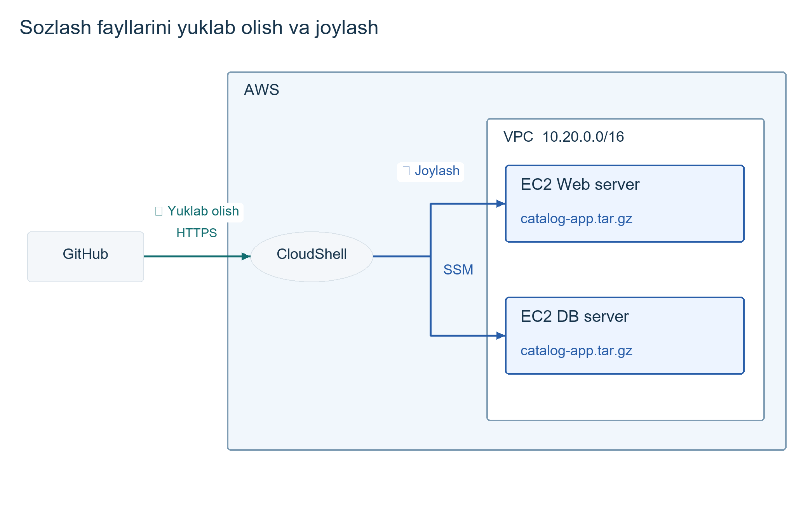

# P0 Shaxsiy muhit va buyruqlarni bajarish joyi

[Mashqlar P0–P6](practice.md) · [Topshiriqlar M0–M6](missions.md)

[日本語](../ja/p0.md) · [Русский](../ru/p0.md) · [O‘zbekcha](../uz/p0.md)

Mos topshiriq: [M0](m0.md).


## Nimani o‘rganamiz

CloudShell, Windows va beshta Ubuntu serverni farqlash; kerakli serverga SSM orqali kirish va o‘zini tekshirish.

## Topshiriq

Tayyor muhitingizda beshta serverning instance ID si va rolini tekshiring. Qaysi serverga va qaysi foydalanuvchi sifatida ulanganingizni aniqlang.

## Serverlarga ulanish va kurs fayllari


Yashil strelka P0.2 da terminalga ulanishni, ko‘k strelkalar dastlabki sozlashda fayllarni joylashni ko‘rsatadi. Repo server Ubuntu paketlarini tarqatadi.

**Practice0 da bajariladigan ishlar**

O‘z AWS hisobingizni, har bir server rolini va buyruq bajariladigan muhitni tekshiring.

## Dastlabki sozlashda joylanadigan o‘quv fayllari

Muhit umumiy kod bilan yaratilgach, ilova va DB uchun SQL fayllari bor `catalog-app.tar.gz` arxivi Web va DB serverlaridagi `/var/lib/jdu-web/lesson-resources-r1` katalogiga joylangan bo‘ladi. Xavfsizlik uchun Web serverdan internetga chiquvchi HTTPS ulanishlari cheklangan, shuning uchun skript fayllarni quyidagi yo‘l orqali yetkazadi.



Muhit umumiy kod orqali yaratilganda, CloudShell o‘quv fayllarini GitHub dan yuklab oladi va SSM orqali Web hamda DB serverlariga joylaydi.

## Yechim namunasi (bajarish tartibi)

### P0.1 Beshta serverning instance ID sini tekshirish

**Bajarish muhiti:**

Talabaning shaxsiy AWS Console oynasi

**Maqsad va amallar:**

AWS Console tepasidagi Search maydoniga EC2 deb yozib, boshqaruv oynasini oching. EC2 → Instances ro‘yxatida Name ustunidan o‘z muhitingizdagi beshta serverni tekshiring. Shu qatordagi Instance ID ustunidan i- bilan boshlangan to‘liq ID ni ko‘ring.


C3 bobidagi 3-4-rasm. EC2 → Instances ni oching va kerakli server qatoridan Instance ID ni tekshiring.

### P0.2 CloudShell dan SSM orqali Web serverga ulanish

**Bajarish muhiti:**

Talabaning shaxsiy AWS hisobidagi CloudShell

**Maqsad va amallar:**

Birinchi buyruqdagi i-YOUR-WEB-INSTANCE-ID o‘rniga P0.1 da tekshirilgan Web serverning Instance ID sini yozing va buyruqni CloudShell da bajaring. Ulangach, serverni dastlabki sozlashda joylangan /etc/jdu-web/bootstrap.json faylidan rolni o‘qing. role maydonida server vazifasi saqlanadi. web qiymati Web serverga ulanganligingizni tasdiqlaydi. Shu terminalda uy katalogingizga bitta web satri bor p0-connection.txt faylini yarating.

Buyruqlar: raqamlar shu qadam ichidagi tartib

```bash
# 1. CloudShell dan tanlangan EC2 ga SSM ochish; ulanishni kutish.
aws ssm start-session --target i-YOUR-WEB-INSTANCE-ID
# 2. Shu terminaldagi OS user nomini ko‘rsatish.
id -un
# 3. Bootstrap dan faqat role ni o‘qib, ulangan server vazifasini tekshirish.
python3 -c 'import json;print(json.load(open("/etc/jdu-web/bootstrap.json"))["role"])'
# 4. Uy katalogidagi tekshiruv fayliga bitta web satrini yozish.
printf '%s\n' web > "$HOME/p0-connection.txt"
# 5. $HOME/p0-connection.txt mazmunini o‘zgartirmay o‘qish.
cat "$HOME/p0-connection.txt"
# 6. Joriy server session ini yopib CloudShell ga qaytish.
exit
```

**Kutilgan natija va ma’nosi:**

id -un natijasi ssm-user, fayldan o‘qilgan rol qiymati esa web bo‘ladi.

Ulangandan keyingi terminal ko‘rinishi

```text
$ id -un
ssm-user
$ python3 -c …
web
```

### P0.3 RDP orqali bastion ish stolini ochish

**Bajarish muhiti:**

Talabaning Windows PC si (umumiy hisob)

**Maqsad va amallar:**

EC2 dagi hozirgi bastion public IPv4 ni ishlating. Windows+R ni bosib mstsc /prompt kiriting va Enter bosing. Computer ga IP, user ga labuser, parolga boshlang‘ich o‘rnatishda belgilangan shaxsiy RDP parolini kiriting; Windows paroli emas. Credentials ni saqlashni tanlamang. Ko‘k xrdp login chiqsa Session=Xorg va labuser ni tekshiring.

Buyruqlar: raqamlar shu qadam ichidagi tartib

```bash
# 1. Windows RDP ni hisob ma’lumotlarini so‘rash bilan ochish.
mstsc /prompt
```

**Buyruq va sozlamalar ma’nosi:**

RDP bastion ekrani va kiritishni uzatadi. RDP ichidagi Firefox request i Windows emas, bastiondan chiqadi. Klaviatura tartibi paroldagi belgilarga ta’sir qiladi; interfeys tili va keyboard layout alohida sozlamadir.

**Kutilgan natija va ma’nosi:**

Ubuntu bastion ichida Xfce va Firefox ochiladi; bu Windows browser idan boshqa. labuser da sudo yo‘q: qurishni CloudShell → SSM/ssm-user orqali bajaring.

**Ishlamasa:**

Login failed bo‘lsa user nomi va klaviatura tartibini tekshiring. Parolni chat ga yubormang. Ulanmasa joriy IP va ruxsatli CIDR ni o‘qituvchi bilan tekshiring; 3389 ni hammaga ochmang. RDP ni yopishdan oldin ishni saqlang.

## Tekshirish va topshirish

RDP mashqi tugagach, o‘qituvchi ko‘rsatgan topshiriqlar sahifasida P0 ni tanlab tekshiruvni boshlang. Web serverdagi uy katalogingizdagi tekshiruv faylida bitta `web` satri bo‘lsa, 1 ball beriladi.

## Tushunishni tekshirish (ballsiz)

Web SSM session ichida DB qadamlarini kiritsangiz, qaysi server o‘zgaradi?

**Izoh:**

Joriy Web o‘zgaradi. Exit bilan CloudShell ga qaytib DB instance ID ga qayta ulaning.

---

[Keyingi: M0](m0.md)
