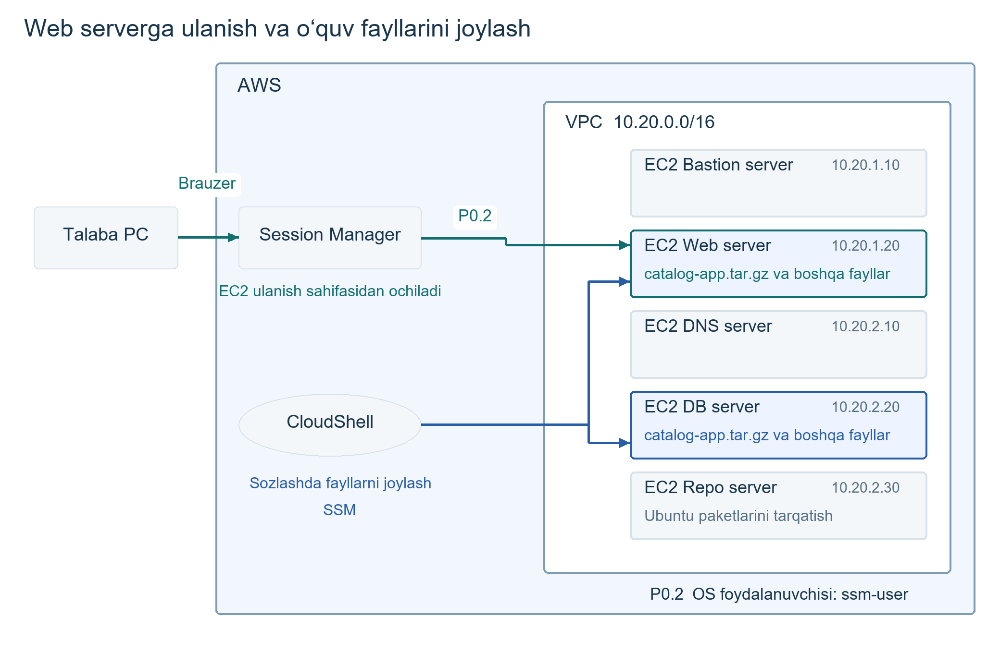
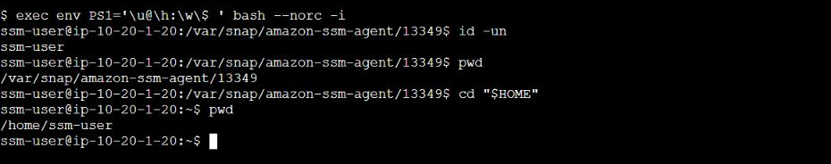
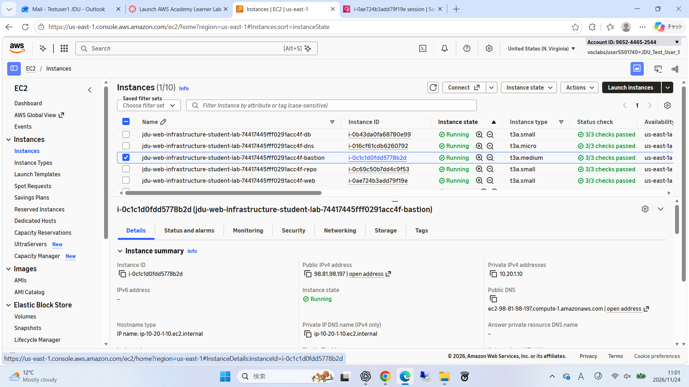
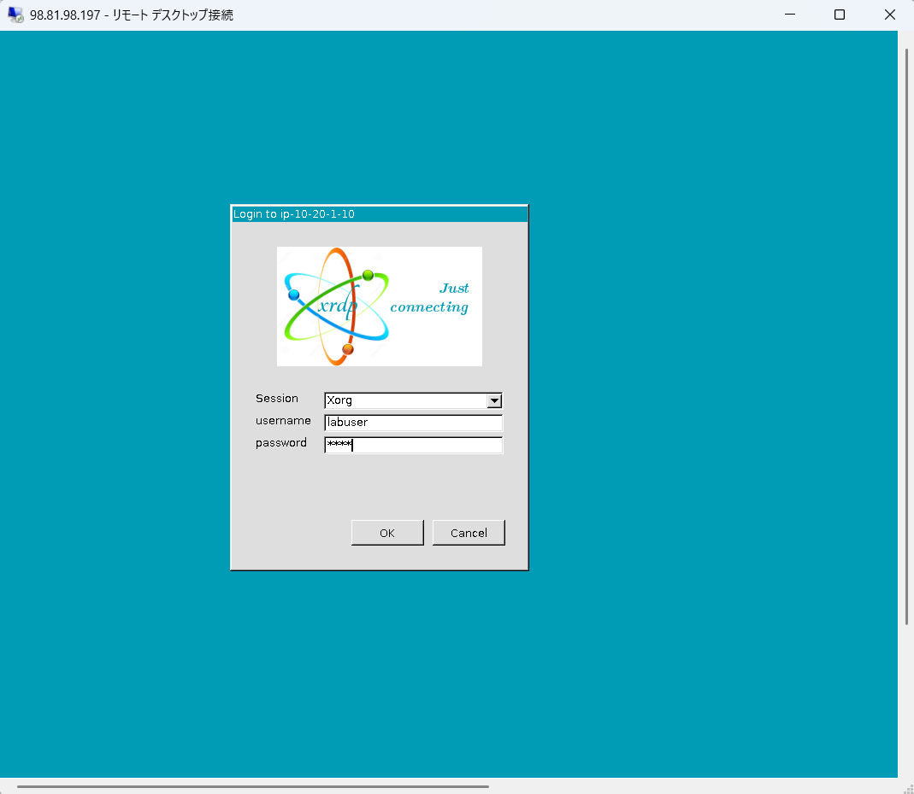

# P0 Shaxsiy muhit va buyruqlarni bajarish joyi

[Mashqlar P0–P6](practice.md) · [Topshiriqlar M0–M6](missions.md)

[日本語](../ja/p0.md) · [Русский](../ru/p0.md) · [O‘zbekcha](../uz/p0.md)

Mos topshiriq: [M0](m0.md).


## Nimani o‘rganamiz

EC2 ro‘yxatidan kerakli serverni tanlash, Session Manager orqali ulanish va topshiriq natijasini tekshirish.

## Topshiriq

Tayyor muhitingizda beshta serverning instance ID si va rolini tekshiring. Qaysi serverga va qaysi foydalanuvchi sifatida ulanganingizni aniqlang.

## Serverlarga ulanish va sozlash fayllarini joylash



Yashil strelka P0.2 da terminalga ulanishni, ko‘k strelkalar dastlab serverlarni sozlash fayllarini joylashni ko‘rsatadi. Repo server Ubuntu paketlarini tarqatadi.

**Practice0 da bajariladigan ishlar**

O‘z AWS hisobingizni, har bir server rolini va buyruq bajariladigan muhitni tekshiring.

## Dastlab joylanadigan serverlarni sozlash fayllari

Muhit umumiy kod bilan yaratilgach, ilova va DB uchun SQL fayllari bor `catalog-app.tar.gz` arxivi Web va DB serverlaridagi `/var/lib/jdu-web/lesson-resources-r1` katalogiga joylangan bo‘ladi. Xavfsizlik uchun Web serverdan internetga chiquvchi HTTPS ulanishlari cheklangan, shuning uchun skript fayllarni quyidagi yo‘l orqali yetkazadi.


Muhit umumiy kod orqali yaratilganda, CloudShell serverlarni sozlash fayllarini GitHub dan yuklab oladi va SSM orqali Web hamda DB serverlariga joylaydi.

## Yechim namunasi (bajarish tartibi)

### P0.1 Beshta serverning instance ID sini tekshirish

**Bajarish muhiti:**

Talabaning shaxsiy AWS Console oynasi

**Maqsad va amallar:**

AWS Console tepasidagi Search maydoniga EC2 deb yozib, boshqaruv oynasini oching. EC2 → Instances ro‘yxatida Name ustunidan o‘z muhitingizdagi beshta serverni tekshiring. Shu qatordagi Instance ID ustunidan i- bilan boshlangan to‘liq ID ni ko‘ring.


EC2 dagi Instances ro‘yxati. P0 uchun nomi `-web`, M0 uchun `-db` bilan tugaydigan qatorni tanlang.

### P0.2 Session Manager orqali Web serverga ulanish

**Bajarish muhiti:**

Web serverning SSM terminali: ssm-user

**Maqsad va amallar:**

P0.1 da topilgan Web serverning **Instance ID** havolasini bosing. Tafsilotlarda **Connect** yonidagi o‘ng strelkani bosing va **Connect with SSM Session Manager** ni tanlang. Yangi varaqdagi terminalda quyidagi buyruqlarni bittadan bajaring. Dastlabki sozlashda yaratilgan `/etc/jdu-web/bootstrap.json` faylini `cat` bilan ko‘ring va `"role": "web"` yozuvini toping. Web serverga ulangan bo‘lsangiz, uy katalogida `nano` bilan tekshiruv faylini yarating.


EC2 tafsilot oynasi. Connect yonidagi o‘ng strelkadan Connect with SSM Session Manager ni tanlang. Rasmda Web server ko‘rsatilgan.

Buyruqlar: raqamlar shu qadam ichidagi tartib

```bash
# 1. Shu terminaldagi OS user nomini ko‘rsatish.
id -un
# 2. O‘z uy katalogingizga o‘ting.
cd ~
# 3. Joriy ish katalogini ko‘rsatish.
pwd
# 4. Faylni ko‘ring va role qiymati web ekanini tekshiring.
cat /etc/jdu-web/bootstrap.json
# 5. Faqat web deb yozing. Ctrl+O va Enter bilan saqlang, Ctrl+X bilan chiqing.
nano p0-connection.txt
# 6. p0-connection.txt mazmunini o‘zgartirmay o‘qish.
cat p0-connection.txt
```

**Kutilgan natija va ma’nosi:**

`id -un` buyrug‘i `ssm-user`, `pwd` esa `/home/ssm-user` ni ko‘rsatadi. JSON faylda `"role": "web"` bor va oxirgi `cat` buyrug‘i faqat bitta `web` satrini chiqaradi.

Buyruq satri boshida foydalanuvchi nomi, host nomi va joriy katalogni tekshiring. `~` uy katalogini, `pwd` esa joriy katalogning to‘liq yo‘lini ko‘rsatadi. Sozlashda bu ko‘rinish yoqilmasa va faqat `$` chiqsa, quyidagi qatorni bajaring. Ish yakunida `exit` bilan ulanishni yoping.

```bash
exec env PS1='\u@\h:\w\$ ' bash --norc -i
```



Session Manager terminali. Sozlangach, katalogga o‘tganda buyruq satri yangi katalogni ko‘rsatadi.

### P0.3 RDP orqali bastion ish stolini ochish

**Bajarish muhiti:**

Talabaning Windows PC si (umumiy hisob)

**Maqsad va amallar:**

Windows dagi Remote Desktop Connection orqali o‘z oraliq serveringizning ish stolini oching.

**1. Oraliq serverni tanlang**

EC2 → Instances bo‘limida o‘z muhitingizdagi nomi `-bastion` bilan tugaydigan qatorni toping va shu qatordagi **Instance ID** ni bosing.



**2. Ommaviy IPv4 manzilini nusxalang**

Instans tafsilotlarida **Public IPv4 address** yonidagi nusxalash belgisini bosing. Keyingi qadamda o‘z oynangizdagi joriy ommaviy IPv4 manzilini ishlating. Rasmdagi manzil misol.


Windows+R tugmalarini bosib Run oynasini oching. Open maydoniga `mstsc /prompt` yozing va **OK** ni bosing.

Buyruqlar: raqamlar shu qadam ichidagi tartib

```bash
# 1. Windows RDP ni hisob ma’lumotlarini so‘rash bilan ochish.
mstsc /prompt
```

**3. Ommaviy IPv4 manzilini kiritib ulaning**

Remote Desktop Connection oynasidagi **Computer** maydoniga 2-qadamda nusxalangan ommaviy IPv4 manzilini qo‘ying va **Connect** tugmasini bosing.


**4. Sertifikat ogohlantirishini tekshiring**

Bu oyna chiqsa, ulanish manzilini 2-qadamdagi ommaviy IPv4 manzili bilan solishtiring. O‘qituvchi bu sizning oraliq serveringiz va mashq sertifikati ekanini tasdiqlasa, **Yes** ni bosing. Tasdiqlanmasa, **No** ni bosing va o‘qituvchiga murojaat qiling.


**5. Oraliq serverga kiring**

xrdp kirish oynasida **Session** maydonida `Xorg` tanlanganini tekshiring. **username** maydoniga `labuser`, **password** maydoniga dastlab belgilagan RDP parolingizni yozing va **OK** ni bosing.



**6. Ish stoli ochilganini tekshiring**

Uzoq ish stoli oynasining yuqori chapida **Applications** menyusi va **Home** belgisi ko‘rinsa, oraliq serverga ulangansiz.


**Buyruq va sozlamalar ma’nosi:**

RDP bastion ekrani va kiritishni uzatadi. RDP ichidagi Firefox request i Windows emas, bastiondan chiqadi. Klaviatura tartibi paroldagi belgilarga ta’sir qiladi; interfeys tili va keyboard layout alohida sozlamadir.

**Kutilgan natija va ma’nosi:**

Oraliq serverning Ubuntu ish stoli (Xfce) ochiladi. Yuqori chapdagi Applications menyusidan Firefox va boshqa dasturlarni ochish mumkin.

**Ishlamasa:**

Login failed bo‘lsa user nomi va klaviatura tartibini tekshiring. Parolni chat ga yubormang. Ulanmasa joriy IP va ruxsatli CIDR ni o‘qituvchi bilan tekshiring; 3389 ni hammaga ochmang. RDP ni yopishdan oldin ishni saqlang.

## Tekshirish va topshirish

O‘qituvchi bergan baholash manzilini o‘z kompyuteringizdagi brauzerda oching va ta’lim muassasasining Google hisobi bilan kiring. Birinchi kirishda o‘z AWS muhitingizni ro‘yxatdan o‘tkazish bo‘limini tanlang va ekrandagi ko‘rsatmalarga amal qiling.

P0 kartasidagi **Ushbu vazifani tekshirish** tugmasini bosing. Shu sahifada natijani tekshirib, P0 kartasida **1 / 1** saqlanganiga ishonch hosil qiling.

---

[Keyingi: M0](m0.md)
