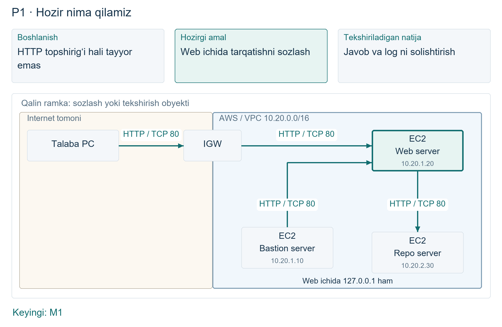
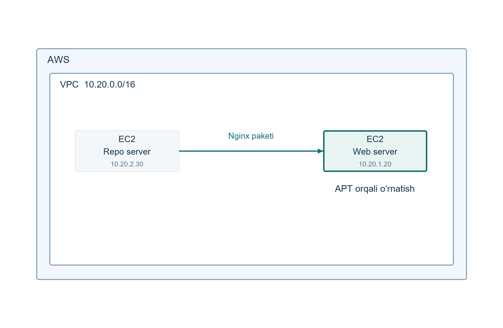
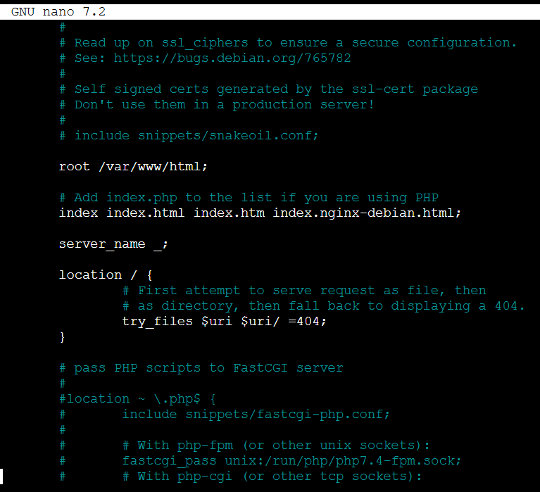
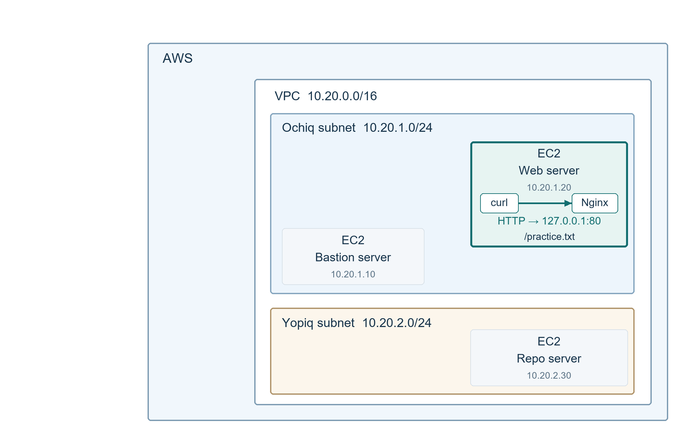
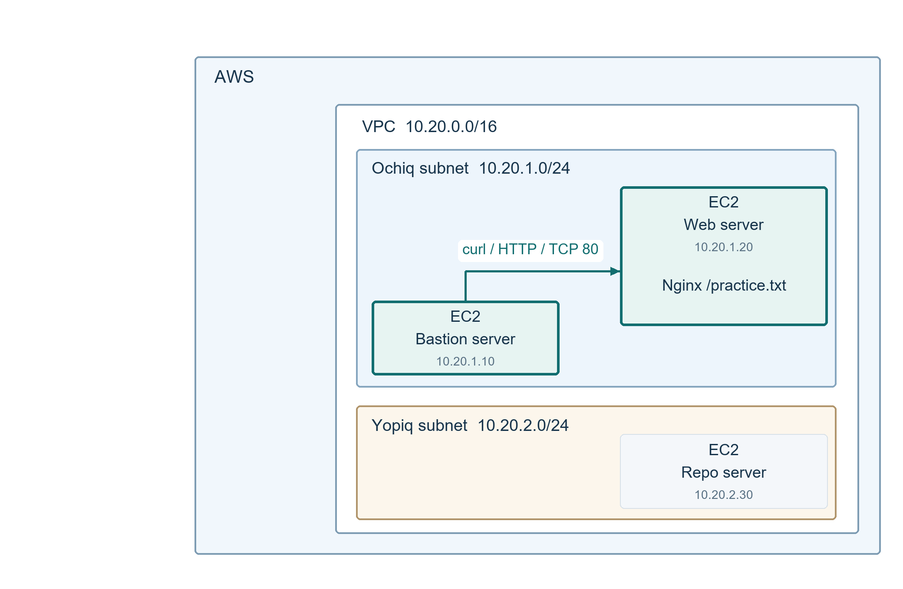

# P1 HTTP orqali statik faylni qaytarish

[Mashqlar P0–P5](practice.md) · [Topshiriqlar M0–M5](missions.md)

[日本語](../ja/p1.md) · [Русский](../ru/p1.md) · [O‘zbekcha](../uz/p1.md)

Mos topshiriq: [M1](m1.md).


## Nimani o‘rganamiz

Nginx, fayl joyi, tinglash porti, HTTP javobi va access log ni bog‘lash.

## Topshiriq

Nginx ni sozlab, `/var/www/jdu-practice/practice.txt` faylini HTTP orqali tarqating.

## Topshiriq diagrammasi



- File: /var/www/jdu-practice/practice.txt
- URL path: /practice.txt

```text
JDU WEB-02 practice: HTTP response verified.
```

**Practice1 da bajariladigan ishlar**

Nginx da HTTP uchun TCP 80 portini oching va `/practice.txt` so‘roviga fayl matnini qaytaring. Web serverning o‘z terminalidan va Bastion terminalidan so‘rov yuboring, so‘ng ularni Nginx access log ida tekshiring.

## Yechim namunasi (bajarish tartibi)

### P1.1 Ichki APT dan Nginx o‘rnatish

**Bajarish muhiti:**

Web serverning SSM terminali: ssm-user

**Maqsad va amallar:**

P0 dagidek Web serverga SSM orqali ulaning. Nginx paketini ichki Repo serveridan (`10.20.2.30`) yuklab olib, Web serverga o‘rnating.



Buyruqlar: raqamlar shu qadam ichidagi tartib

```bash
# 1. Ichki serverdagi paketlar ro‘yxatini yangilash.
sudo apt-get update
# 2. Ichki paket serveridan nginx ni o‘rnatish.
sudo apt-get install nginx
```

**Buyruq va sozlamalar ma’nosi:**

`apt-get update` mavjud paketlar ro‘yxatini yangilaydi. `apt-get install nginx` shu ro‘yxat yordamida Nginx ni o‘rnatadi.

**Kutilgan natija va ma’nosi:**

Ro‘yxat yangilanganda ichki server qatorida `Hit:` yoki `Get:` ko‘rinadi. `N: Ignoring file ... ubuntu.sources.jdu-disabled` xabari APT dastlabki sozlashda o‘chirilgan standart Ubuntu manbasi faylini o‘tkazib yuborganini bildiradi. Yuklash yoki imzo tekshiruvida xato bo‘lmasa, o‘rnatishni davom ettiring. Tasdiq so‘ralsa, `Y` kiriting.

**Ishlamasa:**

Paketlar ro‘yxatini olib bo‘lmasa, ichki paket serverining holati va IP manzilini tekshiring.

### P1.2 Aniq matn yaratish va ruxsatlarni sozlash

**Bajarish muhiti:**

Web serverning SSM terminali: ssm-user

**Maqsad va amallar:**

Matnni ish fayliga yozing, keyin uni Nginx fayllarni tarqatadigan katalogga nusxalang.

Buyruqlar: raqamlar shu qadam ichidagi tartib

```bash
# 1. O‘z uy katalogingizga o‘ting.
cd ~
# 2. Mashq katalogini yaratish; mavjud bo‘lsa saqlash.
mkdir -p jdu-web-practice/p1
# 3. Ish katalogini jdu-web-practice/p1 ga o‘zgartirish.
cd jdu-web-practice/p1
# 4. Joriy ish katalogini ko‘rsatish.
pwd
# 5. Practice.txt ni ochish: matn yozish, saqlash va chiqish.
nano practice.txt
```

**nano oynasiga yoziladigan matn**

```text
JDU WEB-02 practice: HTTP response verified.
```

nano oynasiga yuqoridagi qatorni aynan yozing va oxirida Enter tugmasini bosing. Ctrl+O va Enter orqali saqlang, Ctrl+X orqali chiqing. Terminalga qaytgach, 6-qadamdan davom eting.

Buyruqlar: raqamlar shu qadam ichidagi tartib

```bash
# 6. /var/www/jdu-practice katalogini yaratish.
sudo mkdir -p /var/www/jdu-practice
# 7. Fayllarni /var/www/jdu-practice/practice.txt ga nusxalash.
sudo cp practice.txt /var/www/jdu-practice/practice.txt
# 8. /var/www/jdu-practice/practice.txt egasi va guruhini root:www-data ga o‘zgartirish.
sudo chown root:www-data /var/www/jdu-practice/practice.txt
# 9. /var/www/jdu-practice/practice.txt huquqlarini 0640 ga o‘zgartirish.
sudo chmod 0640 /var/www/jdu-practice/practice.txt
# 10. Ko‘rsatilgan fayl owner, guruh, permission va nomini o‘qish.
stat -c '%U:%G %a %n' /var/www/jdu-practice/practice.txt
# 11. Administrator huquqi bilan /var/www/jdu-practice/practice.txt mazmunini o‘qish.
sudo cat /var/www/jdu-practice/practice.txt
```

**Buyruq va sozlamalar ma’nosi:**

`chown root:www-data` egani root, guruhni www-data qiladi. `chmod 0640` egaga o‘qish/yozish, guruhga o‘qish huquqini beradi; boshqalarga ruxsat yo‘q. Nginx worker process lari www-data sifatida ishlaydi va guruh huquqi bilan faylni o‘qiydi.

**Kutilgan natija va ma’nosi:**

`root:www-data 640 /var/www/jdu-practice/practice.txt` ko‘rinadi. Matn bitta qator: `JDU WEB-02 practice: HTTP response verified.`.

**Ishlamasa:**

Nano hali ochiq bo‘lsa, keyingi buyruqdan oldin faylni saqlab chiqing.

### P1.3 Nginx da tarqatish katalogini sozlash

**Bajarish muhiti:**

Web serverning SSM terminali: ssm-user

**Maqsad va amallar:**

`sudo nano /etc/nginx/sites-available/default` bilan sozlamani oching. Quyidagi blokni `listen 80` mavjud `server { ... }` ichiga, boshqa `location` bloklaridan tashqariga qo‘shing. `/practice.txt` so‘ralganda Nginx yo‘lni root ga qo‘shib, `/var/www/jdu-practice/practice.txt` ni o‘qiydi. Saqlang, sintaksisni tekshiring va sozlamani qayta yuklang.

Buyruqlar: raqamlar shu qadam ichidagi tartib

```bash
# 1. /etc/nginx/sites-available/default faylini nano da tahrirlash.
sudo nano /etc/nginx/sites-available/default
```

**Qo‘shish joyi**



nano da `location / {` ni toping. Ctrl+W orqali `location /` ni qidirish mumkin. `try_files $uri $uri/ =404;` qatorini ham, undan keyingi `}` ni ham o‘chirmang. Bu qavs mavjud `location /` blokini yopadi. Kursorni shu qavs ostidagi bo‘sh qatorga olib, quyidagi uch qatorni qo‘shing. Ularni `try_files` bilan yopuvchi qavs orasiga yozmang.

**nano da yoziladigan sozlama**

```text
location = /practice.txt {
    root /var/www/jdu-practice;
}
```

**Qo‘shilgandan keyingi joylashuv (parcha)**

Mavjud va yangi bloklar quyidagidek yonma-yon turadi. Ikkalasi ham mavjud `server { ... }` ichida bo‘ladi. Butun faylni bu misol bilan almashtirmang: boshqa sozlamalar va yuqoridagi `root /var/www/html;` qatori saqlansin.

```text
location / {
    try_files $uri $uri/ =404;
}

location = /practice.txt {
    root /var/www/jdu-practice;
}
```

`location = /practice.txt` so‘rov yo‘li `/practice.txt` ga aynan mos kelganda ishlaydi. Faqat shu holatda yangi root ishlatiladi va `/var/www/jdu-practice/practice.txt` o‘qiladi.

Sozlamani Ctrl+O, Enter bilan saqlang, Ctrl+X bilan chiqing. Terminalda keyingi buyruqlarni bajaring.

Buyruqlar: raqamlar shu qadam ichidagi tartib

```bash
# 2. Nginx ning to‘liq sozlamasini chiqarib, qanday yozilganini tekshirish.
sudo nginx -T
# 3. Nginx config sintaksisi va fayllarini tekshirish.
sudo nginx -t
# 4. nginx ni hozir yoqish va avtomatik start ni yoqish.
sudo systemctl enable --now nginx
# 5. nginx ni to‘xtatmay sozlamani qayta o‘qish.
sudo systemctl reload nginx
# 6. nginx joriy ish holatini o‘qish.
systemctl is-active nginx
# 7. Nginx TCP 80 portini, masalan 0.0.0.0:80 manzilida tinglayotganini tekshirish.
sudo ss -lntp
```

**Buyruq va sozlamalar ma’nosi:**

Nginx -T config ni ko‘rsatadi; -t sintaksisni tekshiradi. Systemctl enable keyingi boot da ishga tushishni, --now hozir ishga tushishni belgilaydi. Fayl saqlangach reload, service holati va portni tekshiring.

**Kutilgan natija va ma’nosi:**

Sintaksis tekshiruvida `syntax is ok` va `test is successful`, xizmat holatida `active` chiqadi. Nginx TCP 80 portini, masalan `0.0.0.0:80` manzilida tinglayotganini tekshiring.

**Ishlamasa:**

Sintaksis xatosida `nginx -t` ko‘rsatgan fayl va qatorni tuzating.

### P1.4 Web ichidan javobni ko‘rish

**Bajarish muhiti:**

Web serverning SSM terminali: ssm-user

**Maqsad va amallar:**

Web server terminalida `curl` bilan HTTP so‘rov yuboring. `127.0.0.1` buyruq bajarilayotgan Web serverning o‘zini bildiradi.



Buyruqlar: raqamlar shu qadam ichidagi tartib

```bash
# 1. http://127.0.0.1/practice.txt manziliga HTTP so‘rov yuborish.
curl -i http://127.0.0.1/practice.txt
```

**Buyruq va sozlamalar ma’nosi:**

`127.0.0.1` - loopback manzili. So‘rov shu Web server ichidagi Nginx ga yetib boradi.

**Kutilgan natija va ma’nosi:**

HTTP 200 va practice.txt ichidagi `JDU WEB-02 practice: HTTP response verified.` qatori chiqadi.

**Ishlamasa:**

«Welcome to nginx» chiqsa, curl buyrug‘ida `/practice.txt` ko‘rsatilganini tekshiring. `http://127.0.0.1/` manzili Nginx bosh sahifasini qaytarishi mumkin.

### P1.5 Ayni faylni Bastion serveridan tekshirish

**Bajarish muhiti:**

Bastionning SSM terminali: ssm-user

**Maqsad va amallar:**

Bastion serverga SSM orqali ulaning va `curl` bilan Web serverga HTTP so‘rov yuboring. Ichki tarmoqdan Web serverning ichki IP manzili `10.20.1.20` ni kiriting.



Buyruqlar: raqamlar shu qadam ichidagi tartib

```bash
# 1. http://10.20.1.20/practice.txt manziliga HTTP so‘rov yuborish.
curl -i http://10.20.1.20/practice.txt
```

**Buyruq va sozlamalar ma’nosi:**

Manzil Web serverning ichki IP siga o‘zgaradi. Fayl yo‘li P1.4 dagidek `/practice.txt` bo‘lib qoladi.

**Kutilgan natija va ma’nosi:**

HTTP 200 va `JDU WEB-02 practice: HTTP response verified.` qatori chiqadi.

### P1.6 So‘rovni log bilan bog‘lash va yuborish

**Bajarish muhiti:**

Web serverning SSM terminali: ssm-user

**Maqsad va amallar:**

Web ga qayting. Access log da vaqt, client IP, path va statusni ko‘ring. Bu fayl borligidan tashqari so‘rov ishlanganining dalilidir. Exit bilan CloudShell ga qaytgach, PC dagi Web Portal da P1 ni tekshiring.

Buyruqlar: raqamlar shu qadam ichidagi tartib

```bash
# 1. Access log oxirgi 20 qatoridan oldingi HTTP so‘rovini topish.
sudo tail -n 20 /var/log/nginx/access.log
# 2. Joriy server session ini yopib CloudShell ga qaytish.
exit
```

**Buyruq va sozlamalar ma’nosi:**

Access log dagi vaqt, path va status ni oldingi curl bilan solishtiring. Tail oxirgi qatorlarni o‘qiydi, log ni o‘zgartirmaydi. Exit dan keyin PC brauzerida P1 ni tekshiring.

**Kutilgan natija va ma’nosi:**

Ekranda sakkizta tekshiruv natijasi va bajarilgan mezonlar soni ko‘rinadi. Tizim ochiq IP orqali HTTP ulanishini avtomatik tekshiradi.

**Ishlamasa:**

Ishlov davom etsa natijani yangilang. Saqlash xatosida sababni o‘qing. Checker kutgan matnni o‘zgartirmang.

## Natijani o‘qish namunasi (kiritmang)

```text
HTTP/1.1 200 OK

JDU WEB-02 practice: HTTP response verified.
```

Faqat kerakli qatorlar ko‘rsatilgan; haqiqiy javobda boshqa header lar ham bor. 200, matn va access log dagi path/status ni tekshiring.

## Tushunishni tekshirish (ballsiz)

Web ichida 200, bastiondan ulanish ishlamaydi. Faylni qayta yozishdan oldin nimani tekshirasiz?

**Izoh:**

Manzil IP, listen address/port va bastion → Web ruxsatini tekshiring. Fayl mazmuni va yetib borish alohida tekshiruvdir.

---

[Oldingi: M0](m0.md) · [Keyingi: M1](m1.md)
