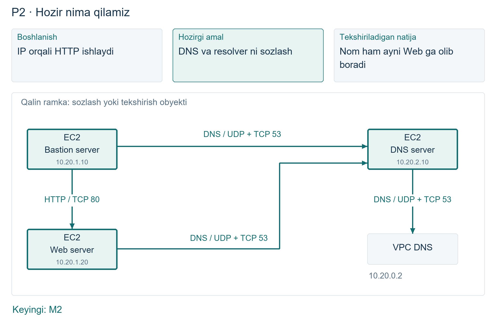

# P2 Ichki DNS va odatiy nom yechimi

[Mashqlar P0–P5](practice.md) · [Topshiriqlar M0–M5](missions.md)

[日本語](../ja/p2.md) · [Русский](../ru/p2.md) · [O‘zbekcha](../uz/p2.md)

Mos topshiriq: [M2](m2.md).


**Practice2 da bajariladigan ishlar**

Ichki DNS ga Web va DB nomlarini yozing. Bastion va Web ni shu DNS ga sozlab, P1 faylini nom bilan oching.

## Topshiriq diagrammasi



## Yechim namunasi (bajarish tartibi)

### P2.1 Paketlar serveridan BIND o‘rnatish

**Bajarish muhiti:**

DNS serverning SSM terminali: ssm-user

DNS serverda paketlar ro‘yxatini yangilang va BIND hamda tekshiruv vositalarini o‘rnating. Tahrirdan oldin ikkita faylni nusxalang.

Buyruqlar: raqamlar shu qadam ichidagi tartib

```bash
# 1. Ichki serverdagi paketlar ro‘yxatini yangilash.
sudo apt-get update
# 2. Paketlar serveridan bind9 bind9-utils va kerakli bog‘liqliklarni o‘rnatish.
sudo apt-get install bind9 bind9-utils
# 3. Asl fayldan nusxa olish; mavjud nusxani ustidan yozmaslik.
sudo cp -an /etc/bind/named.conf.options /etc/bind/named.conf.options.before-p2
# 4. Asl fayldan nusxa olish; mavjud nusxani ustidan yozmaslik.
sudo cp -an /etc/bind/named.conf.local /etc/bind/named.conf.local.before-p2
```

**Kutilgan natija va ma’nosi:**

`bind9` va `bind9-utils` o‘rnatiladi va ikkita `.before-p2` nusxasi yaratiladi.

### P2.2 DNS so‘rovini yubora oladigan serverlarni belgilash

**Bajarish muhiti:**

DNS serverning SSM terminali: ssm-user

DNS serverning o‘zi, Bastion va Web serverlariga ruxsat bering. Mashq zonasidan tashqaridagi nomlar AWS DNS ga (`10.20.0.2`) yuboriladi.

Fayl tarkibini quyidagi sozlama bilan almashtiring. nano da Ctrl+W qidiradi, Ctrl+O va Enter saqlaydi, Ctrl+X chiqadi.

```bash
sudo nano /etc/bind/named.conf.options
```

**nano da kiritiladigan matn**

```text
acl "jdu_clients" { 127.0.0.1; 10.20.1.10; 10.20.1.20; };
options {
    directory "/var/cache/bind";
    listen-on { 127.0.0.1; 10.20.2.10; };
    listen-on-v6 { none; };
    allow-query { jdu_clients; };
    allow-recursion { jdu_clients; };
    allow-query-cache { jdu_clients; };
    recursion yes;
    forward only;
    forwarders { 10.20.0.2; };
    dnssec-validation no;
    allow-transfer { none; };
};
```

**Kutilgan natija va ma’nosi:**

`listen-on` da DNS serverning ichki IP manzili `10.20.2.10`, `forwarders` da AWS DNS `10.20.0.2` turadi.

### P2.3 Nom va IPv4 manzillarini yozish

**Bajarish muhiti:**

DNS serverning SSM terminali: ssm-user

`named.conf.local` da BIND ga `lab.test` zona fayli yo‘lini ko‘rsating. `db.lab.test` da nomni IPv4 manzili bilan bog‘lovchi A yozuvlarini yozing.

`named.conf.local` oxiriga blokni qo‘shing. `lab.test` bloki mavjud bo‘lsa uni tahrirlang.

```bash
sudo nano /etc/bind/named.conf.local
```

**nano da kiritiladigan matn**

```text
zone "lab.test" {
    type primary;
    file "/etc/bind/zones/db.lab.test";
    allow-transfer { none; };
    allow-update { none; };
};
```

`/etc/bind/zones/db.lab.test` faylini nano da ochib, quyidagi sozlamani kiriting va saqlang.

```bash
sudo mkdir -p /etc/bind/zones
sudo chmod 0755 /etc/bind/zones
sudo nano /etc/bind/zones/db.lab.test
```

**nano da kiritiladigan matn**

```text
$TTL 300
@ IN SOA dns.lab.test. hostmaster.lab.test. (
    2026102301 3600 600 604800 300 )
@ IN NS dns.lab.test.
dns IN A 10.20.2.10
guide IN A 10.20.1.20
practice-db IN A 10.20.2.20
```

**Kutilgan natija va ma’nosi:**

`guide.lab.test` Web serverning `10.20.1.20`, `practice-db.lab.test` DB serverning `10.20.2.20` manziliga mos keladi.

**Ishlamasa:**

Zona fayli mavjud bo‘lsa, mavjud nomlarni qoldirib ikkita mashq yozuvini qo‘shing. Yozuvlar o‘zgarganda SOA seriya raqamini oshiring.

### P2.4 BIND ni ishga tushirib DNS serverning o‘zidan so‘rash

**Bajarish muhiti:**

DNS serverning SSM terminali: ssm-user

Sozlama va zona faylini tekshirib BIND ni ishga tushiring. `dig` DNS so‘rovini yuborib javobni ko‘rsatadi. `127.0.0.1` DNS serverning o‘zini bildiradi.

Buyruqlar: raqamlar shu qadam ichidagi tartib

```bash
# 1. BIND config va ulangan zone sintaksisini tekshirish.
sudo named-checkconf -z
# 2. Lab.test zone faylini tekshirish.
sudo named-checkzone lab.test /etc/bind/zones/db.lab.test
# 3. OS yuklanganda named avtomatik ishga tushishini yoqish.
sudo systemctl enable named
# 4. named ni yangi sozlama bilan qayta ishga tushirish.
sudo systemctl restart named
# 5. UDP 53 orqali guide.lab.test ni so‘rab javobini o‘qish.
dig @127.0.0.1 guide.lab.test A
# 6. TCP 53 orqali guide.lab.test ni so‘rab javobini o‘qish.
dig @127.0.0.1 guide.lab.test A +tcp
```

**Kutilgan natija va ma’nosi:**

Zona tekshiruvida `OK` chiqadi. UDP va TCP uchun `NOERROR` hamda `guide.lab.test` uchun `10.20.1.20` qaytadi.

**Ishlamasa:**

Xatoda sudo journalctl -u named -n 30 --no-pager ni o‘qing, sozlamani tuzatib yana tekshiring.

### P2.5 BIND ni Bastion va Web serveridan tekshirish

**Bajarish muhiti:**

Bastion va Web serverlarining SSM terminallari

Buyruqlarni ikkala serverda bajaring. `dig` dagi `@10.20.2.10` faqat shu so‘rov uchun DNS serverni tanlaydi. `AXFR` zona yozuvlarini to‘liq ko‘chirishni so‘raydi. Unga ruxsat berilmaganini tekshiring.

Buyruqlar: raqamlar shu qadam ichidagi tartib

```bash
# 1. UDP 53 orqali guide.lab.test ni so‘rab javobini o‘qish.
dig @10.20.2.10 guide.lab.test A
# 2. TCP 53 orqali practice-db.lab.test ni so‘rab javobini o‘qish.
dig @10.20.2.10 practice-db.lab.test A +tcp
# 3. UDP 53 orqali absent-p2.lab.test ni so‘rab javobini o‘qish.
dig @10.20.2.10 absent-p2.lab.test A
# 4. UDP 53 orqali aws.amazon.com ni so‘rab javobini o‘qish.
dig @10.20.2.10 aws.amazon.com A
# 5. Butun zone uchun AXFR so‘rab aniq rad etilishini tekshirish.
dig @10.20.2.10 lab.test AXFR
```

**Kutilgan natija va ma’nosi:**

`guide.lab.test` uchun `10.20.1.20`, `practice-db.lab.test` uchun `10.20.2.20` chiqadi. Ro‘yxatda yo‘q nom uchun `NXDOMAIN`, `aws.amazon.com` uchun IP qaytadi, zona uzatish rad etiladi.

### P2.6 Ubuntu OS odatda ishlatadigan DNS ni sozlash

**Bajarish muhiti:**

Bastion va Web serverlarining SSM terminallari

Bastion va Web serverlarini bittadan sozlang. Brauzer va ilovalar nomni qidirganda Ubuntu ishlatadigan DNS sifatida Netplan da `10.20.2.10` ni belgilang.

Avval tarmoq interfeysi nomini va Netplan fayli nomini toping.

```bash
ip -br link
ls /etc/netplan
```

`ens5` va `YOUR-NETPLAN-FILE.yaml` o‘rniga haqiqiy nomlarni yozing. `networkctl status` dagi `Network File` kerakli Netplan faylini topishga yordam beradi.

```bash
networkctl status ens5
```

Quyida mavjud faylni tahrirlash namunasi. O‘z interfeysingiz bo‘limida `dhcp4-overrides` va `nameservers` ni qo‘shing yoki tuzating. Interfeys nomi va boshqa sozlamalarni saqlang.

```bash
sudo cp -an /etc/netplan/YOUR-NETPLAN-FILE.yaml /etc/netplan/YOUR-NETPLAN-FILE.yaml.before-p2
sudo nano /etc/netplan/YOUR-NETPLAN-FILE.yaml
```

**nano da kiritiladigan matn**

```text
network:
  version: 2
  ethernets:
    ens5:
      dhcp4: true
      dhcp4-overrides:
        use-dns: false
      nameservers:
        addresses: [10.20.2.10]
```

**Kutilgan natija va ma’nosi:**

IP manzilni DHCP orqali olishni saqlang. Faqat DNS ni avtomatik olishni o‘chiring va YAML chekinishlarini tekislang.

**Ishlamasa:**

Bir interface bir necha YAML da bo‘lsa, qiymatlar birlashadi. resolvectl dns da AWS DNS qolsa, tegishli barcha YAML va amaldagi sozlamani tekshiring.

### P2.7 DNS sozlamasini qo‘llab sahifani nomi bilan ochish

**Bajarish muhiti:**

Bastion va Web serverlarining SSM terminallari

Netplan sozlamasini qo‘llang. `resolvectl dns` da DNS serverni, `getent` orqali Ubuntu nomni qanday yechishini tekshiring. So‘ng P1 faylini nom bilan oling.

Buyruqlar: raqamlar shu qadam ichidagi tartib

```bash
# 1. Netplan YAML dan config yaratib, qo‘llashdan oldin sintaksisni tekshirish.
sudo netplan generate
# 2. Saqlangan netplan sozlamasini tarmoqqa qo‘llash.
sudo netplan apply
# 3. systemd-resolved ni yangi sozlama bilan qayta ishga tushirish.
sudo systemctl restart systemd-resolved
# 4. Odatiy resolver ishlatadigan DNS serverlarni ko‘rsatish.
resolvectl dns
# 5. Odatiy resolver orqali guide.lab.test IPv4 sini olish.
getent ahostsv4 guide.lab.test
# 6. Odatiy resolver orqali practice-db.lab.test IPv4 sini olish.
getent ahostsv4 practice-db.lab.test
# 7. http://guide.lab.test/practice.txt manziliga HTTP so‘rov yuborish.
curl -i http://guide.lab.test/practice.txt
```

**Kutilgan natija va ma’nosi:**

`resolvectl dns` da `10.20.2.10` chiqadi. Nomlar `10.20.1.20` va `10.20.2.20` ga yechiladi. HTTP `200` va `JDU WEB-02 practice: HTTP response verified.` qaytadi.

**Ishlamasa:**

dig o‘tib getent o‘tmasa, client resolver ini tekshiring. Firefox dagi DoH o‘chirilgan sozlamani saqlang.

### P2.8 Sahifani Bastion brauzerida tekshirish

**Bajarish muhiti:**

RDP orqali bastiondagi Firefox

P0 dagidek Bastion serveriga RDP orqali ulaning. Uning Firefox brauzerida `http://10.20.1.20/practice.txt`, keyin `http://guide.lab.test/practice.txt` ni oching. O‘z kompyuteringizdagi baholash sahifasida P2 ni tekshiring.

**Kutilgan natija va ma’nosi:**

Ikkala URL da `JDU WEB-02 practice: HTTP response verified.` ko‘rinadi. Baholash sahifasida P2 ning 13 mezoni chiqadi.

## Natijani o‘qish namunasi (kiritmang)

```text
status: NOERROR
guide.lab.test.  300  IN  A  10.20.1.20
```

Dig ning qisqa namunasi: A dan keyin IPv4, 300 esa TTL. So‘rov SERVER i 10.20.2.10 ekanini alohida tekshiring.

---

[Oldingi: M1](m1.md) · [Keyingi: M2](m2.md)
