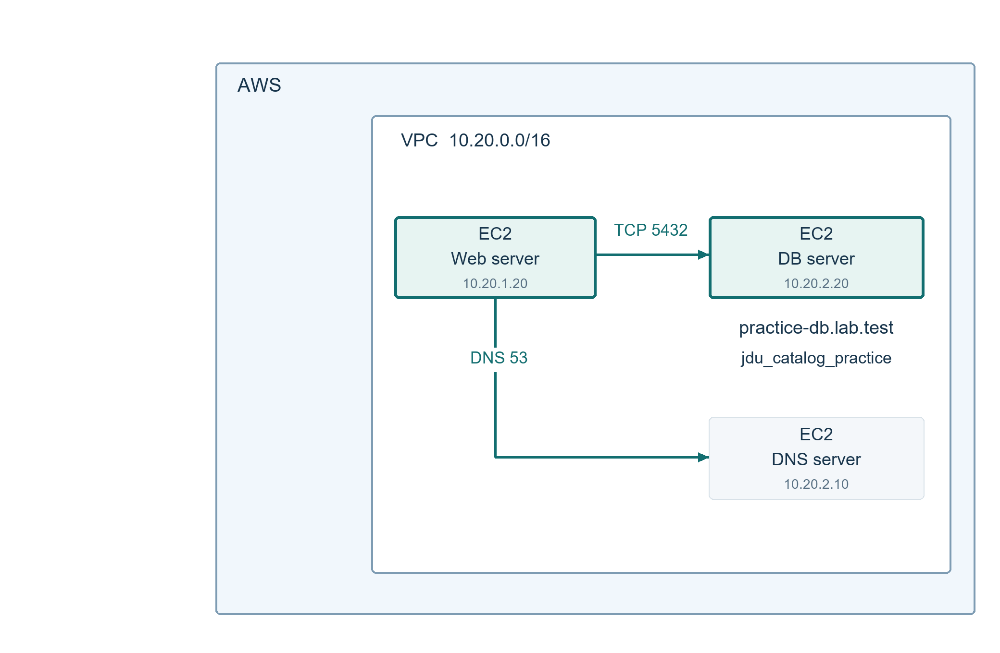

# P3 PostgreSQL ga autentifikatsiya bilan ulanish

[Mashqlar P0–P5](practice.md) · [Topshiriqlar M0–M5](missions.md)

[日本語](../ja/p3.md) · [Русский](../ru/p3.md) · [O‘zbekcha](../uz/p3.md)

Mos topshiriq: [M3](m3.md).


**Practice3 da bajariladigan ishlar**

DB serverda PostgreSQL ni sozlab, Web serverdan mashq DB siga parol bilan ulaning.

## Topshiriq diagrammasi



## Yechim namunasi (bajarish tartibi)

### P3.1 Paketlar serveridan PostgreSQL o‘rnatish

**Bajarish muhiti:**

DB serverning SSM terminali: ssm-user

DB serverda PostgreSQL 16 ni o‘rnating. Keyingi qadamlar uchun SQL fayllarini arxivdan chiqaring.

Buyruqlar: raqamlar shu qadam ichidagi tartib

```bash
# 1. Ichki serverdagi paketlar ro‘yxatini yangilash.
sudo apt-get update
# 2. Paketlar serveridan postgresql-16 postgresql-client-16 va kerakli bog‘liqliklarni o‘rnatish.
sudo apt-get install --no-install-recommends postgresql-16 postgresql-client-16
# 3. Belgilangan hash ni tekshirib o‘qituvchi app/SQL resurslarini ochish.
sudo python3 -B /var/lib/jdu-web/lesson-resources-r1/offline_assets.py
# 4. PostgreSQL version, cluster, port va holatini o‘qish.
pg_lsclusters
# 5. Postgres sifatida DB sozlamasini o‘qish: SHOW data_directory;
sudo -u postgres psql -X -d postgres -c "SHOW data_directory;"
```

**Kutilgan natija va ma’nosi:**

`pg_lsclusters` da `16` versiya va `main` klasteri chiqadi. Ma’lumot katalogi `/var/lib/postgresql/16/main`.

### P3.2 PostgreSQL manzili va portini sozlash

**Bajarish muhiti:**

DB serverning SSM terminali: ssm-user

`postgresql.conf` da DB serverning ichki IP manzili `10.20.2.20` va 5432-portni belgilang. Parollar uchun SCRAM-SHA-256 ni tanlang.

Kerakli parametrlarni topib, quyidagi qiymatlarni yozing. Qator boshidagi `#` bo‘lsa, olib tashlang.

```bash
sudo cp -an /etc/postgresql/16/main/postgresql.conf /etc/postgresql/16/main/postgresql.conf.before-p4
sudo nano /etc/postgresql/16/main/postgresql.conf
```

**nano da kiritiladigan matn**

```text
listen_addresses = '10.20.2.20'
port = 5432
password_encryption = 'scram-sha-256'
```

**Kutilgan natija va ma’nosi:**

Uchta parametrni bitta faylga saqlang. Qayta ishga tushirish kirish sozlangach P3.4 da bajariladi.

### P3.3 Web serveridan DB ulanishiga ruxsat berish

**Bajarish muhiti:**

DB serverning SSM terminali: ssm-user

`pg_hba.conf` da manba, DB va rollarni belgilang. Web serverning `10.20.1.20` ichki manzilidan mashq va topshiriq uchun ko‘rsatilgan DB va rol juftliklariga ruxsat bering.

Ulanish qoidalarini quyidagilar bilan almashtirib, faylni saqlang.

```bash
sudo cp -an /etc/postgresql/16/main/pg_hba.conf /etc/postgresql/16/main/pg_hba.conf.before-p4
sudo nano /etc/postgresql/16/main/pg_hba.conf
```

**nano da kiritiladigan matn**

```text
local all postgres peer
local all all reject
host jdu_catalog_practice catalog_practice_setup 10.20.1.20/32 scram-sha-256
host jdu_catalog_practice catalog_practice_app 10.20.1.20/32 scram-sha-256
host jdu_catalog catalog_setup 10.20.1.20/32 scram-sha-256
host jdu_catalog catalog_app 10.20.1.20/32 scram-sha-256
host all all 0.0.0.0/0 reject
host all all ::/0 reject
```

**Kutilgan natija va ma’nosi:**

PostgreSQL yuqoridan birinchi mos qatorni ishlatadi. Avval ruxsat qatorlari, oxirida qolgan ulanishlar uchun `reject` turadi.

### P3.4 PostgreSQL ni qayta ishga tushirib sozlamani tekshirish

**Bajarish muhiti:**

DB serverning SSM terminali: ssm-user

Saqlangan parametr va kirish qoidalarini qo‘llash uchun PostgreSQL ni qayta ishga tushiring.

Buyruqlar: raqamlar shu qadam ichidagi tartib

```bash
# 1. postgresql@16-main ni yangi sozlama bilan qayta ishga tushirish.
sudo systemctl restart postgresql@16-main
# 2. postgresql@16-main joriy ish holatini o‘qish.
systemctl is-active postgresql@16-main
# 3. PostgreSQL 10.20.2.20:5432 da tinglayotganini tekshirish.
sudo ss -lntp
# 4. Postgres sifatida DB sozlamasini o‘qish: SHOW password_encryption;
sudo -u postgres psql -X -d postgres -c "SHOW password_encryption;"
# 5. HBA xato qatorlarini topish; to‘g‘ri bo‘lsa 0 qator.
sudo -u postgres psql -X -d postgres -c \
  "SELECT line_number,error FROM pg_hba_file_rules WHERE error IS NOT NULL;"
```

**Kutilgan natija va ma’nosi:**

Xizmat `active`, manzil va port `10.20.2.20:5432`, parol saqlash usuli `scram-sha-256`, kirish xatolari `(0 rows)`.

### P3.5 Mashq DB va ikkita rolini yaratish

**Bajarish muhiti:**

DB serverning SSM terminali: ssm-user

Tayyor SQL `jdu_catalog_practice` DB sini yaratadi. `catalog_practice_setup` jadval tayyorlashga, `catalog_practice_app` odatiy ishlashga xizmat qiladi. Avval SQL ni ko‘ring, so‘ng `psql` orqali bajaring.

Buyruqlar: raqamlar shu qadam ichidagi tartib

```bash
# 1. Ish katalogini /var/lib/jdu-web/lesson-resources-r1/app ga o‘zgartirish.
cd /var/lib/jdu-web/lesson-resources-r1/app
# 2. Mashq DB role yaratish SQL i ni ko‘rsatish; hali qo‘llamaslik.
python3 -B profile_sql.py --profile practice 01_create_roles.sql
# 3. Mashq DB role yaratish SQL i ni yaratib postgres orqali kerakli DB ga qo‘llash.
python3 -B profile_sql.py --profile practice 01_create_roles.sql | sudo -u postgres \
  psql -X -v ON_ERROR_STOP=1 -d postgres
# 4. Mashq DB va schema yaratish SQL i ni yaratib postgres orqali kerakli DB ga qo‘llash.
python3 -B profile_sql.py --profile practice 02_prepare_schema.sql | sudo -u postgres \
  psql -X -v ON_ERROR_STOP=1 -d jdu_catalog_practice
```

**Kutilgan natija va ma’nosi:**

`CREATE ROLE` ikki marta, `CREATE DATABASE` bir marta chiqadi.

**Ishlamasa:**

already exists oldin bajarilganini anglatishi mumkin. DROP qilmang; \du va \l orqali solishtiring. Pipe o‘ngidagi psql SQL error bermaganini tekshiring.

### P3.6 Har bir DB roliga parol belgilash

**Bajarish muhiti:**

DB serverning SSM terminali: ssm-user

DB serverda `psql` ni oching. `\password` ni bittadan bajaring va har rol uchun tanlagan parolni ikki marta kiriting. Belgilar ko‘rinmaydi. Ikkala parol P4 da ham kerak. Kamida 16 belgili turli parollarni tanlang.

Buyruqlar: raqamlar shu qadam ichidagi tartib

```bash
# 1. DB OS terminalida postgres sifatida psql ochish; keyingi amallar psql ichida.
sudo -u postgres psql -X -d postgres
```

Bundan keyin psql ichida kiriting

```sql
-- 2. Psql ichida catalog_practice_setup parolini yashirin kiritish.
\password catalog_practice_setup
-- 3. Psql ichida catalog_practice_app parolini yashirin kiritish.
\password catalog_practice_app
-- 4. Psql ichida mashq DB role atribut va huquqlarini tekshirish.
\du catalog_practice_*
-- 5. Psql dan chiqib ayni DB server OS terminaliga qaytish.
\q
```

**Kutilgan natija va ma’nosi:**

`\du` chiqishida `catalog_practice_setup` va `catalog_practice_app` ko‘rinadi.

### P3.7 Web serveridan mashq DB ga ulanish

**Bajarish muhiti:**

Web serverning SSM terminali: ssm-user

P0 dagidek Web server uchun Session Manager ni oching. `psql` da avval DB ichki IP manzilini, keyin P2 dagi `practice-db.lab.test` nomini kiriting. Har ikki ulanishda P3.6 dagi `catalog_practice_app` parolini ishlating.

Buyruqlar: raqamlar shu qadam ichidagi tartib

```bash
# 1. Paketlar serveridan postgresql-client-16 va kerakli bog‘liqliklarni o‘rnatish.
sudo apt-get install --no-install-recommends postgresql-client-16
# 2. Web dan kerakli DB ga mavjud parol bilan ulanib SELECT natijasini o‘qish.
psql -X -h 10.20.2.20 -U catalog_practice_app -d jdu_catalog_practice -W -c \
  'SELECT current_database(),current_user,1 AS value;'
# 3. Odatiy resolver orqali practice-db.lab.test IPv4 sini olish.
getent ahostsv4 practice-db.lab.test
# 4. Web dan kerakli DB ga mavjud parol bilan ulanib SELECT natijasini o‘qish.
psql -X -h practice-db.lab.test -U catalog_practice_app -d jdu_catalog_practice -W -c \
  'SELECT current_database(),current_user,1 AS value;'
```

**Kutilgan natija va ma’nosi:**

Ikkala ulanishda `jdu_catalog_practice` DB si, `catalog_practice_app` roli va `1` qiymati chiqadi.

**Ishlamasa:**

IP orqali ulanish ishlasa, nom orqali esa ishlamasa, P2 dagi tizim DNS i va mashq DB nomini tekshiring. Autentifikatsiya rad etilsa, manba, DB, rol va parolni tekshiring. Sinash uchun DB ni Internet ga ochmang.

### P3.8 Baholash uchun DB parolini Web serverda saqlash

**Bajarish muhiti:**

Web serverning SSM terminali: ssm-user

Buyruqni bajarib `catalog_practice_app` parolini ikki marta kiriting. Kiritish yashirin, parol ulanishni tekshirish uchun Web serverdagi himoyalangan faylga yoziladi. O‘z kompyuteringizdagi baholash sahifasida P3 ni tekshiring.

Buyruqlar: raqamlar shu qadam ichidagi tartib

```bash
# 1. Mavjud mashq DB parolini yashirin kiritib, faqat Web da saqlash.
sudo python3 -B /var/lib/jdu-web/lesson-resources-r1/database_secret.py --profile \
  practice
```

**Kutilgan natija va ma’nosi:**

Terminalda `D11_EXISTING_DB_PASSWORD_STORED_LOCALLY` chiqadi. Baholash sahifasida P3 ning to‘qqiz mezoni ko‘rinadi.

**Ishlamasa:**

Fayl mavjud bo‘lsa qayta yaratmang. P4 da ayni DB paroli app sozlamasiga kiritiladi. M3 alohida mission DB/rollaridan foydalanadi.

## Natijani o‘qish namunasi (kiritmang)

```text
current_database    | current_user         | value
jdu_catalog_practice | catalog_practice_app | 1
```

SELECT natijasini o‘qish namunasi; ustun kengligi boshqacha bo‘lishi mumkin. DB, role va value=1 ni tekshiring. Bu table o‘zgartirish huquqini isbotlamaydi.

---

[Oldingi: M2](m2.md) · [Keyingi: M3](m3.md)
