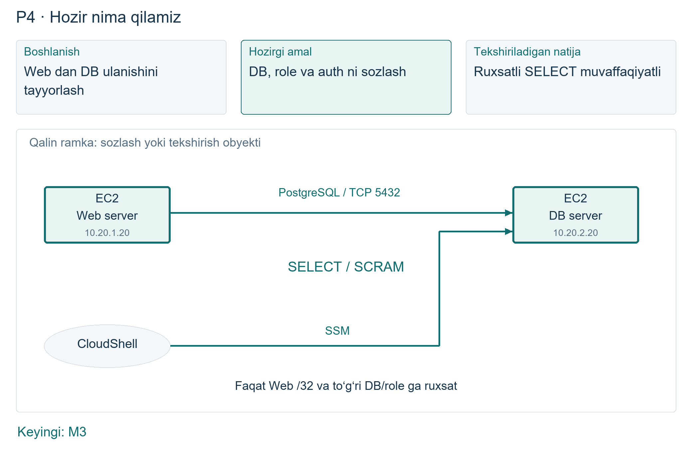

# P4 Berilgan app ni Web va DB bilan bog‘lash

[Mashqlar P0–P5](practice.md) · [Topshiriqlar M0–M5](missions.md)

[日本語](../ja/p4.md) · [Русский](../ru/p4.md) · [O‘zbekcha](../uz/p4.md)

Mos topshiriq: [M4](m4.md).


**Practice4 da bajariladigan ishlar**

Web serverda jihozlar ilovasini ishga tushirib DB ga ulang. Ochiq ro‘yxat va Bastiondan boshqaruvni sozlang.

## Topshiriq diagrammasi



## Yechim namunasi (bajarish tartibi)

### P4.1 DNS ni tekshirish va Python paketlarini tayyorlash

**Bajarish muhiti:**

Web serverning SSM terminali: ssm-user

Avval Web serverdan DB va boshqaruv sahifasi nomlarini yeching. So‘ng paketlar serveridan Python vositalarini o‘rnating, ilova va Python paketlarini oching.

Buyruqlar: raqamlar shu qadam ichidagi tartib

```bash
# 1. Odatiy resolver orqali db.lab.test IPv4 sini olish.
getent ahostsv4 db.lab.test
# 2. Odatiy resolver orqali admin.lab.test IPv4 sini olish.
getent ahostsv4 admin.lab.test
# 3. Paketlar serveridan python3-venv python3-pip va kerakli bog‘liqliklarni o‘rnatish.
sudo apt-get install --no-install-recommends python3-venv python3-pip
# 4. Imzo/hash ni tekshirib app va belgilangan wheel larni tayyorlash.
sudo python3 -B /var/lib/jdu-web/lesson-resources-r1/offline_assets.py --wheels
# 5. /var/lib/jdu-web/lesson-resources-r1/app dagi serverlarni sozlash fayllarini ro‘yxatlash.
ls /var/lib/jdu-web/lesson-resources-r1/app
# 6. /var/lib/jdu-web/lesson-resources-r1/wheels dagi serverlarni sozlash fayllarini ro‘yxatlash.
ls /var/lib/jdu-web/lesson-resources-r1/wheels
```

**Kutilgan natija va ma’nosi:**

`db.lab.test` uchun `10.20.2.20`, `admin.lab.test` uchun `10.20.1.20` chiqadi. Terminalda `PUBLIC_APP_RESOURCES_VERIFIED` va `SIGNED_OFFLINE_WHEELS_READY=7` ko‘rinadi.

### P4.2 Ilovani joylab unga alohida Python muhiti yaratish

**Bajarish muhiti:**

Web serverning SSM terminali: ssm-user

Fayllarni `/opt/jdu-catalog/app` ga nusxalang. `venv` orqali ilova muhitini yaratib, tayyor paketlarni o‘rnating. `pip` tashqi saytga murojaat qilmasdan fayllar xeshlarini tekshiradi.

Buyruqlar: raqamlar shu qadam ichidagi tartib

```bash
# 1. /opt/jdu-catalog/app katalogini yaratish.
sudo mkdir -p /opt/jdu-catalog/app
# 2. /opt/jdu-catalog/app egasi va guruhini root:root ga o‘zgartirish.
sudo chown root:root /opt/jdu-catalog/app
# 3. /opt/jdu-catalog/app huquqlarini 0755 ga o‘zgartirish.
sudo chmod 0755 /opt/jdu-catalog/app
# 4. Fayllarni /opt/jdu-catalog/app/ ga nusxalash.
sudo cp -a /var/lib/jdu-web/lesson-resources-r1/app/. /opt/jdu-catalog/app/
# 5. App uchun alohida Python venv yaratish.
sudo python3 -m venv /opt/jdu-catalog/venv
# 6. Python bog‘liqliklarini faqat ichki wheel va lock/hash bilan o‘rnatish.
sudo /opt/jdu-catalog/venv/bin/python -m pip --isolated --no-cache-dir install \
  --no-index --find-links=/var/lib/jdu-web/lesson-resources-r1/wheels \
  --only-binary=:all: --require-hashes -r \
  /var/lib/jdu-web/lesson-resources-r1/requirements.lock
# 7. O‘rnatilgan Python bog‘liqliklari mosligini tekshirish.
sudo /opt/jdu-catalog/venv/bin/python -m pip check
```

**Kutilgan natija va ma’nosi:**

Oxirgi `pip check` natijasida `No broken requirements found.` chiqadi.

### P4.3 Ilovani ishga tushiradigan OS foydalanuvchisini yaratish

**Bajarish muhiti:**

Web serverning SSM terminali: ssm-user

Web serverda ilovani ishlatuvchi `catalog` OS foydalanuvchisini yarating. CSS va boshqa fayllar katalogini yaratib, `catalog` ga yozish huquqini bering.

Buyruqlar: raqamlar shu qadam ichidagi tartib

```bash
# 1. App uchun login shell va home siz catalog tizim user ini yaratish.
sudo useradd --system --user-group --home-dir /nonexistent --no-create-home --shell \
  /usr/sbin/nologin catalog
# 2. /var/lib/jdu-catalog katalogini yaratish.
sudo mkdir -p /var/lib/jdu-catalog
# 3. /var/lib/jdu-catalog egasi va guruhini root:root ga o‘zgartirish.
sudo chown root:root /var/lib/jdu-catalog
# 4. /var/lib/jdu-catalog huquqlarini 0755 ga o‘zgartirish.
sudo chmod 0755 /var/lib/jdu-catalog
# 5. /var/lib/jdu-catalog/static katalogini yaratish.
sudo mkdir -p /var/lib/jdu-catalog/static
# 6. /var/lib/jdu-catalog/static egasi va guruhini catalog:catalog ga o‘zgartirish.
sudo chown catalog:catalog /var/lib/jdu-catalog/static
# 7. /var/lib/jdu-catalog/static huquqlarini 0755 ga o‘zgartirish.
sudo chmod 0755 /var/lib/jdu-catalog/static
# 8. Catalog user UID, GID va guruhlarini tekshirish.
id catalog
# 9. Catalog user home va login shell ini tekshirish.
getent passwd catalog
```

**Kutilgan natija va ma’nosi:**

Natijada `catalog` foydalanuvchisi va `/usr/sbin/nologin` ko‘rinadi. `/var/lib/jdu-catalog/static` egasi va guruhi `catalog`.

**Ishlamasa:**

Ruxsat xatosini chmod -R 777 yoki catalog ga sudo berish bilan hal qilmang. Aniq katalog va egasini solishtiring.

### P4.4 Ilovaning odatiy DB ulanishini sozlash

**Bajarish muhiti:**

Web serverning SSM terminali: ssm-user

`YOUR-CURRENT-WEB-PUBLIC-IP` o‘rniga AWS Console dagi Web serverning joriy ochiq IPv4 manzilini yozing. So‘ralganda P3 dagi `catalog_practice_app` parolini kiriting. Yaratilgan mashq sozlamasini ilova uchun tanlang. Kiritilgan belgilar ekranda ko‘rinmaydi.

Buyruqlar: raqamlar shu qadam ichidagi tartib

```bash
# 1. AWS Console dagi joriy Web public IPv4 ni belgilash.
PUBLIC_WEB_IPV4='YOUR-CURRENT-WEB-PUBLIC-IP'
# 2. Mavjud DB parolini yashirin kiritib, practice runtime config yaratish.
sudo python3 -B /opt/jdu-catalog/app/configuration.py create-runtime --profile \
  practice --public-web-ipv4 "$PUBLIC_WEB_IPV4"
# 3. Keyingi ishga tushirish uchun saqlangan mashq profilini tanlash.
sudo python3 -B /opt/jdu-catalog/app/configuration.py activate --profile practice
# 4. Maxfiy qiymatlarni chiqarmay runtime config ni tekshirish.
sudo python3 -B /opt/jdu-catalog/app/configuration.py check --phase runtime
# 5. Ko‘rsatilgan fayl owner, guruh, permission va nomini o‘qish.
sudo stat -c '%U:%G %a %n' /etc/jdu-catalog/app.env
```

**Kutilgan natija va ma’nosi:**

`CATALOG_ENV_CREATED=practice`, `CATALOG_PROFILE_ACTIVATED=practice` va `VALID` chiqadi. `app.env` egasi va guruhi `root:root`, huquqi `600`.

### P4.5 Ilova jadvallari va administratorini tayyorlash

**Bajarish muhiti:**

Web serverning SSM terminali: ssm-user

Vaqtinchalik sozlama yaratishda P3 dagi `catalog_practice_setup` parolini kiriting. Jadvallar va namunaviy jihozlarni yaratish uchun buyruqlarni bittadan bajaring. Oxirida `practice_admin` parolini o‘zingiz tanlab kiriting. Kiritilgan belgilar ekranda ko‘rinmaydi.

Buyruqlar: raqamlar shu qadam ichidagi tartib

```bash
# 1. Mavjud setup parolini yashirin kiritib, vaqtinchalik config yaratish.
sudo python3 -B /opt/jdu-catalog/app/configuration.py create-setup --profile practice
# 2. Setup rejimida app sozlama xatolarini tekshirish.
sudo /opt/jdu-catalog/venv/bin/python -B /opt/jdu-catalog/app/manage_secure.py \
  --phase setup check
# 3. O‘qituvchi migration larini bajarib, kerakli DB jadvallarini yaratish.
sudo /opt/jdu-catalog/venv/bin/python -B /opt/jdu-catalog/app/manage_secure.py \
  --phase setup migrate
# 4. Belgilangan boshlang‘ich ma’lumotni mashq DB ga yozish.
sudo /opt/jdu-catalog/venv/bin/python -B /opt/jdu-catalog/app/manage_secure.py \
  --phase setup seed_catalog
# 5. App administratorini yaratib parolini yashirin kiritish.
sudo /opt/jdu-catalog/venv/bin/python -B /opt/jdu-catalog/app/manage_secure.py \
  --phase setup create_lab_admin
```

**Kutilgan natija va ma’nosi:**

11 ta ilova jadvali va uchta namunaviy jihoz yaratiladi. Boshqaruv sahifasiga `practice_admin` bilan kirasiz.

### P4.6 Ilovaning DB roliga kerakli huquqlarni berish

**Bajarish muhiti:**

DB serverning SSM terminali: ssm-user

DB server uchun Session Manager ni oching. `catalog_practice_app` roliga mavjud jadvallar bilan ishlash huquqlarini bering. Avval SQL ni ko‘ring, keyingi buyruq bilan uni qo‘llang.

Buyruqlar: raqamlar shu qadam ichidagi tartib

```bash
# 1. Ish katalogini /var/lib/jdu-web/lesson-resources-r1/app ga o‘zgartirish.
cd /var/lib/jdu-web/lesson-resources-r1/app
# 2. Runtime uchun kerakli SQL huquqlari SQL i ni ko‘rsatish; hali qo‘llamaslik.
python3 -B profile_sql.py --profile practice 03_runtime_grants.sql
# 3. Runtime uchun kerakli SQL huquqlari SQL i ni yaratib postgres orqali kerakli DB ga qo‘llash.
python3 -B profile_sql.py --profile practice 03_runtime_grants.sql | sudo -u postgres \
  psql -X -v ON_ERROR_STOP=1 -d jdu_catalog_practice
```

**Kutilgan natija va ma’nosi:**

`COMMIT` chiqadi. `catalog_item` jadvalida o‘qish, qo‘shish va o‘zgartirish mumkin.

### P4.7 Ilovani systemd xizmati sifatida ishga tushirish

**Bajarish muhiti:**

Web serverning SSM terminali: ssm-user

Web serverda CSS va boshqa fayllarni Nginx katalogiga yig‘ing. Xizmat ta’rifini `/etc/systemd/system` ga nusxalab, systemd ga yuklang. `enable --now` xizmatni hozir ishga tushiradi va OS yuklanganda avtomatik startni sozlaydi.

Buyruqlar: raqamlar shu qadam ichidagi tartib

```bash
# 1. Runtime config bilan CSS va static fayllarni tarqatish katalogiga yig‘ish.
sudo /opt/jdu-catalog/venv/bin/python -B /opt/jdu-catalog/app/manage_secure.py \
  --phase runtime collectstatic
# 2. Administrator huquqi bilan /opt/jdu-catalog/app/config/jdu-catalog.service mazmunini o‘qish.
cat /opt/jdu-catalog/app/config/jdu-catalog.service
# 3. Fayllarni /etc/systemd/system/jdu-catalog.service ga nusxalash.
sudo cp /opt/jdu-catalog/app/config/jdu-catalog.service \
  /etc/systemd/system/jdu-catalog.service
# 4. /etc/systemd/system/jdu-catalog.service egasi va guruhini root:root ga o‘zgartirish.
sudo chown root:root /etc/systemd/system/jdu-catalog.service
# 5. /etc/systemd/system/jdu-catalog.service huquqlarini 0644 ga o‘zgartirish.
sudo chmod 0644 /etc/systemd/system/jdu-catalog.service
# 6. Joylangan systemd unit fayllarini qayta o‘qitish.
sudo systemctl daemon-reload
# 7. jdu-catalog ni hozir yoqish va avtomatik start ni yoqish.
sudo systemctl enable --now jdu-catalog
# 8. jdu-catalog joriy ish holatini o‘qish.
systemctl is-active jdu-catalog
# 9. Gunicorn 127.0.0.1:8000 da tinglayotganini tekshirish.
sudo ss -lntp
```

**Kutilgan natija va ma’nosi:**

Xizmat `active`. Gunicorn shu Web serverdagi Nginx ulanishi uchun `127.0.0.1:8000` da tinglaydi.

**Ishlamasa:**

Xatoda journalctl -u jdu-catalog ni o‘qing. Env mazmunini log ga qo‘ymang; formatni configuration.py check bilan tekshiring.

### P4.8 Nginx ning ochiq va boshqaruv kirishlarini sozlash

**Bajarish muhiti:**

Web serverning SSM terminali: ssm-user

Sozlamani nusxalang va `sites-enabled` ichida ramziy havola yarating. Sozlamadan so‘ng 80-port ro‘yxatni, Bastiondan 8080-port boshqaruv sahifasini ochadi. Nginx ilova so‘rovlarini Gunicorn ga yuboradi.

Nusxalangan sozlamada `/practice.txt` va `/mission.txt` uchun ikkita location ni quyidagi bloklarga almashtiring. Bu P1 va M1 kataloglarini saqlaydi. Qolgan sozlamalar o‘zgarmasin.

Buyruqlar: raqamlar shu qadam ichidagi tartib

```bash
# 1. Administrator huquqi bilan /opt/jdu-catalog/app/config/jdu-catalog.nginx.conf mazmunini o‘qish.
cat /opt/jdu-catalog/app/config/jdu-catalog.nginx.conf
# 2. Fayllarni /etc/nginx/sites-available/jdu-catalog ga nusxalash.
sudo cp /opt/jdu-catalog/app/config/jdu-catalog.nginx.conf \
  /etc/nginx/sites-available/jdu-catalog
# 3. /etc/nginx/sites-available/jdu-catalog egasi va guruhini root:root ga o‘zgartirish.
sudo chown root:root /etc/nginx/sites-available/jdu-catalog
# 4. /etc/nginx/sites-available/jdu-catalog huquqlarini 0644 ga o‘zgartirish.
sudo chmod 0644 /etc/nginx/sites-available/jdu-catalog
# 5. Default sayt linkini nusxaga ko‘chirish; mavjud nusxani ustidan yozmaslik.
sudo mv -n /etc/nginx/sites-enabled/default /etc/nginx/default-site.before-p5
# 6. App sayt sozlamasini yoqish uchun link yaratish.
sudo ln -s /etc/nginx/sites-available/jdu-catalog /etc/nginx/sites-enabled/jdu-catalog
# 7. /etc/nginx/sites-available/jdu-catalog faylini nano da tahrirlash.
sudo nano /etc/nginx/sites-available/jdu-catalog
```

**nano da yoziladigan sozlama**

```text
location = /practice.txt { root /var/www/jdu-practice; try_files $uri =404; }
location = /mission.txt { root /var/www/jdu-mission; try_files $uri =404; }
```

Sozlamani Ctrl+O, Enter bilan saqlang, Ctrl+X bilan chiqing. Terminalda keyingi buyruqlarni bajaring.

Buyruqlar: raqamlar shu qadam ichidagi tartib

```bash
# 8. Nginx config sintaksisi va fayllarini tekshirish.
sudo nginx -t
# 9. nginx ni to‘xtatmay sozlamani qayta o‘qish.
sudo systemctl reload nginx
# 10. http://127.0.0.1/practice.txt manziliga HTTP so‘rov yuborish.
curl -i http://127.0.0.1/practice.txt
```

**Kutilgan natija va ma’nosi:**

`nginx -t` muvaffaqiyatli. `/practice.txt` HTTP `200` va `JDU WEB-02 practice: HTTP response verified.` qaytaradi. Shu usulda `http://127.0.0.1/mission.txt` ni ochib M1 matnini tekshiring.

### P4.9 Boshqaruv sahifasida bittadan ochiq va yopiq jihoz qo‘shish

**Bajarish muhiti:**

RDP orqali bastiondagi Firefox

Bastion serveriga RDP orqali ulanib, Firefox da `http://admin.lab.test:8080/admin/` ni oching. P4.5 dagi parol bilan `practice_admin` sifatida kiring. «備品» (jihozlar) bo‘limida jadvaldagi ikki yozuvni bittadan qo‘shing. Ochiq yozuv miqdorini o‘zgartirib saqlang, so‘ng 4 ga qaytaring.

| Kod | Nom | Miqdor | Saqlash joyi | Ochiq |
| --- | --- | --- | --- | --- |
| P5-PUBLIC-001 | Practice keyboard | 4 | Training shelf A | Ha |
| P5-PRIVATE-001 | Practice mouse | 2 | Training shelf B | Yo‘q |

**Kutilgan natija va ma’nosi:**

Boshqaruv sahifasida `P5-PUBLIC-001` va `P5-PRIVATE-001` ko‘rinadi. Ochiq ro‘yxatda yangi yozuvlardan `P5-PUBLIC-001` chiqadi.

### P4.10 Ikkala yozuv DB ga saqlanganini tekshirish

**Bajarish muhiti:**

Web serverning SSM terminali: ssm-user

Web terminalida `psql` orqali boshqaruv sahifasida qo‘shilgan ikki yozuvni o‘qing. P3.6 dagi `catalog_practice_app` parolini ishlating.

Buyruqlar: raqamlar shu qadam ichidagi tartib

```bash
# 1. Belgilangan ikki yozuv uchun SELECT ni saqlash; hali DB ga yubormaslik.
QUERY="SELECT code,name,quantity,location,is_public
FROM catalog_item
WHERE code IN ('P5-PUBLIC-001','P5-PRIVATE-001')
ORDER BY code;"
# 2. Web dan kerakli DB ga mavjud parol bilan ulanib SELECT natijasini o‘qish.
psql -X -h db.lab.test -U catalog_practice_app -d jdu_catalog_practice -W -c "$QUERY"
```

**Kutilgan natija va ma’nosi:**

`P5-PUBLIC-001` miqdori `4`, ochiqligi `t`. `P5-PRIVATE-001` miqdori `2`, ochiqligi `f`. Nom va saqlash joyini ham P4.9 jadvali bilan solishtiring.

### P4.11 Baholash sahifasida ilova ishini tekshirish

**Bajarish muhiti:**

Shaxsiy PC brauzeri: Web Portal

O‘z kompyuteringizdan baholash sahifasida P4 ni ochib, funksiya va huquqlarni tekshirishni tanlang. `practice_admin` parolini kiritib tekshiruvni boshlang. Tekshiruv bitta nazorat yozuvini yaratadi va miqdor o‘zgarishini tekshiradi.

**Kutilgan natija va ma’nosi:**

P4 ning 13 mezoni chiqadi. Nazorat jihozi boshqaruv sahifasida qoladi.

---

[Oldingi: M3](m3.md) · [Keyingi: P5](p5.md)
