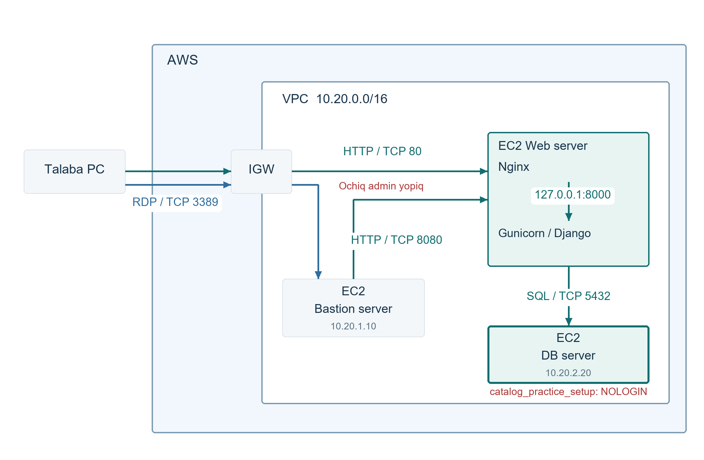

# P6 Eng kam huquq va ochiq kirish chegarasi

[Mashqlar P0–P6](practice.md) · [Topshiriqlar M0–M5](missions.md)

[日本語](../ja/p6.md) · [Русский](../ru/p6.md) · [O‘zbekcha](../uz/p6.md)

Mos topshiriq: [M5](m5.md).


**Practice6 da bajariladigan ishlar**

DB sozlash roliga kirishni yoping. Ilovaning odatiy huquqlar bilan ishlashini va ochiq tomondan boshqaruv hamda sozlamalar yopilganini tekshiring.

## Topshiriq diagrammasi



## Yechim namunasi (bajarish tartibi)

### P6.1 Ilova DB da bajara oladigan amallarni ko‘rish

**Bajarish muhiti:**

DB serverning SSM terminali: ssm-user

DB terminalida `psql` ni oching. `\du` mashq rollari atributlarini, `\dp` jadval huquqlarini ko‘rsatadi.

Buyruqlar: raqamlar shu qadam ichidagi tartib

```bash
# 1. DB OS terminalida postgres sifatida psql ochish; keyingi amallar psql ichida.
sudo -u postgres psql -X -d jdu_catalog_practice
```

Bundan keyin psql ichida kiriting

```sql
-- 2. Psql ichida mashq DB role atribut va huquqlarini tekshirish.
\du catalog_practice_*
-- 3. Psql ichida public schema jadval huquqlarini o‘qish.
\dp public.*
-- 4. Psql dan chiqib ayni DB server OS terminaliga qaytish.
\q
```

**Kutilgan natija va ma’nosi:**

`catalog_practice_app` jihozni o‘qishi, qo‘shishi va o‘zgartirishi mumkin. Jihozni o‘chirish huquqi berilmagan.

### P6.2 Boshlang‘ich sozlama uchun DB roli kirishini yopish

**Bajarish muhiti:**

DB serverning SSM terminali: ssm-user

`catalog_practice_setup` ochiq qolsa, uning parolini bilgan kishi yuqori huquqlarni ishlatishi mumkin. SQL da `NOLOGIN` ni topib, uni `psql` orqali qo‘llang.

Buyruqlar: raqamlar shu qadam ichidagi tartib

```bash
# 1. Ish katalogini /var/lib/jdu-web/lesson-resources-r1/app ga o‘zgartirish.
cd /var/lib/jdu-web/lesson-resources-r1/app
# 2. Setup role login ini o‘chirish SQL i ni ko‘rsatish; hali qo‘llamaslik.
python3 -B profile_sql.py --profile practice 04_disable_setup.sql
# 3. Setup role login ini o‘chirish SQL i ni yaratib postgres orqali kerakli DB ga qo‘llash.
python3 -B profile_sql.py --profile practice 04_disable_setup.sql | sudo -u postgres \
  psql -X -v ON_ERROR_STOP=1 -d jdu_catalog_practice
```

**Kutilgan natija va ma’nosi:**

`ALTER ROLE` chiqadi. `catalog_practice_setup` kirishi yopiladi, ilova esa `catalog_practice_app` bilan ulana oladi.

### P6.3 Web serverdagi vaqtinchalik sozlama fayllarini olib tashlash

**Bajarish muhiti:**

Web serverning SSM terminali: ssm-user

Ikkita vaqtinchalik sozlama faylini o‘chiring. Ilovani to‘xtating, P5 dagi `practice` sozlamasini tanlang va ilovani ishga tushiring. `catalog` OS foydalanuvchisi ilova kodiga yoza olmasligini tekshiring.

Buyruqlar: raqamlar shu qadam ichidagi tartib

```bash
# 1. Ko‘rsatilgan fayl owner, guruh, permission va nomini o‘qish.
sudo stat -c '%U:%G %a %n' /etc/jdu-catalog/setup.env \
  /etc/jdu-catalog/profiles/practice.setup.env
# 2. Tekshirilgan ikkita vaqtinchalik setup maxfiy faylini o‘chirish.
sudo rm -- /etc/jdu-catalog/setup.env /etc/jdu-catalog/profiles/practice.setup.env
# 3. Ko‘rsatilgan fayl owner, guruh, permission va nomini o‘qish.
sudo stat -c '%U:%G %a %n' /etc/jdu-catalog/app.env \
  /etc/jdu-catalog/profiles/practice.app.env /etc/jdu-web/db-practice.runtime.env
# 4. Sozlamani tanlashdan oldin jdu-catalog ni to‘xtatish.
sudo systemctl stop jdu-catalog
# 5. Keyingi ishga tushirish uchun saqlangan mashq profilini tanlash.
sudo python3 -B /opt/jdu-catalog/app/configuration.py activate --profile practice
# 6. Maxfiy qiymatlarni chiqarmay runtime config ni tekshirish.
sudo python3 -B /opt/jdu-catalog/app/configuration.py check --phase runtime
# 7. jdu-catalog ni tanlangan sozlama bilan ishga tushirish.
sudo systemctl start jdu-catalog
# 8. jdu-catalog joriy ish holatini o‘qish.
systemctl is-active jdu-catalog
# 9. Catalog foydalanuvchisi yoza oladigan ilova fayl va kataloglarini qidirish.
sudo -u catalog find /opt/jdu-catalog/app -writable -print
```

**Kutilgan natija va ma’nosi:**

`CATALOG_PROFILE_ACTIVATED=practice` va `VALID` chiqadi. Ilova `active` holatida bo‘ladi. Oddiy ish fayllari `root:root 600`. Oxirgi `find` natija chiqarmaydi.

**Ishlamasa:**

Boshqa profil faol bo‘lsa, to‘xtang. O‘chirilgan fayllarni qayta o‘chirmang. To‘xtatish, profilni tanlash yoki tekshirishda xato bo‘lsa, ilovani ishga tushirishdan oldin sababini aniqlang.

### P6.4 Ochiq 80-portdan nimalar ko‘rinishini tekshirish

**Bajarish muhiti:**

Bastionning SSM terminali: ssm-user

Bastion terminalidan Web ning 80-portiga HTTP so‘rovlarini yuboring. Ro‘yxat ochilishini, boshqaruv sahifasi va ichki sozlamalar yopiq ekanini tekshiring. Boshqaruv sahifasini RDP orqali Bastion Firefox brauzerida `http://admin.lab.test:8080/admin/` bilan oching.

Buyruqlar: raqamlar shu qadam ichidagi tartib

```bash
# 1. http://web.lab.test/ ga HTTP yuborib status, header va matnni ko‘rsatish.
curl -i http://web.lab.test/
# 2. http://web.lab.test/admin/ ga HTTP yuborib status, header va matnni ko‘rsatish.
curl -i http://web.lab.test/admin/
# 3. http://web.lab.test/app.env ga HTTP yuborib status, header va matnni ko‘rsatish.
curl -i http://web.lab.test/app.env
# 4. http://web.lab.test/static/app.env ga HTTP yuborib status, header va matnni ko‘rsatish.
curl -i http://web.lab.test/static/app.env
```

**Kutilgan natija va ma’nosi:**

Ro‘yxat HTTP `200` qaytaradi. `/admin/` va sozlama fayli URL manzillari uchun `403` yoki `404` qaytadi. 8080-portda boshqaruv tizimiga kirish sahifasi chiqadi.

**Ishlamasa:**

Env matni ko‘rinsa uni ulashmang; o‘qituvchiga aytib ochiq sozlamani tuzating.

### P6.5 Baholash sahifasida kirish cheklovlarini tekshirish

**Bajarish muhiti:**

Shaxsiy PC brauzeri: Web Portal

Baholash sahifasida P6 ni ochib, funksiya va huquqlarni tekshirishni tanlang. `practice_admin` parolini kiriting. Tekshiruv muvaffaqiyatli kirish va tizimga kirmasdan jihozni qo‘shish yoki o‘zgartirish rad etilishini solishtiradi.

**Kutilgan natija va ma’nosi:**

P6 ning 16 mezoni natijalari ko‘rinadi.

---

[Oldingi: P5](p5.md) · [Keyingi: M4](m4.md)
