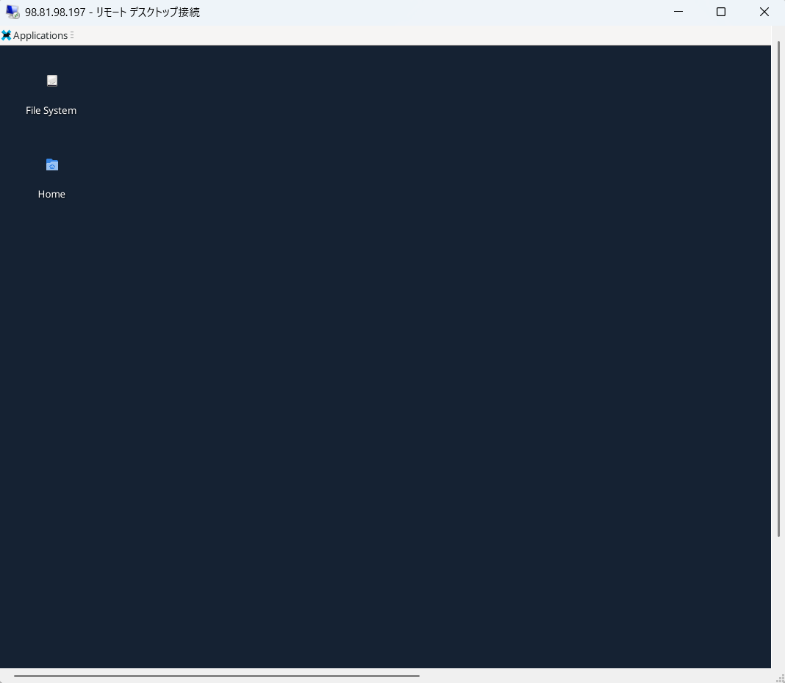
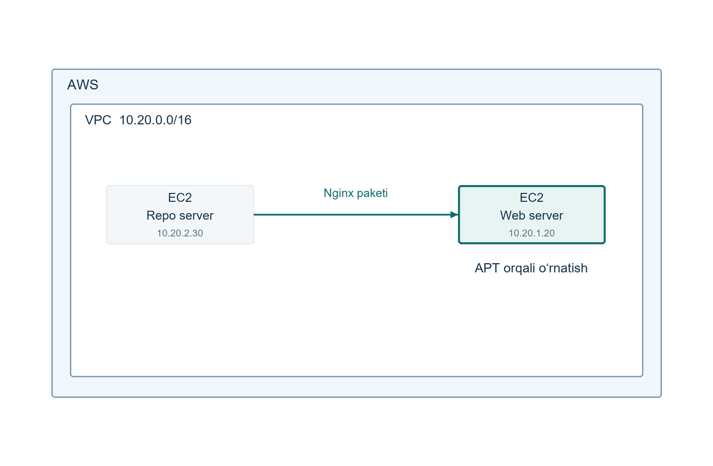
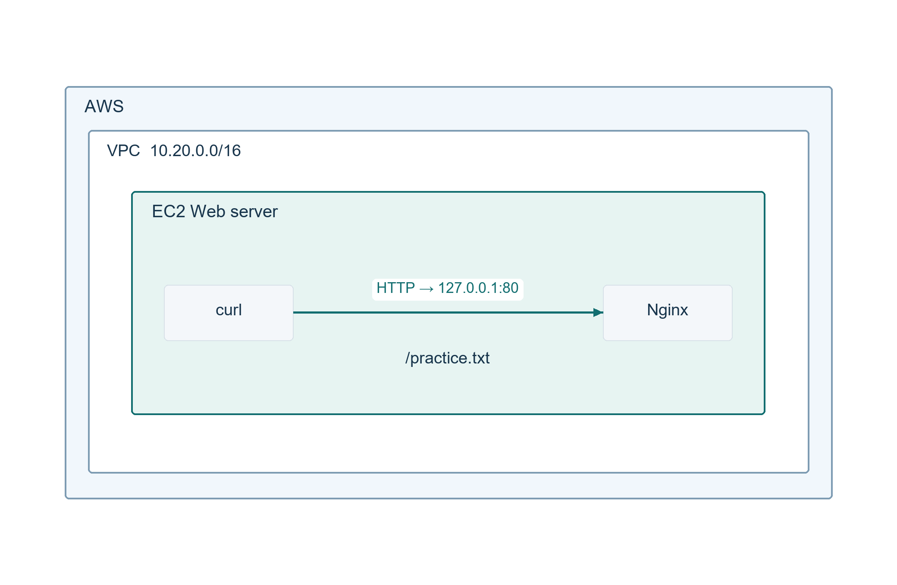

# Web Infrastructure: P0-P6 mashqlar va batafsil qadamlar

O‘qituvchi tekshiruvi uchun birinchi nashr. Talabaning qo‘llanma bo‘yicha boshidan oxirigacha o‘tishi hali tekshirilmagan.

Ruscha va o‘zbekcha matn yaponcha asl nusxa bilan bir xil qadam va shartlarga ega. Ona tili mutaxassisi tahriri hali bajarilmagan.

[日本語](../ja/practice-full.md) · [Русский](../ru/practice-full.md) · [O‘zbekcha](../uz/practice-full.md)

[Mashqlar P0–P6](practice.md) · [Topshiriqlar M0–M6](missions.md)

## Qo‘llanmadan foydalanish

Avval P topshirig‘ini o‘qing; kerak bo‘lsa batafsil namunani qadam-baqadam bajaring. P - batafsil qadamli mashq. M da boshqa obyekt/qiymatni mustaqil quring. Topshiriq raqami dars raqami emas; o‘z sur’atingizda ishlang. P tugashi M bajarilganini anglatmaydi.

P0 → M0 → P1 → M1 → P2 → M2 → P4 → M4 → P5 → P6 → M5 → M6

P5 uchun ham M2 DNS kerak. P4 da DB ga IP va nom orqali ulanishni mashq qiling. Ilova db.lab.test dan foydalanadi. Practice → mission almashishdan oldin P6 da setup ni tugating.

P0=1, M0=4, M1=8, M2=13, M4=9, M5=13, M6=16: jami 64 xom ball. Shaxsiy namoyish, backup/restore, qo‘shimcha disk va app dasturlash talab qilinmaydi. 25 ballga o‘tkazishni o‘qituvchi alohida qiladi. E’lon qilingan muddatgacha qayta yuborish mumkin. Turli urinish PASS lari qo‘shilmaydi; eng yuqori ball avtomatik tanlanmaydi.

## Muhit va tayyorgarlik

Avval boshlang‘ich tarqatma imzosi, yangi beshta server yoki mavjud muhitga install, ichki SSH va shaxsiy ro‘yxatni tugating. Yo‘riqnoma zip dagi distribution/STUDENT.md da. Maxfiy kalitni umumiy Windows ga saqlamang; shaxsiy Academy hisobining CloudShell idan foydalaning. O‘qituvchi anonim Lab ID, fingerprint va muddatni beradi.

Umumiy private IP quyida; public IPv4 doimiy emas. AWS region us-east-1, Ubuntu24.04/amd64. RDP: labuser; SSM: ssm-user; ichki SSH: ubuntu. User nomi va server rolini adashtirmang.

| Role | Private IPv4 | Vazifa |
| --- | --- | --- |
| bastion | 10.20.1.10 | RDP3389 / Firefox / SSH |
| web | 10.20.1.20 | HTTP80 / private8080 / loopback8000 |
| dns | 10.20.2.10 | BIND UDP/TCP53 |
| db | 10.20.2.20 | PostgreSQL5432 |
| repo | 10.20.2.30 | Oldindan saqlangan imzolangan resurslar HTTP80 |

P0 va M0 da Session Manager’ni EC2 ro‘yxatidan oching. Keyingi qadam CloudShell orqali ulanishni so‘rasa, u yerda `aws ssm start-session --target i-server-ID` ni bajaring. Har ikkala holatda serverda `ssm-user` sifatida ishlaysiz.

Nano: faylni ochish → matn yozish → Ctrl+O → Enter bilan saqlash → Ctrl+X bilan chiqish. Sozlama bloki shell buyrug‘i emas. Psql ichida prompt o‘zgaradi; SQL/\password shu yerga yoziladi, \q Ubuntu ga qaytaradi. Xatodan keyin natijani tekshirmay davom etmang.

Raqamli izohlar shu qadamdagi tartib va maqsadni bildiradi. # shell, -- psql ichidagi izohdir. Izohni o‘zgartirish shart emas. Ulanish, editor va parol kiritish tugashini kutib, bittadan bajaring. Qatorga bo‘lingan buyruq bitta buyruq bo‘lib qoladi.

## Qadamlarni qanday o‘qish kerak

Har P da topshiriq, tushuntirish, qadamlar va savollar bor. Butun bo‘limni birdan joylamang: har command ni alohida bajarib natijani o‘qing. Qator oxiridagi backslash davom etishni bildiradi: keyingi qator ham shu command ning qismidir.

Bash blokini ko‘rsatilgan muhit terminaliga kiriting. Text bloki config matni, psql ichidagi kiritish yoki natija namunasi bo‘lishi mumkin; oldingi izohni o‘qing. # bilan boshlangan izoh comment hisoblanadi. Terminaldagi $ yoki postgres=# prompt ini command ga qo‘shmang. YOUR- qiymatlarini o‘zingiznikiga almashtiring.

Tekshirish tartibi: saqlangan fayl, sintaksis, service ga qo‘llash, haqiqiy ulanish. To‘g‘ri fayl ishlayotgan service yangi sozlamani ishlatayotganini hali isbotlamaydi. HTTP response, DNS answer yoki SQL natijasini log bilan solishtiring.

## Tayyor tizim va ulanish yo‘llari

| Manba | Manzil | Protocol / port | Maqsad |
| --- | --- | --- | --- |
| Windows PC | Web public IPv4 | TCP/80 | Internet Gateway orqali ochiq ro‘yxat va statik fayllarni ko‘rish. |
| Windows PC | bastion public IPv4 | TCP/3389 | Ruxsatli CIDR dan RDP bilan bastion ish stoliga kirish. |
| bastion | Web/DNS/DB/repo | TCP/22 | Boshqarish uchun ichki SSH; private key bastion ichida qoladi. |
| bastion / Web | DNS 10.20.2.10 | UDP+TCP/53 | lab.test nomlarini yechish. DNS Web sahifa mazmunini qaytarmaydi. |
| Web app | DB 10.20.2.20 | TCP/5432 | App DB role bilan SQL bajaradi. Windows dan DB ga bevosita ulanish ishlatilmaydi. |
| bastion | Web 10.20.1.20 | TCP/8080 | admin.lab.test admin oynasi; ochiq 80 portdan alohida. |
| Nginx on Web | 127.0.0.1 on Web | TCP/8000 | Shu Web ichidagi app ga uzatish; 127.0.0.1 - ayni joriy host. |

Boshlang‘ich SSM CloudShell dan EC2 ga alohida management yo‘lidir. U oddiy Web request yo‘liga qo‘shilmaydi. Jadvaldagi ichki IP va portlar shu Lab uchun, barcha Web tizimlari uchun emas.

## P0 Shaxsiy muhit va buyruqlarni bajarish joyi

### Nimani o‘rganamiz

EC2 ro‘yxatidan kerakli serverni tanlash, Session Manager orqali ulanish va topshiriq natijasini tekshirish.

### Topshiriq

Tayyor muhitingizda beshta serverning instance ID si va rolini tekshiring. Qaysi serverga va qaysi foydalanuvchi sifatida ulanganingizni aniqlang.

### Ulaniladigan serverlar


Yashil strelka P0.2 da Web serverga ulanishni ko‘rsatadi.

**Practice0 da bajariladigan ishlar**

O‘z AWS hisobingizni, har bir server rolini va buyruq bajariladigan muhitni tekshiring.

### Yechim namunasi (bajarish tartibi)

#### P0.1 Beshta serverning instance ID sini tekshirish

**Bajarish muhiti:**

Talabaning shaxsiy AWS Console oynasi

**Maqsad va amallar:**

AWS Console tepasidagi Search maydoniga EC2 deb yozib, boshqaruv oynasini oching. EC2 → Instances ro‘yxatida Name ustunidan o‘z muhitingizdagi beshta serverni tekshiring. Shu qatordagi Instance ID ustunidan i- bilan boshlangan to‘liq ID ni ko‘ring.


EC2 dagi Instances ro‘yxati. P0 uchun nomi `-web`, M0 uchun `-db`, `-dns`, `-repo` va `-bastion` bilan tugaydigan qatorlarni navbat bilan tanlang.

#### P0.2 Session Manager orqali Web serverga ulanish

**Bajarish muhiti:**

Web serverning SSM terminali: ssm-user

**Maqsad va amallar:**

P0.1 da topilgan Web serverning **Instance ID** havolasini bosing. Tafsilotlarda **Connect** yonidagi o‘ng strelkani bosing va **Connect with SSM Session Manager** ni tanlang. Yangi varaqdagi terminalda quyidagi buyruqlarni bittadan bajaring. Dastlabki sozlashda yaratilgan `/etc/jdu-web/bootstrap.json` faylini `cat` bilan ko‘ring va `"role": "web"` yozuvini toping. Web serverga ulangan bo‘lsangiz, uy katalogida `nano` bilan tekshiruv faylini yarating.


EC2 tafsilot oynasi. Connect yonidagi o‘ng strelkadan Connect with SSM Session Manager ni tanlang. Rasmda Web server ko‘rsatilgan.

Buyruqlar: raqamlar shu qadam ichidagi tartib

```bash
# 1. Shu terminaldagi OS user nomini ko‘rsatish.
id -un
# 2. O‘z uy katalogingizga o‘ting.
cd ~
# 3. Joriy ish katalogini ko‘rsatish.
pwd
# 4. Faylni ko‘ring va role qiymati web ekanini tekshiring.
cat /etc/jdu-web/bootstrap.json
# 5. Faqat web deb yozing. Ctrl+O va Enter bilan saqlang, Ctrl+X bilan chiqing.
nano p0-connection.txt
# 6. p0-connection.txt mazmunini o‘zgartirmay o‘qish.
cat p0-connection.txt
```

**Kutilgan natija va ma’nosi:**

`id -un` buyrug‘i `ssm-user`, `pwd` esa `/home/ssm-user` ni ko‘rsatadi. JSON faylda `"role": "web"` bor va oxirgi `cat` buyrug‘i faqat bitta `web` satrini chiqaradi.

#### P0.3 RDP orqali bastion ish stolini ochish

**Bajarish muhiti:**

Talabaning Windows PC si (umumiy hisob)

**Maqsad va amallar:**

Windows dagi Remote Desktop Connection orqali o‘z oraliq serveringizning ish stolini oching.

**1. Oraliq serverni tanlang**

EC2 → Instances bo‘limida o‘z muhitingizdagi nomi `-bastion` bilan tugaydigan qatorni toping va shu qatordagi **Instance ID** ni bosing.


**2. Ommaviy IPv4 manzilini nusxalang**

Instans tafsilotlarida **Public IPv4 address** yonidagi nusxalash belgisini bosing. Keyingi qadamda o‘z oynangizdagi joriy ommaviy IPv4 manzilini ishlating. Rasmdagi manzil misol.


Windows+R tugmalarini bosib Run oynasini oching. Open maydoniga `mstsc /prompt` yozing va **OK** ni bosing.

Buyruqlar: raqamlar shu qadam ichidagi tartib

```bash
# 1. Windows RDP ni hisob ma’lumotlarini so‘rash bilan ochish.
mstsc /prompt
```

**3. Ommaviy IPv4 manzilini kiritib ulaning**

Remote Desktop Connection oynasidagi **Computer** maydoniga 2-qadamda nusxalangan ommaviy IPv4 manzilini qo‘ying va **Connect** tugmasini bosing.


**4. Sertifikat ogohlantirishini tekshiring**

Bu oyna chiqsa, ulanish manzilini 2-qadamdagi ommaviy IPv4 manzili bilan solishtiring. O‘qituvchi bu sizning oraliq serveringiz va mashq sertifikati ekanini tasdiqlasa, **Yes** ni bosing. Tasdiqlanmasa, **No** ni bosing va o‘qituvchiga murojaat qiling.


**5. Oraliq serverga kiring**

xrdp kirish oynasida **Session** maydonida `Xorg` tanlanganini tekshiring. **username** maydoniga `labuser`, **password** maydoniga dastlab belgilagan RDP parolingizni yozing va **OK** ni bosing.


**6. Ish stoli ochilganini tekshiring**

Uzoq ish stoli oynasining yuqori chapida **Applications** menyusi va **Home** belgisi ko‘rinsa, oraliq serverga ulangansiz.



**Buyruq va sozlamalar ma’nosi:**

RDP bastion ekrani va kiritishni uzatadi. RDP ichidagi Firefox request i Windows emas, bastiondan chiqadi. Klaviatura tartibi paroldagi belgilarga ta’sir qiladi; interfeys tili va keyboard layout alohida sozlamadir.

**Kutilgan natija va ma’nosi:**

Oraliq serverning Ubuntu ish stoli (Xfce) ochiladi. Yuqori chapdagi Applications menyusidan Firefox va boshqa dasturlarni ochish mumkin.

**Ishlamasa:**

Login failed bo‘lsa user nomi va klaviatura tartibini tekshiring. Parolni chat ga yubormang. Ulanmasa joriy IP va ruxsatli CIDR ni o‘qituvchi bilan tekshiring; 3389 ni hammaga ochmang. RDP ni yopishdan oldin ishni saqlang.

### Tekshirish va topshirish

O‘qituvchi bergan baholash manzilini o‘z kompyuteringizdagi brauzerda oching va ta’lim muassasasining Google hisobi bilan kiring. Birinchi kirishda o‘z AWS muhitingizni ro‘yxatdan o‘tkazish bo‘limini tanlang va ekrandagi ko‘rsatmalarga amal qiling.

P0 qatoridagi **Ushbu vazifani tekshirish** tugmasini bosing. Shu sahifada natijani tekshirib, P0 qatorida **1 / 1** saqlanganiga ishonch hosil qiling.

## P1 HTTP orqali statik faylni qaytarish

### Nimani o‘rganamiz

Nginx, fayl joyi, tinglash porti, HTTP javobi va access log ni bog‘lash.

### Topshiriq

Web serverdagi /var/www/html/practice.txt faylini HTTP 200 bilan qaytaring.

### Topshiriq diagrammasi


- File: /var/www/html/practice.txt
- URL path: /practice.txt

```text
JDU WEB-02 practice: HTTP response verified.
```

**Practice1 da bajariladigan ishlar**

Nginx da HTTP uchun TCP 80 portini oching va `/practice.txt` so‘roviga fayl matnini qaytaring. Web serverning o‘z terminalidan va Bastion terminalidan so‘rov yuboring, so‘ng ularni Nginx access log ida tekshiring.

### Yechim namunasi (bajarish tartibi)

#### P1.1 Ichki APT dan Nginx o‘rnatish

**Bajarish muhiti:**

Web serverning SSM terminali: ssm-user

**Maqsad va amallar:**

P0 dagidek Web serverga SSM orqali ulaning. Nginx paketini ichki Repo serveridan (`10.20.2.30`) yuklab olib, Web serverga o‘rnating.



Buyruqlar: raqamlar shu qadam ichidagi tartib

```bash
# 1. Ichki serverdagi paketlar ro‘yxatini yangilash.
sudo apt-get update
# 2. Ichki paket serveridan nginx ni o‘rnatish.
sudo apt-get install nginx
```

**Buyruq va sozlamalar ma’nosi:**

`apt-get update` mavjud paketlar ro‘yxatini yangilaydi. `apt-get install nginx` shu ro‘yxat yordamida Nginx ni o‘rnatadi.

**Kutilgan natija va ma’nosi:**

Ro‘yxat yangilanganda ichki server qatorida `Hit:` yoki `Get:` ko‘rinadi. `N: Ignoring file ... ubuntu.sources.jdu-disabled` xabari APT dastlabki sozlashda o‘chirilgan standart Ubuntu manbasi faylini o‘tkazib yuborganini bildiradi. Yuklash yoki imzo tekshiruvida xato bo‘lmasa, o‘rnatishni davom ettiring. Tasdiq so‘ralsa, `Y` kiriting.

**Ishlamasa:**

Paketlar ro‘yxatini olib bo‘lmasa, ichki paket serverining holati va IP manzilini tekshiring.

#### P1.2 Aniq matn yaratish va ruxsatlarni sozlash

**Bajarish muhiti:**

Web serverning SSM terminali: ssm-user

**Maqsad va amallar:**

Matnni ish fayliga yozing, keyin uni Nginx fayllarni tarqatadigan katalogga nusxalang.

Buyruqlar: raqamlar shu qadam ichidagi tartib

```bash
# 1. O‘z uy katalogingizga o‘ting.
cd ~
# 2. Mashq katalogini yaratish; mavjud bo‘lsa saqlash.
mkdir -p jdu-web-practice/p1
# 3. Ish katalogini jdu-web-practice/p1 ga o‘zgartirish.
cd jdu-web-practice/p1
# 4. Joriy ish katalogini ko‘rsatish.
pwd
# 5. Practice.txt ni ochish: matn yozish, saqlash va chiqish.
nano practice.txt
```

**nano oynasiga yoziladigan matn**

```text
JDU WEB-02 practice: HTTP response verified.
```

nano oynasiga yuqoridagi qatorni aynan yozing va oxirida Enter tugmasini bosing. Ctrl+O va Enter orqali saqlang, Ctrl+X orqali chiqing. Terminalga qaytgach, 6-qadamdan davom eting.

Buyruqlar: raqamlar shu qadam ichidagi tartib

```bash
# 6. practice.txt faylini Web serverning ochiq katalogiga nusxalash.
sudo cp practice.txt /var/www/html/practice.txt
# 7. Nusxalangan fayl egasi va guruhini root ga o‘zgartirish.
sudo chown root:root /var/www/html/practice.txt
# 8. Nusxalangan faylga 0644 ruxsatlarini berish.
sudo chmod 0644 /var/www/html/practice.txt
# 9. Ko‘rsatilgan fayl owner, guruh, permission va nomini o‘qish.
stat -c '%U:%G %a %n' /var/www/html/practice.txt
# 10. /var/www/html/practice.txt mazmunini o‘zgartirmay o‘qish.
cat /var/www/html/practice.txt
```

**Buyruq va sozlamalar ma’nosi:**

`cp` matnni tarqatiladigan faylga nusxalaydi. `chown root:root` nusxaning egasi va guruhini root ga o‘zgartiradi. `chmod 0644` egaga o‘qish va yozish, guruh va boshqa foydalanuvchilarga o‘qish huquqini beradi.

**Kutilgan natija va ma’nosi:**

`root:root 644` egasi, guruhi va ruxsatlari hamda `JDU WEB-02 practice: HTTP response verified.` qatori ko‘rinadi.

**Ishlamasa:**

Nano hali ochiq bo‘lsa, keyingi buyruqdan oldin faylni saqlab chiqing.

#### P1.3 Web root ni tekshirish va service ni ishga tushirish

**Bajarish muhiti:**

Web serverning SSM terminali: ssm-user

**Maqsad va amallar:**

`nginx -T` bilan amaldagi sozlamani chiqaring. `/etc/nginx/sites-enabled/default` ichidan `root /var/www/html` va `listen 80` ni toping. Kerak bo‘lsa `sudo nano` bilan tahrirlang va sintaksis tekshiruvidan keyin sozlamani qayta yuklang.

Buyruqlar: raqamlar shu qadam ichidagi tartib

```bash
# 1. Nginx ning to‘liq sozlamasini chiqarib, qanday yozilganini tekshirish.
sudo nginx -T
# 2. Nginx config sintaksisi va fayllarini tekshirish.
sudo nginx -t
# 3. nginx ni hozir yoqish va avtomatik start ni yoqish.
sudo systemctl enable --now nginx
# 4. nginx ni to‘xtatmay sozlamani qayta o‘qish.
sudo systemctl reload nginx
# 5. nginx joriy ish holatini o‘qish.
systemctl is-active nginx
# 6. Nginx TCP 80 portini, masalan 0.0.0.0:80 manzilida tinglayotganini tekshirish.
sudo ss -lntp
```

**Buyruq va sozlamalar ma’nosi:**

Nginx -T config ni ko‘rsatadi; -t sintaksisni tekshiradi. Systemctl enable keyingi boot da ishga tushishni, --now hozir ishga tushishni belgilaydi. Fayl saqlangach reload, service holati va portni tekshiring.

**Kutilgan natija va ma’nosi:**

Sintaksis tekshiruvida `syntax is ok` va `test is successful`, xizmat holatida `active` chiqadi. Nginx TCP 80 portini, masalan `0.0.0.0:80` manzilida tinglayotganini tekshiring.

**Ishlamasa:**

Sintaksis xatosida `nginx -t` ko‘rsatgan fayl va qatorni tuzating.

#### P1.4 Web ichidan javobni ko‘rish

**Bajarish muhiti:**

Web serverning SSM terminali: ssm-user

**Maqsad va amallar:**

Web server terminalida `curl` bilan HTTP so‘rov yuboring. `127.0.0.1` buyruq bajarilayotgan Web serverning o‘zini bildiradi.



Buyruqlar: raqamlar shu qadam ichidagi tartib

```bash
# 1. http://127.0.0.1/practice.txt manziliga HTTP so‘rov yuborish.
curl -i http://127.0.0.1/practice.txt
```

**Buyruq va sozlamalar ma’nosi:**

`127.0.0.1` - loopback manzili. So‘rov shu Web server ichidagi Nginx ga yetib boradi.

**Kutilgan natija va ma’nosi:**

HTTP 200 va practice.txt ichidagi `JDU WEB-02 practice: HTTP response verified.` qatori chiqadi.

**Ishlamasa:**

«Welcome to nginx» chiqsa, curl buyrug‘ida `/practice.txt` ko‘rsatilganini tekshiring. `http://127.0.0.1/` manzili Nginx bosh sahifasini qaytarishi mumkin.

#### P1.5 Ayni faylni Bastion serveridan tekshirish

**Bajarish muhiti:**

Bastionning SSM terminali: ssm-user

**Maqsad va amallar:**

Bastion serverga SSM orqali ulaning va `curl` bilan Web serverga HTTP so‘rov yuboring. Ichki tarmoqdan Web serverning ichki IP manzili `10.20.1.20` ni kiriting.


Buyruqlar: raqamlar shu qadam ichidagi tartib

```bash
# 1. http://10.20.1.20/practice.txt manziliga HTTP so‘rov yuborish.
curl -i http://10.20.1.20/practice.txt
```

**Buyruq va sozlamalar ma’nosi:**

Manzil Web serverning ichki IP siga o‘zgaradi. Fayl yo‘li P1.4 dagidek `/practice.txt` bo‘lib qoladi.

**Kutilgan natija va ma’nosi:**

HTTP 200 va `JDU WEB-02 practice: HTTP response verified.` qatori chiqadi.

#### P1.6 So‘rovni log bilan bog‘lash va yuborish

**Bajarish muhiti:**

Web serverning SSM terminali: ssm-user

**Maqsad va amallar:**

Web ga qayting. Access log da vaqt, client IP, path va statusni ko‘ring. Bu fayl borligidan tashqari so‘rov ishlanganining dalilidir. Exit bilan CloudShell ga qaytgach, PC dagi Web Portal da P1 ni tekshiring.

Buyruqlar: raqamlar shu qadam ichidagi tartib

```bash
# 1. Access log oxirgi 20 qatoridan oldingi HTTP so‘rovini topish.
sudo tail -n 20 /var/log/nginx/access.log
# 2. Joriy server session ini yopib CloudShell ga qaytish.
exit
```

**Buyruq va sozlamalar ma’nosi:**

Access log dagi vaqt, path va status ni oldingi curl bilan solishtiring. Tail oxirgi qatorlarni o‘qiydi, log ni o‘zgartirmaydi. Exit dan keyin PC brauzerida P1 ni tekshiring.

**Kutilgan natija va ma’nosi:**

Ekranda sakkizta tekshiruv natijasi va bajarilgan mezonlar soni ko‘rinadi. Tizim ochiq IP orqali HTTP ulanishini avtomatik tekshiradi.

**Ishlamasa:**

Ishlov davom etsa natijani yangilang. Saqlash xatosida sababni o‘qing. Checker kutgan matnni o‘zgartirmang.

### Natijani o‘qish namunasi (kiritmang)

```text
HTTP/1.1 200 OK

JDU WEB-02 practice: HTTP response verified.
```

Faqat kerakli qatorlar ko‘rsatilgan; haqiqiy javobda boshqa header lar ham bor. 200, matn va access log dagi path/status ni tekshiring.

### Tushunishni tekshirish (ballsiz)

Web ichida 200, bastiondan ulanish ishlamaydi. Faylni qayta yozishdan oldin nimani tekshirasiz?

**Izoh:**

Manzil IP, listen address/port va bastion → Web ruxsatini tekshiring. Fayl mazmuni va yetib borish alohida tekshiruvdir.

## P2 Ichki DNS va odatiy nom yechimi

### Nimani o‘rganamiz

BIND zone, A record, ACL va client resolver ni ketma-ket sozlash.

### Topshiriq

guide.lab.test → 10.20.1.20 va practice-db.lab.test → 10.20.2.20 ni sozlang; P1 HTTP ni nom orqali oching. Asosiy IP lar o‘zgarmaydi.

### Topshiriq diagrammasi


Qalin ramka asosiy obyektni bildiradi. Har qadamdagi terminalda sozlang; strelkalar ulanish yoki tekshirish yo‘nalishidir. SG ruxsatlari boshlang‘ich tarqatmada tayyor; bu topshiriqda server ichini sozlaysiz.

| DNS name | A / IPv4 |
| --- | --- |
| guide.lab.test | 10.20.1.20 |
| practice-db.lab.test | 10.20.2.20 |

### Bu qanday ishlaydi

**Boshlashdan oldingi holat:**

P1 HTTP IP orqali ishlaydi; DNS endi sozlanadi.

**Practice2 da bajariladigan ishlar**

BIND mashq nomlari bastion va Web ning oddiy resolver idan ishlaydi.

DNS nom so‘roviga javob beradi, Web sahifani qaytarmaydi. BIND lab.test zone ni boshqaradi; A record IPv4 qaytaradi. Aniq DNS server bilan dig va OS sozlamalaridan foydalanuvchi getent/browser ni farqlang. DNS dan keyin alohida HTTP ulanish bo‘ladi. [BIND hujjati](https://bind9.readthedocs.io/en/v9.18.39/chapter3.html).

### Yechim namunasi (bajarish tartibi)

#### P2.1 BIND o‘rnatish va asl sozlamani saqlash

**Bajarish muhiti:**

DNS serverning SSM terminali: ssm-user

**Maqsad va amallar:**

DNS ga kirib role=dns ni tekshiring. cp -a asl fayl atributlarini saqlaydi; -n eski nusxa ustiga yozmaydi. Bu tahrir xatosi uchun nusxa, DB backup/restore topshirig‘i emas.

Buyruqlar: raqamlar shu qadam ichidagi tartib

```bash
# 1. Ichki repo package ro‘yxatini yangilash; yuklash xatosini xato deb olish.
sudo apt-get update -o APT::Update::Error-Mode=any
# 2. Ichki repo dan bind9 bind9-utils ni tavsiya etilgan qo‘shimchalarsiz o‘rnatish.
sudo apt-get install --no-install-recommends bind9 bind9-utils
# 3. Asl fayldan nusxa olish; mavjud nusxani ustidan yozmaslik.
sudo cp -an /etc/bind/named.conf.options /etc/bind/named.conf.options.before-p2
# 4. Asl fayldan nusxa olish; mavjud nusxani ustidan yozmaslik.
sudo cp -an /etc/bind/named.conf.local /etc/bind/named.conf.local.before-p2
```

**Buyruq va sozlamalar ma’nosi:**

Named - BIND service nomi; named-checkconf kabi vositalar config ni tekshiradi. Cp -an dagi -n takroriy bajarishda mavjud zaxira nusxa ustiga yozmaydi.

**Kutilgan natija va ma’nosi:**

Ichki repo dan o‘rnatiladi. M2 da shu DNS ga record qo‘shilib, P2 record lari saqlanadi.

**Ishlamasa:**

Boshqa Lab named.conf faylini to‘liq ko‘chirmang. O‘zingizning zone mavjud bo‘lsa, avval o‘qing.

#### P2.2 Client lar va forwarder ni sozlash

**Bajarish muhiti:**

DNS serverning SSM terminali: ssm-user

**Maqsad va amallar:**

sudo nano /etc/bind/named.conf.options ni ochib quyidagi matnni saqlang. acl ruxsatli client larni, listen-on DNS tinglashini belgilaydi; forward only tashqi nomlarni AWS DNS ga uzatadi. Query va recursion uchta manbaga cheklanadi. dnssec-validation no yopiq o‘quv forwarding tuzilmasiga mos.

Sozlama yoki ma’lumot: terminal buyrug‘i emas

```text
acl "jdu_clients" { 127.0.0.1; 10.20.1.10; 10.20.1.20; };
options {
    directory "/var/cache/bind";
    listen-on { 127.0.0.1; 10.20.2.10; };
    listen-on-v6 { none; };
    allow-query { jdu_clients; };
    allow-recursion { jdu_clients; };
    allow-query-cache { jdu_clients; };
    recursion yes;
    forward only;
    forwarders { 10.20.0.2; };
    dnssec-validation no;
    allow-transfer { none; };
};
```

**Buyruq va sozlamalar ma’nosi:**

Allow-query so‘rov yuboruvchi client ni, allow-recursion tashqi nom uchun recursive qidiruv client ini belgilaydi. Lab.test o‘z zone idan, tashqi nom forwarder orqali olinadi. Client lar bastion, Web va localhost bilan cheklangan.

**Kutilgan natija va ma’nosi:**

Bu shell buyrug‘i emas, fayl mazmuni. 10.20.0.2 - AWS resolver, 10.20.2.10 - o‘z BIND serveringiz.

**Ishlamasa:**

Nuqtali vergul va qavslar sintaksis qismidir. ACL ni any yoki 0.0.0.0/0 gacha kengaytirmang.

#### P2.3 Zone ni e’lon qilish va A record yozish

**Bajarish muhiti:**

DNS serverning SSM terminali: ssm-user

**Maqsad va amallar:**

sudo nano /etc/bind/named.conf.local ga birinchi zone blokini yozing. sudo install -d -m 0755 /etc/bind/zones dan so‘ng sudo nano /etc/bind/zones/db.lab.test ga qolgan matnni yozing. SOA boshqaruv ma’lumoti, NS vakolatli DNS, A nom/IPv4 mosligi. Oxirgi nuqta to‘liq nomni bildiradi; har tahrirda serial ni oshiring.

Sozlama yoki ma’lumot: terminal buyrug‘i emas

```text
// /etc/bind/named.conf.local
zone "lab.test" {
    type primary;
    file "/etc/bind/zones/db.lab.test";
    allow-transfer { none; };
    allow-update { none; };
};

; /etc/bind/zones/db.lab.test
$TTL 300
@ IN SOA dns.lab.test. hostmaster.lab.test. (
    2026102301 3600 600 604800 300 )
@ IN NS dns.lab.test.
dns IN A 10.20.2.10
guide IN A 10.20.1.20
practice-db IN A 10.20.2.20
```

**Buyruq va sozlamalar ma’nosi:**

Zone e’loni va record lar alohida fayllarga saqlanadi. Guide nomi guide.lab.test gacha to‘ldiriladi; nuqtali dns.lab.test. to‘liq nomdir. TTL cache vaqtini, SOA serial esa zone versiyasini bildiradi, IP ni emas.

**Kutilgan natija va ma’nosi:**

Ikkita alohida faylga saqlang. dns A yozuvi NS nomining manzilidir. Client resolver ini hozircha o‘zgartirmang.

**Ishlamasa:**

M2 allaqachon mavjud bo‘lsa, zone ni almashtirmay ikkita mashq yozuvini qo‘shing. Zone ni ikki marta e’lon qilmang.

#### P2.4 Sintaksis va DNS ichki javobini tekshirish

**Bajarish muhiti:**

DNS serverning SSM terminali: ssm-user

**Maqsad va amallar:**

Client ni nosoz DNS ga o‘tkazish nom yechimini to‘xtatadi. Avval named-checkconf va named-checkzone muvaffaqiyatli bo‘lsin, keyin UDP hamda TCP ni tekshiring.

Buyruqlar: raqamlar shu qadam ichidagi tartib

```bash
# 1. BIND config va ulangan zone sintaksisini tekshirish.
sudo named-checkconf -z
# 2. Lab.test zone faylini tekshirish.
sudo named-checkzone lab.test /etc/bind/zones/db.lab.test
# 3. named ni hozir yoqish va avtomatik start ni yoqish.
sudo systemctl enable --now named
# 4. named ni yangi sozlama bilan qayta ishga tushirish.
sudo systemctl restart named
# 5. UDP 53 orqali guide.lab.test ni so‘rab javobini o‘qish.
dig @127.0.0.1 guide.lab.test A
# 6. TCP 53 orqali guide.lab.test ni so‘rab javobini o‘qish.
dig @127.0.0.1 guide.lab.test A +tcp
```

**Buyruq va sozlamalar ma’nosi:**

Sintaksis tekshiruvi o‘tgach sozlamani qo‘llang. Dig dagi @ DNS serverni, A IPv4 record turini bildiradi. +tcp bilan TCP53 tekshiriladi; uni UDP muvaffaqiyatidan alohida o‘qing.

**Kutilgan natija va ma’nosi:**

zone loaded/OK, NOERROR, aa va A=10.20.1.20. aa shu zone uchun vakolatli javobni bildiradi.

**Ishlamasa:**

Xatoda sudo journalctl -u named -n 30 --no-pager ni o‘qing, sozlamani tuzatib yana tekshiring.

#### P2.5 Bastion va Web dan DNS ga bevosita so‘rov yuborish

**Bajarish muhiti:**

Bastionning SSM terminali: ssm-user

**Maqsad va amallar:**

Buyruqlarni bastionda ham, Web da ham bajaring. @10.20.2.10 faqat shu so‘rov uchun DNS ni belgilaydi. Bu browser va app odatda shu DNS ni ishlatishini hali isbotlamaydi.

Buyruqlar: raqamlar shu qadam ichidagi tartib

```bash
# 1. UDP 53 orqali guide.lab.test ni so‘rab javobini o‘qish.
dig @10.20.2.10 guide.lab.test A
# 2. TCP 53 orqali practice-db.lab.test ni so‘rab javobini o‘qish.
dig @10.20.2.10 practice-db.lab.test A +tcp
# 3. UDP 53 orqali absent-p2.lab.test ni so‘rab javobini o‘qish.
dig @10.20.2.10 absent-p2.lab.test A
# 4. UDP 53 orqali aws.amazon.com ni so‘rab javobini o‘qish.
dig @10.20.2.10 aws.amazon.com A
# 5. Butun zone uchun AXFR so‘rab aniq rad etilishini tekshirish.
dig @10.20.2.10 lab.test AXFR
```

**Buyruq va sozlamalar ma’nosi:**

Mavjud ichki nom, yo‘q nom, tashqi nom va zone transfer ni alohida sinang. NXDOMAIN to‘g‘ri manfiy javob, timeout emas. AXFR butun zone ni so‘raydi; bu Lab da rad etilishi kerak.

**Kutilgan natija va ma’nosi:**

Kerakli nomlar to‘g‘ri A qaytaradi; absent-p2 vakolatli NXDOMAIN, tashqi nom javob beradi; AXFR rad qilinadi. Timeout aniq rad etish isboti emas.

**Ishlamasa:**

Ulanmasa, manba hamda UDP/TCP 53 ni ajratib tekshiring. Boshqa private serverlarni client ACL ga qo‘shmang.

#### P2.6 Odatiy resolver ni faqat BIND ga yo‘naltirish

**Bajarish muhiti:**

Bastionning SSM terminali: ssm-user

**Maqsad va amallar:**

Bastion va Web da bittadan bajaring. ip -br link orqali interface nomini, networkctl status NOM orqali Network File ni aniqlang. ls /etc/netplan bilan YAML ni topib sudo cp -an orqali nusxa saqlang. sudo nano da ayni interface ga dhcp4-overrides/use-dns:false va nameservers qo‘shing. Quyida tuzilma namunasi: interface nomi hamda mavjud match/set-name/renderer qiymatlarini saqlang.

Sozlama yoki ma’lumot: terminal buyrug‘i emas

```text
network:
  version: 2
  ethernets:
    ens5:
      dhcp4: true
      dhcp4-overrides:
        use-dns: false
      nameservers:
        addresses: [10.20.2.10]
```

**Buyruq va sozlamalar ma’nosi:**

Bu Netplan DNS serverga emas, client bo‘lgan bastion va Web ga yoziladi. Dhcp4 IP olishni davom ettiradi; use-dns: false DHCP DNS ni olishni to‘xtatadi. Addresses dagi DNS manzili EC2 ning o‘z IP si emas.

**Kutilgan natija va ma’nosi:**

IP va gateway DHCP da qoladi. Boshqa fallback DNS qo‘shmang, /etc/resolv.conf ni almashtirmang, topshiriq nomlarini /etc/hosts ga yozmang. SSM oynasini ochiq qoldiring.

**Ishlamasa:**

Bir interface bir necha YAML da bo‘lsa, qiymatlar birlashadi. resolvectl dns da AWS DNS qolsa, tegishli barcha YAML va amaldagi sozlamani tekshiring.

#### P2.7 Qo‘llagach odatiy resolver va HTTP ni tekshirish

**Bajarish muhiti:**

Bastionning SSM terminali: ssm-user

**Maqsad va amallar:**

Bastion va Web da avval sozlamani hosil qiling, keyin qo‘llang va tekshiring. Ikkinchi SSH/RDP oynasini ochiq tuting; uzilsa SSM orqali qaytib nusxa bilan solishtiring. Fayl tekshirilgach va generate muvaffaqiyatli tugagach apply qiling.

Buyruqlar: raqamlar shu qadam ichidagi tartib

```bash
# 1. Netplan YAML dan config yaratib, qo‘llashdan oldin sintaksisni tekshirish.
sudo netplan generate
# 2. Saqlangan netplan sozlamasini tarmoqqa qo‘llash.
sudo netplan apply
# 3. systemd-resolved ni yangi sozlama bilan qayta ishga tushirish.
sudo systemctl restart systemd-resolved
# 4. Odatiy resolver ishlatadigan DNS serverlarni ko‘rsatish.
resolvectl dns
# 5. Odatiy resolver orqali guide.lab.test IPv4 sini olish.
getent ahostsv4 guide.lab.test
# 6. Odatiy resolver orqali practice-db.lab.test IPv4 sini olish.
getent ahostsv4 practice-db.lab.test
# 7. http://guide.lab.test/practice.txt ga HTTP yuborib status, header va matnni ko‘rsatish.
curl --noproxy '*' -i http://guide.lab.test/practice.txt
```

**Buyruq va sozlamalar ma’nosi:**

Netplan generate config hosil qiladi; apply qo‘llaydi. SSM uzilsa ayni instance ga qayta ulaning. Resolvectl tanlangan DNS ni ko‘rsatadi; getent OS ning oddiy yo‘lini ishlatadi; oxirida nom bilan HTTP tekshiriladi.

**Kutilgan natija va ma’nosi:**

Yagona upstream DNS 10.20.2.10. getent kerakli IP, HTTP esa 200 va P1 matnini beradi. 127.0.0.53 mahalliy stub; upstream ni resolvectl da ko‘ring.

**Ishlamasa:**

dig o‘tib getent o‘tmasa, client resolver ini tekshiring. Firefox dagi DoH o‘chirilgan sozlamani saqlang.

#### P2.8 Browser da IP va nomni solishtirib yuborish

**Bajarish muhiti:**

RDP orqali bastiondagi Firefox

**Maqsad va amallar:**

RDP orqali bastion Firefox ini oching. http://10.20.1.20/practice.txt va http://guide.lab.test/practice.txt bir xil matn berishini ko‘ring. lab.test maktab PC DNS ida emas, bastion ichki DNS ida ishlaydi. Keyin PC dagi Web Portal da P2 ni tekshiring.

**Buyruq va sozlamalar ma’nosi:**

Bastion Firefox i ichki guide.lab.test nomini ishlatadi. Windows browser i ayni ichki DNS ga sozlanmagan. IP va nom orqali ko‘rinishni solishtirib, yuborishdan oldin ayni P1 fayl ekanini tekshiring.

**Kutilgan natija va ma’nosi:**

13 ta mashq tekshiruvi; P1 ning joriy ishlashi ham kerak. DB/app dan oldin M2 da oltita asosiy nomni qo‘shing.

**Ishlamasa:**

Nom ochilmasa darhol HTTP to‘xtagan demang: IP → dig → getent → HTTP tartibida solishtiring.

### Natijani o‘qish namunasi (kiritmang)

```text
status: NOERROR
guide.lab.test.  300  IN  A  10.20.1.20
```

Dig ning qisqa namunasi: A dan keyin IPv4, 300 esa TTL. So‘rov SERVER i 10.20.2.10 ekanini alohida tekshiring.

### Tushunishni tekshirish (ballsiz)

dig @10.20.2.10 ishlaydi, getent ishlamaydi. Muammo albatta zone dami?

**Izoh:**

Yo‘q. Aniq tanlangan DNS bilan OS ning oddiy resolver i farq qilishi mumkin. Netplan va resolvectl ning amaldagi sozlamalarini tekshiring.

## P4 PostgreSQL ga autentifikatsiya bilan ulanish

### Nimani o‘rganamiz

Database, role va schema ni farqlash; Web dan belgilangan parol bilan SQL bajarish.

### Topshiriq

jdu_catalog_practice, catalog_practice_setup va catalog_practice_app ni yarating. Faqat Web 10.20.1.20/32 dan SCRAM ulanishiga ruxsat bering. P4 da app jadvallari hali kerak emas.

### Topshiriq diagrammasi


Qalin ramka asosiy obyektni bildiradi. Har qadamdagi terminalda sozlang; strelkalar ulanish yoki tekshirish yo‘nalishidir. SG ruxsatlari boshlang‘ich tarqatmada tayyor; bu topshiriqda server ichini sozlaysiz. CloudShell dan DB serverga SSM orqali ulanib, sozlang.

- Profile: practice
- Database: jdu_catalog_practice
- Setup role: catalog_practice_setup
- Runtime role: catalog_practice_app
### Bu qanday ishlaydi

**Boshlashdan oldingi holat:**

DB serverda sozlash fayllari bor; Web → DB ruxsatli yo‘li ishlatiladi.

**Practice4 da bajariladigan ishlar**

Mashq DB va setup/runtime role yaratiladi; Web dan parol bilan SQL bajariladi.

Tarmoq yo‘li, DB listen, HBA ruxsati, parol va SQL privilege alohida kerak. ssm-user - OS user, catalog_practice_app - DB role. HBA birinchi mos qatorni ishlatadi. Ulanish huquqi table yaratish huquqini anglatmaydi. [HBA](https://www.postgresql.org/docs/16/auth-pg-hba-conf.html) va [SQL privilege](https://www.postgresql.org/docs/16/sql-grant.html).

### Yechim namunasi (bajarish tartibi)

#### P4.1 PostgreSQL o‘rnatish va DB sozlash uchun SQL ni ochish

**Bajarish muhiti:**

DB serverning SSM terminali: ssm-user

**Maqsad va amallar:**

DB ga SSM bilan kirib role=db ni tekshiring. PostgreSQL 16 cluster - DB serverni boshqarish birligi. Yordamchi app ni tekshirib SQL ni ochadi; DB yoki role yaratmaydi.

Buyruqlar: raqamlar shu qadam ichidagi tartib

```bash
# 1. Ichki repo package ro‘yxatini yangilash; yuklash xatosini xato deb olish.
sudo apt-get update -o APT::Update::Error-Mode=any
# 2. Ichki repo dan postgresql-16 postgresql-client-16 ni tavsiya etilgan qo‘shimchalarsiz o‘rnatish.
sudo apt-get install --no-install-recommends postgresql-16 postgresql-client-16
# 3. Belgilangan hash ni tekshirib o‘qituvchi app/SQL resurslarini ochish.
sudo python3 -B /var/lib/jdu-web/lesson-resources-r1/offline_assets.py
# 4. PostgreSQL version, cluster, port va holatini o‘qish.
pg_lsclusters
# 5. Postgres sifatida DB sozlamasini o‘qish: SHOW data_directory;
sudo -u postgres psql -X -d postgres -c "SHOW data_directory;"
```

**Buyruq va sozlamalar ma’nosi:**

Package o‘rnatish va DB ichida o‘quv obyektlarini yaratish alohida bosqich. Pg_lsclusters version, cluster, port va holatni ko‘rsatadi. Sudo -u postgres command ni OS postgres bilan bajaradi; -X shaxsiy psql config ni o‘qimaydi.

**Kutilgan natija va ma’nosi:**

16/main, data directory /var/lib/postgresql/16/main. DB sozlash uchun SQL /var/lib/jdu-web/lesson-resources-r1/app/sql da.

**Ishlamasa:**

Mavjud DB yoki role ni o‘chirmang. Oldin qurilgan bo‘lsa, holatni o‘qib faqat yetishmagan qadamlarni bajaring.

#### P4.2 DB tinglashi va SCRAM ni sozlash

**Bajarish muhiti:**

DB serverning SSM terminali: ssm-user

**Maqsad va amallar:**

postgresql.conf nusxasini sudo cp -an bilan saqlang. sudo nano /etc/postgresql/16/main/postgresql.conf da uch qiymatni sozlang. Parametr takrorlansa, amaldagi qiymatni SHOW bilan tekshiring. Faqat DB private IP va 5432 tinglanadi; password_encryption keyingi parollar saqlanish turini belgilaydi.

Sozlama yoki ma’lumot: terminal buyrug‘i emas

```text
listen_addresses = '10.20.2.20'
port = 5432
password_encryption = 'scram-sha-256'
```

**Buyruq va sozlamalar ma’nosi:**

Listen_addresses DB tinglaydigan o‘z IP sini bildiradi, client ruxsat ro‘yxatini emas. Password_encryption yangi o‘rnatiladigan parol formatini belgilaydi. Faylni saqlash listener yoki eski parollar o‘zgarganini isbotlamaydi.

**Kutilgan natija va ma’nosi:**

Barcha manzil uchun * ishlatmang. Parollar HBA va restart dan keyin belgilanadi.

**Ishlamasa:**

Bu SQL emas, postgresql.conf mazmuni. SG va OS tinglash manzili alohida nazoratdir.

#### P4.3 HBA da manba, database va role ni cheklash

**Bajarish muhiti:**

DB serverning SSM terminali: ssm-user

**Maqsad va amallar:**

pg_hba.conf nusxasini saqlab, sudo nano /etc/postgresql/16/main/pg_hba.conf ga quyidagi qoidalarni yozing. Birinchi mos qator ishlatiladi, shu sabab eski keng ruxsatlarni qoldirmang. OS postgres Unix socket/peer orqali boshqaradi. M4 rollari alohida ko‘rsatilgan; mashq roli asosiy DB ga kira olmaydi.

Sozlama yoki ma’lumot: terminal buyrug‘i emas

```text
local all postgres peer
local all all reject
host jdu_catalog_practice catalog_practice_setup 10.20.1.20/32 scram-sha-256
host jdu_catalog_practice catalog_practice_app 10.20.1.20/32 scram-sha-256
host jdu_catalog catalog_setup 10.20.1.20/32 scram-sha-256
host jdu_catalog catalog_app 10.20.1.20/32 scram-sha-256
host all all 0.0.0.0/0 reject
host all all ::/0 reject
```

**Buyruq va sozlamalar ma’nosi:**

Host qatori DB, role, client address va authentication usuli birikmasidir. 10.20.1.20/32 faqat Web ni bildiradi. Kerakli ruxsatlar oxirgi reject dan oldin turadi. OS postgres uchun local peer TCP parolli kirishdan alohida.

**Kutilgan natija va ma’nosi:**

Ruxsat database/role/manba birikmasiga bog‘liq. 0.0.0.0/0 qatori reject, ya’ni rad etishdir.

**Ishlamasa:**

Autentifikatsiyani trust bilan chetlab o‘tmang. Asosiy SG ham DB 5432 ni faqat Web dan ruxsat qiladi.

#### P4.4 Qayta ishga tushirish va amaldagi qiymatni tekshirish

**Bajarish muhiti:**

DB serverning SSM terminali: ssm-user

**Maqsad va amallar:**

restart sozlamani qayta o‘qiydi. SHOW va pg_hba_file_rules fayl matnini emas, ishlayotgan qiymatni tekshiradi. psql -X shaxsiy boshlang‘ich fayllarni o‘qimaydi.

Buyruqlar: raqamlar shu qadam ichidagi tartib

```bash
# 1. postgresql@16-main ni yangi sozlama bilan qayta ishga tushirish.
sudo systemctl restart postgresql@16-main
# 2. postgresql@16-main joriy ish holatini o‘qish.
systemctl is-active postgresql@16-main
# 3. TCP listen IP, port va jarayonlarini ko‘rsatish.
sudo ss -lntp
# 4. Postgres sifatida DB sozlamasini o‘qish: SHOW password_encryption;
sudo -u postgres psql -X -d postgres -c "SHOW password_encryption;"
# 5. HBA xato qatorlarini topish; to‘g‘ri bo‘lsa 0 qator.
sudo -u postgres psql -X -d postgres -c \
  "SELECT line_number,error FROM pg_hba_file_rules WHERE error IS NOT NULL;"
```

**Buyruq va sozlamalar ma’nosi:**

Postgresql@16-main kerakli cluster service idir. Restart dan keyin service, listener va SHOW amaldagi qiymatini birga tekshiring. Pg_hba_file_rules da error yo‘qligi haqiqiy client ulanishini almashtirmaydi.

**Kutilgan natija va ma’nosi:**

active, 10.20.2.20:5432, scram-sha-256, HBA xatosi - 0 qator.

**Ishlamasa:**

postgresql.service active(exited) bo‘lishi cluster ishlashini isbotlamaydi. journalctl -u postgresql@16-main ni o‘qing.

#### P4.5 Mashq DB va ikkita role yaratish

**Bajarish muhiti:**

DB serverning SSM terminali: ssm-user

**Maqsad va amallar:**

profile_sql.py faqat mashq nomlari bilan tayyor SQL ni chiqaradi. Avval matnni o‘qing, keyin ayni chiqishni psql ga uzating. setup DB/schema egasi va boshlang‘ich jadval yaratuvchi; app odatiy ulanish roli. App dasturlash talab qilinmagani uchun berilgan SQL dan foydalaning.

Buyruqlar: raqamlar shu qadam ichidagi tartib

```bash
# 1. Ish katalogini /var/lib/jdu-web/lesson-resources-r1/app ga o‘zgartirish.
cd /var/lib/jdu-web/lesson-resources-r1/app
# 2. Mashq DB role yaratish SQL i ni ko‘rsatish; hali qo‘llamaslik.
python3 -B profile_sql.py --profile practice 01_create_roles.sql
# 3. Mashq DB role yaratish SQL i ni yaratib postgres orqali kerakli DB ga qo‘llash.
python3 -B profile_sql.py --profile practice 01_create_roles.sql | sudo -u postgres \
  psql -X -v ON_ERROR_STOP=1 -d postgres
# 4. Mashq DB va schema yaratish SQL i ni yaratib postgres orqali kerakli DB ga qo‘llash.
python3 -B profile_sql.py --profile practice 02_prepare_schema.sql | sudo -u postgres \
  psql -X -v ON_ERROR_STOP=1 -d jdu_catalog_practice
```

**Buyruq va sozlamalar ma’nosi:**

Profile_sql.py ning birinchi ishga tushishi faqat SQL ni ko‘rsatadi. | orqali psql ga uzatilganda DB o‘zgaradi. --profile practice mashq nomlarini tanlaydi; ON_ERROR_STOP=1 SQL xatosida to‘xtatadi. Mavjud DB da yaratishni takrorlamang.

**Kutilgan natija va ma’nosi:**

Ikki CREATE ROLE, CREATE DATABASE va schema/CONNECT/USAGE sozlanadi. app ga superuser/CREATEDB berilmaydi.

**Ishlamasa:**

already exists oldin bajarilganini anglatishi mumkin. DROP qilmang; \du va \l orqali solishtiring. Pipe o‘ngidagi psql SQL error bermaganini tekshiring.

#### P4.6 Ikki DB parolini yashirin kiritish

**Bajarish muhiti:**

DB serverda OS postgres nomidan psql

**Maqsad va amallar:**

Birinchi qator DB shell ida bajarilib postgres=# psql ni ochadi. \password buyruqlarini psql ichida kiriting. setup/app uchun kamida 16 belgili turli parollarni har birini ikki marta yashirin kiriting. Qiymatni buyruq yoki hisobotga yozmang. \q DB shell iga qaytaradi.

Buyruqlar: raqamlar shu qadam ichidagi tartib

```bash
# 1. DB OS terminalida postgres sifatida psql ochish; keyingi amallar psql ichida.
sudo -u postgres psql -X -d postgres
```

Bundan keyin psql ichida kiriting

```sql
-- 2. Psql ichida catalog_practice_setup parolini yashirin kiritish.
\password catalog_practice_setup
-- 3. Psql ichida catalog_practice_app parolini yashirin kiritish.
\password catalog_practice_app
-- 4. Psql ichida mashq DB role atribut va huquqlarini tekshirish.
\du catalog_practice_*
-- 5. Psql dan chiqib ayni DB server OS terminaliga qaytish.
\q
```

**Buyruq va sozlamalar ma’nosi:**

Sudo qatorini OS terminalida, keyingi \password, \du va \q ni psql ichida bittadan kiriting. Setup va app boshqa DB role bo‘lib, parollarini farqlang. Parol kiritishda belgilar ko‘rinmasligi normal.

**Kutilgan natija va ma’nosi:**

Superuser/Create role/Create DB yo‘q. Bular RDP paroli, app admin paroli yoki baholash tokenidan alohida maxfiy qiymatlardir.

**Ishlamasa:**

Klaviatura tartibiga e’tibor bering. Tekshirish uchun parolni chat yoki editorga yozmang. Unutilsa o‘qituvchi bilan shaxsiy tiklash tartibini bajaring.

#### P4.7 Web dan parol bilan SELECT bajarish

**Bajarish muhiti:**

Web serverning SSM terminali: ssm-user

**Maqsad va amallar:**

DB SSM dan exit qilib CloudShell ga qayting, Web SSM ni oching. psql da -h manzil, -U role, -d DB nomi, -W parol so‘rovi. Avval ichki IP orqali ulaning, keyin P2 da ro‘yxatga olingan mashq DB nomi orqali shu SELECT ni bajaring. DB nomi, rol va natijani solishtiring.

Buyruqlar: raqamlar shu qadam ichidagi tartib

```bash
# 1. Ichki repo dan postgresql-client-16 ni tavsiya etilgan qo‘shimchalarsiz o‘rnatish.
sudo apt-get install --no-install-recommends postgresql-client-16
# 2. Web dan kerakli DB ga mavjud parol bilan ulanib SELECT natijasini o‘qish.
psql -X -h 10.20.2.20 -U catalog_practice_app -d jdu_catalog_practice -W -c \
  'SELECT current_database(),current_user,1 AS value;'
# 3. Odatiy resolver orqali practice-db.lab.test IPv4 sini olish.
getent ahostsv4 practice-db.lab.test
# 4. Web dan kerakli DB ga mavjud parol bilan ulanib SELECT natijasini o‘qish.
psql -X -h practice-db.lab.test -U catalog_practice_app -d jdu_catalog_practice -W -c \
  'SELECT current_database(),current_user,1 AS value;'
```

**Buyruq va sozlamalar ma’nosi:**

Psql da -h serverni, -U DB role ni, -d DB nomini, -W parol so‘rashni, -c SQL ni belgilaydi. Web da bajaring. Natijadagi DB va user nomlari mashq profile ga ulanganini tasdiqlaydi. Nom bilan ulanganda IP tizim DNS idan olinadi.

**Kutilgan natija va ma’nosi:**

jdu_catalog_practice / catalog_practice_app / 1. Port ochiqligi yoki pg_isready muvaffaqiyati bu autentifikatsiyali SQL o‘rnini bosmaydi.

**Ishlamasa:**

IP orqali ulanish ishlasa, nom orqali esa ishlamasa, P2 dagi tizim DNS i va mashq DB nomini tekshiring. Autentifikatsiya rad etilsa, manba, DB, rol va parolni tekshiring. Sinash uchun DB ni Internet ga ochmang.

#### P4.8 Checker uchun mavjud parolni faqat Web da saqlash

**Bajarish muhiti:**

Web serverning SSM terminali: ssm-user

**Maqsad va amallar:**

Yordamchi mavjud catalog_practice_app parolini ikki marta yashirin so‘rab, Web dagi root-only 0600 faylga saqlaydi. DB parolini o‘zgartirmaydi. Env ni cat bilan ko‘rsatmang va source qilmang. Exit dan keyin PC dagi Web Portal da P4 ni tekshiring.

Buyruqlar: raqamlar shu qadam ichidagi tartib

```bash
# 1. Mavjud mashq DB parolini yashirin kiritib, faqat Web da saqlash.
sudo python3 -B /var/lib/jdu-web/lesson-resources-r1/database_secret.py --profile \
  practice
# 2. Joriy server session ini yopib CloudShell ga qaytish.
exit
```

**Buyruq va sozlamalar ma’nosi:**

Database_secret.py mavjud runtime parolini qayta olib Web dagi himoyalangan config ga saqlaydi. Bu yangi parol yaratish yoki almashtirish emas. Setup yoki RDP emas, catalog_practice_app ning mavjud parolini ishlating.

**Kutilgan natija va ma’nosi:**

D11_EXISTING_DB_PASSWORD_STORED_LOCALLY va to‘qqizta mashq tekshiruvi. Noto‘g‘ri parol hamda taqiqlangan DB/admin-role rad etilishi muvaffaqiyatli ulanish bilan solishtiriladi.

**Ishlamasa:**

Fayl mavjud bo‘lsa qayta yaratmang. P5 da ayni DB paroli app sozlamasiga kiritiladi. M4 alohida mission DB/rollaridan foydalanadi.

### Natijani o‘qish namunasi (kiritmang)

```text
current_database    | current_user         | value
jdu_catalog_practice | catalog_practice_app | 1
```

SELECT natijasini o‘qish namunasi; ustun kengligi boshqacha bo‘lishi mumkin. DB, role va value=1 ni tekshiring. Bu table o‘zgartirish huquqini isbotlamaydi.

### Tushunishni tekshirish (ballsiz)

Parol qabul qilinib CREATE TABLE rad etildi. Parol albatta xatomi?

**Izoh:**

Authentication va SQL privilege boshqa-boshqa. Runtime uchun setup amalining rad etilishi to‘g‘ri holat bo‘lishi mumkin.

## P5 Berilgan app ni Web va DB bilan bog‘lash

### Nimani o‘rganamiz

Dastur yozmasdan offline bog‘liqlik, service user, DB tayyorlash, Nginx/systemd va haqiqiy HTTP ni bog‘lash.

### Topshiriq

practice profile da katalogni quring. M2 asosiy DNS va P4 hozir ham ishlashi kerak. P/M DB va admin lari alohida, ayni Web dagi app va port umumiy.

### Topshiriq diagrammasi


Qalin ramka asosiy obyektni bildiradi. Har qadamdagi terminalda sozlang; strelkalar ulanish yoki tekshirish yo‘nalishidir. SG ruxsatlari boshlang‘ich tarqatmada tayyor; bu topshiriqda server ichini sozlaysiz. 8000 faqat Web ichida; 8080 bastiondan boshqarish uchun. Chapda Internet, o‘ngdagi ramka AWS VPC sidir. IGW VPC chegarasida; barcha EC2, jumladan bastion, AWS tomonida.

- Profile: practice
- Database: jdu_catalog_practice
- Setup role: catalog_practice_setup
- Runtime role: catalog_practice_app
- Application administrator: practice_admin

| code | name | quantity | location | is_public |
| --- | --- | --- | --- | --- |
| P5-PUBLIC-001 | Practice keyboard | 4 | Training shelf A | true |
| P5-PRIVATE-001 | Practice mouse | 2 | Training shelf B | false |

### Bu qanday ishlaydi

**Boshlashdan oldingi holat:**

M2 DNS va P4 mashq DB hozir ishlaydi.

**Practice5 da bajariladigan ishlar**

Tayyor app Web ichida ishlaydi; ochiq ro‘yxat va bastion admin oynasi DB ga ulanadi.

Nginx HTTP ni qabul qiladi, Gunicorn Python app ni ishlatadi, PostgreSQL ma’lumot saqlaydi. Statik P1 dan farqli ravishda ro‘yxat mazmuni DB dan olinadi. Venv app Python muhitini ajratadi; systemd unit ishga tushishni belgilaydi. Tayyor kodni joylaysiz, dasturni qayta yozish shart emas.

### Yechim namunasi (bajarish tartibi)

#### P5.1 Kerakli DNS va ochiq resurslarni tekshirish

**Bajarish muhiti:**

Web serverning SSM terminali: ssm-user

**Maqsad va amallar:**

Web odatiy resolver db.lab.test=10.20.2.20 va admin.lab.test=10.20.1.20 qaytarsin. offline_assets ichki repo dan asl imzo/hash bo‘yicha yettita wheel va lock oladi. Tashqi pip ishlatmaydi, DB/app sozlamaydi.

Buyruqlar: raqamlar shu qadam ichidagi tartib

```bash
# 1. Odatiy resolver orqali db.lab.test IPv4 sini olish.
getent ahostsv4 db.lab.test
# 2. Odatiy resolver orqali admin.lab.test IPv4 sini olish.
getent ahostsv4 admin.lab.test
# 3. Ichki repo dan python3-venv python3-pip ni tavsiya etilgan qo‘shimchalarsiz o‘rnatish.
sudo apt-get install --no-install-recommends python3-venv python3-pip
# 4. Imzo/hash ni tekshirib app va belgilangan wheel larni tayyorlash.
sudo python3 -B /var/lib/jdu-web/lesson-resources-r1/offline_assets.py --wheels
# 5. /var/lib/jdu-web/lesson-resources-r1/app dagi serverlarni sozlash fayllarini ro‘yxatlash.
ls /var/lib/jdu-web/lesson-resources-r1/app
# 6. /var/lib/jdu-web/lesson-resources-r1/wheels dagi serverlarni sozlash fayllarini ro‘yxatlash.
ls /var/lib/jdu-web/lesson-resources-r1/wheels
```

**Buyruq va sozlamalar ma’nosi:**

P5 M2 dagi oddiy DNS ni ishlatadi; DB nomini qo‘lda IP ga almashtirmang. --wheels belgilangan Python package resurslarini tayyorlaydi, app ni ishga tushirmaydi. Ochiq fayllar bilan keyingi maxfiy config ni ajrating.

**Kutilgan natija va ma’nosi:**

PUBLIC_APP_RESOURCES_VERIFIED va SIGNED_OFFLINE_WHEELS_READY=7. App fayllari ochiq va root boshqaruvida.

**Ishlamasa:**

Faqat practice-db emas, db.lab.test ham kerak. P5 M2 ga bog‘liq, ammo asosiy katalog topshirig‘ini tugatish shart emas.

#### P5.2 Kod joylash va alohida venv yaratish

**Bajarish muhiti:**

Web serverning SSM terminali: ssm-user

**Maqsad va amallar:**

App va venv ni root boshqaradi; catalog ularni o‘zgartira olmaydi. app yoki venv mavjud bo‘lsa, qayta yaratmay versiyani tekshiring. cp faqat tekshirilgan ochiq resursni joylaydi. venv app bog‘liqliklarini system Python dan ajratadi.

Buyruqlar: raqamlar shu qadam ichidagi tartib

```bash
# 1. Belgilangan owner, guruh va permission bilan katalog yaratish.
sudo install -d -o root -g root -m 0755 /opt/jdu-catalog/app
# 2. O‘qituvchi app ini /opt ga atributlarini saqlab ko‘chirish.
sudo cp -a /var/lib/jdu-web/lesson-resources-r1/app/. /opt/jdu-catalog/app/
# 3. App uchun alohida Python venv yaratish.
sudo python3 -m venv /opt/jdu-catalog/venv
# 4. Python bog‘liqliklarini faqat ichki wheel va lock/hash bilan o‘rnatish.
sudo /opt/jdu-catalog/venv/bin/python -m pip --isolated --no-cache-dir install \
  --no-index --find-links=/var/lib/jdu-web/lesson-resources-r1/wheels \
  --only-binary=:all: --require-hashes -r \
  /var/lib/jdu-web/lesson-resources-r1/requirements.lock
# 5. O‘rnatilgan Python bog‘liqliklari mosligini tekshirish.
sudo /opt/jdu-catalog/venv/bin/python -m pip check
```

**Buyruq va sozlamalar ma’nosi:**

Kod /opt/jdu-catalog/app da, Python muhiti yonidagi venv da. --no-index package index ni ishlatmaydi; --find-links local wheel joyini beradi; --require-hashes hash mosligini talab qiladi. Pip check o‘rnatilgach dependency ni tekshiradi.

**Kutilgan natija va ma’nosi:**

--no-index tashqi index ni ishlatmaydi; --require-hashes lock hash ini talab qiladi. pip check bog‘liqlik ziddiyatini topmaydi.

**Ishlamasa:**

Bog‘liqlik yetishmasa o‘qituvchi tarqatmasini tekshiring. Pip orqali latest ga yangilamang, app kodini o‘zgartirmang.

#### P5.3 Service user va static katalogini yaratish

**Bajarish muhiti:**

Web serverning SSM terminali: ssm-user

**Maqsad va amallar:**

catalog inson login i uchun emas, Gunicorn service user idir. nologin va sudo siz yarating. collectstatic yozishi uchun faqat static katalogini catalog egasi qiling; kod/venv root da qoladi. catalog mavjud bo‘lsa useradd ni takrorlamay id va shell ni tekshiring.

Buyruqlar: raqamlar shu qadam ichidagi tartib

```bash
# 1. App uchun login shell va home siz catalog tizim user ini yaratish.
sudo useradd --system --user-group --home-dir /nonexistent --no-create-home --shell \
  /usr/sbin/nologin catalog
# 2. Belgilangan owner, guruh va permission bilan katalog yaratish.
sudo install -d -o root -g root -m 0755 /var/lib/jdu-catalog
# 3. Belgilangan owner, guruh va permission bilan katalog yaratish.
sudo install -d -o catalog -g catalog -m 0755 /var/lib/jdu-catalog/static
# 4. Catalog user UID, GID va guruhlarini tekshirish.
id catalog
# 5. Catalog user home va login shell ini tekshirish.
getent passwd catalog
```

**Buyruq va sozlamalar ma’nosi:**

Catalog - OS service user, catalog_practice_app DB role idan boshqa. Nologin interaktiv shell ni cheklaydi, service ishlamaydi degani emas. Id catalog allaqachon bor bo‘lsa, avval qadam oldin bajarilganini tekshiring.

**Kutilgan natija va ma’nosi:**

catalog sudo guruhida emas, shell /usr/sbin/nologin. Bu labuser yoki ssm-user dan boshqa user.

**Ishlamasa:**

Ruxsat xatosini chmod -R 777 yoki catalog ga sudo berish bilan hal qilmang. Aniq katalog va egasini solishtiring.

#### P5.4 Runtime sozlamasini yaratish va faollashtirish

**Bajarish muhiti:**

Web serverning SSM terminali: ssm-user

**Maqsad va amallar:**

EC2 dagi hozirgi Web public IPv4 ni kiriting. Runtime yordamchisiga P4 dagi mavjud catalog_practice_app parolini ikki marta kiriting. Django secret shaxsiy Lab uchun yaratiladi. Runtime sozlamasini yarating, so‘ng ilovani ishga tushirishdan oldin activate buyrug‘i bilan practice profilini tanlang. Tekshiruvdan keyin P5.5 da vaqtinchalik setup sozlamasini yarating.

Buyruqlar: raqamlar shu qadam ichidagi tartib

```bash
# 1. AWS Console dagi joriy Web public IPv4 ni belgilash.
PUBLIC_WEB_IPV4='YOUR-CURRENT-WEB-PUBLIC-IP'
# 2. Mavjud DB parolini yashirin kiritib, practice runtime config yaratish.
sudo python3 -B /opt/jdu-catalog/app/configuration.py create-runtime --profile \
  practice --public-web-ipv4 "$PUBLIC_WEB_IPV4"
# 3. Keyingi ishga tushirish uchun saqlangan mashq profilini tanlash.
sudo python3 -B /opt/jdu-catalog/app/configuration.py activate --profile practice
# 4. Maxfiy qiymatlarni chiqarmay runtime config ni tekshirish.
sudo python3 -B /opt/jdu-catalog/app/configuration.py check --phase runtime
# 5. Ko‘rsatilgan fayl owner, guruh, permission va nomini o‘qish.
sudo stat -c '%U:%G %a %n' /etc/jdu-catalog/app.env
```

**Buyruq va sozlamalar ma’nosi:**

Runtime config odatiy DB ulanishi va ruxsatli public host ni saqlaydi. Joriy PUBLIC_WEB_IPV4 ni ishlating. Create-runtime sozlamani saqlaydi, activate uni ilova uchun tanlaydi, check sozlamani, stat esa egasi va huquqlarini tekshiradi.

**Kutilgan natija va ma’nosi:**

CATALOG_ENV_CREATED=practice, CATALOG_PROFILE_ACTIVATED=practice, VALID, root:root 600. Mashq DB va mashq app role tanlanadi.

**Ishlamasa:**

RDP yoki app admin parolini kiritmang. Davom ettirishda bajarilmagan birinchi amaldan boshlang. Activate xato bersa, keyingi qadamdan oldin ilova ishlayotganini va vaqtinchalik setup sozlamalari qolganini tekshiring.

#### P5.5 Vaqtinchalik setup bilan jadval va admin yaratish

**Bajarish muhiti:**

Web serverning SSM terminali: ssm-user

**Maqsad va amallar:**

create-setup ga P4 dagi catalog_practice_setup parolini kiriting. migrate berilgan DB tuzilmasini yaratadi; seed bo‘sh katalogga bir marta uchta xayoliy namuna kiritadi. create_lab_admin yashirin parol bilan practice_admin yaratadi. Oddiy app setup orqali ishlamaydi.

Buyruqlar: raqamlar shu qadam ichidagi tartib

```bash
# 1. Mavjud setup parolini yashirin kiritib, vaqtinchalik config yaratish.
sudo python3 -B /opt/jdu-catalog/app/configuration.py create-setup --profile practice
# 2. Setup rejimida app sozlama xatolarini tekshirish.
sudo /opt/jdu-catalog/venv/bin/python -B /opt/jdu-catalog/app/manage_secure.py \
  --phase setup check
# 3. O‘qituvchi migration larini bajarib, kerakli DB jadvallarini yaratish.
sudo /opt/jdu-catalog/venv/bin/python -B /opt/jdu-catalog/app/manage_secure.py \
  --phase setup migrate
# 4. Belgilangan boshlang‘ich ma’lumotni mashq DB ga yozish.
sudo /opt/jdu-catalog/venv/bin/python -B /opt/jdu-catalog/app/manage_secure.py \
  --phase setup seed_catalog
# 5. App administratorini yaratib parolini yashirin kiritish.
sudo /opt/jdu-catalog/venv/bin/python -B /opt/jdu-catalog/app/manage_secure.py \
  --phase setup create_lab_admin
```

**Buyruq va sozlamalar ma’nosi:**

Migrate table tuzilishini, seed_catalog boshlang‘ich yozuvlarni, create_lab_admin app administratorini yaratadi. Uning paroli DB va RDP parolidan boshqa. Setup tayyorlash uchun, odatiy ishlash uchun emas.

**Kutilgan natija va ma’nosi:**

Belgilangan 11 jadval, uchta namuna va superuser bo‘lmagan staff admin. Amallar OS catalog huquqiga tushirilgan holda bajariladi.

**Ishlamasa:**

Seed/admin already exists mavjud ma’lumotni himoya qiladi. Reset qilmay joriy holatni tekshiring.

#### P5.6 Runtime role ga kerakli SQL huquqini berish

**Bajarish muhiti:**

DB serverning SSM terminali: ssm-user

**Maqsad va amallar:**

Web dan CloudShell ga chiqib DB SSM ni oching. Avval SQL03 ni o‘qing: u 11 jadval va egalarni tekshirib jadval, ustun va sequence bo‘yicha huquq beradi. App ga egalik yoki ALL PRIVILEGES berilmaydi.

Buyruqlar: raqamlar shu qadam ichidagi tartib

```bash
# 1. Ish katalogini /var/lib/jdu-web/lesson-resources-r1/app ga o‘zgartirish.
cd /var/lib/jdu-web/lesson-resources-r1/app
# 2. Runtime uchun kerakli SQL huquqlari SQL i ni ko‘rsatish; hali qo‘llamaslik.
python3 -B profile_sql.py --profile practice 03_runtime_grants.sql
# 3. Runtime uchun kerakli SQL huquqlari SQL i ni yaratib postgres orqali kerakli DB ga qo‘llash.
python3 -B profile_sql.py --profile practice 03_runtime_grants.sql | sudo -u postgres \
  psql -X -v ON_ERROR_STOP=1 -d jdu_catalog_practice
```

**Buyruq va sozlamalar ma’nosi:**

DB ga qaytib yaratilgan table lar uchun runtime privilege bering. DB ga ulanish va table/sequence ishlatish boshqa huquqlar. Avval practice SQL ni o‘qing; runtime ni superuser qilish bilan hal qilmang.

**Kutilgan natija va ma’nosi:**

COMMIT gacha muvaffaqiyat. catalog_item: SELECT/INSERT/UPDATE; auth_user: o‘qish va faqat last_login/password ustunlarini UPDATE; session va boshqalar maqsadiga ko‘ra.

**Ishlamasa:**

Guard xatosi migration/owner ni tekshirish kerakligini bildiradi. O‘tish uchun himoyani o‘chirmang.

#### P5.7 Static va systemd unit ni joylash

**Bajarish muhiti:**

Web serverning SSM terminali: ssm-user

**Maqsad va amallar:**

Web ga qayting. collectstatic CSS va boshqa fayllarni Nginx o‘qiydigan katalogga yig‘adi. Unit ni joylab daemon-reload bajaring. User=catalog, EnvironmentFile va 127.0.0.1:8000 ni toping.

Buyruqlar: raqamlar shu qadam ichidagi tartib

```bash
# 1. Runtime config bilan CSS va static fayllarni tarqatish katalogiga yig‘ish.
sudo /opt/jdu-catalog/venv/bin/python -B /opt/jdu-catalog/app/manage_secure.py \
  --phase runtime collectstatic
# 2. /opt/jdu-catalog/app/config/jdu-catalog.service mazmunini o‘zgartirmay o‘qish.
cat /opt/jdu-catalog/app/config/jdu-catalog.service
# 3. Faylni joylab owner, guruh va permission ni belgilash.
sudo install -o root -g root -m 0644 /opt/jdu-catalog/app/config/jdu-catalog.service \
  /etc/systemd/system/jdu-catalog.service
# 4. Joylangan systemd unit fayllarini qayta o‘qitish.
sudo systemctl daemon-reload
# 5. jdu-catalog ni hozir yoqish va avtomatik start ni yoqish.
sudo systemctl enable --now jdu-catalog
# 6. jdu-catalog joriy ish holatini o‘qish.
systemctl is-active jdu-catalog
# 7. TCP listen IP, port va jarayonlarini ko‘rsatish.
sudo ss -lntp
```

**Buyruq va sozlamalar ma’nosi:**

Collectstatic CSS va boshqa statik fayllarni yig‘adi. Unit joylangach daemon-reload systemd ta’rifini qayta o‘qiydi, app config ni emas. 8000 port faqat Web ichidagi 127.0.0.1 da tinglashini tekshiring.

**Kutilgan natija va ma’nosi:**

active; app 8000 ni faqat 127.0.0.1 da tinglaydi. Uni 0.0.0.0:8000 orqali ochmang.

**Ishlamasa:**

Xatoda journalctl -u jdu-catalog ni o‘qing. Env mazmunini log ga qo‘ymang; formatni configuration.py check bilan tekshiring.

#### P5.8 Nginx ochiq va boshqaruv kirishlarini ajratish

**Bajarish muhiti:**

Web serverning SSM terminali: ssm-user

**Maqsad va amallar:**

Conf ni o‘qing: 80 - ochiq ro‘yxat, private8080 - faqat /admin/, upstream - 8000. Boshlang‘ich default site symlink ini boshqa nom bilan saqlab o‘chiring. jdu-catalog allaqachon yoqilgan bo‘lsa qayta ko‘chirmay tekshiring. P1/M1 statik URL lari saqlanadi.

Buyruqlar: raqamlar shu qadam ichidagi tartib

```bash
# 1. /opt/jdu-catalog/app/config/jdu-catalog.nginx.conf mazmunini o‘zgartirmay o‘qish.
cat /opt/jdu-catalog/app/config/jdu-catalog.nginx.conf
# 2. Faylni joylab owner, guruh va permission ni belgilash.
sudo install -o root -g root -m 0644 \
  /opt/jdu-catalog/app/config/jdu-catalog.nginx.conf \
  /etc/nginx/sites-available/jdu-catalog
# 3. Default sayt linkini nusxaga ko‘chirish; mavjud nusxani ustidan yozmaslik.
sudo mv -n /etc/nginx/sites-enabled/default /etc/nginx/default-site.before-p5
# 4. App sayt sozlamasini yoqish uchun link yaratish.
sudo ln -s /etc/nginx/sites-available/jdu-catalog /etc/nginx/sites-enabled/jdu-catalog
# 5. Nginx config sintaksisi va fayllarini tekshirish.
sudo nginx -t
# 6. nginx ni to‘xtatmay sozlamani qayta o‘qish.
sudo systemctl reload nginx
# 7. http://127.0.0.1/practice.txt ga HTTP yuborib status, header va matnni ko‘rsatish.
curl --noproxy '*' -i http://127.0.0.1/practice.txt
```

**Buyruq va sozlamalar ma’nosi:**

Sites-available config ni saqlaydi; sites-enabled dagi symbolic link uni yoqadi. Asl default alohida saqlanadi. Nginx -t dan keyin reload qilib, P1 statik fayli hamon qaytishini tekshiring.

**Kutilgan natija va ma’nosi:**

Sintaksis to‘g‘ri, practice.txt hali ham 200. Ochiq access log endi jdu-catalog-public.access.log.

**Ishlamasa:**

duplicate default server bo‘lsa eski site ni tekshiring. Reload dan oldin -t xatosini tuzating. Admin port public IP da tinglamasin.

#### P5.9 Admin orqali ikkita mashq yozuvini kiritish

**Bajarish muhiti:**

RDP orqali bastiondagi Firefox

**Maqsad va amallar:**

Bastion Firefox da http://admin.lab.test:8080/admin/ ni ochib practice_admin va o‘z app admin parolingiz bilan kiring. Add orqali quyidagi ikki qatorni code/name/quantity/location qiymatlari bilan aniq kiriting. Is public ni faqat ochiq yozuvda yoqing. http://web.lab.test/ da faqat ochiq qator ko‘rinsin.

Sozlama yoki ma’lumot: terminal buyrug‘i emas

```text
P5-PUBLIC-001 | Practice keyboard | 4 | Training shelf A | is_public=true
P5-PRIVATE-001 | Practice mouse | 2 | Training shelf B | is_public=false
```

**Buyruq va sozlamalar ma’nosi:**

Ikki yozuv code, name, quantity, location va is_public bilan farqlanadi. Is_public app ro‘yxatidagi ko‘rinishni boshqaradi, SG ni emas. Private yozuv ham DB da saqlanadi, ammo ochiq ro‘yxatda ko‘rinmaydi.

**Kutilgan natija va ma’nosi:**

Uch demo ni o‘chirish shart emas. Belgilangan ikkita yozuv zarur qism; boshqa to‘g‘ri ochiq yozuvlar mumkin. Yopiq yozuv ro‘yxatda ko‘rinmaydi.

**Ishlamasa:**

admin.lab.test ni maktab PC da emas, RDP ichidagi Firefox da oching. CSRF xatosida host/port/proxy ni tekshiring.

#### P5.10 DB haqiqiy qatorlarini o‘qish va ekran bilan solishtirish

**Bajarish muhiti:**

Web serverning SSM terminali: ssm-user

**Maqsad va amallar:**

Web da mashq app role bilan SELECT bajaring. Bu admin dagi saqlash haqiqatan PostgreSQL ga yetganini tekshiradi. Ushbu tekshiruvda UPDATE/DELETE ishlatmang.

Buyruqlar: raqamlar shu qadam ichidagi tartib

```bash
# 1. Belgilangan ikki yozuv uchun SELECT ni saqlash; hali DB ga yubormaslik.
QUERY="SELECT code,name,quantity,location,is_public
FROM catalog_item
WHERE code IN ('P5-PUBLIC-001','P5-PRIVATE-001')
ORDER BY code;"
# 2. Web dan kerakli DB ga mavjud parol bilan ulanib SELECT natijasini o‘qish.
psql -X -h db.lab.test -U catalog_practice_app -d jdu_catalog_practice -W -c "$QUERY"
```

**Buyruq va sozlamalar ma’nosi:**

SELECT ma’lumot o‘qiydi; WHERE kerakli ikki yozuvni tanlaydi; ORDER BY tartib beradi. Boshqa to‘g‘ri yozuvlarni o‘chirmang. Browser va SQL ni solishtirish sahifa ko‘rinishini emas, haqiqiy DB qiymatini tasdiqlaydi.

**Kutilgan natija va ma’nosi:**

Ikkala qator topshiriqqa mos. DB ishlamasa, sahifani tayyor HTML bilan almashtirmang.

**Ishlamasa:**

permission denied bo‘lsa SQL03 profile va database ni tekshiring. Oddiy role o‘rniga superuser ishlatmang.

#### P5.11 Funksional tekshiruvni ishga tushirish va yuborish

**Bajarish muhiti:**

Shaxsiy PC brauzeri: Web Portal

**Maqsad va amallar:**

Web dan exit qilib PC dagi Web Portal da P5 va funksiya/huquq tekshiruvini tanlang. Yashirin maydonga practice_admin mavjud parolini kiritib, shu parol bilan tekshiring. Bu RDP paroli emas. Avtomatika HTTP login, bitta CK-P- yozuv yaratish, miqdor tahriri, DB/ochiq sahifani solishtirish va logout ni bajaradi. Belgilangan ikkita yozuv o‘zgarmaydi; tekshiruv yozuvi qoladi. Shaxsiy namoyish kerak emas.

**Buyruq va sozlamalar ma’nosi:**

Funksional tekshiruv faqat config faylini emas, HTTP amallari va DB yangilanishini tekshiradi. Maydon RDP emas, app administratorining mavjud paroli uchun. Natija va saqlash holatini o‘qing.

**Kutilgan natija va ma’nosi:**

13 ta mashq bandi va saqlash holati ko‘rinadi. Faqat sozlama tekshiruvi bilan funksional tekshiruvni farqlang.

**Ishlamasa:**

Parol xato bo‘lsa to‘g‘ri mavjud qiymat bilan takrorlang. Joriy urinishni ko‘rish uchun natijani yangilang. Har yangi funksional tekshiruv bitta CK yozuv qo‘shadi.

### Tushunishni tekshirish (ballsiz)

Ro‘yxatda private yozuv ham chiqsa, faqat HTTP 200 ni to‘g‘ri deb hisoblash mumkinmi?

**Izoh:**

Yo‘q. HTTP yetib borishi, DB qiymati va is_public bo‘yicha ajratishni alohida tekshiring.

## P6 Eng kam huquq va ochiq kirish chegarasi

### Nimani o‘rganamiz

To‘g‘ri ishlashni saqlab, ortiqcha admin yo‘li, SQL huquqi va maxfiy fayl ochilishini rad etish.

### Topshiriq

P5 practice profile dan foydalaning. Setup role ni o‘chiring, vaqtinchalik sozlamani olib tashlang, muvaffaqiyatli login bilan solishtirib rad etishlarni tekshiring. SG/IAM ni kengaytirmang.

### Topshiriq diagrammasi


Qalin ramka asosiy obyektni bildiradi. Har qadamdagi terminalda sozlang; strelkalar ulanish yoki tekshirish yo‘nalishidir. SG ruxsatlari boshlang‘ich tarqatmada tayyor; bu topshiriqda server ichini sozlaysiz. 8000 faqat Web ichida; 8080 bastiondan boshqarish uchun. Chapda Internet, o‘ngdagi ramka AWS VPC sidir. IGW VPC chegarasida; barcha EC2, jumladan bastion, AWS tomonida.

- Profile: practice
- Database: jdu_catalog_practice
- Setup role: catalog_practice_setup
- Runtime role: catalog_practice_app
- Application administrator: practice_admin

| code | name | quantity | location | is_public |
| --- | --- | --- | --- | --- |
| P5-PUBLIC-001 | Practice keyboard | 4 | Training shelf A | true |
| P5-PRIVATE-001 | Practice mouse | 2 | Training shelf B | false |

### Bu qanday ishlaydi

**Boshlashdan oldingi holat:**

P5 mashq app ishlaydi; vaqtinchalik setup ulanish hali mavjud.

**Practice6 da bajariladigan ishlar**

Setup tugatiladi; odatiy app muvaffaqiyati va keraksiz kirish rad etilishi birga tekshiriladi.

Vaqtinchalik setup privilege va ish paytidagi runtime privilege ni ajrating. NOLOGIN va vaqtinchalik sozlama o‘chirilgach app runtime bilan ishlashi kerak. Ochiq 80, admin 8080 va loopback 8000 alohida chegara. Ruxsatli amal muvaffaqiyati bilan aniq keraksiz kirish rad etilishini birga tekshiring.

### Yechim namunasi (bajarish tartibi)

#### P6.1 DB role va jadval huquqlarini o‘qish

**Bajarish muhiti:**

DB serverda OS postgres nomidan psql

**Maqsad va amallar:**

DB da postgres psql ni oching. \dp jadval huquqini, \du role atributini ko‘rsatadi. SQL03 bilan solishtiring: auth_user UPDATE faqat last_login/password, catalog_item DELETE yo‘q; lookup faqat o‘qish, django_migrations huquqsiz. Tekshirish uchun nextval/setval chaqirmang.

Buyruqlar: raqamlar shu qadam ichidagi tartib

```bash
# 1. DB OS terminalida postgres sifatida psql ochish; keyingi amallar psql ichida.
sudo -u postgres psql -X -d jdu_catalog_practice
```

Bundan keyin psql ichida kiriting

```sql
-- 2. Psql ichida mashq DB role atribut va huquqlarini tekshirish.
\du catalog_practice_*
-- 3. Psql ichida public schema jadval huquqlarini o‘qish.
\dp public.*
-- 4. Psql dan chiqib ayni DB server OS terminaliga qaytish.
\q
```

**Buyruq va sozlamalar ma’nosi:**

\du DB role atributlarini, \dp obyekt privilege larini ko‘rsatadi. Bu ls -l dagi file permission emas. Setup va runtime ni solishtirib, runtime ga tuzilmani o‘zgartirish huquqi nega kerak emasligini tushuntiring.

**Kutilgan natija va ma’nosi:**

Runtime owner yoki superuser emas. Django session uchun DELETE zarur, lekin bu jihoz yozuvini o‘chirish huquqi emas.

**Ishlamasa:**

Ortiqcha huquqda SQL03 guard ini saqlab tekshiring. Haqiqiy qatorni o‘chirib rad etishni sinamang.

#### P6.2 Setup role login ini o‘chirish

**Bajarish muhiti:**

DB serverning SSM terminali: ssm-user

**Maqsad va amallar:**

Tayyorlashdan keyin setup login kerak emas. SQL04 NOLOGIN/password NULL qiladi va shu profile setup ulanishlarini yopadi. DB/table egasi setup bo‘lib qoladi; role o‘chirilmaydi, egalik app ga o‘tmaydi.

Buyruqlar: raqamlar shu qadam ichidagi tartib

```bash
# 1. Ish katalogini /var/lib/jdu-web/lesson-resources-r1/app ga o‘zgartirish.
cd /var/lib/jdu-web/lesson-resources-r1/app
# 2. Setup role login ini o‘chirish SQL i ni ko‘rsatish; hali qo‘llamaslik.
python3 -B profile_sql.py --profile practice 04_disable_setup.sql
# 3. Setup role login ini o‘chirish SQL i ni yaratib postgres orqali kerakli DB ga qo‘llash.
python3 -B profile_sql.py --profile practice 04_disable_setup.sql | sudo -u postgres \
  psql -X -v ON_ERROR_STOP=1 -d jdu_catalog_practice
```

**Buyruq va sozlamalar ma’nosi:**

NOLOGIN setup role ning yangi bevosita login ini to‘xtatadi, DB yoki table ni o‘chirmaydi. Runtime qoladi. Qo‘llashdan oldin SQL practice uchunligini tekshiring, keyin normal app ishlashini tasdiqlang.

**Kutilgan natija va ma’nosi:**

ALTER ROLE muvaffaqiyatli; catalog_practice_app ishlashi saqlanadi.

**Ishlamasa:**

Keyin setup ni odatiy ish uchun LOGIN ga qaytarmang. M5 alohida mission setup role bilan tayyorlanadi.

#### P6.3 Vaqtinchalik sozlamani olib tashlab, runtime ni qayta tanlash

**Bajarish muhiti:**

Web serverning SSM terminali: ssm-user

**Maqsad va amallar:**

Web da faqat metadata ni tekshiring. Faqat ikkita practice setup faylini o‘chiring. app.env, practice.app.env, DB runtime, command-state, SSH kalit va baholash ma’lumoti qoladi. So‘ng ilovani to‘xtating, mavjud practice profilini aniq tanlab, ilovani ishga tushiring. Shu tartib M5 da mission ni tanlashda kerak bo‘ladi.

Buyruqlar: raqamlar shu qadam ichidagi tartib

```bash
# 1. Ko‘rsatilgan fayl owner, guruh, permission va nomini o‘qish.
sudo stat -c '%U:%G %a %n' /etc/jdu-catalog/setup.env \
  /etc/jdu-catalog/profiles/practice.setup.env
# 2. Tekshirilgan ikkita vaqtinchalik setup maxfiy faylini o‘chirish.
sudo rm -- /etc/jdu-catalog/setup.env /etc/jdu-catalog/profiles/practice.setup.env
# 3. Ko‘rsatilgan fayl owner, guruh, permission va nomini o‘qish.
sudo stat -c '%U:%G %a %n' /etc/jdu-catalog/app.env \
  /etc/jdu-catalog/profiles/practice.app.env /etc/jdu-web/db-practice.runtime.env
# 4. Sozlamani tanlashdan oldin jdu-catalog ni to‘xtatish.
sudo systemctl stop jdu-catalog
# 5. Keyingi ishga tushirish uchun saqlangan mashq profilini tanlash.
sudo python3 -B /opt/jdu-catalog/app/configuration.py activate --profile practice
# 6. Maxfiy qiymatlarni chiqarmay runtime config ni tekshirish.
sudo python3 -B /opt/jdu-catalog/app/configuration.py check --phase runtime
# 7. jdu-catalog ni tanlangan sozlama bilan ishga tushirish.
sudo systemctl start jdu-catalog
# 8. jdu-catalog joriy ish holatini o‘qish.
systemctl is-active jdu-catalog
```

**Buyruq va sozlamalar ma’nosi:**

Setup.env va practice.setup.env vaqtinchalik; app.env va runtime DB config ishlash uchun kerak. Rm faqat ko‘rsatilgan ikki faylga tegishli. Activate keyingi ishga tushirish uchun saqlangan profilni tanlaydi. Ilova ishlab turganda yoki vaqtinchalik setup sozlamasi qolganda profilni almashtirib bo‘lmaydi.

**Kutilgan natija va ma’nosi:**

Runtime fayllari root:root 600. CATALOG_PROFILE_ACTIVATED=practice, tekshiruv muvaffaqiyati va active holatini kuting. Keyingi qadamda ro‘yxatdagi mashq DB yozuvlarini tekshiring.

**Ishlamasa:**

Boshqa profil faol bo‘lsa, to‘xtang. O‘chirilgan fayllarni qayta o‘chirmang. To‘xtatish, profilni tanlash yoki tekshirishda xato bo‘lsa, ilovani ishga tushirishdan oldin sababini aniqlang.

#### P6.4 Ochiq 80 da admin va maxfiy fayl ko‘rinmasligini tekshirish

**Bajarish muhiti:**

Bastionning SSM terminali: ssm-user

**Maqsad va amallar:**

Bastion SSM da 80 orqali avval oddiy ro‘yxatni, keyin /admin/ va env ni so‘rang. 8080 dagi to‘g‘ri admin kirishni RDP Firefox da alohida tekshiring. Oddiy muvaffaqiyat va aniq 404/403 rad etish kerak; timeout yetarli emas.

Buyruqlar: raqamlar shu qadam ichidagi tartib

```bash
# 1. http://web.lab.test/ ga HTTP yuborib status, header va matnni ko‘rsatish.
curl --noproxy '*' -i http://web.lab.test/
# 2. http://web.lab.test/admin/ ga HTTP yuborib status, header va matnni ko‘rsatish.
curl --noproxy '*' -i http://web.lab.test/admin/
# 3. http://web.lab.test/app.env ga HTTP yuborib status, header va matnni ko‘rsatish.
curl --noproxy '*' -i http://web.lab.test/app.env
# 4. http://web.lab.test/static/app.env ga HTTP yuborib status, header va matnni ko‘rsatish.
curl --noproxy '*' -i http://web.lab.test/static/app.env
```

**Buyruq va sozlamalar ma’nosi:**

Bu curl bastiondan ochiq 80 port xatti-harakatini tekshiradi. / ishlashi, /admin/ va maxfiy path lar ma’lumot bermasligi kerak. Bitta ulanish xatosi to‘g‘ri taqiq bilan service to‘xtashini farqlamaydi.

**Kutilgan natija va ma’nosi:**

Ro‘yxat 200; admin/env maxfiy ma’lumotsiz rad etiladi. Ochiq Nginx X-JDU-Entry ni qayta yozib kirishni soxtalashtirishga yo‘l qo‘ymaydi.

**Ishlamasa:**

Env matni ko‘rinsa uni ulashmang; o‘qituvchiga aytib ochiq sozlamani tuzating.

#### P6.5 Bir tekshiruvda to‘g‘ri kirish va rad etishlarni yuborish

**Bajarish muhiti:**

Shaxsiy PC brauzeri: Web Portal

**Maqsad va amallar:**

Web Portal da P6 va funksiya/huquq tekshiruvini tanlab, practice_admin mavjud parolini yashirin kiriting. To‘g‘ri login nazorat bo‘lib, anonim amallar va xato parol DB ni o‘zgartirmasdan rad etilishini tekshiradi. Faqat CSRF-403 avtorizatsiya isboti emas. Staff faqat jihoz view/add/change huquqiga ega, delete va user boshqaruvi yo‘q.

**Buyruq va sozlamalar ma’nosi:**

To‘g‘ri admin amalini xato parol, setup va keraksiz yo‘l rad etilishi bilan birga tekshiring. Faqat rad etish yetarli emas. P6 dan keyin mission profile ga o‘ting; checker profile ni o‘zi qaytarmaydi.

**Kutilgan natija va ma’nosi:**

16 ta mashq bandi va saqlash holatini o‘qing. M6 mission profile da alohida tekshiriladi. Saqlangan baholar bo‘limida M asl bahosini ko‘rish mumkin.

**Ishlamasa:**

Ishlov paytida natijani yangilang. UNKNOWN sababini tuzatib qayta tekshiring. Ball uchun grade faylini tahrirlamang.

### Tushunishni tekshirish (ballsiz)

Setup yopilgach app ham to‘xtadi. Setup ni qayta ochish tayyor yechimmi?

**Izoh:**

Yo‘q. Runtime config, role va kerakli table privilege ni tekshiring; normal ish setup siz ishlashi kerak.

## Davom ettirish va natijalar

Keyingi safar o‘z Lab va ayni besh serverni ishga tushirib, running/SSM Online va joriy public IP ni tekshiring. Web Portal ga maktab Google orqali kirib, M0 tayyorligidan boshlang. Yaratish, kalit va ro‘yxatni har safar takrorlamang. Muddat tugasa o‘qituvchidan yangilashni so‘rang.

Natijalar avtomatik saqlanadi. Ishlov paytida natijani yangilang; baholarni saqlangan baholar bo‘limidan ko‘ring. Nechta band bajarilganini va nimalarni tuzatish kerakligini ko‘ring. UNKNOWN o‘lchab bo‘lmagan holat, muvaffaqiyat yoki tasdiqlangan nol emas. Tekshirilmagan M ning tasdiqlangan ballari saqlanadi. Oxirgi baholanadigan natija olinadi; turli urinish PASS lari qo‘shilmaydi, maksimum avtomatik tanlanmaydi.

Parol/token/cookie/maxfiy kalit/env ni hisobot yoki chat ga yubormang.

## Ma’lumot manbalari

- [Nginx Beginner’s Guide](https://nginx.org/en/docs/beginners_guide.html)
- [BIND 9: configurations and zones](https://bind9.readthedocs.io/en/v9.18.39/chapter3.html)
- [PostgreSQL 16: pg_hba.conf](https://www.postgresql.org/docs/16/auth-pg-hba-conf.html)
- [EC2 instance states](https://docs.aws.amazon.com/AWSEC2/latest/UserGuide/ec2-instance-lifecycle.html)
